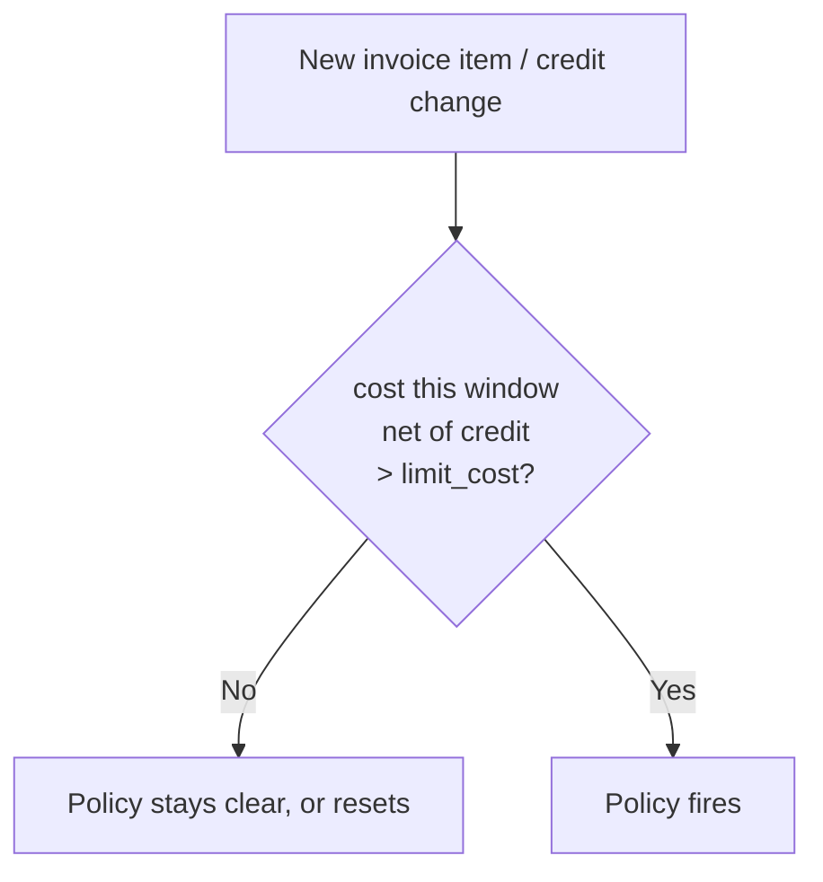

# Policies

## Overview

Policies are automated reactions to events on [marketplace](marketplace.md) resources — typically to cap cost, cap usage, or terminate a misbehaving resource. They run alongside [quotas](quotas.md): a quota refuses an action up front, while most policy actions react to facts after the fact within a period (this month's spend, this quarter's CPU-hours, this year's storage).

The one exception is the `block_creation_of_new_resources` action on cost policies: it is also evaluated **synchronously at order submission**, so an order that would push the projected period total above the limit is rejected with `400 Bad Request` before any resource or order row is persisted. The other actions (notify, terminate, throttle, …) still run from the post-invoice trigger.

## Model

```d2
direction: right
classes: {
  scope:   { style: { fill: "#e8f5e8"; font-color: "#1f2328"; stroke: "#2e7d32" } }
  policy:  { style: { fill: "#fff8e1"; font-color: "#1f2328"; stroke: "#f57f17" } }
  action:  { style: { fill: "#e1f5fe"; font-color: "#1f2328"; stroke: "#0277bd" } }
}

org: Organization { class: scope }
project: Project { class: scope }
offering: Offering { class: scope }

policy: Policy { class: policy }
trigger: Trigger\n(invoice item, usage report) { class: policy }
period: Period\n(month / quarter / year / total) { class: policy }

notify: Notify { class: action }
block: Block further orders { class: action }
terminate: Terminate resources { class: action }

org -> policy: attached to
project -> policy
offering -> policy
trigger -> policy: evaluated by
period -> policy: scoped to
policy -> notify
policy -> block
policy -> terminate
```

## Key concepts

| Concept | One-liner |
|---|---|
| Policy | A rule attached to a project, customer, or offering scope. |
| Trigger | The signal that evaluates the policy — typically a new invoice item or usage report. |
| Period | The window the trigger sums data over — month, quarter, year, or total. |
| Action | What happens when the policy fires. |
| Action type | **Threshold** (warn at N%, fire at 100%) or **immediate** (act the moment a condition is met). |

## Action catalogue

| Action | Effect |
|---|---|
| Notify project / customer | Email the project members or organization owners. |
| Block creation of new resources | Refuse new orders on the affected scope. Enforced synchronously at order submission — including `update_limits` and `switch_plan` orders that would increase cost. |
| Terminate resources | Cancel running resources to stop the bleeding. |
| Block SLURM jobs | (HPC) Pause new job submissions until consumption drops. |
| Custom | Any action wired in via the policy plugin interface. |

A single policy can attach multiple actions.

## Lifecycle

1. Staff (or organization owner, for project-scoped policies) defines a policy: scope, trigger, limit, period, actions.
2. Waldur evaluates the policy each time a new trigger arrives (e.g. an invoice item is written, a SLURM usage report is ingested).
3. When the threshold is crossed, the configured actions execute. A `has_fired` flag prevents repeated firing in the same period.
4. At the next period boundary the flag resets.

## Cost Policies and Credit

`ProjectEstimatedCostPolicy` and `CustomerEstimatedCostPolicy` compare one figure with `limit_cost`: the cost over the policy's window **after credit**. With `use_credit` on, that is the cost net of the credit already applied and of the credit the current month will still draw. How much credit is left is not compared with the limit.



The cost sums the project's or customer's real, persisted invoice items — cost and compensation together — over the policy's window, less the credit the current month will still draw; for an already-finalized month, that is real data, not an estimate. The credit still to be drawn is worked out from the **live** balance: the credit the month started with, minus what this month's usage has drawn so far. So a credit-funded policy fires as soon as the month's usage outgrows the credit, rather than at the month-end billing run. A `use_credit=False` policy fires on the cost before credit.

A Total-period policy also counts every earlier month that credit did not fully cover. Credit added later pays only the current month onwards, so a top-up does not reset a policy whose earlier uncovered cost is over the limit by itself. Staff can let a project credit **pay earlier invoices**: what is left of the allocation then pays that cost, oldest month first, when the setting is saved and at every month end. A payment counts in the month it pays, so it lowers the cost of a Total policy and leaves a one-month policy alone. See [Paying earlier invoices](../../user-guide/customer-organization/cost-and-usage-policies.md#paying-earlier-invoices) in the user guide.

Earlier versions had a second check, which held a credit-funded policy back while the live credit balance stayed above `limit_cost`. Once a Total policy's earlier cost alone was over the limit, `limit_cost` then meant "act when less than this much credit remains", so a larger limit fired before a smaller one. Events recorded then still carry that check's `gate` values.

### Why a cost policy fired or reset

Every evaluation records which check decided it. When an evaluation fires or resets a policy, the events of the actions it runs (`request_downscaling`, `reset_downscaling`, `request_pausing`, `notify_*`, and so on) carry that decision in their context: `gate`, the check that decided, and the figures it compared. The audit log lists these events. The figures are in the event's context, which the API returns (`GET /api/events/`).

For what each field and each `gate` value means, with a worked example, see [Why a cost policy fired or reset](../../user-guide/customer-organization/cost-and-usage-policies.md#why-a-cost-policy-fired-or-reset) in the user guide.

For the full mechanics — how compensation actually gets computed and persisted, and how earlier invoices are paid — see [Cost Policies and Compensation](../../developer-guide/guides/billing-and-invoicing.md#cost-policies-and-compensation).

## Related concepts

- [Quotas](quotas.md) — up-front bounds; pair with policies for defence in depth.
- [Marketplace](marketplace.md) — what policies guard.
- [Billing](billing.md) — invoice items are the primary trigger for cost policies.
- [Billing and Invoicing: Credits and Compensations](../../developer-guide/guides/billing-and-invoicing.md#credits-and-compensations) — the `MonthlyCompensation` mechanics behind the policy's estimate of the credit still to be drawn.
- [Lifecycle](lifecycle.md) — the resource state transitions an "immediate" policy can drive.
