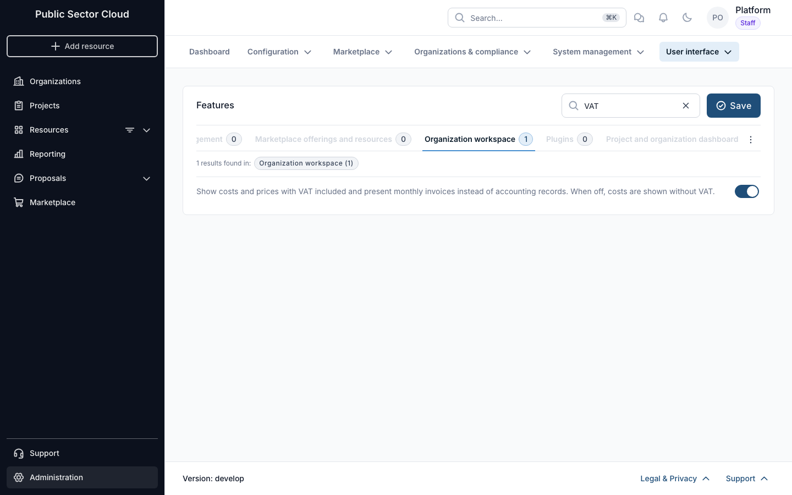
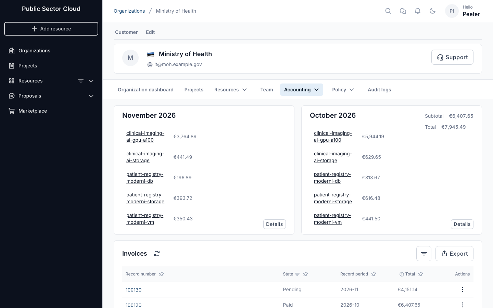
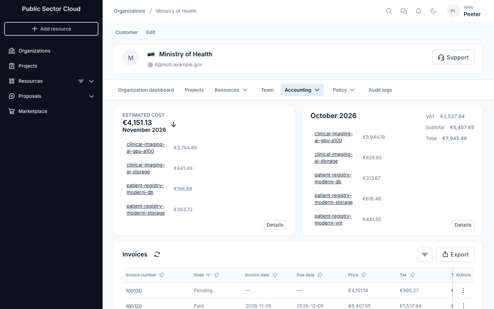
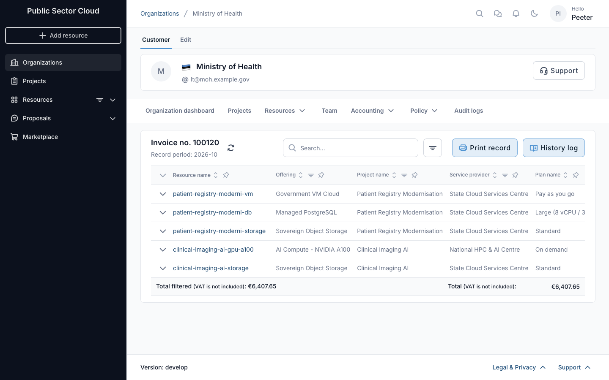
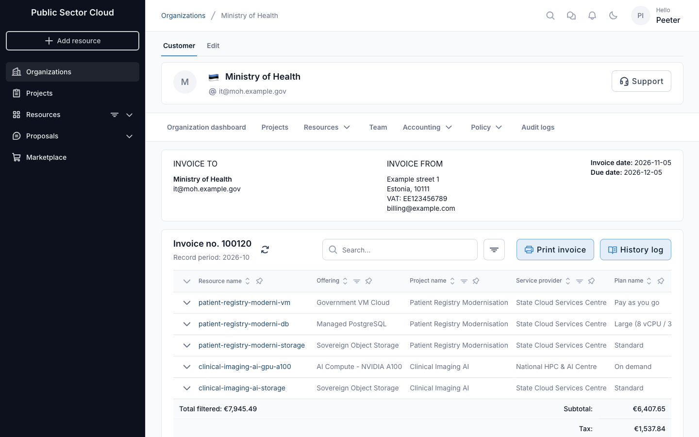

# Billing and accounting in Waldur

Waldur's accounting and billing components are responsible for collecting accounting data and presenting
it to end users. It features built-in reporting and accounting functionality, enabling the tracking of
usage information for each project and its resources. During the service offering creation process,
providers can define accounting components (such as CPU-h, GPU-h, and storage for HPC; CPU, RAM, and
storage for VMs) and set the pricing plans for each component. Consumers can view usage information
according to the policies established by the provider.

From a provider point of view, Waldur supports invoice generation and exposes enough of information via APIs to
integrate with custom payment providers.

Waldur offers convenient tools for consumers to view resource usage information. The user interface displays
overall usage data within a project and breaks down monthly usage across resource components such as CPU,
GPU, and storage. End users can export this usage data in PDF, CSV, and XLSX formats. Access to information
varies by user role: project members can see details for their specific projects, while organization owners
can view information for all projects within their organization.

## Billing models

Waldur supports three billing models for resource components, configurable per offering:

- **Monthly (Limit-based)**: Resources are billed each month based on reserved limits. This is the default for OpenStack Tenant offerings. Limits can be changed at any time, with billing adjusted on the current invoice.
- **Prepaid (One-time + Pre-paid)**: Resources are billed upfront for the full subscription period. The charge is calculated as `price × limit × months`. An end date is required. Mid-period limit changes create supplementary charges for the remaining period.

- **Usage-based**: Resources are billed on polled consumption, for example core-hours and GB-hours for OpenStack tenants. Quotas cap usage and are not billed.

Both models can coexist on the same offering — for example, CPU cores can be prepaid while a management fee remains monthly. Custom components (e.g., consultancy hours) can use the "Maximum total" limit period for flat one-time charges.

A plan can also override how the offering's built-in components are billed through its **billing mode** (inherit, limit-based or usage-based), so one OpenStack offering can carry a reserved plan and a pay-as-you-go plan side by side. Prepaid is not among the plan modes: it says *when* a limit-based subscription is paid rather than how consumption is counted, so it stays on the components and is set there. Customers switch between them with a plan change: the limit fee is charged for the plan's current billing period (whole month for monthly plans, per day for daily plans) and usage accrues from the switch. See [Offering a limit-based and a usage-based plan side by side](../user-guide/service-provider-organization/adding-an-offering.md#offering-a-limit-based-and-a-usage-based-plan-side-by-side).

For configuration details, see [Configuring billing model per component](../user-guide/service-provider-organization/adding-an-offering.md#configuring-billing-model-per-component).

In addition to that, Waldur offers convenient way for exporting the usage information for visualization [with
Grafana](grafana.md).

## Accounting records or invoices with VAT

Each deployment chooses how the portal presents monthly costs to organizations. This setting is global:
it applies to every organization.

- **Accounting records** (the default): costs and prices are shown without VAT, and each month is an
  accounting record. Use this when the portal tracks consumption and invoicing happens elsewhere.
- **Invoices with VAT**: costs and prices include VAT, and each month is an invoice with the issuer and
  recipient details, invoice and due dates, and a subtotal and tax breakdown.

To switch, open **Administration → User interface → Features**, select the **Organization workspace**
tab and turn on *Show costs and prices with VAT included and present monthly invoices instead of
accounting records*, then **Save**. The flag is `customer.show_invoices_with_vat`. Users see the change
the next time they load the portal.

The switch changes the organization's **Accounting** page, the monthly record or invoice view, the
organization cost columns in the organization list, price tooltips, the offering cost chart, and the
financial growth report. The amounts stored in Waldur stay the same; only the presentation changes.

| Accounting records | Invoices with VAT |
|---|---|
|  |  |
|  |  |

In accounting record mode the totals are labelled *VAT is not included* and the print action is
**Print record**. In invoice mode, the overview of a finished month adds a VAT line, the invoice list
gains invoice date, due date, price and tax columns, and the print action is **Print invoice**.

The issuer details on an invoice come from the `WALDUR_INVOICES['ISSUER_DETAILS']` setting. On
Kubernetes, listing `billing` in the Helm chart's `waldur.features` fills them in and also turns this flag
on; see [configuration overrides](deployment/helm/docs/configuration-overrides.md).

## Invoice notifications

When an invoice is issued, Waldur emails the organization's owners a notification that carries
the invoice itself as a **PDF attachment** alongside the link to view it in the portal. The
attachment is rendered by the deployment, so the email is still sent when rendering fails: the
notification then drops the attachment and keeps the link, rather than going out without the
invoice or not at all.

The notification is `invoices.notification`, and like every other one it is off until an
administrator enables it — see [Notification management](../user-guide/staff-users/notification-management.md).
