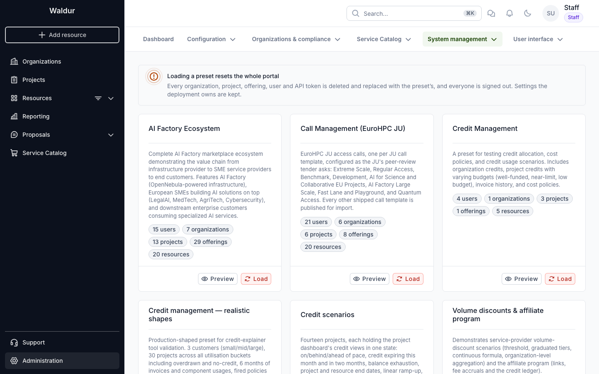
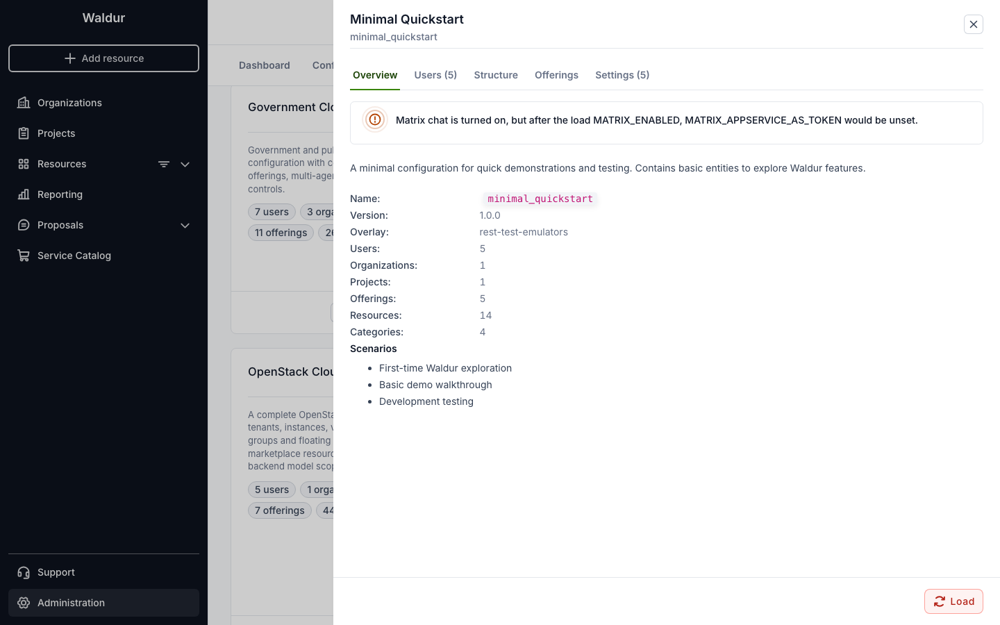
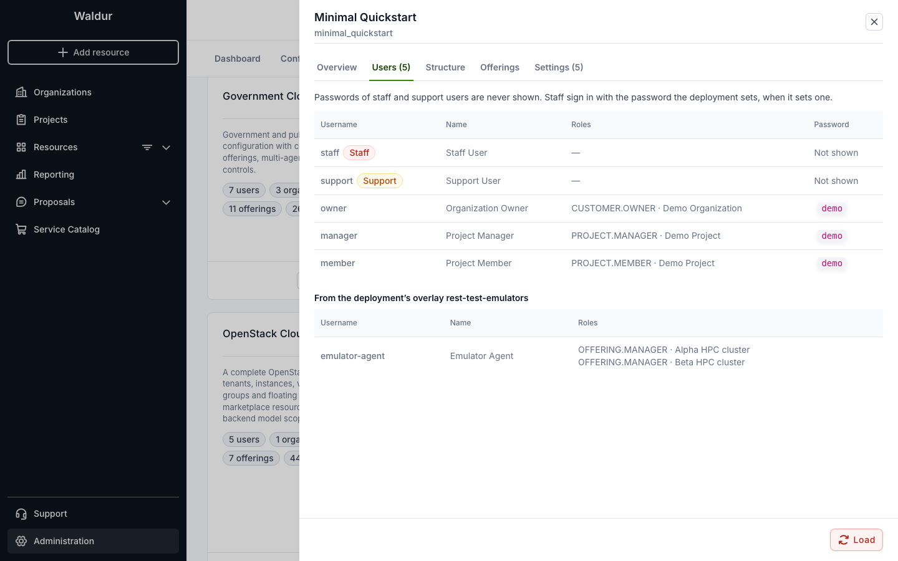
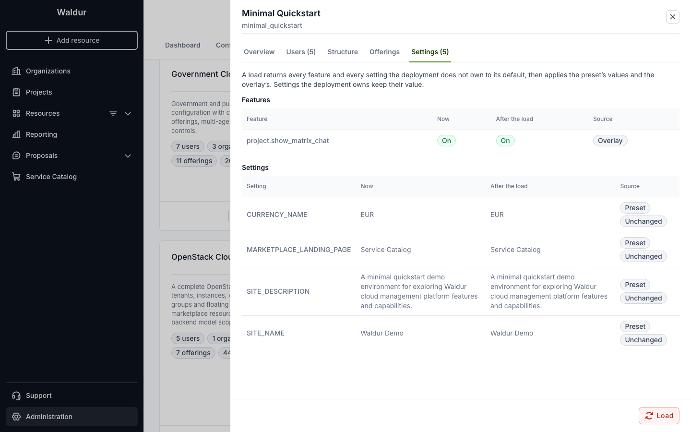
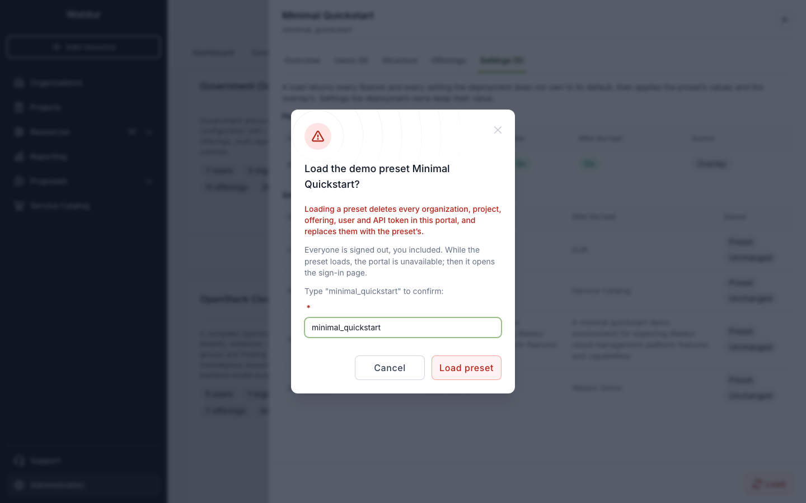
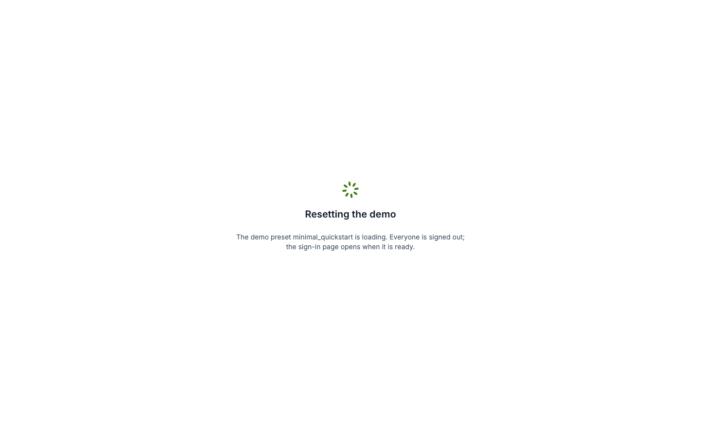

# Demo presets

Demo presets are ready-made data sets for showing Waldur: organizations, projects,
offerings, resources and users, together with the features and settings the demo needs.
On a demo deployment, staff can preview a preset and load it from the portal, under
**Administration → System management → Demo presets**. After the load, the preset's
demo users sign in with the passwords it gives them.

!!! danger "Demo deployments only"
    Loading a preset **deletes every organization, project, offering, user and API token**
    in the database and replaces them with the preset's. Everyone is signed out, the staff
    user who started the load included. Never enable demo presets on a deployment whose data
    matters.

## Enabling it

Demo presets are off by default. They are switched on by the deployment only, through
environment variables: nobody can turn them on from the portal or the settings API. While
they are off, every demo preset endpoint answers 404 and the portal shows nothing of them.
The `waldur demo_presets` command works either way.

| Variable | Meaning |
|---|---|
| `WALDUR_DEMO_PRESETS_ENABLED` | `true` lets staff list, preview and load presets. |
| `WALDUR_DEMO_PRESETS_ALLOWED` | Comma-separated preset names to offer; empty offers every preset. |
| `WALDUR_DEMO_PRESETS_EXTRA_DIRS` | Directories with the deployment's own presets, searched before the built-in ones. |
| `WALDUR_DEMO_PRESETS_OVERLAY` | A preset imported after every load; see [What a load keeps](#what-a-load-keeps). |
| `WALDUR_DEMO_PRESETS_STAFF_PASSWORD` | The password the presets' staff users get, in place of the published one. |

=== "Docker Compose"

    Set the variables in `.env`; the API and the Celery worker both read them.

    ```bash
    WALDUR_DEMO_PRESETS_ENABLED=true
    WALDUR_DEMO_PRESETS_ALLOWED=hpc_ai_platform,call_management
    WALDUR_DEMO_PRESETS_STAFF_PASSWORD=<a password of your own>
    ```

    The deployment's own presets go in `config/waldur-mastermind/presets/`, one
    `<name>.json` file per preset, mounted at `/etc/waldur/presets`.

=== "Helm"

    ```yaml
    waldur:
      demoPresets:
        enabled: true
        allowed:
          - hpc_ai_platform
          - call_management
        staffPassword:
          existingSecret: demo-staff
          key: password
    ```

    See the [Helm guide](deployment/helm/docs/demo-presets.md) for the presets
    ConfigMap and the overlay.

A load runs in the Celery worker, so the worker must be running, and the API and the
worker must share a cache, as the Docker Compose and Helm deployments do.

!!! warning "Set a staff password on any portal others can reach"
    The presets are public, and so are the passwords of their staff users. Without
    `WALDUR_DEMO_PRESETS_STAFF_PASSWORD`, anyone who reads a preset can sign in as staff
    after it is loaded. With it, every staff user of the preset gets that password instead.
    The portal never shows the passwords of staff or support users, and quick sign-in never
    lists them.

## What a load keeps

A load from the portal always cleans up first. In order, it:

1. Deletes the organizations, projects, offerings, resources, users and API tokens, and
   drops the tasks waiting for the workers.
2. Returns every feature, and every setting the deployment does not own, to its default.
3. Imports the preset, with its features and settings.
4. Imports the deployment's overlay preset, if `WALDUR_DEMO_PRESETS_OVERLAY` names one.
5. Gives the staff users the deployment's staff password, if one is set.

The deployment keeps everything it owns:

- its environment variables and settings files;
- settings set by the deployment, locked or managed, and secret settings. A preset that sets
  one of these is skipped for that setting;
- the overlay. It holds what the deployment needs whatever the demo: offerings backed by its
  own services, the users and tokens of its agents, the features it turns on. The overlay is
  never offered as a preset itself, and a load whose overlay is missing fails before
  anything is deleted.

## Choosing a preset

The page lists the presets the deployment offers, each with its size.



**Preview** shows what loading the preset would do, before anything is deleted:

- **Overview**: the description, the counts, the overlay, and warnings about anything that
  would not work after the load. For example, a feature the preset turns on that needs
  settings the deployment has not set.
- **Users**: the preset's users with their roles, and the overlay's. Passwords are shown for
  users without a staff or support role.
- **Structure**: organizations, their projects and each project's resources.
- **Offerings**: offerings grouped by type and category.
- **Settings**: each feature and setting the load changes, its value now and after the load,
  and where the new value comes from: the preset, the overlay, the default, or the
  deployment, which keeps its own value.







## Loading a preset

**Load**, on a card or in the preview, asks you to type the preset's name.



While the preset loads, the API pauses: every request but the status, configuration and
sign-in endpoints answers 503. Every open portal tab, yours and other users', shows a
"Resetting the demo" screen until the load finishes.



When the load is done, each tab reloads to the sign-in page, with the new preset's
configuration and features. If the load fails, the screen shows its error and a way back
to the portal. A failure before the cleanup leaves the data as it was.

Only one load runs at a time: starting another while one runs answers 409.

## Signing in as a demo user

The sign-in page does not list the demo users. They sign in with their username and the
password the preset gives them; the preview lists the preset's users.

A demo deployment can offer one-click sign-in through an identity provider of its own
instead: the provider reads the loaded preset's users from `/api/demo-preset-status/`
(see [Demo presets](../developer-guide/guides/presets.md)) and lists them on its sign-in
page. Signing in through the provider also counts as an identity provider sign-in in
Waldur, which some features, such as chat with single sign-on, require.

Staff sign in with the usual form, with the deployment's staff password when one is set.

## Without the portal

The same presets can be loaded from the command line, which works whether or not
`WALDUR_DEMO_PRESETS_ENABLED` is set; see
[`demo_presets`](mastermind-configuration/cli-guide.md#demo_presets):

```bash
waldur demo_presets list
waldur demo_presets load hpc_ai_platform
```

The API is `/api/marketplace-demo-presets/` (list, preview, load) for staff, and the
public `/api/demo-preset-status/`, which reports the latest load and the users offered for
quick sign-in.
