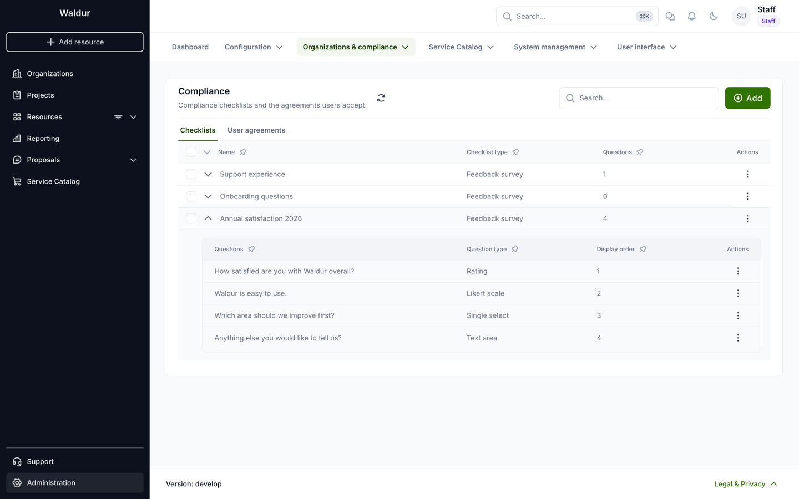
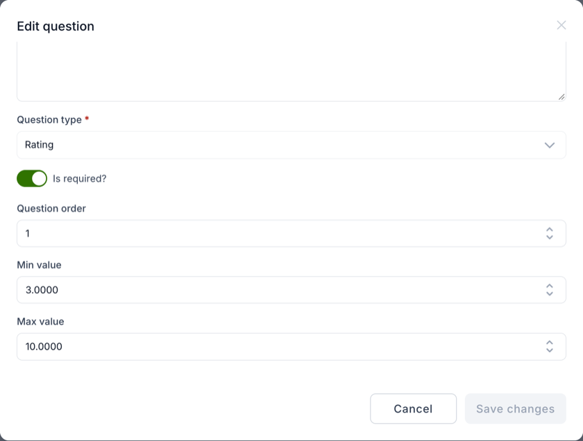
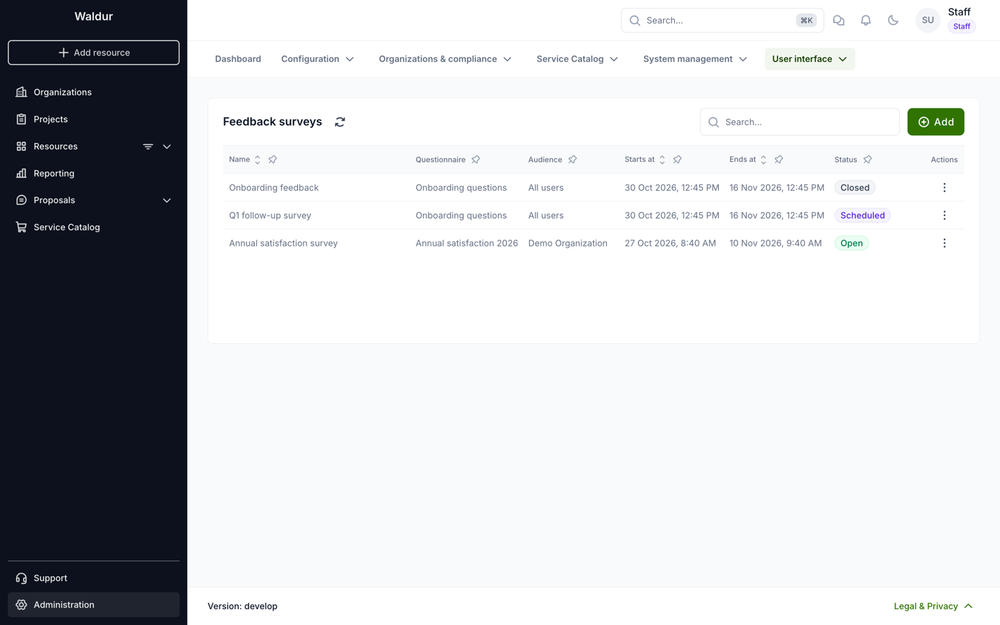
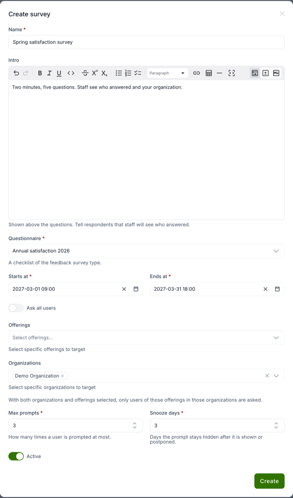
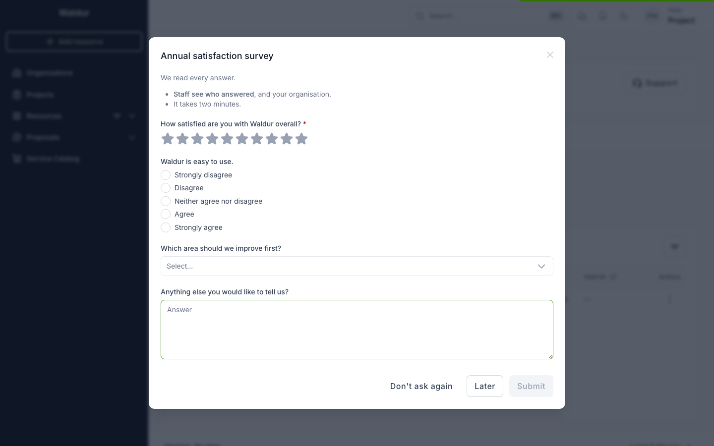
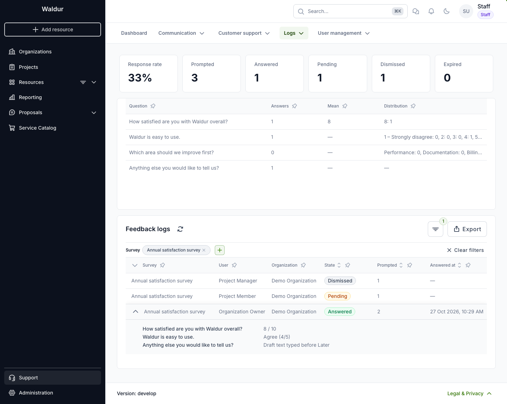

# Feedback surveys

A feedback survey asks your users a few questions in a prompt shown after they log in, for example a yearly satisfaction survey. The answers stay in Waldur, linked to the user and their organization, and support staff browse them in the feedback logs.

Running a survey takes two steps: build the questionnaire, then create a survey that shows it to an audience during a time window.

## Who can do what

| Role | Can |
|---|---|
| Staff | Create, edit and delete surveys and questionnaires, and read all answers |
| Support | Read surveys and all answers |
| Other users | Answer the surveys they are asked, and nothing else |

## 1. Build the questionnaire

You write the questions yourself. They are a checklist of the **Feedback survey** type, and a survey asks exactly the questions of the checklist you pick for it.

1. Go to **Administration > Organizations & compliance > Compliance**, tab **Checklists**.
2. Click **Add**, name the checklist and choose the type **Feedback survey**.
3. Add questions with **Add question** in the checklist's row menu. Expand the row to list them; each question's row menu edits or deletes it.

For each question you set:

- **Question**: the text users see, and optional **User guidance** shown with it.
- **Question type**. Every checklist question type is available. These suit surveys best:
    - **Rating**: stars. **Max value** sets the number of stars (5 when empty) and **Min value** the lowest rating a user may give.
    - **Likert scale**: a 3, 5 or 7 point scale with labels for both ends, and optionally "N/A".
    - **Single select** and **Multi select**: options you define.
    - **Text area** for free comments.
- **Is required?**: whether the question must be answered before the user can submit.
- **Question order**: its position in the prompt.
- On the **Visibility** tab, a condition on the answer to an earlier question. The question stays hidden until that answer is given.

Keep the survey short: a handful of questions is answered far more often than a long form.

## 2. Create the survey

Go to **Administration > User interface > Feedback surveys**. Each survey's status shows whether users are being asked:

- **Open**: the survey is active and inside its window.
- **Scheduled**: the survey is active, and its window has not started yet.
- **Closed**: the window has ended, or the survey is not active.

Click **Add** to create a survey. **Create** stays disabled until the required fields and the audience are filled in, and its tooltip says what is missing.

| Field | Meaning |
|---|---|
| Name | The prompt's title |
| Intro | Markdown shown above the questions. Tell respondents that staff will see who answered. |
| Questionnaire | The Feedback survey checklist from step 1. Locked once anyone has been asked. |
| Starts at, Ends at | The window in which users are asked |
| Ask all users, Offerings, Organizations | The audience (see below) |
| Max prompts | How many times one user is asked at most (default 3) |
| Snooze days | How long the prompt stays hidden after it is shown or postponed (default 3) |
| Active | Untick to pause the survey without changing its window |

### Audience

- **Ask all users**: every user.
- **Organizations**: users with a role in one of the organizations, or in one of their projects.
- **Offerings**: users of organizations that have a resource of one of the offerings.
- **Organizations and offerings together**: only users of those offerings within those organizations.

Staff and support users are never asked. The survey must target someone: with **Ask all users** off, pick at least one organization or offering.

## What users see

While the survey is open, a user in its audience sees the prompt after logging in, at most once per browser session. It never blocks navigation and never opens over the profile and terms of service form a user must complete first. If several surveys are open for a user, the one ending soonest is shown. Users can also answer with the keyboard; for a rating, Tab to the stars and choose with the arrow keys.

The prompt has three buttons:

- **Submit** saves the answers, once every required question is answered. The survey is not shown again, and the answer is logged in the event log.
- **Later**, or closing the prompt, keeps the answers given so far as a draft and asks again after the snooze days. The draft pre-fills the next prompt. An answer that isn't valid, such as a rating below the minimum, is left out of the draft.
- **Don't ask again** stops this survey for that user.

Showing the prompt also counts it against **Max prompts** and hides it for the snooze days, so several open tabs don't ask the same user repeatedly.

A user who was asked but did not answer becomes **Expired** once the survey ends, or once the last prompt's snooze has passed. Waldur checks this every hour.

## Read the results

Go to **Support > Logs > Feedback logs**, or choose **View results** in a survey's row menu to open the logs filtered to that survey.

- The cards show the response rate (answered out of asked) and how many requests are answered, pending, dismissed and expired. They follow the filters.
- Filtered to one survey, a table shows each question's results: how many answered it, the mean of a rating, and the distribution of ratings, scale points and options. Only submitted answers count; drafts do not.
- Each row is one asked user, with their organization at the time they were first asked. Expand it to read the answers, including a pending user's draft.
- Filter by survey, state, organization and answered period.
- **Export** downloads the rows. Filtered to one survey, the export has a column per question; otherwise all answers share one column.

## Things to know

!!! warning
    Questions have no versions. Editing or deleting a question after users have answered changes or deletes those answers. For a new survey round with different questions, build a new questionnaire instead of editing the old one.

- Answers are not anonymous: staff and support see who answered and their organization. Say so in the intro.
- Questions are shown in one language; they are not translated.
- Once anyone has been asked, the survey's questionnaire can no longer be changed; the edit form shows it locked. Its questions can still be edited, with the effect described in the warning above.
- Deleting a survey deletes all of its answers.
