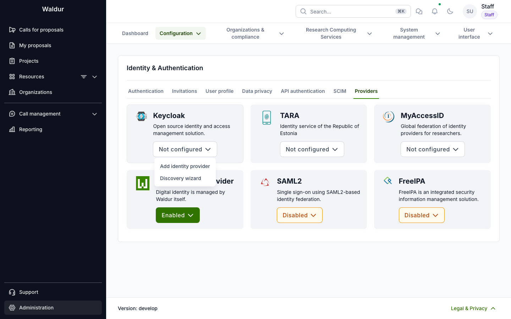
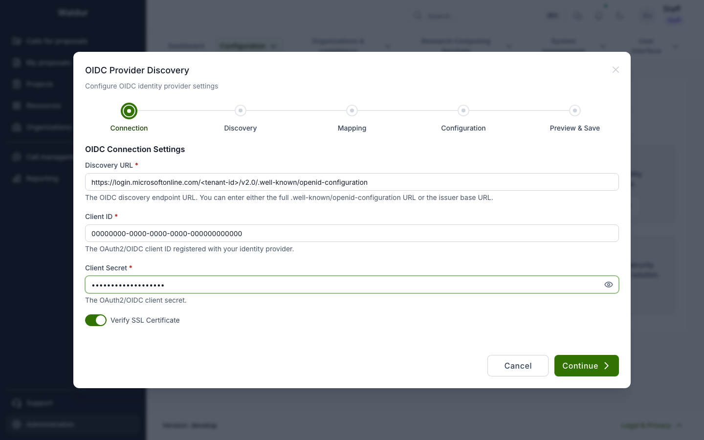
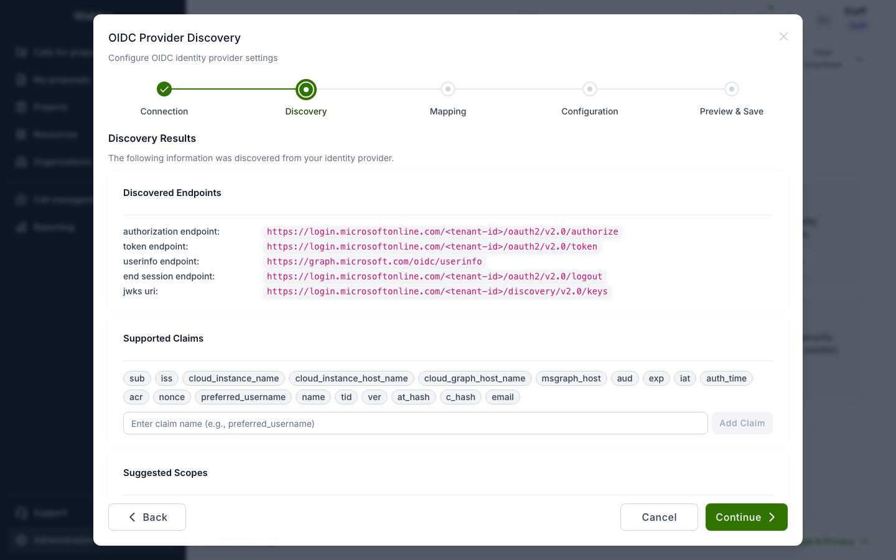
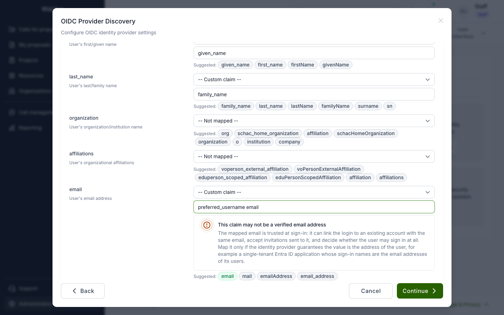
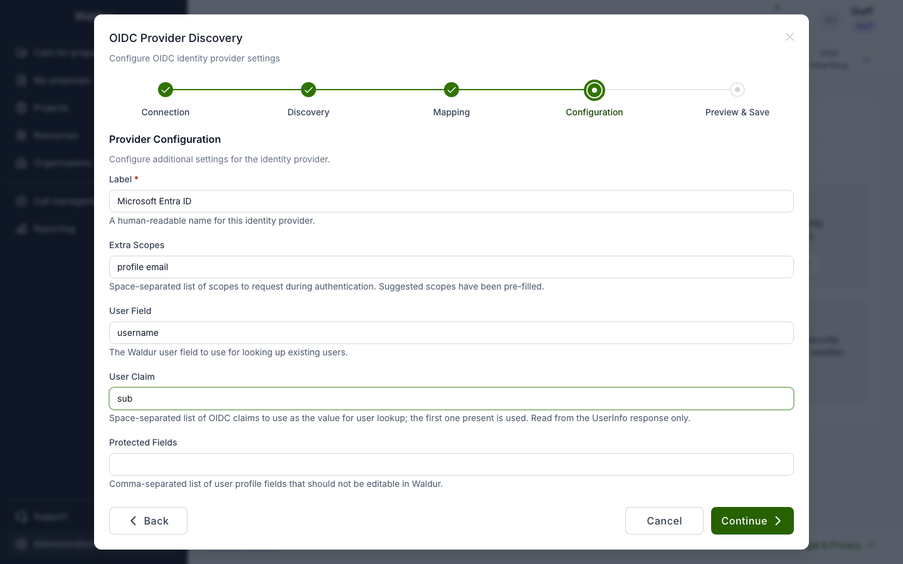
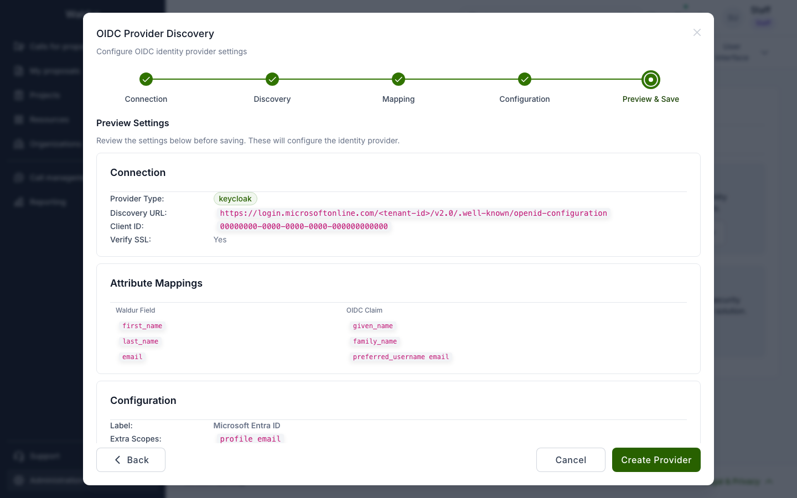

# Microsoft Entra ID

Waldur signs users in with [Microsoft Entra ID](https://learn.microsoft.com/en-us/entra/identity-platform/)
(formerly Azure AD) over OpenID Connect. Entra ID is configured as Waldur's generic OIDC
provider, which the administration interface lists as **Keycloak**.

!!! warning "One generic OIDC provider per deployment"
    Waldur has a single Keycloak (generic OIDC) slot. If your deployment already signs users in
    through Keycloak, configuring Entra ID here replaces it. In that case, add Entra ID to
    Keycloak as an identity provider instead and keep Waldur pointed at Keycloak.

!!! note "Version"
    Mapping claims that Entra issues only in the ID token, such as `preferred_username`, needs a
    Waldur release newer than 8.1.5-rc.1. Earlier versions read UserInfo only, so such a mapping
    stays empty.

You need:

- at least the Application Developer role in Entra, which can register applications;
- the public URL of the Waldur API (Mastermind), for example `https://api.waldur.example.com`;
- the public URL of HomePort, for example `https://waldur.example.com`;
- a Waldur staff account.

## Registering Waldur in Entra ID

1. In the [Microsoft Entra admin center](https://entra.microsoft.com), browse to
   **Entra ID → App registrations** and click **New registration**.
2. Name the application, for example `Waldur`.
3. Under **Supported account types**, select **Single tenant only - &lt;your tenant&gt;**
   (named **Accounts in this organizational directory only (Single tenant)** in older versions
   of the admin center). See [Why a single tenant](#why-a-single-tenant).
4. Under **Redirect URI**, select the **Web** platform and enter the API's callback URL:

    ```text
    https://<waldur-api-host>/api-auth/keycloak/complete/
    ```

    The path is fixed, including the trailing slash. Entra rejects a login whose redirect URI
    does not match exactly (`AADSTS50011`).

5. Click **Register**. On the application's **Overview** page, copy the
   **Application (client) ID** and the **Directory (tenant) ID**.
6. Open **Authentication** and add a second **Web** redirect URI: the HomePort URL from
   Waldur's branding settings (`HOMEPORT_URL`) followed by `/login/`, for example
   `https://waldur.example.com/login/`. When **Enable Post-Logout Redirect** is on (the
   default), Waldur sends signed-out users there, and Entra redirects only to registered URIs.
   Leave **Implicit grant and hybrid flows** unticked: Waldur uses the authorization code flow,
   which returns the ID token without them.
7. Open **Certificates & secrets → Client secrets → New client secret**. Copy the secret's
   **Value**, not its Secret ID; Entra shows it only once. Note its expiry date: when the
   secret expires, sign-in stops working until you create a new one and enter it in Waldur.
8. Open **API permissions**. The default delegated **Microsoft Graph → User.Read** permission
   is enough. The OpenID scopes Waldur requests (`openid`, `profile`, `email`) need no extra
   permissions. Users consent to them at their first sign-in; if your tenant does not let users
   consent to applications, click **Grant admin consent for &lt;your tenant&gt;**.

## Configuring Waldur

The discovery wizard reads Entra's OIDC metadata and walks you through the claim mapping.

1. Open **Administration → Configuration → Identity providers** and select the **Providers**
   tab. On the **Keycloak** card, click **Not configured** and select **Discovery wizard**.

    [](img/entra-id-providers-menu.png)

2. **Connection.** Enter the tenant's discovery URL, with your Directory (tenant) ID in place
   of `<tenant-id>`:

    ```text
    https://login.microsoftonline.com/<tenant-id>/v2.0/.well-known/openid-configuration
    ```

    Enter the Application (client) ID and the client secret value from the registration.

    [](img/entra-id-wizard-connection.png)

    !!! warning "Use the tenant's own URL"
        Do not use the `common` or `organizations` endpoints. Entra refuses `common` for a
        single-tenant application (`AADSTS50194`). Their metadata also gives the issuer as a
        template (`https://login.microsoftonline.com/{tenantid}/v2.0`), and Waldur checks every
        ID token against the issuer it discovered, so even a multi-tenant application would have
        every login rejected.

3. **Discovery.** Check that the authorization, token, logout and JWKS endpoints contain your
   tenant ID; the UserInfo endpoint is on `graph.microsoft.com` and has none. Entra publishes the claims
   below. The protocol claims among them (`iss`, `aud`, `exp`, `nonce`, `at_hash`, …) describe
   the token rather than the user, so the next step does not offer them.

    [](img/entra-id-wizard-discovery.png)

4. **Mapping.** Map the user's name and email:

    | Waldur field | Claim | Notes |
    |---|---|---|
    | `first_name` | `given_name` | Choose **Custom claim**. Entra's UserInfo returns it, but the discovery document does not list it. |
    | `last_name` | `family_name` | Choose **Custom claim**, as above. |
    | `email` | `email`, or `preferred_username email` | See [Choosing the email claim](#choosing-the-email-claim). |

    A custom claim can be a space-separated list. Waldur uses the first claim the user has, so
    `preferred_username email` falls back to `email` for a user without a sign-in name. Leave
    fields with no Entra equivalent unmapped. Waldur stores its defaults for them, which the
    edit form then shows; Entra issues none of those claims, so they stay empty.

    [](img/entra-id-wizard-mapping.png)

    The warning under `email` appears whenever it is mapped to `preferred_username`, `upn` or
    `unique_name`.

5. **Configuration.** Give the provider a label users will recognise, for example
   `Microsoft Entra ID`. Set **Extra Scopes** to `profile email` and leave **User Claim** as
   `sub`. Leave **Allowed Redirect URIs** empty to use the HomePort URL from the branding
   settings, or list the HomePort origins that users sign in from, such as
   `https://waldur.example.com` (no path).

    [](img/entra-id-wizard-configuration.png)

6. **Preview & Save.** Check the summary and click **Create Provider**.

    [](img/entra-id-wizard-preview.png)

To change the settings later, use **Edit** in the card's menu. The edit form holds the same
settings, plus every mappable field, and shows the same email warning. **Re-discover** reruns
the wizard over the existing configuration.

## How Waldur reads Entra's claims

Entra's [UserInfo endpoint](https://learn.microsoft.com/en-us/entra/identity-platform/userinfo)
returns a fixed set of claims (`sub`, `name`, `given_name`, `family_name`, `picture`, `email`),
and it cannot be extended. `preferred_username` and any
optional claims are issued only in the ID token. Waldur reads the settings from different
sources:

| Setting | Read from |
|---|---|
| Attribute mapping (`first_name`, `email`, …) | UserInfo and the validated ID token. UserInfo wins where both carry a claim, unless its value is empty. |
| **User Claim** (account lookup) | UserInfo only |
| Extra fields (stored in the user's details) | UserInfo only |
| Roles claim (`WALDUR_AUTH_SOCIAL_ROLE_CLAIM`) | UserInfo only |

Some consequences:

- **User Claim** must be a UserInfo claim. Keep `sub`, which is stable for each user and
  application. `oid` and `preferred_username` are not in UserInfo and cannot identify accounts.
- Entra app roles and group claims are issued only in tokens. They cannot set staff or support
  flags, and cannot be stored through extra fields. To use them in
  [role assignment from claims](./role-assignment-from-claims.md), add the claim to the ID
  token and map it to a profile field that rules read, such as `affiliations`.
- To map an [optional claim](https://learn.microsoft.com/en-us/entra/identity-platform/optional-claims-reference),
  add it to the **ID** token under **Token configuration** in the app registration. Then map it
  as a custom claim.

The developer guide covers the details in
[user profile attributes](../../developer-guide/user-profile-attributes.md).

## Choosing the email claim

Microsoft's [ID token claims reference](https://learn.microsoft.com/en-us/entra/identity-platform/id-token-claims-reference)
describes both candidates:

- **`email`** is the user's primary email address. It is empty for users without a mailbox or a
  configured address. Microsoft notes that it "isn't guaranteed to be correct and is mutable
  over time", so the warning below applies to it as well.
- **`preferred_username`** is the sign-in name. Microsoft describes it as "an email address,
  phone number, or a generic username without a specified format" that can change. Use it only
  where the tenant's sign-in names are its users' email addresses, as is common when the UPN
  matches the mailbox. A B2B guest's sign-in name in your tenant has the form
  `john_contoso.com#EXT#@yourtenant.onmicrosoft.com`, not an address, so prefer `email` in a
  tenant with guest users.

!!! warning
    Waldur trusts the mapped email at sign-in:

    - with `OIDC_MATCHMAKING_BY_EMAIL`, a sign-in whose email matches an existing account is
      linked to that account;
    - with `OIDC_BLOCK_CREATION_OF_UNINVITED_USERS`, a pending invitation to the email lets a new
      account be created, and `OIDC_ALLOWED_USER_EMAIL_PATTERNS` decides from the email whether
      the user may sign in;
    - autoprovisioning rules can match on the email.

    A claim that is not the user's address can give one person another's account, invitation or
    access. Map `email` only to a claim your tenant guarantees is the user's address.

## Why a single tenant

Waldur accepts ID tokens from the one issuer it discovered, which is your tenant. Signing in
users from other tenants would need the `common` or `organizations` endpoints, which Waldur
cannot use (see the Connection step above). Their `preferred_username` and `email` claims would
also be set by other tenants' administrators, so the warning above would apply to all of them.
To admit people from other organisations, invite them to your tenant as B2B guests, who sign in
through your tenant's endpoint, or put a federation broker such as [Keycloak](./keycloak.md) in
front of their identity providers.

## Troubleshooting

| Symptom | Cause and fix |
|---|---|
| `AADSTS50011` on the Microsoft sign-in page | The redirect URI does not match. Register `https://<waldur-api-host>/api-auth/keycloak/complete/` exactly, including the trailing slash. |
| `AADSTS50194` on the Microsoft sign-in page | The discovery URL uses `common` with a single-tenant registration. Use the tenant-specific URL. |
| Login fails with `AADSTS7000215` (shown by Waldur and in the failed-login event) | The Secret ID was entered instead of the secret's Value. Enter the Value. |
| Login fails with `AADSTS7000222` | The client secret has expired. Create a new secret and update it in Waldur. |
| Login fails with `Invalid ID token` after Microsoft signs the user in | Waldur rejected the token, for example because a multi-tenant registration uses the `common` discovery URL. Use a single-tenant registration and the tenant-specific URL. |
| Users sign in with an empty email | They have no mail attribute. Set it in Entra, or map `email` to `preferred_username email` if your tenant's sign-in names are addresses. |
| Users are not sent back to Waldur after signing out | Register `HOMEPORT_URL` + `/login/` as a Web redirect URI, keep **Enable Post-Logout Redirect** on, and check that `HOMEPORT_URL` in the branding settings is correct. |
