# Matrix chat overview

Waldur integrates with the [Matrix](https://matrix.org/) open communication
protocol as an Application Service (appservice). When the integration is on,
each Waldur project gets a Matrix room, project members are invited
automatically based on their roles, and operational queries (`!status`,
`!orders`, `!members`) are answered by a Waldur bot from inside the chat.
Conversations are rendered in the homeport drawer next to the Waldur UI, so
team members do not need a separate Matrix client.

Rooms and the chat drawer need a homeserver that supports the Application
Service API, and short-lived web sessions need it to issue refresh tokens.
Locking the Matrix account of a deactivated user, resetting a user's chat
encryption from the drawer, password mode for external clients and refusing
homeserver-admin accounts also use the Synapse admin API,
with Waldur's bot as a homeserver admin (see
[Making the bot a homeserver admin](../developer-guide/admin-guide/matrix-appservice-setup.md#making-the-bot-a-homeserver-admin));
on a homeserver without that API they do not work. The examples in this guide
use [Tuwunel](https://github.com/matrix-construct/tuwunel), which is what the
bundled `docker/matrix-dev/docker-compose.yml` brings up.

## How the pieces fit together

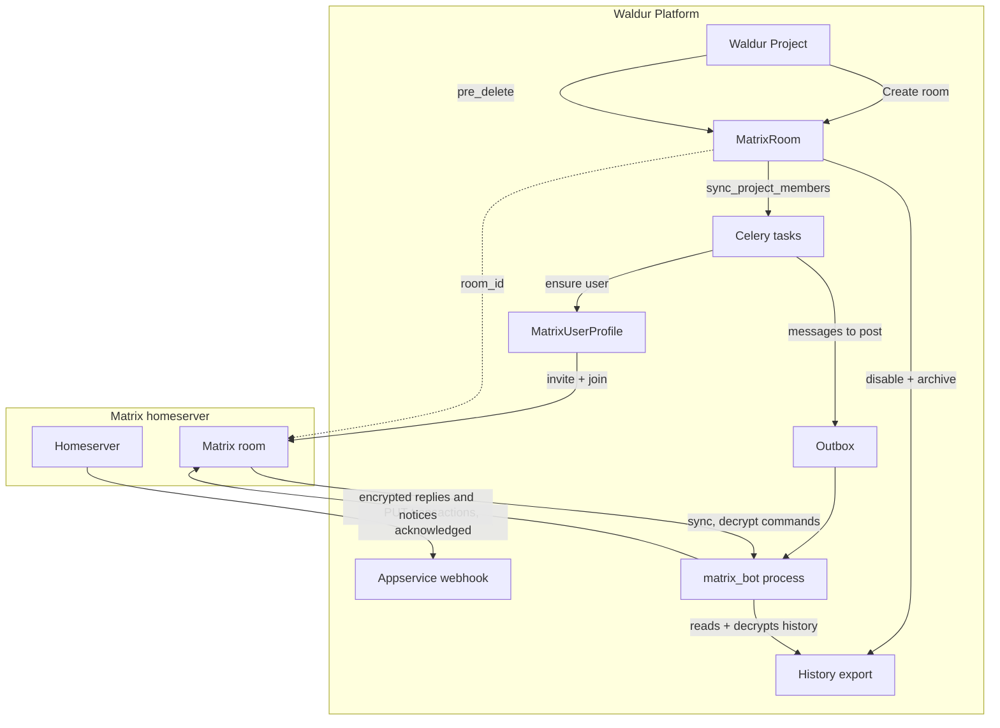

When a Waldur project is provisioned for chat, a `MatrixRoom` row is
created and a celery task syncs every project member into the room via a
per-user `MatrixUserProfile`. Waldur joins and leaves rooms as the user
through the appservice, without logging in as them. The chat drawer talks
to the homeserver directly with a short-lived web session (see
[Web chat sessions](#web-chat-sessions)).

Rooms are end-to-end encrypted, so commands and everything Waldur posts go
through a long-running bot process, `waldur matrix_bot`: the Helm Deployment
`waldur-matrix-bot`, or the `waldur-matrix-bot` service in docker-compose's
`matrix` profile. It syncs the rooms as Waldur's bot user, decrypts the
commands, answers them if the sender holds an active project role, posts
the messages Waldur queues in its outbox, encrypted for the room, and makes
the history exports. Run exactly
one: the bot holds a lease in Waldur's database, and a second process refuses
to start while the first holds it. Without a running bot, commands go
unanswered, Waldur's notices stay in the outbox, and history exports stay
pending, so a room being disabled with export on is not archived. The appservice webhook
(`PUT /_matrix/app/v1/transactions/{txnId}`) only records and acknowledges the
homeserver's transactions; it does not handle commands. Project deletion
runs the same disable path that the staff "Disable room" action uses,
optionally exporting history before the room is archived.

---

## Packaged deployments

The [Helm chart](deployment/helm/docs/matrix-chat.md) ("Zero-touch setup")
and [docker-compose](deployment/docker-compose/matrix-chat-add-on.md)
("Appservice registration") bundle a Tuwunel homeserver and set Matrix chat up
themselves:

- They supply the appservice tokens, the registration token and a bootstrap
  password. docker-compose generates them into its secrets volume; Helm
  generates them into a Secret unless `setup.existingSecret` names your own.
  On every deploy they seed Waldur's Matrix settings from them with
  `waldur init_matrix_settings` (see "Seeding from the environment" in the
  [setup guide](../developer-guide/admin-guide/matrix-appservice-setup.md)).
- By default they register the appservice on every deploy with
  `waldur register_matrix_appservice`, which creates a bootstrap admin,
  `@waldur-bootstrap`, through the homeserver's shared-secret registration API
  and makes the bot a homeserver admin (see "Registering on Tuwunel from the
  command line" in the
  [setup guide](../developer-guide/admin-guide/matrix-appservice-setup.md)).
- The Setup wizard is hidden and its API answers `409`. The settings the
  deployment seeds (the homeserver URLs and domain, the appservice tokens, the
  bot localpart and the registration secret, and with SSO or calls also the
  login methods and the LiveKit settings) are read-only in the **Settings**
  tab, which names them, because the next deploy would write the deployment's
  values back. That is a lock in the UI only: Waldur's API
  refuses Setup but not a change to a seeded setting, so change those in the
  deployment instead.
- Tokens are rotated in the Secret or the secrets volume, followed by a
  deploy, which replaces the registration on the homeserver. The bot process
  (`waldur-matrix-bot`) notices a rotated appservice token within 30 seconds
  and starts over with it, so it needs no restart. Each guide has the steps
  under "Rotating the tokens" (Helm) and "Token rotation" (docker-compose).
- Helm turns on the `project.show_matrix_chat` feature flag, which shows the
  chat in homeport and the **Matrix chat** admin page; on docker-compose,
  [turn it on](deployment/docker-compose/matrix-chat-add-on.md#enabling-the-homeport-ui)
  yourself.
- Helm refuses to run Matrix chat without its bundled homeserver.

On a packaged deployment, skip
[Configuring Waldur](#configuring-waldur) and
[Setting up the appservice](#setting-up-the-appservice): the deployment runs
the [management commands](#with-the-management-commands) for you. Those
sections are for the `docker/matrix-dev` stack and homeservers you run
yourself.

---

## Prerequisites

You need:

- A Matrix homeserver with the Application Service API enabled and
  reachable from Waldur over HTTP/HTTPS. The homeserver must be able to
  reach Waldur back via the URL you provide during setup (webhook callbacks).
- The homeserver's registration token, `MATRIX_USER_REGISTRATION_SECRET`.
  Waldur registers the per-user Matrix accounts behind the embedded chat with
  it. To register the appservice with `waldur register_matrix_appservice`, set
  the homeserver's `registration_shared_secret` to the same value.
- A staff account in Waldur. The Setup wizard, connectivity diagnostics, and
  the **Settings** tab are staff-only.
- For voice/video calls (optional): a LiveKit SFU reachable from the browser.
  Waldur itself issues the LiveKit tokens for calls; no separate token service
  (such as `lk-jwt-service`) is needed. The homeserver advertises Waldur's
  call token API as its LiveKit focus in `.well-known/matrix/client`'s
  `rtc_transports` block (MSC4143) — see [Voice and video calls](#voice-and-video-calls).

The bundled `docker/matrix-dev/` stack in the mastermind repo provides the
homeserver and the SFU for local development. The Helm chart and
docker-compose bring their own (see [Packaged deployments](#packaged-deployments)).

---

## Bringing up a local Matrix stack

From `waldur-mastermind`:

```bash
cd docker/matrix-dev
docker compose up -d
```

This starts:

| Service | Port | Notes |
| --- | --- | --- |
| `tuwunel` | `6167` | Homeserver, `server_name=localhost` |
| `livekit` | `7880-7882` | LiveKit SFU for Matrix RTC (API key `devkey`, secret `devsecret`) |

There is no token service in the stack: the call tokens come from the Waldur
API. `tuwunel.toml` advertises
`http://localhost:10780/api/matrix/livekit` as the LiveKit focus, the
mastermind dev API on the default port; change it if your API runs elsewhere.

Run Waldur's API with the `dev_matrix_settings` settings module, and the bot
next to it with the same module:

```bash
export DJANGO_SETTINGS_MODULE=waldur_core.server.dev_matrix_settings
waldur runserver 0.0.0.0:10780
# in a second terminal, with the same DJANGO_SETTINGS_MODULE
waldur matrix_bot
```

The settings module runs Celery tasks inline, because a dev machine has no
worker: room creation and member sync are Celery tasks, so without it rooms
stay in `creating` and nobody is invited. It also adds `host.docker.internal`,
the name Tuwunel reaches Waldur by, to `ALLOWED_HOSTS`, and defaults the
LiveKit Constance keys to the stack's key, secret and URLs. If you run a
Celery worker instead, add `host.docker.internal` to `ALLOWED_HOSTS` yourself.
The bot waits until the homeserver and the appservice token are configured,
so it can start before the appservice is set up. Without it, commands go
unanswered and **Matrix bot running** fails in **Diagnostics**.

Health check:

```bash
curl -s -o /dev/null -w "Tuwunel: %{http_code}\n" http://localhost:6167/_matrix/client/versions
curl -s -o /dev/null -w "LiveKit: %{http_code}\n" http://localhost:7880/
curl -s http://localhost:6167/.well-known/matrix/client
curl -s -X POST -H 'Content-Type: application/json' -d '{}' \
  http://localhost:10780/api/matrix/livekit/get_token
```

Tuwunel and LiveKit should return `200`, and the well-known document should
list the `livekit` transport with the Waldur URL. Once Matrix chat is enabled
in Waldur, the token request answers `400` with `M_BAD_JSON` (the empty body
is refused); a `404` means Matrix chat is switched off. Waldur reaches Tuwunel
at `http://localhost:6167`.

In homeport, `VITE_LK_JWT_URL` is optional. When set in a dev build, it
replaces the focus the homeserver advertises, which is useful for pointing the
browser at a call token API on another port.

---

## Configuring Waldur

Waldur's side of the integration is a handful of Constance settings. Both ways
of [setting up the appservice](#setting-up-the-appservice) take the same
settings; they only differ in how the values get into Constance. On the dev
stack:

| Setting | Dev stack value | Notes |
| --- | --- | --- |
| `MATRIX_ENABLED` | `true` | The commands switch it on at the first run; by hand you switch it on |
| `MATRIX_HOMESERVER_URL` | `http://localhost:6167` | Required. Where Waldur reaches the homeserver |
| `MATRIX_HOMESERVER_DOMAIN` | `localhost` | Required. The homeserver's `server_name` |
| `MATRIX_USER_REGISTRATION_SECRET` | `devregistrationsecret` | Required. Must match `registration_token` and `registration_shared_secret` in `tuwunel.toml` |
| `MATRIX_APPSERVICE_SENDER_LOCALPART` | `waldur-bot` | The bot's localpart |
| `MATRIX_EXTERNAL_LOGIN_METHOD` | `none` | `password` allows Element; `oidc` needs the [SSO steps](#single-sign-on-for-external-clients) |
| `MATRIX_HISTORY_EXPORT_ENABLED` | `true` | |
| `MATRIX_LIVEKIT_KEY`, `MATRIX_LIVEKIT_SECRET` | `devkey`, `devsecret` | Calls only. The key pair Waldur signs call tokens with |
| `MATRIX_LIVEKIT_URL` | `http://localhost:7880` | Calls only. Internal, for room management |
| `MATRIX_LIVEKIT_PUBLIC_URL` | `ws://localhost:7880` | Calls only. What browsers connect to |

`dev_matrix_settings` already defaults the four LiveKit settings to these
values. The appservice tokens, `MATRIX_APPSERVICE_AS_TOKEN` and
`MATRIX_APPSERVICE_HS_TOKEN`, are not in the table: with the management
commands you generate them yourself, and by hand the Setup wizard generates
them.

Turn on the `project.show_matrix_chat` feature flag too, under
**Administration → User interface → Features** or with `waldur load_features`.
It shows the chat in homeport and also the **Matrix chat** admin page, so the
Setup and Diagnostics steps below need it. The backend continues to gate
access on `MATRIX_ENABLED` regardless — the feature flag only toggles the UI.

After changing Constance values, the homeport reads them on its next full
page load (the `/api/configuration/` response is cached in the SPA bootstrap).

---

## Setting up the appservice

Setting up the appservice means two things: Waldur stores a pair of
appservice tokens, and the homeserver registers Waldur's appservice with the
same pair. There are two ways to do it:

- [With the management commands](#with-the-management-commands), which is what
  the Helm chart and docker-compose run on every deploy. Use this on Tuwunel.
- [By hand](#by-hand), with the Setup wizard and the registration YAML. Use
  this on Synapse, or when you want to register the YAML yourself.

Pick one. The Setup wizard and `init_matrix_settings` don't mix:
`init_matrix_settings` marks the tokens as managed by the deployment
(`MATRIX_TOKENS_MANAGED_BY`), which hides the wizard and makes its API answer
`409`. To move from one way to the other later, see "Seeding from the
environment" in the
[setup guide](../developer-guide/admin-guide/matrix-appservice-setup.md).
Either way, finish with [Verifying the integration](#verifying-the-integration):
**Bot authentication (whoami)** and **Bot is a homeserver admin** should pass.

!!! warning
    The Waldur URL you pass in either way is where the homeserver calls Waldur
    back, so it must be reachable from inside the homeserver process, not just
    from the operator's browser. For Tuwunel running in Docker that reaches the
    host, use `http://host.docker.internal:10780` (Linux/macOS Docker Desktop).
    For Kubernetes deployments you usually want the in-cluster service DNS.

### With the management commands

Run both commands in a terminal with the same `DJANGO_SETTINGS_MODULE` as the
API.

1. Seed the settings from the environment. `waldur init_matrix_settings` reads
   each setting from the environment variable of the same name:

    ```bash
    export MATRIX_HOMESERVER_URL=http://localhost:6167
    export MATRIX_HOMESERVER_DOMAIN=localhost
    export MATRIX_USER_REGISTRATION_SECRET=devregistrationsecret
    export MATRIX_EXTERNAL_LOGIN_METHOD=none
    export MATRIX_HISTORY_EXPORT_ENABLED=true
    export MATRIX_APPSERVICE_AS_TOKEN=<random token>  # e.g. openssl rand -hex 32
    export MATRIX_APPSERVICE_HS_TOKEN=<another random token>
    waldur init_matrix_settings
    ```

    Generate the two tokens once and keep them, for example in an env file:
    running the command with other tokens rotates them. The homeserver URL,
    domain, registration secret and both tokens are required; without one of
    them the command fails and writes nothing. It switches `MATRIX_ENABLED` on
    at the first run.

2. Register the appservice on the homeserver:

    ```bash
    MATRIX_BOOTSTRAP_PASSWORD=<a password you keep> \
      waldur register_matrix_appservice --url http://host.docker.internal:10780
    ```

    It creates a bootstrap admin, `@waldur-bootstrap`, through the homeserver's
    shared-secret registration API, which needs the homeserver's
    `registration_shared_secret` to equal `MATRIX_USER_REGISTRATION_SECRET` (on
    the dev stack both are `devregistrationsecret`). It then sends the
    registration to the admin room, makes the bot a homeserver admin and checks
    the result. Later runs sign in as the bootstrap admin, so keep the
    password. "Registering on Tuwunel from the command line" in the
    [setup guide](../developer-guide/admin-guide/matrix-appservice-setup.md)
    has the details.

From then on the **Settings** tab shows the settings a deployment seeds as
read-only (see [Packaged deployments](#packaged-deployments)). Change them in
the environment and run `init_matrix_settings` again.

To rotate the tokens, put new ones in the environment, run
`init_matrix_settings`, then run `register_matrix_appservice` with the same
`MATRIX_BOOTSTRAP_PASSWORD`. It replaces the old registration. The bot process
(`waldur matrix_bot`) notices the new appservice token within 30 seconds and
starts over with it, so it needs no restart.

### By hand

1. Put the settings from [Configuring Waldur](#configuring-waldur) into
   Constance, `MATRIX_ENABLED` included, since the wizard is disabled while it
   is off: in the **Settings** tab under **Administration → Configuration →
   Matrix chat**, in the Django admin (`/admin/constance/config/`), or from a
   Django shell (`config.MATRIX_HOMESERVER_URL = "http://localhost:6167"` and
   so on). The wizard asks for the homeserver URL, domain and registration
   secret itself if they are still empty.
2. Generate the tokens: on the same page, click **Setup appservice**. The
   wizard generates fresh AS/HS tokens, stores them in Constance, and shows the
   registration YAML. You can also call the API directly:

    ```bash
    curl -X POST http://localhost:10780/api/admin/matrix-appservice/setup/ \
      -H "Authorization: Token YOUR_STAFF_TOKEN" \
      -H "Content-Type: application/json" \
      -d '{"url": "http://host.docker.internal:10780"}'
    ```

    The response includes a `bot_provision_status` field. It is `"ok"` when the
    bot user was registered on the homeserver, `"failed: …"` otherwise. On a
    first Setup it is `M_UNKNOWN_TOKEN`, because the homeserver does not have
    the registration yet; the next step fixes that.

    To print the YAML again later without rotating the tokens, run
    `waldur generate_appservice_registration --url <URL the homeserver uses to reach Waldur>`
    (`http://host.docker.internal:10780` on the dev stack).

3. Register the YAML on the homeserver.

    On Tuwunel and other Conduit-derived homeservers, act as a homeserver
    admin in the admin room, `#admins:<homeserver domain>`:

    1. Create an admin through the homeserver's shared-secret registration
       API, with `"admin": true`. Don't rely on the first account registered
       becoming an admin: the Helm chart and docker-compose turn Tuwunel's
       `grant_admin_to_first_user` off, because Waldur registers an account
       for whoever opens the chat first. The setup guide's
       [Token rotation](../developer-guide/admin-guide/matrix-appservice-setup.md#token-rotation)
       has a script that creates such an admin, and one that deactivates it
       when you are done. On the dev stack the secret is
       `devregistrationsecret`.
    2. As that admin, send `!admin appservices register` in the admin room,
       with the YAML in a `yaml` code block below it. Send it from a Matrix
       client, or with the admin's access token through the client API; the
       docker-compose guide's
       [Registering by hand](deployment/docker-compose/matrix-chat-add-on.md#registering-by-hand)
       script shows the calls. Tuwunel replies
       `Appservice registered with ID: waldur` and creates the bot's account.
    3. Send `!admin users make-user-admin @<bot localpart>:<homeserver domain>`
       (see
       [Making the bot a homeserver admin](../developer-guide/admin-guide/matrix-appservice-setup.md#making-the-bot-a-homeserver-admin)).

    On Synapse, drop the YAML into a path listed in
    `app_service_config_files`, restart the homeserver, and make the bot a
    homeserver admin.

Don't run Setup again to provision the bot. Setup generates new tokens, and
the registration you just made would stop working.

To rotate the tokens, run Setup again and register the new YAML. On Tuwunel,
remove the old registration first with `!admin appservices unregister waldur`:
Tuwunel refuses to register an ID that is already registered, and rejects
Waldur's requests under the new tokens until it has them. The bot process
(`waldur matrix_bot`) notices the new appservice token within 30 seconds and
starts over with it, so it needs no restart.

---

## Verifying the integration

Open **Diagnostics** from the same page:

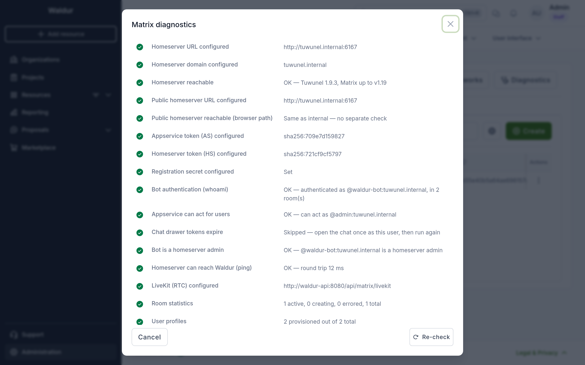

The dialog runs live checks against the homeserver and reports the result.
AS/HS tokens are shown as SHA-256 fingerprints (`sha256:<first-12-hex>`)
so the diagnostic does not leak token material. The integration is ready for
use when every check is green, except the LiveKit check, which matters only
for voice and video calls. Every check talks from Waldur to the homeserver
except **Homeserver can reach Waldur (ping)**, which has the homeserver call
Waldur back with the HS token: it fails on a wrong HS token, or on a Waldur
URL in the registration that the homeserver cannot reach. Bot commands do not
depend on it, as the bot reads them from its own sync; if commands go
unanswered, check that the bot process is running and look at its log. The
[setup guide](../developer-guide/admin-guide/matrix-appservice-setup.md#get-apiadminmatrixdiagnostics)
lists the checks.

---

## Creating a project room

From the **Rooms** tab on the same page, click **Create**, then pick an
organization and one of its projects. Only projects without a Matrix room are
listed. The page is for staff and support. Users who hold `MATRIX_ROOM.CREATE`
on a project or its organization (organization owners by default) create the
project's room from its **Settings → Chat** tab instead.

To give every new project a room, turn on `MATRIX_AUTO_CREATE_PROJECT_ROOMS`;
`waldur provision_matrix_rooms` creates rooms for existing projects. See
[Creating project rooms](../developer-guide/admin-guide/matrix-appservice-setup.md#creating-project-rooms).

Once created, the room synchronises its members (see
[Who is in a project room](#who-is-in-a-project-room)):

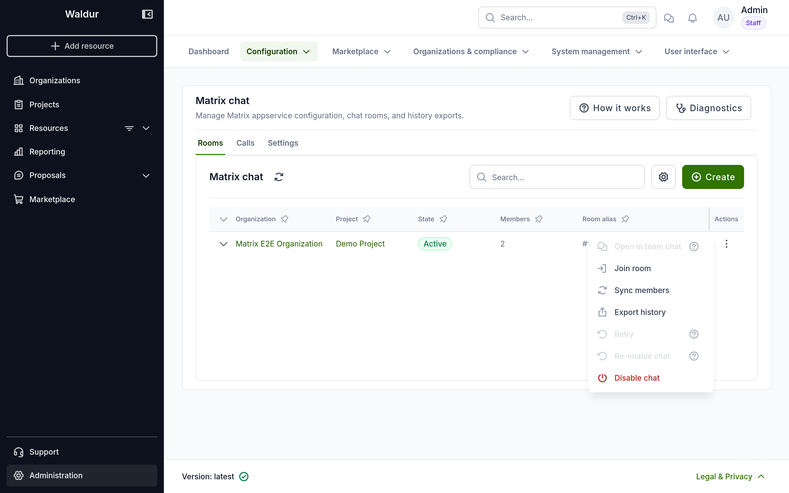

Each row's action menu has **Open in team chat**, **Connect to Matrix…**
(when external clients are allowed), **Join room** or **Leave room**,
**Sync members** and **Export history**, and for staff also **Retry**,
**Re-enable chat** and **Disable chat**. Expanding a
row shows the room's **History exports** and **Members**. State transitions go
through the standard Matrix room lifecycle and are guarded server-side
against concurrent calls. Staff also get a **Calls** tab with the calls
running on LiveKit, and **How it works** explains the integration.

### Who is in a project room

Member sync and role changes decide who is in a project's room and which
Matrix power level each member gets. Power level 50 shows as **Admin** in
the chat's member list; 100 is the Waldur bot.

| Role | Rooms the user is in | Power level |
|---|---|---|
| Project admin | That project's room | 50 |
| Project manager, project member | That project's room | 0, or 50 if the role has `MATRIX_ROOM.CREATE` |
| Organization role with `MATRIX_ROOM.CREATE` (the owner, by default) | Every project room in the organization | 50 |
| Organization support, organization reader | None | — |
| Staff, global support | None automatically; they can join any room as a moderator | 50 |

`MATRIX_ROOM.CREATE` is the permission to create a project's chat room, and
whoever may create a room is also in it and runs it. Granting it on an
organization adds the role's holders to every project room as admins;
granting it on a project makes them admins of that project's room. Taking it
away from organization owners takes them out of every project room.

A user with several roles gets the highest power level. Roles on offerings,
resources, service providers or calls do not put anyone in a project room.

---

## Using the chat in homeport

When `project.show_matrix_chat` and `MATRIX_ENABLED` are both on, the chat
icon in the page header (tooltip **Support**) opens a drawer whose **Team
chat** tab holds the user's rooms; a **Helpdesk** tab sits next to it when
support is enabled. A project with an active room also gets a
**Communication** page with the same chat:

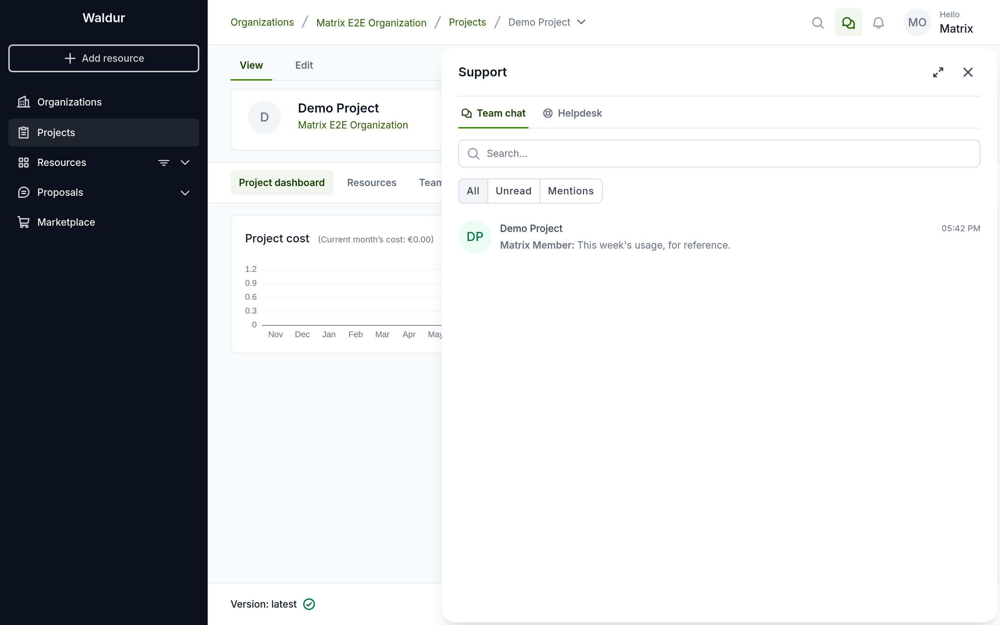

Project members can send messages, attach files, react with emoji, and start
voice or video calls (when LiveKit is configured). All UI strings flow
through the same i18n pipeline as the rest of homeport, so the chat
inherits the active language.

Messages are sent over the homeserver via matrix-js-sdk; the embedded
client is started inside the homeport tab and tears down on Waldur logout.

Rooms are end-to-end encrypted from creation (see
[End-to-end encryption](#end-to-end-encryption)).
The drawer decrypts in the browser with a
WebAssembly module, so homeport's Content-Security-Policy must allow
`'wasm-unsafe-eval'` in `script-src`. The Helm chart and docker-compose
already do; add it if you serve homeport behind your own proxy.

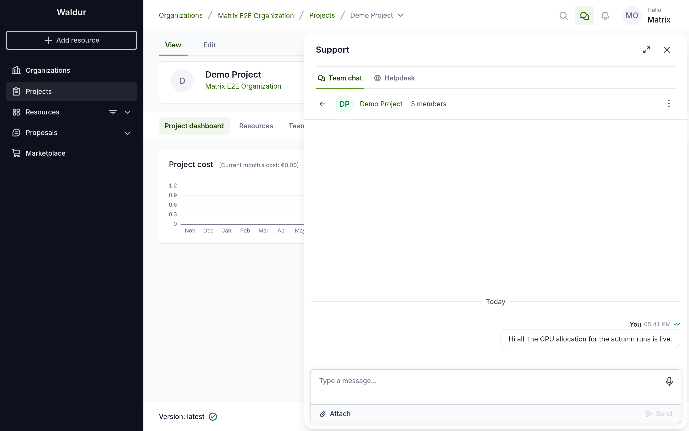

---

## Multiple users in the same room

Each project member gets their own per-user Matrix account (registered
with the homeserver's registration token, `MATRIX_USER_REGISTRATION_SECRET`)
and an independent matrix-js-sdk session inside their browser tab. Sending a
message from one user propagates to every other room member through
the homeserver in real time. The drawer attributes each message with
the **Waldur display name**, not the raw Matrix ID — so an `@manager:
localhost` message is shown as **Project Manager** to every viewer.

The two screenshots below were captured from two browser sessions
logged in as different users simultaneously. The project member's
session shows the organization owner's earlier messages and the bot's
answers, plus the member's own reply; the owner's session shows that
reply landing without a refresh.

| Project member view | Organization owner view |
| --- | --- |
| 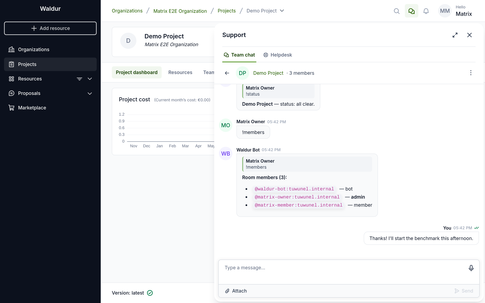 | 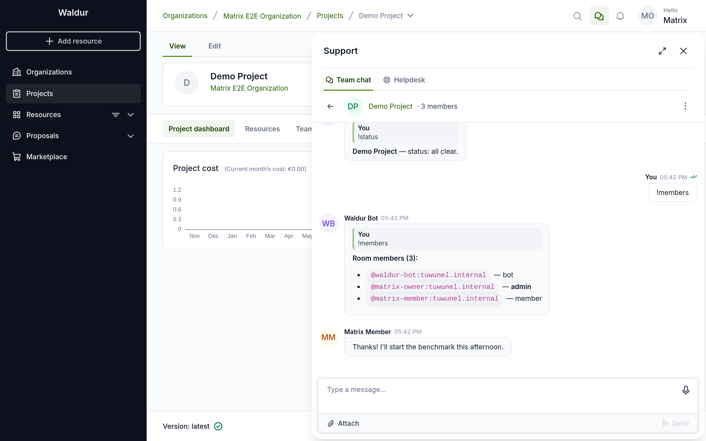 |

Unread badges are computed per user from Matrix read receipts; opening
the room clears them.

### Full-screen view

On desktop screens, the drawer's **Expand to full screen** corner button
(top-right of the drawer header) widens the drawer over the whole content
area, next to the page's sidebar, which stays visible: the room list
moves to a left rail and the conversation takes the remainder. The
**Collapse to panel** button on the same corner returns to the docked
drawer.

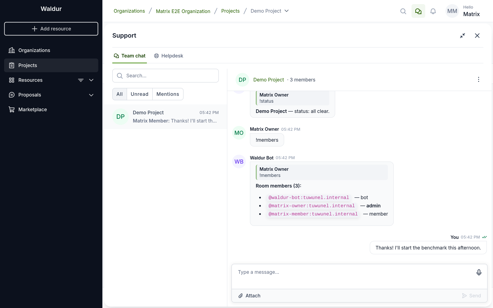

This mode is meant for screen-share / projector use and for users who
want the chat to be the primary surface for an extended period. The
backing matrix-js-sdk client is the same — switching modes doesn't
reconnect, re-paginate, or lose typing buffers.

### Sharing files

The **Attach** button (paperclip icon) in the message composer opens the
browser's file picker. Uploaded files are sent through the homeserver's
authenticated media API (`/_matrix/media/v3/upload` →
`/_matrix/client/v1/media/download`)
and rendered inline for image and video MIME types.

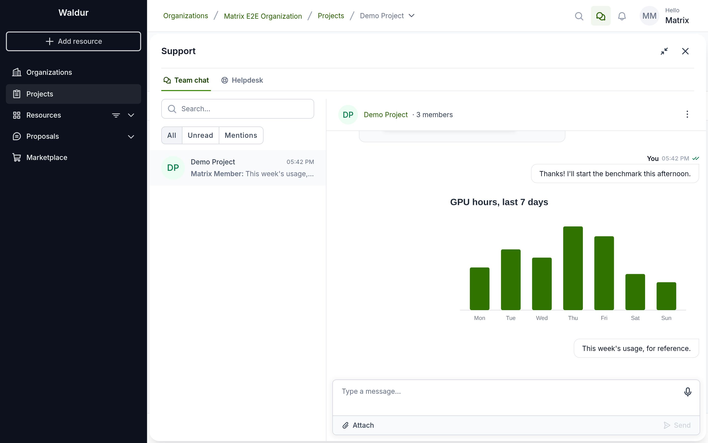

Every recipient's homeport client makes its own authenticated fetch
against `/_matrix/client/v1/media/download/...` carrying the user's
Matrix access token; the bytes are then exposed as a `blob:` URL so
nothing leaks into the page's HTTP referer or browser extensions.
There is **no unauthenticated fallback** — if a download fails (e.g.
the user lost access), the message renders an *Attachment unavailable*
placeholder instead of leaking the media via the legacy unauthenticated
endpoint.

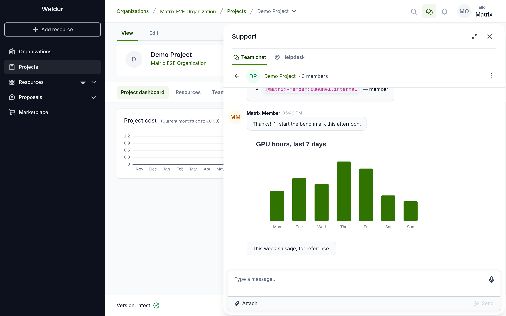

## Voice and video calls

Voice and video calls use [LiveKit](https://livekit.io/) as the SFU and
follow the Matrix RTC pattern via MSC4143. The chat header's kebab menu
shows a **Start call** entry once the integration has decided that a
LiveKit transport is reachable.

The conditions are:

1. The user has loaded the room (the matrix-js-sdk client is connected
   and the room is the active room).
2. The homeserver advertises a `livekit` entry under
   `rtc_transports` in `.well-known/matrix/client` (or the legacy
   `rtc_foci` key). The bundled `tuwunel.toml` ships this entry pointing
   at the Waldur API.
3. The well-known fetch from the browser succeeded. If the homeserver
   is unreachable or the response doesn't include a `livekit` transport,
   the menu shows only **Mute**, plus **Open in external Matrix client**
   when `MATRIX_EXTERNAL_LOGIN_METHOD` is `password` or `oidc`.

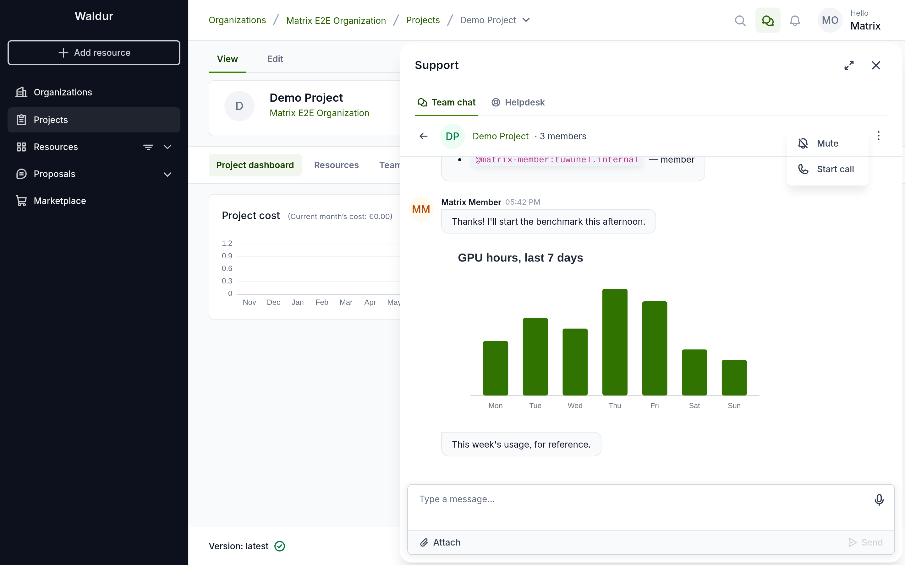

When **Start call** runs, the browser exchanges the user's Matrix
OpenID token for a short-lived LiveKit JWT by posting it to
`/sfu/get` under the `livekit_service_url` the homeserver advertised,
then connects to the LiveKit room. `/sfu/get` is the older endpoint, the one
Element Call uses in its compatibility mode. The drawer falls back to
`/get_token` only when `/sfu/get` is missing and the call is unencrypted, and
every Waldur room is encrypted. Element Call may use either. While the
call is connecting (15-second budget), a spinner replaces the message
list; on success the call view renders inline with the LiveKit
participant tiles and call controls (mute, camera, screenshare, hang
up):

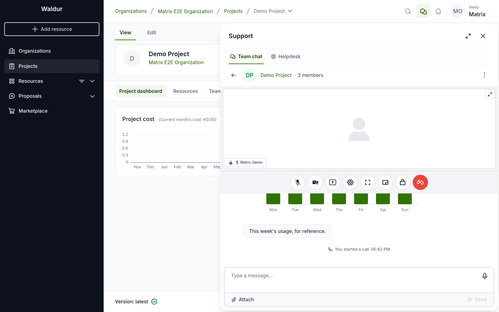

If the homeserver advertises LiveKit but the SFU or Waldur's call token
API is not reachable, the call view surfaces a single-line **Could not
connect to the call** error with **Reload** and **Close** buttons —
the call provider never gets stuck on a spinner.

### Joining an in-progress call

When one room member is on a call, every other member sees a
**Call in progress** banner above the message list
with a **Join call** button. The banner is driven by Matrix RTC membership
events: each participant publishes a per-device call-membership state
event, and the homeport tracks the room's set of live members through
the matrix-js-sdk timeline.

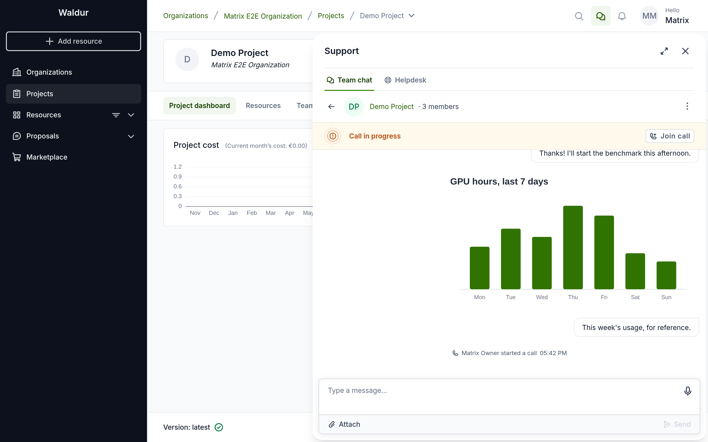

Joining produces a multi-participant view with a tile per LiveKit
publisher. The local tile is labelled with the user's Waldur display
name; remote tiles show the display name once the Matrix call
membership event for that participant has propagated. Until it lands, a
tile may briefly show the participant's LiveKit identity, their Matrix ID
and device (`@user:domain:DEVICE`), after which the
homeport's `NameOverrider` swaps the visible label.

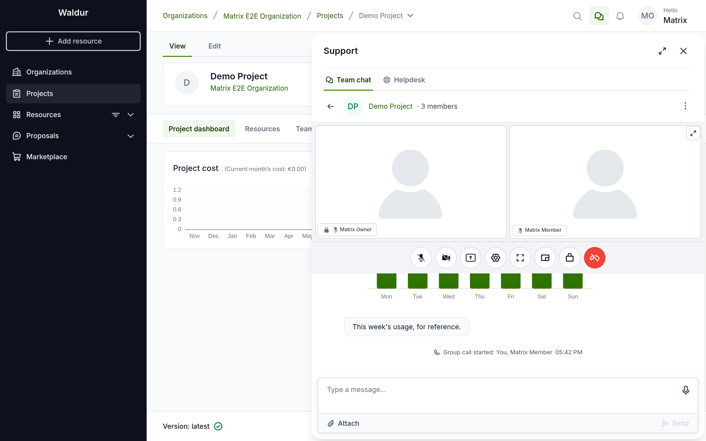

### How call tokens are issued

Waldur serves the call token API that Matrix clients — Waldur's chat drawer
and Element Call alike — use to join a call. It replaces `lk-jwt-service`, so
deployments run only the homeserver and the LiveKit SFU next to Waldur.

Point the homeserver's `.well-known/matrix/client` LiveKit focus at it —
the `livekit` entry under `rtc_transports` (or the legacy `rtc_foci` key):

```json
{
  "type": "livekit",
  "livekit_service_url": "https://<waldur-api-host>/api/matrix/livekit"
}
```

Under that base Waldur answers:

| Endpoint | Request | Answer |
| --- | --- | --- |
| `POST /api/matrix/livekit/get_token` | `{room_id, slot_id, openid_token, member: {id, claimed_user_id, claimed_device_id}}` | `{url, jwt}` |
| `POST /api/matrix/livekit/sfu/get` | `{room, openid_token, device_id}`, the older form Element Call falls back to | `{url, jwt}` |
| `POST /api/matrix/livekit/delegate_delayed_leave` | anything | `404 M_NOT_FOUND`: not supported |

For each token request Waldur:

1. **Verifies the Matrix OpenID token with the homeserver**, through its
   federation endpoint `/_matrix/federation/v1/openid/userinfo` at
   `MATRIX_HOMESERVER_URL`, which must therefore be reachable from Waldur
   there. Users of other homeservers are refused.
2. **Checks room membership and the device**: the user must be joined to the
   room at that moment, and the device named in the request must be one of
   their own. This applies to any room the user has joined, not only Waldur's
   project rooms. A deactivated Waldur user is refused.
3. **Rate-limits** per client address (`matrix_livekit_token`, 600/hour by
   default) and per Matrix user (`matrix_livekit_token_user`, 120/hour). The
   client address is the last `X-Forwarded-For` entry, the one the proxy in
   front of Waldur wrote.
4. **Issues a LiveKit token** for that room's call, valid for 3 minutes;
   LiveKit renews the token of a connected participant.

Every refusal to join gets the same `403 M_FORBIDDEN` answer, so the response
does not reveal whether a room exists or who is in it. An OpenID token the
homeserver does not accept, or one for another user than the request claims,
gets `401 M_UNAUTHORIZED`. If `MATRIX_LIVEKIT_KEY`, `MATRIX_LIVEKIT_SECRET` or
`MATRIX_LIVEKIT_PUBLIC_URL` is unset, the homeserver cannot be reached, or
Waldur cannot create the call's room through LiveKit's API at
`MATRIX_LIVEKIT_URL`, the endpoints answer `503`.

Element Call can hand its delayed leave event (MSC4140) over to the token
service, which then sends the leave once the member drops off the SFU. Waldur
does not take that over: `delegate_delayed_leave` always answers "not
supported", so clients keep the delayed leave themselves and restart it while
they are in the call.

When a user loses access to a Waldur room (role revoked, deactivation, room
disabled), Waldur also disconnects them from its call.

Any origin may call these paths, without credentials, so Element Web on
another domain can use them. The packaged Helm chart and Docker Compose stack
route `/api/matrix/livekit` to Waldur with CORS open to all origins. The
LiveKit admin API (`/twirp`) is used only by Waldur internally and should not
be exposed publicly.

---

## Bot commands

The Waldur bot answers operational queries from inside the chat:

- `!help` — list available commands.
- `!status` — errored resources, pending approvals, in-flight operations.
- `!orders` — last five marketplace orders for the project.
- `!members` — Waldur-aware membership list with roles.

Senders are gated server-side. The bot resolves the sender's Matrix ID to
their Waldur user via `MatrixUserProfile`, and replies only when that user
holds an active project or customer role on the room's linked project. A
local account that holds no such role, such as a guest someone invited by
hand, gets a single-line denial, not project data. Accounts on other
homeservers cannot join at all: Waldur creates rooms unfederated (see
[Creating a room](../developer-guide/admin-guide/matrix-appservice-setup.md#creating-a-room)).

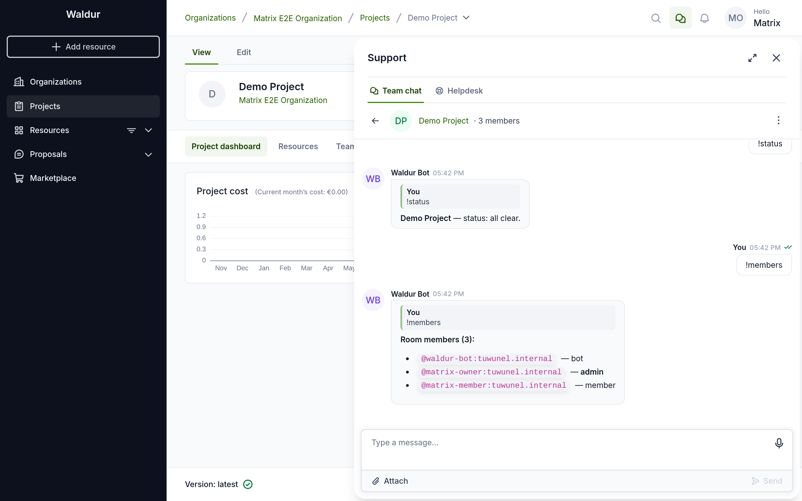

---

## Web chat sessions

With refresh tokens configured on the homeserver (the Helm chart and
docker-compose do this for Tuwunel), the chat drawer never holds a long-lived
token. It calls `POST /api/matrix/session/`, which signs the user in through
the appservice on a new device (`WALDUR_WEB_<id>`) and returns an access token
and a refresh token. The drawer keeps both in memory and renews the access
token through Matrix `/refresh`. It asks Waldur for a new session when a
refresh is rejected or when the homeserver signs its device out, for example
from Element's session list or because Waldur's limit of web devices was
reached. Whether the user may still chat is decided there: a deactivated,
deleted or signed-out user gets no new session and is returned to the login
page. When chat was switched off, or the new session is signed out again
within a minute, the drawer shows **Your chat session has ended.**

Waldur is consulted only when the drawer connects, when a refresh is rejected
and when the device is signed out. Switching chat off or signing out of
Waldur in another tab therefore does not cut an open drawer: it keeps working
until it next needs a new session.

The homeserver sets the lifetimes:

| Tuwunel key | Helm value | Default | Meaning |
| --- | --- | --- | --- |
| `access_token_ttl` | `matrixChat.homeserver.accessTokenTtl` | `300` | Access token lifetime in seconds |
| `refresh_token_ttl` | `matrixChat.homeserver.refreshTokenTtl` | `86400` | Idle lifetime of the refresh token in seconds |

docker-compose sets the same values in `config/matrix/tuwunel.toml.template`;
edit the template to change them. Each refresh moves the idle deadline
forward, so an open drawer never expires. Logins without a refresh token, such
as Element with a password, keep non-expiring tokens.

Every session has its own device. Tuwunel keeps one refresh token per
device, so a device shared by two browser tabs would revoke itself. After
each new session Waldur signs out the user's web devices not seen for 24
hours, a window fixed in Waldur, and beyond the 10 most recently seen it
signs out the rest, except devices seen in the last ten minutes: those belong
to open tabs. A daily task applies the same rules to every provisioned user,
so the devices of users who start no new session are signed out too. The
[setup guide](../developer-guide/admin-guide/matrix-appservice-setup.md#web-chat-sessions)
has the full rules.

### External clients

`MATRIX_EXTERNAL_LOGIN_METHOD` decides whether users can also open rooms in
an external client: `none` (default) hides the option, `password` shows the
homeserver and the user's Matrix ID and lets them generate a password, and
`oidc` tells the user to sign in with single sign-on configured on the
homeserver. Use `oidc` in production: users then sign in to their client with
the same identity provider as Waldur, and there is no Matrix password to leak.
`password` is meant for testing and for installations without an identity
provider.

In `password` mode Waldur stores no Matrix password. The user clicks
**Generate password** in the external client dialog and gets a random password
that is shown once; generating again replaces it on the homeserver (see
[Generated passwords](../developer-guide/admin-guide/matrix-appservice-setup.md#generated-passwords)).
Waldur sets the password through the homeserver's admin API, so the bot must
be a homeserver admin; until it is, generating fails. On Tuwunel, send
`!admin users make-user-admin @<bot localpart>:<homeserver domain>` in the
admin room. `waldur register_matrix_appservice` does this itself, so on Helm
and docker-compose, which run it on every deploy, the bot is an admin already.
Then check that **Bot is a homeserver admin** passes in **Diagnostics**. Make
the bot an admin in the other modes too: without it, Waldur cannot lock the
Matrix account of a deactivated user, and a user whose recovery key is lost
cannot reset their chat encryption from the drawer. It also lets Waldur refuse
to give a user a homeserver admin's account, and lets the appservice token use
the admin API as the bot. Treat that token as a homeserver admin credential
whether or not the bot is an admin: it can act as any account of the
homeserver, admins included, from the moment the appservice is registered.
[Making the bot a homeserver admin](../developer-guide/admin-guide/matrix-appservice-setup.md#making-the-bot-a-homeserver-admin)
explains why and covers Synapse.

`none` and `oidc` only hide the option: password login still works on the
homeserver, so switching away from `password` does not cut off users who
have generated a password. To stop new password logins, turn them off on the
homeserver with `login_with_password = false`
(Helm `matrixChat.homeserver.loginWithPassword: false`, docker-compose
`WALDUR_MATRIX_LOGIN_WITH_PASSWORD=false`). Clients already signed in stay
signed in until their sessions are signed out. Waldur's chat drawer signs in
through the appservice, but its encryption reset answers interactive auth with
a temporary password and has not been tested with password login off (see the
warning under
[Single sign-on for external clients](#single-sign-on-for-external-clients)).
An admin created with a password can then no longer sign in to a client
either.

That includes the bootstrap admin that registers the appservice. A first
install and routine deploys still work, but changing the registration then
needs a homeserver admin's access token: `admin_token` in the Helm Secret,
on standard input to a one-off register container on docker-compose
(`docker compose --profile matrix run --rm --no-deps -T waldur-matrix-register
/etc/waldur/matrix/register-matrix.sh --admin-token-stdin`), or
`MATRIX_ADMIN_TOKEN` for `register_matrix_appservice`. Without one, a token
rotation fails after the new tokens are seeded, with "Password login is disabled on the homeserver
(login_with_password = false), so the command cannot sign in as
@waldur-bootstrap", and any other change to the registration, such as
Waldur's URL, is only warned about and not made. The "Rotating with password
login off" sections of the [Helm](deployment/helm/docs/matrix-chat.md) and
[docker-compose](deployment/docker-compose/matrix-chat-add-on.md) guides say
how to get a token.

The homeserver reads its configuration only at startup. With Helm, a
`helm upgrade` that changes a non-secret `matrixChat.homeserver` value restarts
it. The checksum that does this leaves out the secrets (`registrationToken`,
`sso.clientSecret`) and any Secret you manage yourself, so after changing one
run `kubectl rollout restart statefulset/matrix-homeserver`.
(`sso.waldurRegistrationMethod` is left out too, but it is Waldur's setting,
not the homeserver's, and needs no restart.) With docker-compose,
re-render the configuration and restart Tuwunel, which an `up` leaves running
with the old values:

```bash
docker compose --profile matrix up -d
docker compose restart tuwunel
```

### Single sign-on for external clients

In `oidc` mode, users sign in to Element through the same identity provider
(IdP) as Waldur and land in the Matrix account Waldur provisioned, with their
project rooms. Waldur hands out no password.
[Single sign-on for Matrix clients](../developer-guide/admin-guide/matrix-sso.md)
explains how the accounts line up, what each setting does and the limits. The
"Single sign-on for Matrix clients" sections of the
[Helm](deployment/helm/docs/matrix-chat.md) and
[docker-compose](deployment/docker-compose/matrix-chat-add-on.md) guides list
their values and what they check.

1. Point Waldur's identity provider at the IdP with `user_field` set to
   `username`, and set `MATRIX_USER_ID_FORMAT = username`,
   `MATRIX_EXTERNAL_LOGIN_METHOD = oidc` and `MATRIX_SSO_REGISTRATION_METHOD`
   to that identity provider's name in Waldur, such as `keycloak`. Waldur gives
   a Matrix account only to users who registered through it; while the setting
   is blank, no user gets one. The packagings seed it from Helm
   `matrixChat.homeserver.sso.waldurRegistrationMethod` and docker-compose
   `WALDUR_MATRIX_SSO_REGISTRATION_METHOD`.
2. Register a client for the homeserver at the IdP with the redirect URI
   `https://<homeserver>/_matrix/client/unstable/login/sso/callback/<client id>`.
3. Turn on SSO on the homeserver (Helm `matrixChat.homeserver.sso`,
   docker-compose `WALDUR_MATRIX_SSO_*`). Its claim must be the one Waldur's
   identity provider uses as `user_claim`; keep the default `sub` unless the
   IdP controls usernames.
4. List every other homeserver admin in the forbidden usernames (Helm
   `sso.forbiddenUsernames`, docker-compose
   `WALDUR_MATRIX_SSO_FORBIDDEN_USERNAMES`). Both packagings trust the IdP,
   which signs a user in to any existing account whose name matches their
   claim, not only the ones Waldur provisioned. Both always reserve Waldur's
   bot and `waldur-bootstrap`, the bootstrap admin that automatic registration
   creates, ahead of the list, but nothing else, so without this step an IdP
   user named like an admin gets the admin's account. The two take different
   formats: Helm takes anchored patterns, such as `^admin$` (default `[]`),
   and docker-compose takes plain localparts separated by commas, such as
   `matrix-admin`. A bot localpart changed in Waldur's settings rather than in
   the packaging has to be listed too.
5. Turn off password login and restart the homeserver, as above.

    !!! warning
        Turning password login off has not been tested together with the
        drawer's encryption reset. A user whose recovery key is lost resets
        their chat encryption from the drawer, which answers the homeserver's
        interactive auth with a temporary password that Waldur sets through
        the admin API. Check that a reset still works on your homeserver
        before you turn password login off in production.

To check it, sign in to Element with the homeserver URL and the SSO button
after the user has opened Waldur's chat once: Element shows the user's Waldur
Matrix ID and project rooms, and no second account exists for them.

---

## End-to-end encryption

The user guide's [Chat encryption](../user-guide/end-users/chat-encryption.md)
page is what to point users at; this section is what operators need to know.

**What is encrypted.** The content of messages and files: text, edits, replies,
attachments and voice messages. Room names and topics, membership, timestamps,
which event replies to, edits or reacts to which, and the emoji of reactions
stay in plaintext on the homeserver, as Matrix needs them to route events. Say
"message and file content is encrypted", not "the homeserver stores only
encrypted data". Calls in encrypted rooms, which all of Waldur's rooms are, are
end-to-end encrypted too, with a key per participant that goes Olm-encrypted to
each member's devices;
LiveKit still sees who takes part and when, the kinds and sizes of their tracks
and who is speaking.

**Who holds the keys.** Each user's encryption identity (cross-signing keys, key
backup, and the dehydrated device that receives messages while no drawer is
open) lives on the homeserver, encrypted under the user's recovery key. Waldur
escrows every recovery key, encrypted at rest under `FIELD_ENCRYPTION_KEY`, and
hands it only to the user's own sign-in: to the drawer at the start of each
session, and to the user in the external client dialog. The Waldur bot holds the
room keys of every room since its creation, in its crypto store in Waldur's
database. The encryption therefore protects against someone who gets the
homeserver's database or its backups, not against the operators of the Waldur
deployment, who can read every message.

**Back up together, and keep `FIELD_ENCRYPTION_KEY`.**

- Back up the homeserver and Waldur's database together, and restore them
  together. A Waldur database restored to a point before a user first opened the
  chat, while the homeserver keeps newer data, leaves that user's identity
  locked (see
  [Locked identities](../developer-guide/admin-guide/matrix-appservice-setup.md#locked-identities)).
- Without `FIELD_ENCRYPTION_KEY` no escrowed recovery key, and not the bot's
  crypto store, can be read. Set a dedicated key rather than relying on the one
  derived from `SECRET_KEY`, keep it outside the database backups, and never
  rotate `SECRET_KEY` while `FIELD_ENCRYPTION_KEY` is unset: the derived key
  changes with it. Rotate `FIELD_ENCRYPTION_KEY` only with `reencrypt_fields`
  (see the [field encryption guide](../developer-guide/field-encryption.md)).
- Never reset the bot's crypto store: room history the bot holds, and the
  history export, depend on it.

**Element and other clients.** In `password` and `oidc` mode the external
client dialog has a **Show recovery key** button. Waldur returns the key only
after checking that it still opens the user's secret storage on the homeserver,
records each reveal in the user's event log (`matrix_recovery_key_viewed`), and
refuses it to personal access tokens, OIDC access tokens and requests made while
staff impersonate the user. That does not keep the key from staff: while
impersonating, they can fetch the user's own Waldur API token, which the endpoint
accepts. Operators are trusted with the keys anyway, as Waldur escrows them;
binding key access to an interactive sign-in is planned. With the key, Element verifies its session and reads the user's
history. The `matrix_recovery_key` rate limit (default 30/hour per user)
applies.

**Keys Waldur never saw.** A user who set encryption up in Element before ever
opening the drawer, or who resets it there later, has a key that Waldur does not
hold. The drawer then shows **Encrypted messages cannot be read** and offers
**Enter recovery key** before **Reset encryption**. The key the user enters is
checked against their secret storage in the browser and again by Waldur, then
escrowed; the drawer does not ask again. Until the user enters it, chat in
Waldur stays locked for them. Only a user without any working key
needs the reset, which replaces the identity and deletes the old key backups;
the bot then writes the history it holds into the new backup.

**Keys Waldur can no longer read.** A recovery key escrowed under a
`FIELD_ENCRYPTION_KEY` that is since lost, or under the key derived from a
`SECRET_KEY` that was since rotated, is still in the database but cannot be
decrypted. Waldur treats it as no key: the drawer shows the same **Encrypted
messages cannot be read** notice with **Enter recovery key** and **Reset
encryption**, and **Show recovery key** returns nothing. A user who kept the key
in another client enters it and Waldur escrows it again; the others reset. The
old key put back in `FIELD_ENCRYPTION_KEY_FALLBACKS` (not as the primary key,
which would lock out everything encrypted since) makes the escrowed keys of
every user who has not reset meanwhile work again without anyone doing anything.

**History for new members.** A member added to a room gets its earlier history
through their key backup: the bot, which holds the room keys since the room was
created, writes them into the member's backup, and the drawer restores them from
there. The drawer shows these messages like any other, without a marker, but
their keys were shared by the bot rather than by the sender's own device, so
their authenticity is not guaranteed the way it is for keys from the sender
(Element may mark them; not verified).
This runs on every path that adds a member (a role, member sync, opening a room
the user was invited to) and on a staff or support **Join room**, which therefore gets
the room's whole earlier history, for as long as the Join counts. After a setup
or reset in the drawer, the bot writes everything it holds into the new backup.
Only keys the bot holds are written, so history from before the bot was in a
room, or that no member's device shared with it, is not covered. Whether Element
shows this history has not been verified. The
[setup guide](../developer-guide/admin-guide/matrix-appservice-setup.md) has the
details, including how the bot decides which backup it may write into.

---

## Operational notes

- **Tear-down on logout.** The embedded Matrix client disconnects whenever
  Waldur loses the authenticated user and, as a best effort, signs its session
  device out, which revokes its tokens; otherwise its access token expires
  within `access_token_ttl` and its refresh token after `refresh_token_ttl` of
  disuse. Re-logins start a fresh client instance, so a shared
  workstation never leaks one user's session to the next. The same teardown
  removes the matrix-js-sdk `Sync` listener and any per-call sub-module
  handlers.
- **Webhook rate limit.** The appservice endpoints
  (`/_matrix/app/v1/transactions/{txnId}` and `/_matrix/app/v1/ping`) are
  limited per client address via the `matrix_webhook` DRF throttle scope
  (default 10000/hour), the two endpoints sharing one bucket. Calls that
  carry the homeserver's `hs_token` are not limited: the homeserver sends
  every transaction from one address, about one per chat message, and would
  otherwise reach the limit on a busy instance. The limit applies to every
  other caller, such as a scanner or a homeserver with a stale token, and
  those calls are counted in the `webhook_errors` diagnostic. When Matrix is
  disabled the transactions endpoint returns `200` and discards the payload,
  so the homeserver does not retry.
- **Per-user limits.** `/api/matrix/session/` is rate-limited via the
  `matrix_session` scope (default 120/hour per user). The drawer calls it on
  connect, which includes the background connect on every page load for a
  room member, and when a token refresh is rejected, so each page load counts
  against the limit. `/api/matrix/credentials/`,
  which only the external-client dialog calls, uses the `matrix_credentials`
  scope (default 1000/hour per user), and `/api/matrix/credentials/password/`,
  behind its **Generate password** button, the `matrix_password` scope
  (default 30/hour per user). `/api/matrix/credentials/recovery-key/`, behind
  **Show recovery key**, uses the `matrix_recovery_key` scope (default 30/hour
  per user), and the `/api/matrix/crypto/` endpoints, which the drawer calls to
  set up or reset encryption, the `matrix_crypto` scope (default 30/hour per
  user). All of these return `404` when the integration is disabled. History
  export downloads use the `matrix_export_download` scope (default 120/hour per
  user).
- **Periodic tasks.** Matrix chat runs these daily (UTC):
  `periodic_history_export` at 02:00 exports every active room's history when
  `MATRIX_HISTORY_EXPORT_ENABLED` is on; `cleanup_old_appservice_transactions`
  at 03:15 prunes webhook idempotency rows older than 30 days;
  `cleanup_old_outbox_messages` at 03:20 prunes old sent and failed messages
  from the bot's outbox; `cleanup_old_history_exports` at 03:30 applies the
  export retention; and `prune_all_web_devices` at 03:45 signs out idle web
  chat devices. Every ten minutes `scrub_expired_temporary_passwords` replaces
  the temporary passwords of encryption resets whose lease ran out. The
  [scheduled jobs reference](mastermind-configuration/scheduled.md) lists every
  task Waldur schedules.
- **History export.** Disabling a room can optionally export its history.
  The bot process makes every export: it pages through the room and decrypts
  each message with the room keys in its crypto store, so an export holds the
  messages in clear, apart from those the bot never received a key for. While
  no bot runs, exports stay pending. At rest, each export's files are
  encrypted under a key of its own, which is stored encrypted under
  `FIELD_ENCRYPTION_KEY`; the download view decrypts them. See
  [Export process](../developer-guide/admin-guide/matrix-appservice-setup.md#export-process).
  Exports go only to
  those holding `MATRIX_ROOM.CREATE` on the project or its organization
  (organization owners by default) and to staff and support. Everyone else,
  room members included, gets an empty export list and `404` on a download. Files
  are served through a permission-checked view rather than the raw storage
  URL. Exports older than `MATRIX_HISTORY_EXPORT_RETENTION_DAYS` (default 90)
  are deleted daily, except each room's newest completed export; `0` or less
  keeps them all. See
  [Who can download exports](../developer-guide/admin-guide/matrix-appservice-setup.md#who-can-download-exports)
  and [Retention](../developer-guide/admin-guide/matrix-appservice-setup.md#retention).
- **Stored secrets.** Waldur stores no Matrix access token for any user. The
  drawer's tokens live only in the browser's memory, and registering a user
  creates no device. Waldur does store the bot's encryption keys and access
  token, users' recovery keys, each history export's data key and the secret
  Matrix settings in Constance; all of them are encrypted at rest with
  `FIELD_ENCRYPTION_KEY`, or with a key derived from `SECRET_KEY` while that is
  unset. Back that key up separately from the database dumps: without it they
  cannot be decrypted, and neither can any history export.
- **Deactivated and deleted users.** Deactivating or deleting a Waldur user
  signs out every one of their Matrix devices, Element included, and removes
  them from their rooms, through background tasks that retry failures, even
  while chat is switched off. An open drawer loses access within moments.
  Reactivating the user while chat is on brings them back into the rooms their
  roles give them. If the bot is a homeserver admin, Waldur also locks the
  account, so no client can sign in to it again and a generated password stops
  working, and reactivation unlocks it; deleting a user also replaces their
  Matrix password. Without that, the account stays unlocked: deactivate it on
  the homeserver, and with single sign-on also disable the user at the IdP,
  which the homeserver otherwise keeps trusting. See
  [Automatic member management](../developer-guide/admin-guide/matrix-appservice-setup.md#automatic-member-management).
- **Keep user registration closed.** Waldur creates each user's Matrix
  account the first time that user needs chat. It claims only the bot's
  username exclusively on the homeserver, so anyone the homeserver lets
  register can take a username Waldur will later want, such as a Waldur
  user's Matrix ID. Waldur does not adopt an account it did not create: chat
  provisioning for that user fails with an error naming the `waldur
  link_matrix_account` command. Before running that command, or its `--all`
  form, make sure the account really belongs to the user. Linking someone
  else's account gives them the user's project rooms, messages and calls.
  The packaged deployments keep registration behind a token that only Waldur
  and the operator hold: the Helm chart refuses to render
  `allowRegistration: true` without one, and Docker Compose generates a random
  one and keeps `WALDUR_MATRIX_OPEN_REGISTRATION` false. Do not turn on open
  registration on a homeserver that Waldur uses, and treat the token
  (`MATRIX_USER_REGISTRATION_SECRET`) like a password: Helm and Docker Compose
  also use it as the homeserver's registration shared secret, which can create
  admin accounts. If it may have leaked, replace it, and review the accounts
  registered since. With Helm, follow
  [Rotating the tokens](deployment/helm/docs/matrix-chat.md#rotating-the-tokens).
  With Docker Compose, change only the `REG_TOKEN=` line in `secrets.env`,
  bring the profile up so Waldur gets the new token, wait for the register
  container, and restart Tuwunel, which reads the token only at start:

    ```bash
    docker compose --profile matrix run --rm --no-deps --entrypoint sh waldur-matrix-init-volume -c '
      sed -i "s/^REG_TOKEN=.*/REG_TOKEN=$(openssl rand -hex 32)/" /var/lib/waldur/matrix/secrets.env'
    docker compose --profile matrix up -d
    docker wait waldur-matrix-register
    docker compose restart tuwunel
    ```

    The appservice tokens stay the same, so nothing needs registering again.
    Don't delete `secrets.env` to get a new token: that also replaces the
    bootstrap password, and registration then fails (see
    [Token rotation](deployment/docker-compose/matrix-chat-add-on.md#token-rotation)).
    On a homeserver you run yourself, change it in Waldur and in the
    homeserver's `registration_token` and `registration_shared_secret`
    together, then restart the homeserver (see
    [Registration secret](../developer-guide/admin-guide/matrix-appservice-setup.md#registration-secret)).

---

## Troubleshooting

| Symptom | Likely cause | Fix |
| --- | --- | --- |
| The chat drawer shows **Your chat session has ended.** | Matrix chat was switched off (`MATRIX_ENABLED`) while the drawer was open, or the homeserver signed the drawer's device out again within a minute of reconnecting | Re-enable chat. If sessions keep being signed out, look for what removes `WALDUR_WEB_*` devices on the homeserver. **Reload** in the drawer starts a new session. A deactivated, deleted or signed-out user is returned to the login page instead. A rate-limited connect shows **Too many chat requests. Please try again in …** |
| One user's chat always answers **Chat is unavailable right now**, and the worker log says their Matrix ID "already belongs to an account this Waldur did not create" | The homeserver already had an account with that ID when Waldur provisioned the user: one registered by hand, or one Waldur created before its database was restored from an older dump or reset | If the account is the user's, link it with `waldur link_matrix_account <username> @<localpart>:<homeserver domain>`. After restoring or resetting Waldur's database against the same homeserver, run `waldur link_matrix_account --all`. If it is not theirs, the user gets no chat under that ID: deactivating the other account does not free the ID. See [Existing Matrix accounts](../developer-guide/admin-guide/matrix-appservice-setup.md#existing-matrix-accounts). |
| Bot commands go unanswered and Waldur's notices do not appear in rooms | The `matrix_bot` process is not running or failed to start | Check that `waldur-matrix-bot` runs and read its log. A second process exits with "Another Matrix bot process holds the lease" while the first runs; run exactly one. |
| `bot_provision_status: "failed: M_UNKNOWN_TOKEN"` after Setup | The homeserver has no registration with the tokens this Setup generated, which is expected on a first Setup | Register the YAML Setup returned (see [By hand](#by-hand)). Tuwunel then creates the bot itself. Don't run Setup again: it generates new tokens. |
| Webhook reaches Waldur but returns `400 DisallowedHost` | The hostname the homeserver uses to reach Waldur is not in Django's `ALLOWED_HOSTS` | Add the hostname (e.g. `host.docker.internal`) to `ALLOWED_HOSTS` and restart. On the dev stack, run Waldur with `dev_matrix_settings`, which adds `host.docker.internal`. |
| Diagnostics shows `Bot authentication: 401 Unauthorized — AS token rejected` or `403 Forbidden — AS token not recognized by homeserver` | The homeserver holds a registration with other tokens than Waldur's, for example after Setup was run again | On Helm or docker-compose, deploy again: the register step replaces a registration that differs from Waldur's. With password login off, pass an admin token (see [External clients](#external-clients)). On a homeserver you run yourself, run `waldur register_matrix_appservice` again, which does the same. By hand, `waldur generate_appservice_registration --url <URL the homeserver uses to reach Waldur>` prints the YAML of the tokens Waldur has. Send `!admin appservices unregister waldur`, then register it. |
| Voice/video call fails to connect | The `livekit_service_url` in `.well-known/matrix/client` does not point at Waldur's `/api/matrix/livekit`, or the browser cannot reach it | Set it to `https://<waldur-api-host>/api/matrix/livekit` and check the token request in the browser's network tab. |
| The browser's token request returns `503` | LiveKit keys or public URL are not set in Waldur, Waldur cannot reach the homeserver's `/_matrix/federation/v1/openid/userinfo` at `MATRIX_HOMESERVER_URL`, or Waldur cannot reach LiveKit's API at `MATRIX_LIVEKIT_URL` (the log says "Could not create the LiveKit room") | Set `MATRIX_LIVEKIT_KEY`, `MATRIX_LIVEKIT_SECRET` and `MATRIX_LIVEKIT_PUBLIC_URL`; make sure the homeserver's federation endpoints are reachable at `MATRIX_HOMESERVER_URL`, and LiveKit at `MATRIX_LIVEKIT_URL` (default `http://livekit:7880`). |
| The browser's token request returns `401 M_UNAUTHORIZED` | The homeserver did not accept the OpenID token, or the token belongs to another user than the request claims | Check that `MATRIX_HOMESERVER_URL` reaches the same homeserver the user's client signed in to. |
| The browser's token request returns `403 M_FORBIDDEN` | The user is not joined to the room, the device is not theirs, the user belongs to another homeserver, or the Waldur user is deactivated | Join the room first; check the Waldur logs for "Refused a call token". |
| The browser's token request returns `429` | Rate limit hit. Behind a load balancer that does not pass the client address on, all clients share one per-address bucket | Pass the real client address to the proxy in front of Waldur, or raise `matrix_livekit_token`. |
| The browser's token request returns `404` | Matrix chat is switched off (`MATRIX_ENABLED`), or a reverse proxy does not route `/api/matrix/livekit` to Waldur | Enable Matrix chat; route the whole `/api/matrix/livekit` prefix to the Waldur API. |
| A call fails with **This browser can't take part in encrypted calls.** | The browser cannot encrypt call media (it has neither insertable streams nor `RTCRtpScriptTransform`), and every call in Waldur's rooms is encrypted | Use a current version of Chrome, Edge, Firefox or Safari. |
| The call view says **Not shown, not end-to-end encrypted:** and names participants | Their media reaches the call unencrypted, for example from a client that does not encrypt calls. The drawer does not play media in clear, which could as well come from the call server as from them | Have them join from Waldur's chat, or from a Matrix client that encrypts calls. |

If the bot answers a command with "You don't have access to this room's
project in Waldur.", check that the Matrix sender ID is mapped to a Waldur
user in `MatrixUserProfile`, that the user is active, and that a role puts
them in the room: an active role on the room's project, or an organization
role with `MATRIX_ROOM.CREATE`. Staff and support who only used **Join room**
get the same answer. In a room that is not active, the bot answers no
commands at all.
