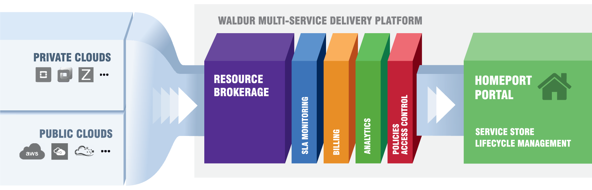

---
hide:
  - navigation
  - toc
---

# Waldur documentation

Waldur is an open-source platform for managing hybrid cloud resources. It is used both for controlling internal enterprise IT resources and for selling cloud services. It includes a rich functionality for managing service catalogues and supports integration of services managed by other Waldur deployments.

## Get started

- :material-rocket-launch-outline:{ .lg .middle } **Try Waldur**

    ---

    Run a local instance with Docker Compose and look around the portal.

    [:octicons-arrow-right-24: Try Waldur locally](get-started/try-waldur.md)

- :material-account-group-outline:{ .lg .middle } **Use a Waldur portal**

    ---

    Find your way around, set up organizations and projects, and order resources.

    [:octicons-arrow-right-24: Get started as a user](get-started/index.md#use-a-waldur-deployment)

- :material-server-outline:{ .lg .middle } **Deploy Waldur**

    ---

    Install with Docker Compose or Helm, configure identity providers, and go live.

    [:octicons-arrow-right-24: Deploy for production](get-started/index.md#deploy-waldur-for-production)

- :material-api:{ .lg .middle } **Call the API**

    ---

    Make your first request with curl, the Python SDK or TypeScript.

    [:octicons-arrow-right-24: Make your first API call](get-started/first-api-call.md)

## Guides

- :material-book-open-variant:{ .lg .middle } **Use Waldur**

    ---

    Organizations, projects and resources; publishing offerings as a service provider; calls for proposals; staff tasks.

    [:octicons-arrow-right-24: User guide](user-guide/index.md)

- :material-tools:{ .lg .middle } **Operate Waldur**

    ---

    Deployment, settings, identity providers, service provider backends, monitoring and backups.

    [:octicons-arrow-right-24: Operator guide](admin-guide/index.md)

- :material-puzzle-outline:{ .lg .middle } **Integrations**

    ---

    SRAM, GLAuth, Open OnDemand, LEXIS, service desks, the Keycloak mapper and the MCP server.

    [:octicons-arrow-right-24: Integrations](integrations/index.md)

- :material-source-pull:{ .lg .middle } **Build with Waldur**

    ---

    REST API, Python SDK, waldur-cli, Terraform and Ansible, and how Waldur itself is built.

    [:octicons-arrow-right-24: Integrate with the API](integrator-guide/APIs/api.md) · [Develop Waldur](developer-guide/index.md)

## How Waldur is built

- [Waldur MasterMind](https://github.com/waldur/waldur-mastermind/) — broker and orchestrator of cloud services, responsible for technical service delivery. It exposes the REST API, documented in the [API reference](https://api-docs.waldur.com/).
- [Waldur HomePort](https://github.com/waldur/waldur-homeport/) — the web-based self-service portal. It talks to MasterMind over the REST API.

Waldur is open source, extendable, and comes with [professional support](about/support.md). For a quick look at the portal, see the [screenshots](about/screenshots.md); for the ideas behind it, the [concepts](about/concepts/platform.md).

