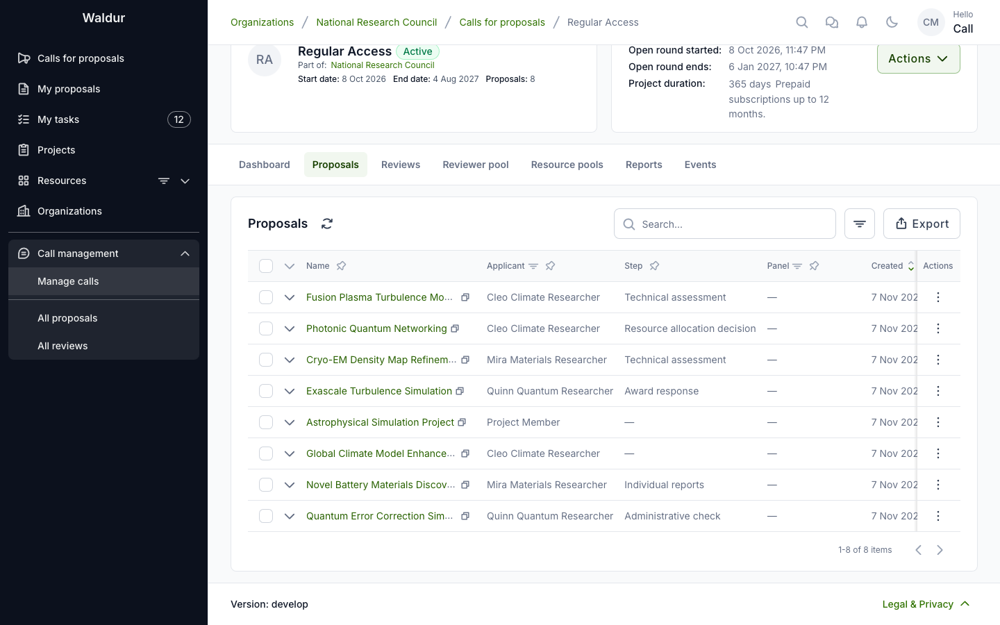
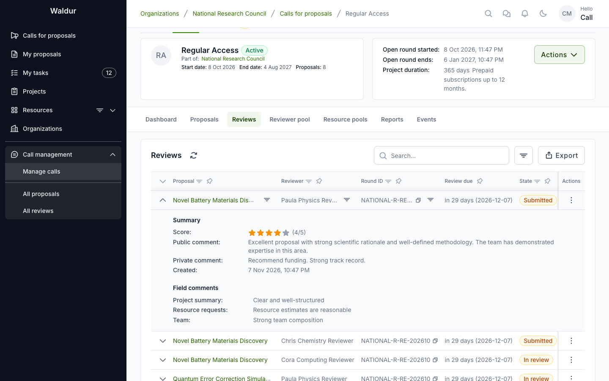
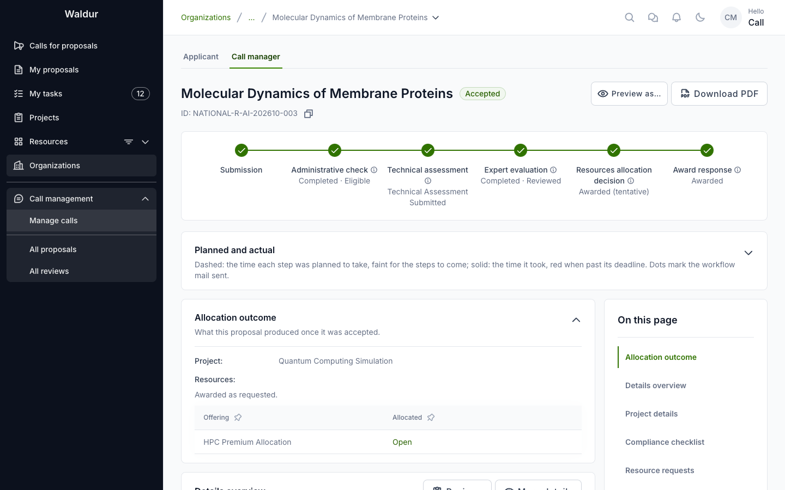
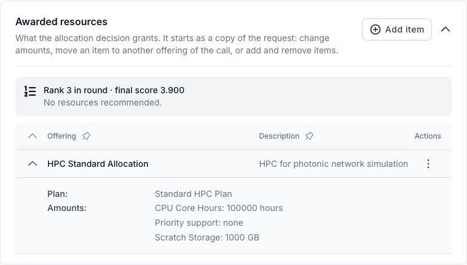
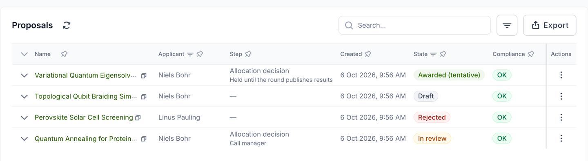
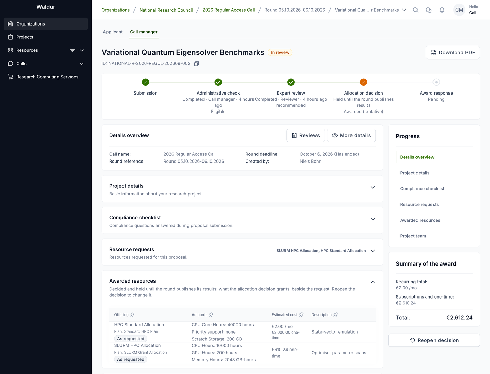
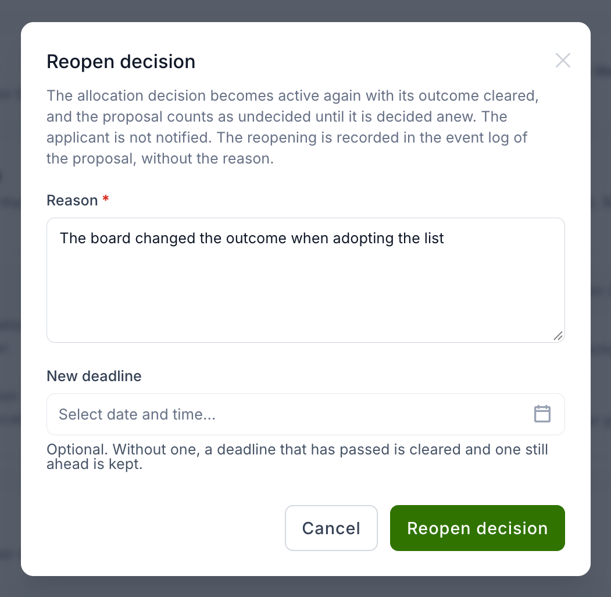

# Allocation decision and award

**Performed by:** The responsible role of the **Allocation decision** step (Call manager by default)

Every call ends its evaluation in one **allocation decision**: a person weighs the evaluation
and approves or declines the proposal. This page covers that decision, what can be awarded,
decisions held for the round's publication, the applicant's award response, the project that
an accepted proposal becomes, and the steps that can run after the award. Announcing a whole
round's results is described in [Publishing a round's results](round-results.md).

## Before deciding

The call manager monitors all proposals and their review status:

The reviews list shows every review with its reviewer, round and state:

## The allocation decision

Exactly one enabled decision step of every call is its allocation decision; a call cannot be
activated without one. The final decision process determines which proposals receive resource
allocations:

1. The responsible user completes the **Allocation decision** step after weighing the reviews.
   While the step is in progress, the call manager can adjust what is granted in
   the proposal's [awarded resources](#awarded-resources).
2. Proposal is **accepted** or **rejected** — at once, or, on a call that
   publishes results together for the whole round, when the round's results are
   [published](round-results.md#publishing-a-rounds-results).
3. If accepted:
      - A **new project** is created under the call-managing organization.
      - The awarded resources are provisioned.
      - Team members are added to the project.

Decisions are always made by a person completing a workflow step; scores never decide on their
own. The step can be declined regardless of scores, but approving is blocked while a
**Minimum reviewers** or **Minimum score threshold** set on it is not met. On the allocation
decision, **Decide automatically** awards the proposal as requested as soon as it reaches the
step, and **Allocation timing** chooses between allocating **On decision** and on a
**Fixed date** — the round's allocation date (see [Per-step settings](workflow-configuration.md#per-step-settings)).

Completing it with an *Approved* outcome advances the proposal to the next enabled step.
Provisioning happens when the **last enabled step** completes, not at the
allocation decision as such:

- If **Award response** is disabled, the allocation decision is the last step, so
  approving it immediately marks the proposal **Accepted**, creates a project
  under the call-managing organisation, provisions the awarded resources and
  grants the team access.
- If **Award response** is enabled, the proposal moves to that step instead and
  waits for the applicant to accept before anything is provisioned. See
  [Award response](#award-response).

An accepted proposal shows the full workflow completed, each step stamped with
its outcome and completion time.

## Awarded resources

The allocation decision can grant something other than what was requested. When
the **Allocation decision** step starts, the proposal gets an **Awarded
resources** section — also listed in the page's section navigation — that starts
as a copy of the resource requests. While the step is in progress, a call
manager can:

- change the amounts of an item,
- move an item to another offering of the call that its provider has accepted,
  or pick another plan of that offering,
- add items with **Add item**, and remove them.

Each row's actions offer **Edit** and **Remove**. Adding or editing an item is first
confirmed in a **Change the award** dialog, and removing one in its own confirmation; the
item form then walks through **Select offering**, **Configure award** and **Additional
configuration**.

An item awarded as requested carries no badge; the others are marked **Changed**,
**Moved**, **Added** or **Not awarded**, and a changed plan or option reads
*X (requested Y)*. When the award differs from the request, the section's header says
**Differs from the request**. The **Summary of the award** in the side panel
totals the estimated cost of what is awarded. A proposal ranked on its round shows the
recommended resources, and **Prefill from recommendation** copies them into the award (see
[Ranking and meeting notes](round-rankings.md#ranking-and-meeting-notes)).

An item on an offering sold by amount must name an amount; approving the
decision is refused while an awarded item has none. Declining is never blocked.

What is provisioned on acceptance is the award, not the request — the resource
requests stay as the applicant submitted them. A purchase order attached to a
request follows its item only while the item stays on the offering it was
requested for.

The section is editable only while the allocation decision is in progress, and
only by the call's managers and staff. Once the decision is completed, rejected
or held for the round's publication, the rows lose their actions and the award
is read-only.

Who sees the award:

- staff, support, the call's managers and the managing organisation's call
  organisers, and managers of the offerings requested or awarded — at any time;
- the applicant team — once the decision is released: when the proposal is
  accepted, when the applicant is asked to respond to the award, or when the
  call shows the allocation step to applicants; never while the decision is held
  for the round's publication;
- reviewers and panel members — never.

## Held decisions

On a call whose applicants learn the decision **Together for the whole round**
(see [Publishing a round's results](round-results.md#publishing-a-rounds-results)),
completing or rejecting the **Allocation decision** step records the outcome
but holds it. The proposal stays **In review**; the proposals list shows its
tentative outcome — *Awarded (tentative)*, *Not awarded (tentative)* or
*Decision lapsed (tentative)* — and its step as *Held until the round publishes
results*.

On the proposal's **Call manager** tab, the stepper shows the held outcome on
the allocation decision, the awarded resources are read-only, and the
**Current step** panel offers **Reopen decision**. The **Applicant** tab shows the
proposal as the applicant sees it, with the decision still the current step.

**Reopen decision** takes a held decision back, for example when the board
changed the outcome while adopting the list. The allocation decision becomes
active again with its outcome cleared, and the proposal counts as undecided when
the round's results are published. A **Reason** is required; a **New deadline**
is optional — without one, a deadline that has passed is cleared and one still
ahead is kept.

Reopening is possible only before the round's results are published — on a call whose
results are [adopted before publication](round-results.md#recording-adoption), only
until the adoption is recorded — and only
for staff and users who can update the call — not support, and not the
applicant even if they also manage the call. Nothing is sent to the applicant.
The proposal's event feed records that the decision was reopened and by whom,
without the outcome or the reason; the reason goes to the server log only. Until
the round's results are published that event is hidden from everyone who may not
see held decisions, the applicant team included.

## Award response

An **award response** is an applicant step right after the allocation decision: an approved
proposal pauses for the applicant to **Accept award** or **Decline award** before anything is
provisioned, and a declined award cancels the proposal. A new call has no **Award response**
step; add one with **Add award response** above the call's workflow steps, which puts it
right after the allocation decision. A call created from a template or imported from a file
brings one where it has it. Disabling or deleting it lets the allocation decision allocate
directly.

What the applicant sees is described in
[Responding to an award](applicant-guide.md#responding-to-an-award).

## Projects and resources

When a proposal is accepted, Waldur creates a project under the call-managing organisation,
named `<call reference or slug> - <round start date> - <proposal name>`. The proposal's team
members are added to it with the project roles set under
[Role mapping](call-resources-and-team.md#role-mapping), and each awarded resource becomes an
order, attributed to the person chosen under **Resource orders created by** (see
[General configuration](creating-a-call.md#general-configuration)). A purchase order collected
with the proposal travels with its order — see [Purchase orders in calls](purchase-orders.md).

### How long a granted project runs

When a proposal is granted, the project starts on the day it is created, or on the round's
allocation date when **Allocation timing** is **Fixed date**. Its end date is decided in this
order:

1. **The call's fixed duration**, when it is set. The project ends that many days after it starts. Subscription lengths requested under the call are limited to fit inside it, and a resource never outlasts its project.
2. **The length chosen from the call's list**, when the call offers
   **Durations the applicant chooses from**: the awarded length, or the requested one
   before there is an award.
3. **The longest awarded subscription**, when the call sets neither. The project lasts as long as the longest subscription in its [awarded resources](#awarded-resources), which start as a copy of the resource requests.
4. **No end date**, when the call sets no fixed duration or list and nothing requested is sold by the month. The project runs until someone sets an end date on it.

!!! warning "Awards that must expire"
    If every award from the call must end, set a fixed duration. Without one, a proposal that requests only resources not sold by the month creates a project with no end date.

## After the award: extensions and final reports

A call can carry steps that run on an accepted proposal, each phase as a run of its own. A
step's **Runs** setting puts it in a phase (see
[Per-step settings](workflow-configuration.md#per-step-settings)):

- **In an extension request** — the team of an accepted proposal asks for an extension as
  often as needed;
- **In the closing (final report)** — the final report on the project.

The first step of an extension or closing sets **Days before the project ends**. When a call
has such steps, its **Steps & settings** table has a tab per phase: **Evaluation**,
**Extension** and **Final report**. The [Extreme Scale call template](extreme-scale-template.md#after-the-award)
shows a complete example: an approved extension moves the project's end date, and approving
the final report completes the project.
