# Applicant guide

This guide follows an **applicant** (a principal investigator or proposal
submitter) end to end: finding an open call, creating and filling in a proposal,
answering the call's compliance checklist, submitting, tracking the proposal
through the evaluation workflow, reading technical-assessment feedback when the
call shares it, responding to the reviews and reading released reports on calls
that use them, and finally responding to an award.

For the call manager's side of the same workflow see the
[Call manager workflow](call-manager-workflow.md); for the reviewer's side see
the [Reviewer workflow](reviewer-workflow.md).

!!! note
    Screenshots in this guide use the *2025 Spring HPC Allocation Call* demo
    call, which shares its technical assessment with applicants and includes an
    award-response step; those of the response to reviews and the released
    report use a call created from the
    [Extreme Scale template](extreme-scale-template.md). Your calls will show
    different names, offerings, checklists and reviewers, and the steps you see
    depend on how the call manager configured the call.

!!! tip "Service access modes"
    How applicants reach calls depends on the deployment's service access mode. In a marketplace-only
    deployment they apply from an offering and see *access requests* instead of proposals — see
    [How you reach services](../end-users/service-access-modes.md).

## Finding an open call

Open **Calls → Calls for proposals** from the sidebar. The dashboard lists
**Open calls** you can apply to and the **Available offerings** they grant access
to. Each call card shows the managing organisation, a short description and the
submission **cutoff**.

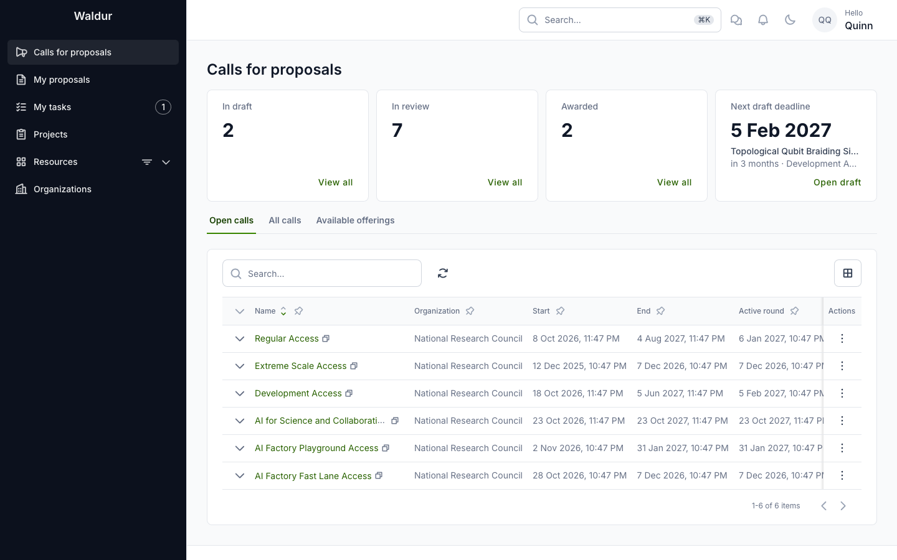

Use **Details** to read a call's full description and eligibility rules, or
**View all** (or **All calls** in the banner) to browse the complete catalogue.
When you have found the call you want, click **Apply to call**.

!!! tip
    The **Calls for proposals** catalogue is also reachable without signing in,
    from the public landing page — handy for sharing a call with colleagues.

A call marked *This call restricts who may apply* checks who you are before you
can apply; when you do not qualify, **Apply to call** is disabled with *You are
not eligible to apply to this call*.

### How many proposals you may have at once

A call-managing organization may limit how many proposals one applicant holds
with it at a time, across all of its calls. A proposal you created counts while
it is **Submitted** or **In review**, and once **Accepted** for as long as its
project runs. Drafts, rejected and cancelled proposals do not count, nor do
proposals on which you are only a team member.

At the limit you cannot start or submit another proposal to that
organization's calls: you see *You have reached the maximum of N active
projects or pending proposals*. You can apply again once one of them is
decided against, withdrawn, or its project has ended. A draft you have already
started stays a draft; submit it when a place frees up.

## Starting a proposal

**Apply** opens the **Create proposal** dialog. It confirms the call name, the
round you are applying to and the round deadline. Give your proposal a **Name**
and click **Create**.

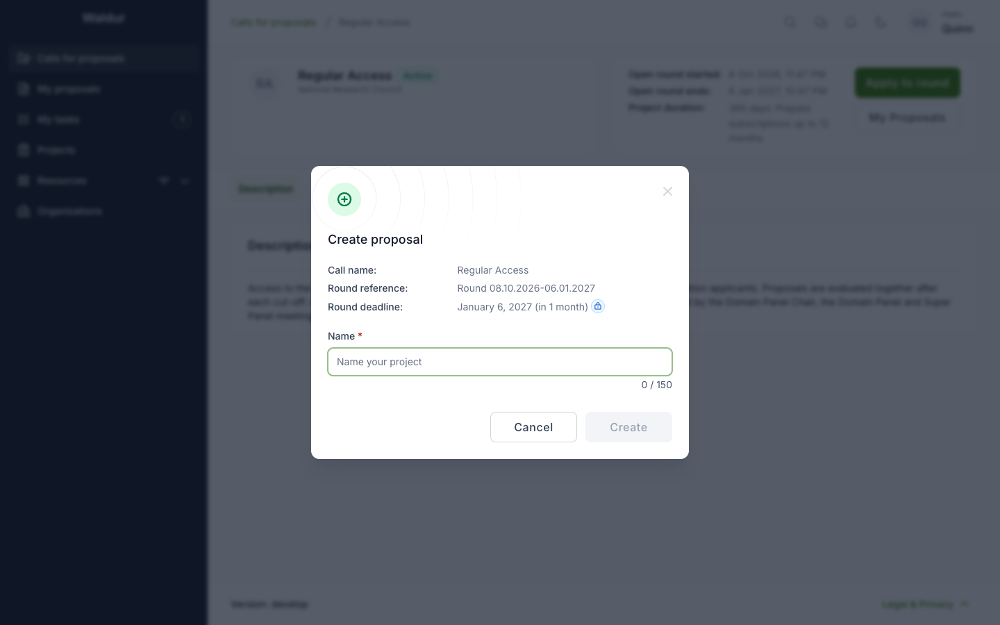

The proposal opens in the **Applicant** editor. The **Progress** panel on the
right tracks each section's completion and holds the **Submit** and **Save as
draft** actions; the main area presents the sections as expandable cards. A
proposal stays in **Draft** — and is never seen by the call team — until you
submit it, so you can save and return as often as you like.

The editor opens on **Details overview**, a read-only summary of the call, round
and deadline you are applying under. The editable sections follow.

### Project details

Expand **Project details** and describe your project:

| Field | Notes |
|---|---|
| **Name** | Required |
| **Summary** | Required |
| **Description** | Optional, longer free text |
| **Science domain** | Optional; pick a domain, then a sub-domain from the taxonomy your deployment maintains |
| **Project duration** | Read-only. The longest subscription you request under **Resource requests**, or the duration the call fixes; see below |
| **Upload supporting documentation** | Optional attachments |

Required fields are marked with a red asterisk, and the card header shows how
many fields are filled. **Project details** is expanded when the page opens, so
this is the first section you see.

Which of these fields you see, and which you must fill in, is set per call.
**Name** is always required; each of the others may be required, optional, or
not asked for at all. A call that does not
ask for a field simply does not show it, so your form may be shorter than the
table above. See
[Project details fields](call_management.md#1a-project-details-fields) for the
call manager's side of it.

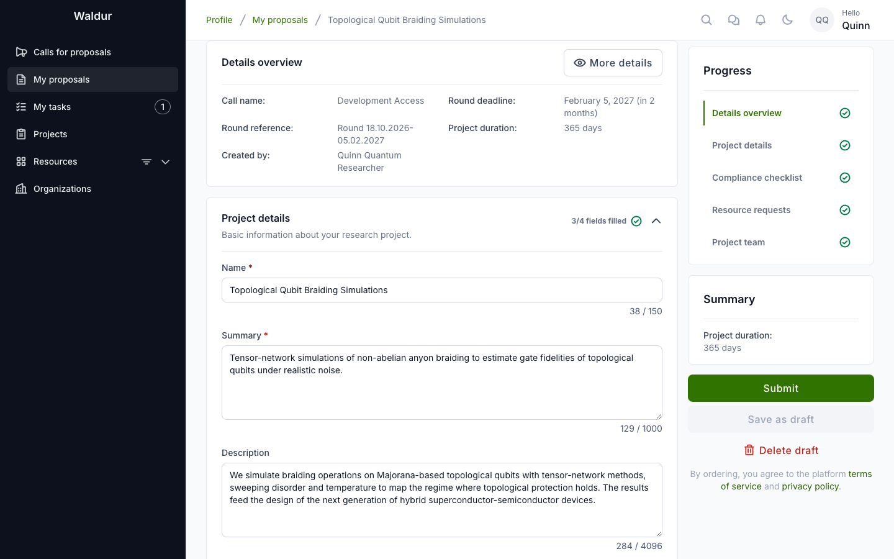

!!! note "Project duration"
    You are not asked how long the project should run. When the call sets a
    fixed duration, the project lasts exactly that long, and any subscription
    length you choose must fit inside it. Otherwise, when a resource you
    request is sold by the month, you choose the subscription length on that
    request, and the project lasts as long as the longest subscription. When
    the call sets no fixed duration and nothing you request is sold by the
    month, the project has no end date. The **Project details** card and the
    **Summary** panel state the length this comes to.

### Resource requests

Expand **Resource requests** to choose what you need. On a **template-based**
call you request resources only through the call manager's resource
templates; each fixes its offering, plan, amounts and attributes. Depending on
the call:

- **Several templates** — tick the ones your project requires (here, the
  *GPU Compute Package*) and click **Save**.
- **One template** — choose one with its radio button and click **Save**.
  Choosing another replaces it. The proposal cannot be submitted without one.

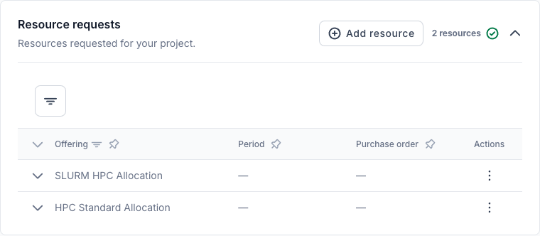

A proposal started from an offering page already requests that offering's
template, unless several templates use it; then choose one here.

!!! note "Requests that are not from a template"
    A request whose template was deleted, or that was not made from one, is
    flagged above the templates. Choose a template and click **Save** to
    replace it; until then the proposal cannot be submitted.

### Compliance checklist

When the call has a **compliance checklist**, a **Compliance checklist** step
appears between project details and resource requests. Answer every required
question; the card header tracks your progress as *n/N answered*, and its
subtitle warns that *additional questions may appear based on your answers* — so
the total can grow as you answer.

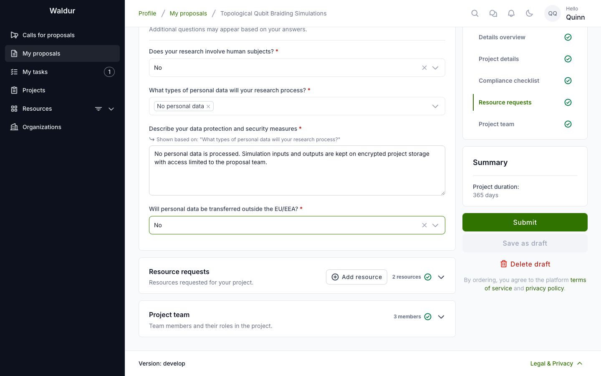

Checklists support many question types — single- and multi-select, numbers,
dates, file uploads, confirmations and more (see
[Checklists and forms](checklists-and-forms.md)). Some questions are
**conditional**: answering one may reveal a follow-up, flagged with a
*Shown based on: …* hint naming the answer that triggered it.

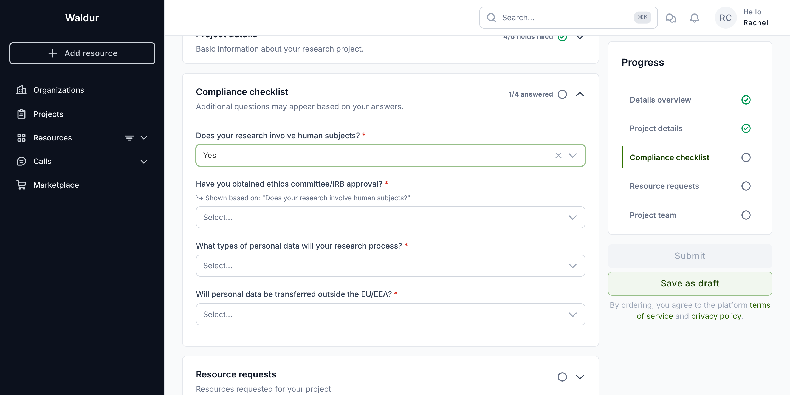

### Project team

Expand **Project team** to add colleagues who should have access to the resulting
project and set their roles. You are added automatically as the creator.

## Reviewing and submitting

Before submitting, review each section. The **Submit** button stays disabled
until every required step is complete — the **Progress** panel shows a green tick
against finished sections and an empty circle against those still needing input.

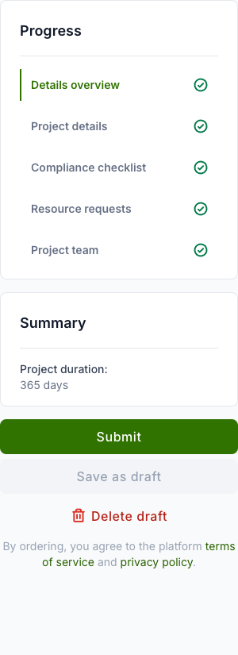

When everything is complete, click **Submit**. A note beneath the button records
that submitting means agreeing to the platform's terms of service and privacy
policy. The proposal moves out of **Draft** and into the evaluation workflow, and
the call team can now see it.

!!! warning
    Submit before the round **deadline**. Once the round closes you can no longer
    submit, and a proposal left in **Draft** is not evaluated by that round. On
    most calls it is not lost either: it moves into the call's next round and
    stays editable, and you are emailed the new deadline. A draft left at the
    last round's cut-off, or on a call that has carry-over turned off, is
    cancelled — see [Drafts at the cut-off](call_management.md#drafts-at-the-cut-off).

!!! note "Waiting for the round cut-off"
    Some calls evaluate all proposals of a round together. On such a call your
    proposal stays **Submitted** after you submit it, and nothing happens to it
    until the round's cutoff date has passed. Evaluation then starts for every
    proposal of the round at once, and yours moves to **In review**, usually
    within an hour of the cut-off. Until then the proposal's stepper shows
    *Submitted — evaluation starts after the round cut-off.* under
    **Submission**, with no later step highlighted. Waiting as **Submitted** is
    expected, not a sign that something is wrong.

## Your proposals

Open **Calls → My proposals** to see everything you have created, across all
calls, with its call, round deadline and current **state**. Use the state filter
to focus on drafts, submitted, in-review or accepted proposals.

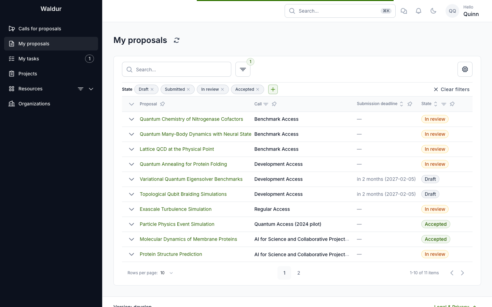

Proposal states an applicant sees:

| State | Meaning |
|---|---|
| **Draft** | Not yet submitted — only you can see it |
| **Submitted** | Submitted and awaiting evaluation — on calls that evaluate at the round cut-off, until the cut-off has passed |
| **In review** | Moving through the evaluation workflow — on calls that announce results together for the whole round, until the round's results are published |
| **Accepted** | Approved — a project and resources have been (or are being) provisioned |
| **Rejected** | Not funded |
| **Canceled** | Withdrawn, or an award you declined |

### Withdrawing a proposal

To take a submitted proposal out of evaluation, a proposal manager of its team
uses **Withdraw proposal** on it and may give a reason. This works while the
proposal is **Submitted** or **In review**; it moves to **Canceled**, and the
call managers are told. Once an award awaits your answer, decline the award
instead. A proposal still in **Draft** is not withdrawn but deleted, with
**Delete draft**.

## Tracking progress

Open a submitted proposal to follow it through the call's **evaluation
workflow**. The **stepper** at the top shows every step, with completed steps
ticked, the current step highlighted, and later steps greyed out. Here the
proposal has cleared *Administrative check* and *Technical assessment* and is in
*Expert review*.

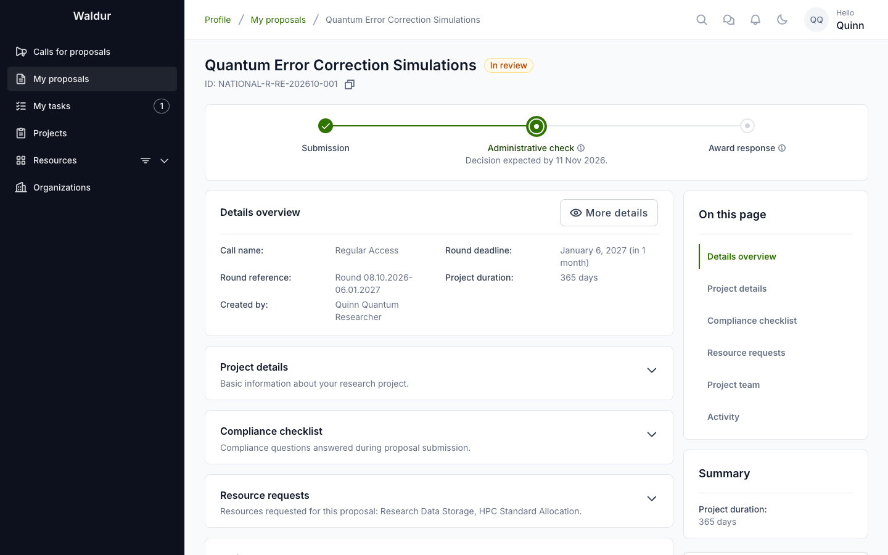

The sections below the stepper are read-only once submitted, so you always see
exactly what you sent. Editing a submitted proposal is refused, not just
hidden: your requested resources, documents and checklist answers are fixed at
the moment you submit, and only the call team can change them afterwards —
unless they ask you to (see [When changes are requested](#when-changes-are-requested)).
A draft you leave open when the round closes is not affected — it moves into
the call's next round and stays editable, because it was never submitted (see
[Drafts at the cut-off](call_management.md#drafts-at-the-cut-off)).

### When changes are requested

On some calls an evaluation step can send your proposal back to you for
changes instead of rejecting it. You are notified, and the proposal shows
*Changes requested at <step>* with the message, the parts you may edit and,
when set, the date to submit the changes by. The proposal stays **In review**.

Only the parts listed become editable — for example the summary, supporting
documentation or resource requests. Make the changes and click **Submit
changes** in the **Progress** panel; the step then continues with what you
changed. If the due date passes first, the request lapses and the step
continues with the proposal as it stands.

Which steps appear, and how much of each you can see,
depends on the call's configuration at the moment you submitted (see
[The evaluation workflow](call-manager-workflow.md#the-evaluation-workflow)).
Steps that were not part of your proposal's sequence are omitted from the
stepper, so two proposals in the same call can show different steps if the call
was reconfigured between their submissions.

### When you hear the decision

Some calls announce every allocation decision of a round together. On such a
call your proposal stays **In review** until the call manager publishes the
round's results, even if the decision has already been taken. The tracker shows
the decision as the current step — named *Decision* when the call keeps the step
internal — with *Your proposal is being reviewed.* beneath it. Then every
applicant of the round is notified at the same time, and the proposal moves on: to **Responding to an award**, to
**Accepted**, or to **Rejected**.

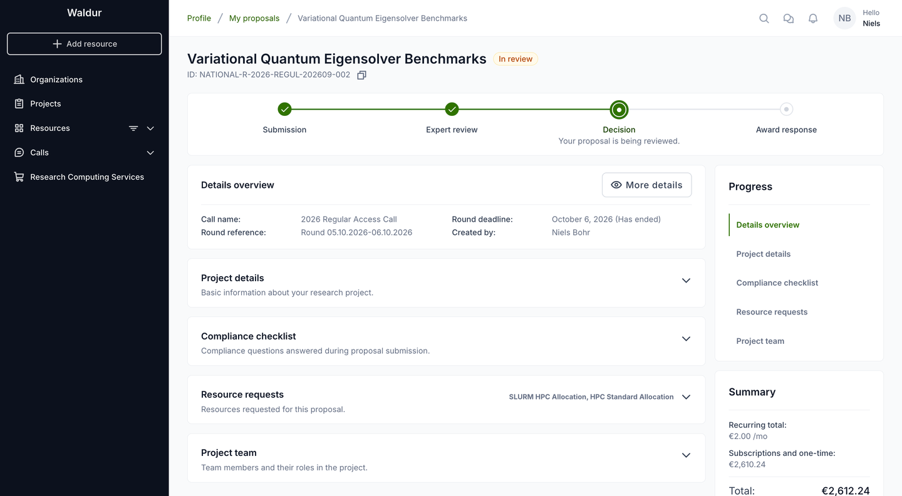

## Technical-assessment feedback

Some steps can be made **visible to applicants** by the call manager. When the
**Technical assessment** step is shared, its **contributions** section shows the
assessment of each service provider. On a call that assesses each requested
partition separately, there is one card per partition, filled in by the team of
the provider that runs it, with its outcome —
**Accepted**, **Conditionally accepted** with the conditions, or **Rejected** —
and the provider's comment. A partition that rejected your proposal does not
necessarily end it: some calls carry on to the decision with the other
partitions.

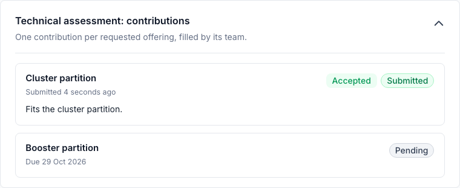

!!! note
    You only see this section when the call manager has marked the step
    **applicant-visible**. On calls that keep technical assessments internal, the
    section does not appear — this is expected, not an error. Whether you see who
    wrote an assessment depends on the call, and per-partition outcomes stay
    hidden while the call holds decisions for the round's publication.

## Responding to the reviews

Some calls ask you to respond to the reviewers before the decision. The
proposal then shows a step named by the call — *Response to reviews*, say —
with **Respond by *date*.** and, above your response form, what you are
responding to: the reviews and the evaluators' questions the call lists for
the step. Reviews appear without the reviewers' names or their private
comments.

Fill in the response form, click **Save answers**, then **Submit response**.
You are asked to confirm, as a response cannot be changed afterwards. Any of the proposal's managers
can submit the response; the whole team reads it once it is submitted.

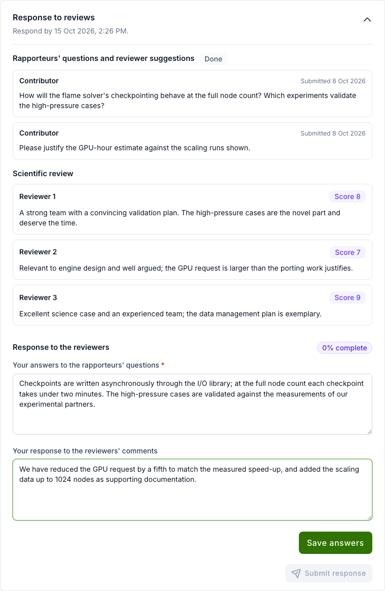

!!! warning
    The response step has a deadline. If it passes without a response, the step
    ends as *No response* and the proposal moves on to the decision without it.

## Feedback to the applicant

Calls can release a report to you, such as the panel's consolidated report.
Released reports appear in the **Feedback to the applicant** section of the
proposal, with the date they were released. What you read may be an edited
version prepared for applicants. A call that announces its decisions together
for the whole round releases nothing to you before the round's results are
published.

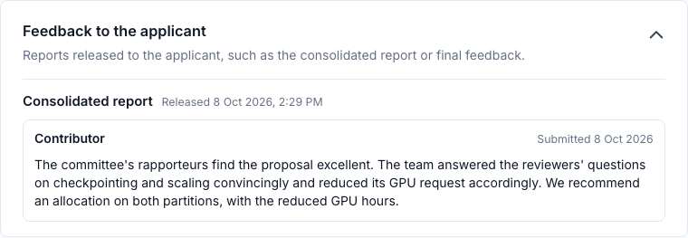

## Responding to an award

If the call includes an **award response** step, an approved proposal pauses for
your decision before resources are provisioned. The stepper shows an *Award
response* step, and the **Progress** panel offers **Accept award** and **Decline
award**.

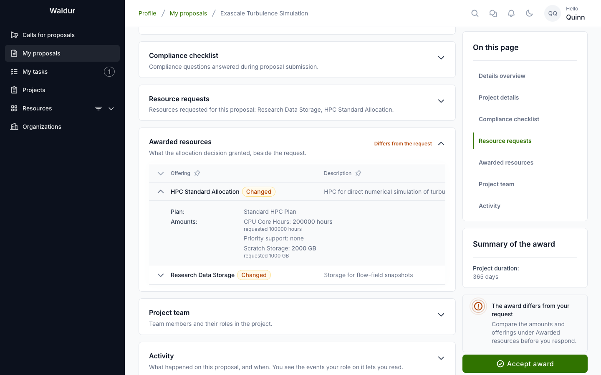

The award may differ from what you requested: the call manager can change
amounts, move an item to another offering of the call, or add and remove items.
The **Awarded resources** section on the proposal shows what was granted, each
item marked **As requested** or **Changed**, and the **Summary of the award**
totals its estimated cost. You see this section once the decision is released
to you; it is read-only.

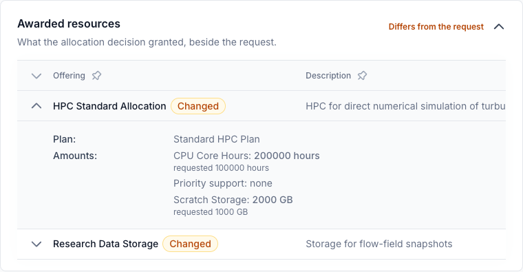

**Accept award** asks you to confirm; once you do, the awarded resources are
provisioned, a project is created under the call-managing organisation and your team is
granted access.

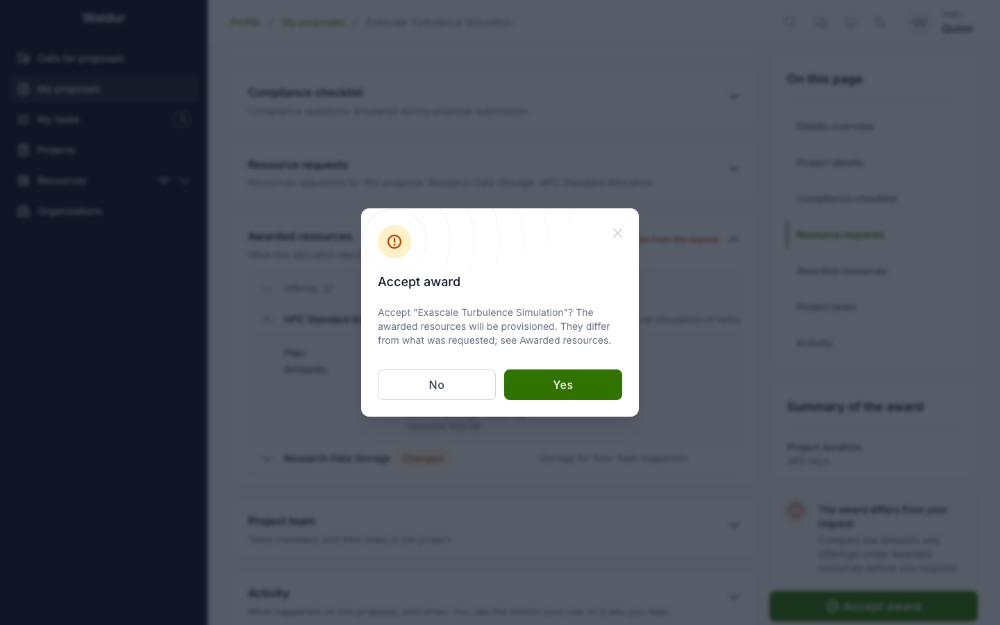

**Decline award** asks for a **Reason for declining** — it is required — and
moves the proposal to **Canceled**. Use it when you can no longer take up the
allocation.

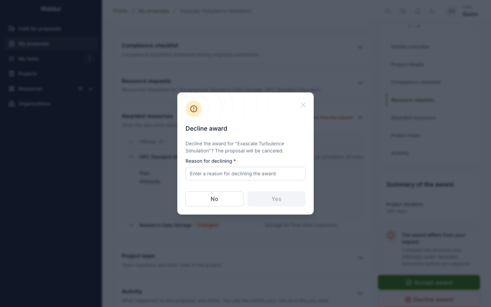

!!! tip
    Not every call uses an award response step. When it is absent, an approved
    proposal is provisioned automatically at the **Allocation decision** step
    without asking you to confirm.

## Related guides

- [Call management](call_management.md) — the call lifecycle and rounds
- [Checklists and forms](checklists-and-forms.md) — question types and conditional visibility
- [Call manager workflow](call-manager-workflow.md) — how call managers drive proposals through the workflow
- [Reviewer workflow](reviewer-workflow.md) — the reviewer's perspective
