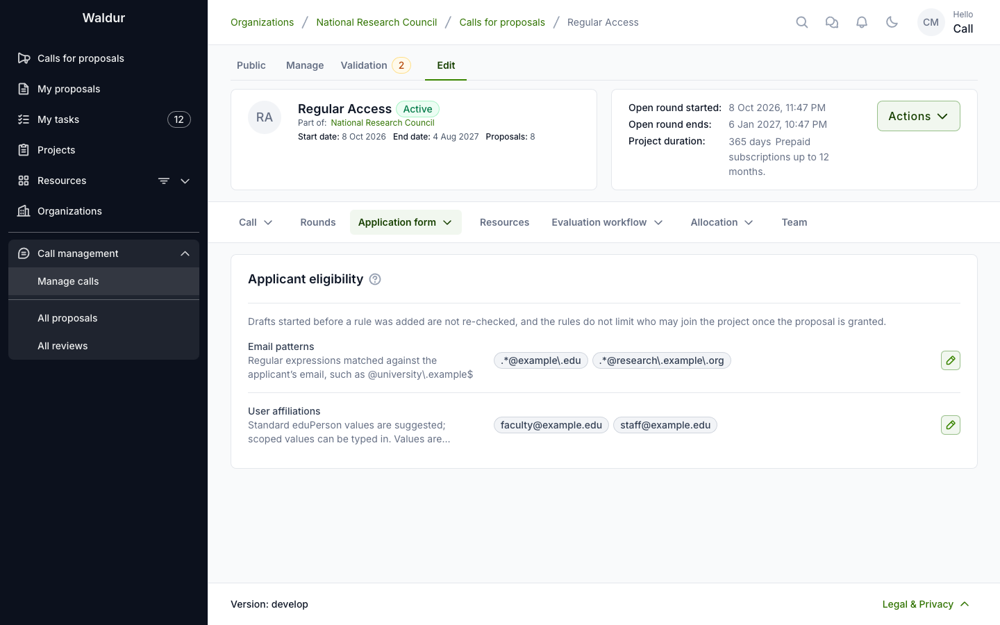
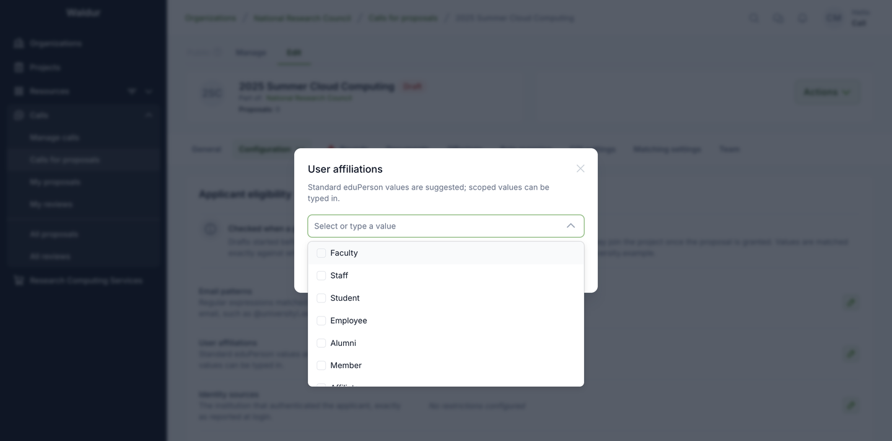

# Application form

**Performed by:** Call manager

The call's **Application form** tab holds what the call asks of applicants:

- **Project details fields** — what this call asks applicants for (see [below](#project-details-fields))
- **Applicant eligibility** — who may submit a proposal at all (see [below](#applicant-eligibility))
- **Applicant data visibility** — which applicant data is exposed during evaluation
- **Resource templates** — what applicants can request, and how many templates (see [below](#resource-templates))

A call can also ask applicants to answer a **compliance checklist**, chosen under **Call →
General configuration → Compliance** (see
[Checklists and forms](checklists-and-forms.md#attaching-checklists-to-calls)). What the
applicant sees of all this is described in the [Applicant guide](applicant-guide.md#starting-a-proposal).

## Project details fields

Under **Application form → Project details fields**, choose what the Project details
step asks the applicant for. Each field is one of:

| State | On the form | On submission |
|---|---|---|
| **Required** | shown, marked with a red asterisk | blocked while empty |
| **Optional** | shown | may be left empty |
| **Not asked** | not shown at all | — |

**Name** is always required and is not configurable: it identifies the
proposal and forms the last part of the awarded project's name — a granted
project is named `<call reference or slug> - <round start date> - <proposal name>`.
The project duration is not a field the applicant fills in either; it is derived
from the subscription lengths requested and the call's fixed duration, and shown
read-only (see [How long a granted project runs](allocation-decision.md#how-long-a-granted-project-runs)).
The configurable fields are **Summary**,
**Description**, **Science domain** and **Supporting documentation**.

Each row lists what the field feeds, so the cost of switching one off is visible
before you do. Fields marked with a warning have a functional consumer — the
summary and description are the text that **automatic reviewer matching** scores
against reviewer profiles, so a call that does not collect them gets less
accurate reviewer suggestions.

A field **cannot be made required once the call has proposals**. Drafts that were
complete under the published form would silently stop being submittable, and
nothing notifies the applicants who wrote them. Relaxing a field — making it
optional, or not asking for it at all — stays possible at any time. To run a
stricter round, duplicate the call: the copy starts in draft with no proposals,
and its field configuration is carried over ready to tighten.

New calls start from the deployment defaults, which an administrator sets under
**Proposal settings** in the Constance configuration
(`DEFAULT_PROPOSAL_REQUIRED_FIELDS`, `DEFAULT_PROPOSAL_HIDDEN_FIELDS`). Those
defaults are applied when the call is created; changing them later never alters
a call that already exists.

## Applicant eligibility

Under **Application form → Applicant eligibility**, restrict who may submit a
proposal to this call. Each row holds a list of values; a row left empty is not
checked, and a call with every row empty is open to anyone who can sign in.

| Restriction | Matched against | Values |
|---|---|---|
| **Email patterns** | the applicant's email address | regular expressions, for example `.*@(helsinki\.fi\|kth\.se)$` |
| **User affiliations** | the affiliations the identity provider asserts | standard eduPerson values are offered as suggestions; any other value can be typed in |
| **Identity sources** | the institution that authenticated the applicant, exactly as reported at login | free text — no suggestions, because the value comes from the applicant's home institution rather than from the providers this installation is configured with |
| **Nationalities** | the applicant's nationality or nationalities | picked from the country list, stored as ISO country codes |
| **Organization types** | the applicant's organization type | standard SCHAC values are offered as suggestions |
| **Assurance levels** | the assurance levels the identity provider asserts | standard REFEDS values are offered as suggestions |

Values are lists rather than one comma-separated box on purpose: a regular
expression may itself contain a comma, and splitting on it would turn one
working pattern into two that match nobody.

### How the rows combine

This is the part worth reading twice, because the intuitive reading is the wrong
one. The rows are **not** six independent requirements:

- **Email patterns, user affiliations and identity sources form one group.** An
  applicant who matches *any one* value in *any one* of those three rows passes
  the group. Listing both an affiliation and an email pattern therefore *widens*
  the call — it admits anyone matching either — rather than narrowing it to
  applicants who match both.
- **Nationalities, organization types and assurance levels are each an extra
  requirement on top of that group.** A configured row here must also be
  satisfied, so these do narrow the call.
- **Assurance levels are stricter still**: the applicant must hold *every* level
  listed, not just one of them.

The call in the screenshot above therefore admits an applicant who is either
`faculty` or `staff`, **or** has a `helsinki.fi` or `kth.se` address — and who,
in addition, holds a Finnish, Swedish or Norwegian nationality, comes from an
organization of type *University*, and carries the *IAP Medium* assurance level.

!!! warning
    Combinations that match nobody are accepted without complaint. Restricting a
    call to an assurance level the identity providers in use never assert, or to
    an organization type nobody's home organization reports, produces a call
    that every applicant is turned away from. If applicants report being refused,
    check these rows first.

### Entering values

Click the pencil on a row to edit it. Rows that have a standard vocabulary offer
it as a list of suggestions — but the list is not closed, and typing a value
that is not in it is deliberately allowed:

That matters most for affiliations. Identity providers routinely send *scoped*
values — `faculty@university.example` rather than plain `faculty` — and the
value is matched exactly, character for character, against what the provider
sends. If applicants who should qualify are refused, compare the stored value
with what actually arrives at login rather than assuming the plain form.

!!! note
    Only attributes this installation collects get a row. A deployment that does
    not collect nationality, for instance, does not show the **Nationalities**
    row at all — an administrator controls this with
    `ENABLED_USER_PROFILE_ATTRIBUTES` in the Constance configuration. A row that
    already holds values stays visible even if its attribute is later switched
    off, carrying a warning: the restriction keeps being enforced, so leaving it
    in place behind a hidden row would turn every applicant away.

### When eligibility is checked

Eligibility is checked when a proposal is **created**. Two consequences follow:

- A draft started before a restriction was added is not re-checked when it is
  submitted. Tightening a call that already has drafts does not retract them.
- Eligibility does not limit who may join the project once the proposal is
  granted. It gates who may apply, nothing further.

Applicants are not shown the restrictions themselves. A call that has any of
them carries a warning in the call catalogue — *This call restricts who may
apply. Check the terms before submitting* — and an applicant who does not
qualify is refused when the proposal is created, with a message naming the
restriction that failed. Spell the rules out in the call description or the
external URL, so nobody writes a proposal they cannot submit.

The same warning appears when the call-managing organization
[limits proposals per applicant](organization-setup.md#limiting-proposals-per-applicant); that limit
is checked on creation and again on submission.

## Resource templates

Under **Application form → Resource templates**, define what applicants can
request. A template names one of the call's offerings with a plan, its amounts
(usage limits) and any preset attributes. Its attributes and subscription
length are checked against the offering when you save it.

Once a call has a template, templates are the only way to request resources
in it. Applicants cannot request an offering directly or change a template's
amounts or attributes, and can request each template at most once. A proposal
with a request that is not from a template, for example because its template
was deleted, cannot be submitted until that request is replaced.

The **Template selection** card above the templates sets how many an applicant
may choose:

| Applicants can request | On the applicant's form | Rule |
|---|---|---|
| **Several templates** (default) | a checkbox per template | any combination |
| **One template** | a radio button per template | exactly one, required to submit |

Use **One template** when the templates are alternatives, such as access
tiers. It cannot be set while a draft proposal holds several requests.

Editing a template updates the requests made from it on **draft** proposals;
submitted proposals keep their amounts.
