# Call manager workflow

This guide follows the **call manager** end to end: from setting up a call and
its evaluation workflow, through building a reviewer pool and managing conflicts
of interest, to driving individual proposals through each workflow step and
recording the final allocation decision.

It focuses on the multi-step **evaluation workflow** — the sequence of call
steps that every proposal travels through, which the call manager configures
per call. For the higher-level call lifecycle (organisation setup, rounds,
offerings, role mapping) see [Call management](call_management.md).

!!! note
    Most screenshots in this guide use the *2025 Spring HPC Allocation Call*
    demo call; those of evaluator roles, contributions, reviewer suggestions,
    released reports and the round's ranking use a call created from the
    [Extreme Scale template](extreme-scale-template.md). Your calls will show
    different names, offerings and reviewers, and which steps you see depends on
    how the call is configured.

## The evaluation workflow

Each call defines an ordered list of **call steps**. A step is one of four
kinds — **applicant action**, **assignment**, **assessment** or **decision** —
and a call can use a kind as often as its process needs. Every step has a
name, a **responsible role** that completes it, an optional **deadline** and a
**transition mode**, and can carry an evaluation **checklist**, scoring
**criteria**, **contributors** and **input steps**. Exactly one decision step
is the **allocation decision**. See
[Workflow configuration](workflow-configuration.md) for every setting.

A lightweight call might use only an administrative check and an allocation
decision. A competitive programme can add a technical assessment per partition,
rapporteurs, peer review, a response to the reviews, reports and a committee
meeting; the [Extreme Scale template](extreme-scale-template.md) sets up exactly
that, and a call can be created from it as a starting point.

## Landing in call management

After signing in, open your call-managing organisation and switch to the
**Call management** tab. Its **Dashboard** counts open calls, accepted proposals,
pending proposals and pending reviews — each with a **View all** shortcut into
the matching list — above a second row tracking active rounds, rounds and calls
closing soon, and pending offering requests.

The **Calls** section lists every call your organisation manages, grouped by
state (All / Active / Draft / Archived). Click a call name to open its
configuration.

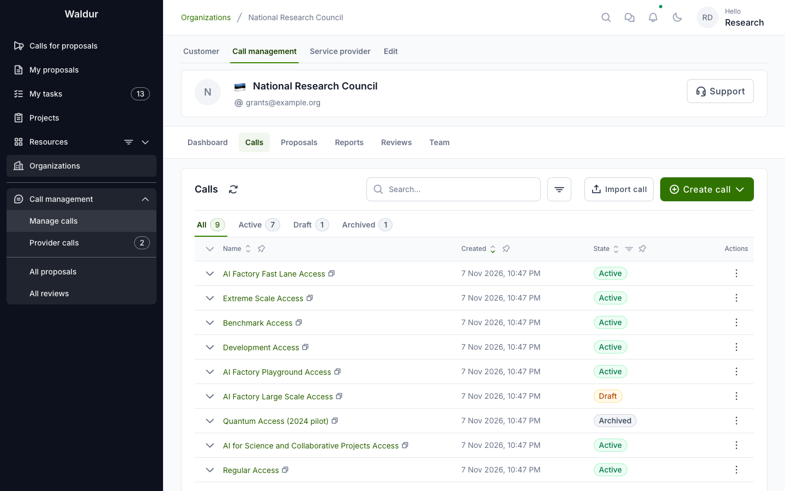

## Setting up a call

### General settings

The **General** tab holds the call's identity: name, description, reference code,
an optional external URL, and the proposal slug template used to generate
human-readable proposal IDs. See
[Proposal ID configuration](proposal-id-configuration.md) for slug placeholders.

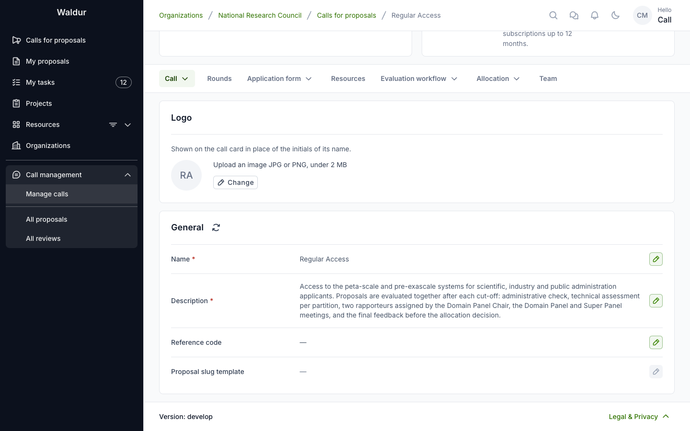

### Configuration and workflow steps

The **Configuration** tab is where the evaluation workflow lives. Below the
general options, the project details fields, applicant data visibility,
applicant eligibility and resource templates, the **Steps & settings** table
lists every workflow step in order with its kind, duration, responsible role
and transition mode, with a tab per phase when the call has steps after the
award. The **Preview sequence** below
the table visualises the proposal journey exactly as configured. The
**Evaluator roles** sub-tab next to it defines the roles that people hold on a
proposal, such as rapporteurs (see [Evaluator roles](#evaluator-roles)).

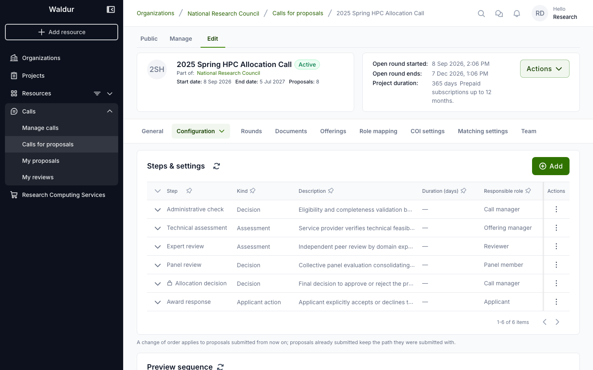

!!! warning
    Workflow steps stay editable while the call is in **Draft** or **Active**;
    the step table only becomes read-only once the call is **Archived**.

    Adding, removing, reordering, enabling or disabling a step, moving the
    allocation decision or changing a step's input steps does **not**
    retroactively change proposals already in flight: each proposal's path is
    fixed when it is submitted, so
    reconfiguring an active call means new submissions follow the new sequence
    while existing proposals continue on the one they were submitted under. Make
    structural changes before activation wherever you can.

    Per-step **durations** are the exception — a step reads its duration when it
    becomes active, so adjusting one still affects steps a proposal has not
    reached yet.

## Configuring a workflow step

**Add** above the table adds a step: pick its **Kind**, name it and fill in the
settings that kind offers. Each row's actions menu offers **Configure**, **Move
up**, **Move down**, **Enable**/**Disable** and **Remove**; choose **Configure**
to open a step's settings. The dialog adapts to the step's kind.

For a **decision** such as the administrative check, it shows the name and
description, the outcomes, what a negative outcome does, the estimated
duration, responsible role, transition mode and an optional checklist.

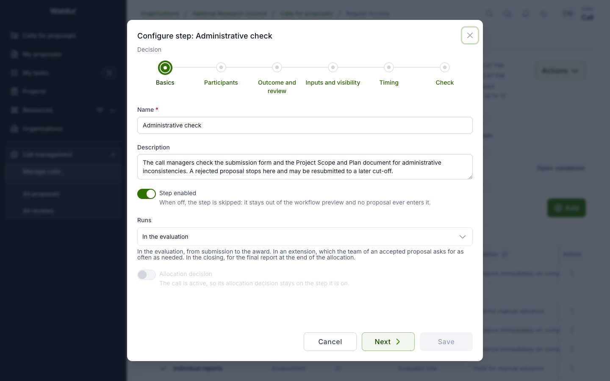

For an **assessment** such as expert review, it adds the contributors, the
number of contributions needed, the minimum score threshold, scoring criteria,
blind review, conflict-of-interest confirmation, input steps, and whether the
step's report is released to the applicant or collects reviewer suggestions.

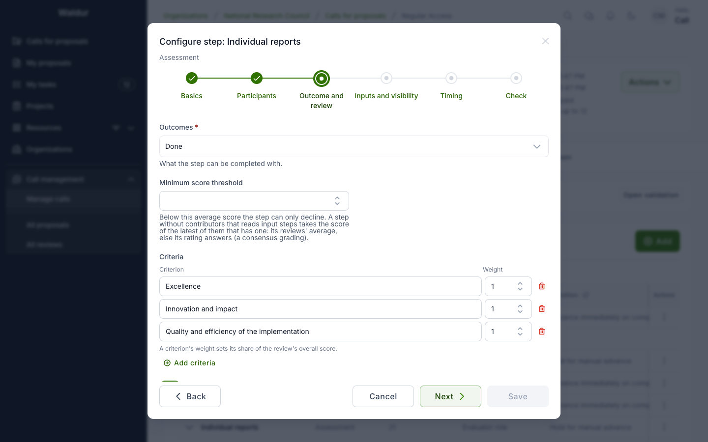

The remaining criteria appear lower in the same dialog:

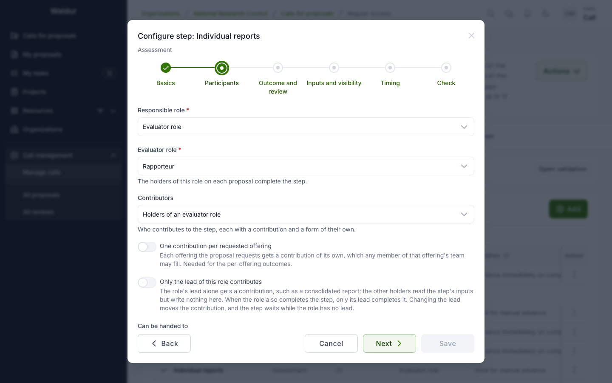

Key settings:

- **Estimated duration (days)** — days allowed for the step, used to compute its
  deadline. Leave it empty for a step that should wait indefinitely.
- **Responsible role** — who owns the step and can complete it (call manager,
  offering manager, reviewer, panel member, the panel chair or vice-chair, the
  applicant, or the holders of an evaluator role such as the rapporteurs).
- **Outcomes** and **On a negative outcome** — the outcomes the step can be
  completed with, and whether a negative one rejects the proposal, cancels it or
  lets it continue to the next step.
- **Contributors**, **Minimum contributions** and **Maximum contributions** —
  who contributes to an assessment and how many contributions it needs (see
  [Contributions](#contributions-and-the-technical-assessment-per-partition)).
- **Input steps** — earlier steps whose work this step reads (see
  [Input steps and the response to reviews](#input-steps-and-the-response-to-reviews)).
- **Transition mode options** — *Advance immediately on completion* moves the
  proposal to the next step automatically; *Hold for manual advance* pauses so
  you can review before advancing.
- **Checklist** — attach an evaluation form (see below). The **Checklist
  required** toggle decides whether it blocks completion.
- **Minimum contributions / Minimum reviewers / Minimum score threshold** —
  completion gates; the step cannot complete until enough contributions or
  reviews are in and the average score clears the threshold.
- **Criteria** — named scoring criteria, available on assessment steps.
- **Blind review** — evaluators cannot see each other's assessments.
- **Conflict of interest confirmation** — reviewers must confirm they have no
  conflict with the proposal before they can **submit** their review; it does not
  block them from opening or drafting it (see
  [Conflict of interest](#conflict-of-interest)).
- **Applicant visible** — applicants see this step by name on their progress tracker.
  Off by default; while an invisible step runs, it shows to them only under the name
  of its stage — *Decision* for the allocation decision, *Awaiting your response*
  for the award response, *Evaluation* for any other step.

### Required vs advisory checklists

A step checklist turns the step into a structured evaluation form. The
**Checklist required** toggle controls how strictly it is enforced:

- **Required** — the step cannot be completed until every required question is
  answered. This is the checklist **gate** (see
  [Completing or rejecting a step](#completing-or-rejecting-a-step)).
- **Advisory** (toggle off) — the checklist is available to record structured
  input but never blocks completion.

Checklists are built from the same flexible question types described in
[Checklists and forms](checklists-and-forms.md). A technical-assessment
checklist, for example, pairs a single-select decision question with a free-text
rationale — in the demo call, *Technical feasibility decision* (**Feasible –
sufficient resources** / **Feasible with conditions** / **Not feasible**) and
*Assessment rationale*.

## Evaluator roles

An evaluator role is a role a person holds on one proposal — a rapporteur, say,
who follows the proposal through evaluation. Define the call's roles under
**Evaluation workflow → Evaluator roles** with **Add**: a **Name**, **Who may hold
it** (panel members, reviewers or call managers of the call, members or the
chair of the proposal's panel, the proposal's reviewers, or any user), how
many holders a proposal needs and allows, and whether one holder **Has a lead**.

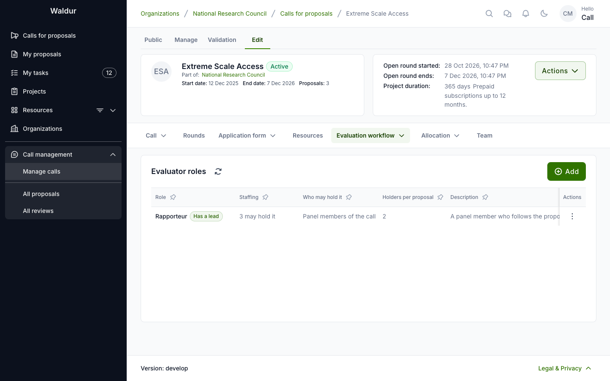

Then use the roles in the steps:

- an **assignment** step lists the roles it fills under **Assigns roles** — one
  step can fill several, for example a lead and a second rapporteur;
- a step whose **Responsible role** is an evaluator role is completed by its
  holders;
- an assessment whose **Contributors** are an evaluator role takes one
  contribution from each holder.

A person holds **at most one evaluator role per proposal**, and holders are
never part of the applicant team: the applicant never learns who they are. A
conflict of interest recorded between a holder and the proposal removes their
access until it is dismissed or waived. See
[Evaluator roles](workflow-configuration.md#evaluator-roles) for the full rules.

## Building the reviewer pool

Open the call's **Manage** tab and go to **Reviewer pool** to invite and track
reviewers. The **Pool** table lists each reviewer with their acceptance status,
review counts, invitation date and assignment load; an **Expertise match** column
is available from the column settings, and expanding a row reveals the reviewer's
expertise in full. The sub-tabs are **Pool**, **Discovery**, **Assignment
batches**, **Reviewer capacity** and **COI**.

Building the pool, running matching suggestions and creating assignment batches
are covered in depth in [Reviewer management](reviewer-management.md) and the
[Reviewer guide](reviewer-guide.md).

## Conflict of interest

### COI settings

Configure automated conflict detection per call from the **COI settings** tab
in the call configuration. You control co-authorship and institutional
lookback windows, matching thresholds, and which relationships are flagged.

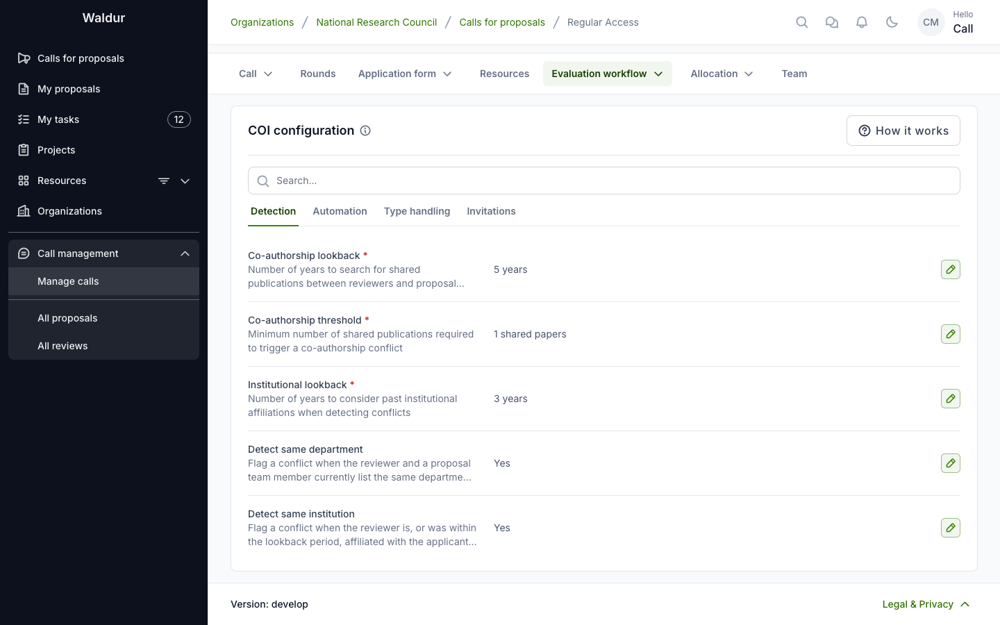

When a review step has **Conflict of interest confirmation** enabled, reviewers
must additionally attest to being conflict-free before they can submit their
review — the **Submit review** button stays disabled until they do.

### Reviewing detected conflicts

The **COI** sub-tab of the reviewer pool lists conflicts detected between
reviewers and proposal teams. From here you dismiss false positives, waive with
a management plan, or recuse a reviewer.

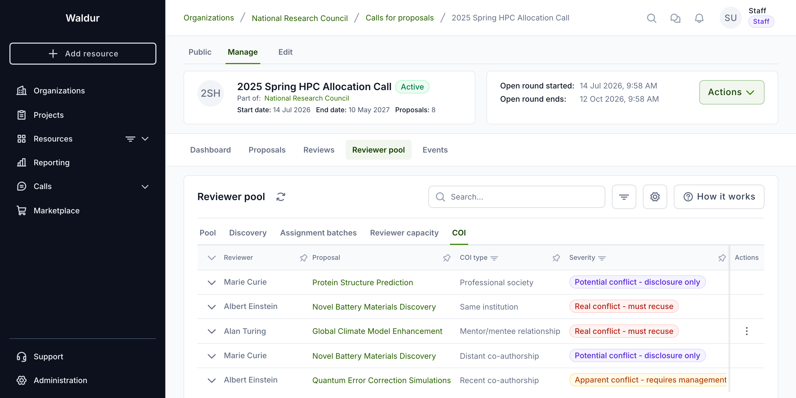

Conflict types, severities and handling rules are detailed in
[COI management](coi-management.md).

## Driving proposals through the workflow

### The proposals list

The **Proposals** tab (under either call management or the call's Manage view)
lists every proposal for the call with its applicant, current **Step** and the
step's responsible role, creation date, state and compliance status. Click a
proposal to open it. A decision held for the round's publication shows its
tentative outcome in place of the state (see [Held decisions](#held-decisions)).

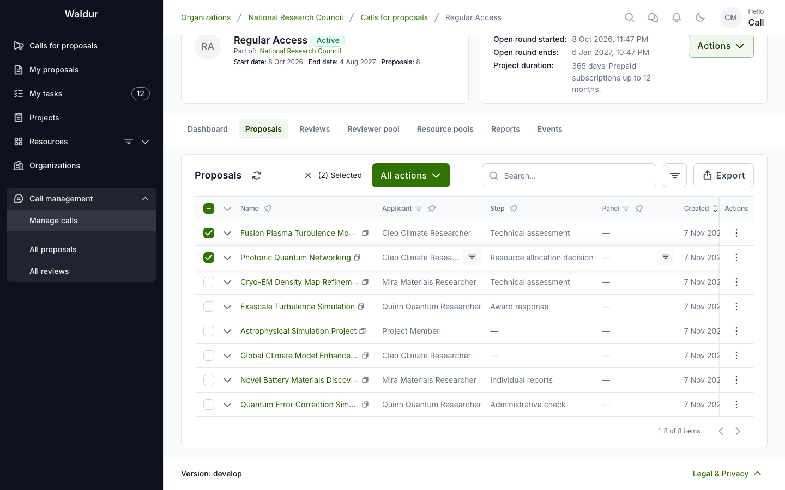

### Opening a proposal

A proposal opens on the **Call manager** view. The **workflow stepper** at the
top shows each step with its status and outcome; the **Progress** sidebar on the
right offers the section tabs and the step action buttons — **Create review**,
**Complete step** and **Reject at step**.

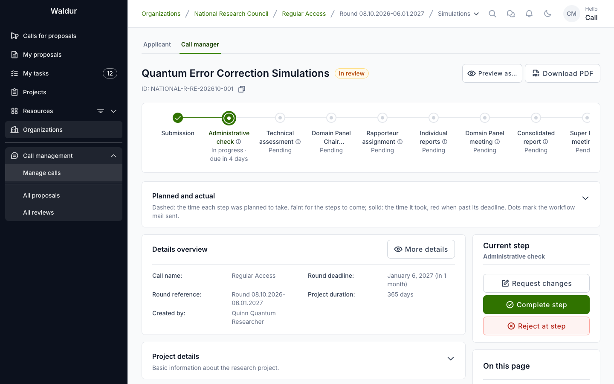

The stepper makes the proposal's position obvious at a glance: completed steps
carry their outcome (for example *Eligible*, *Accepted*, *Approved*), the active
step is marked *In progress*, and downstream steps are *Pending*.

### Answering a step checklist

When the active step has a checklist and you are its responsible role, the
checklist appears as a section on the proposal. Answer the questions and click
**Submit answers**. Once every required question is answered, the section shows
an **OK** completion badge.

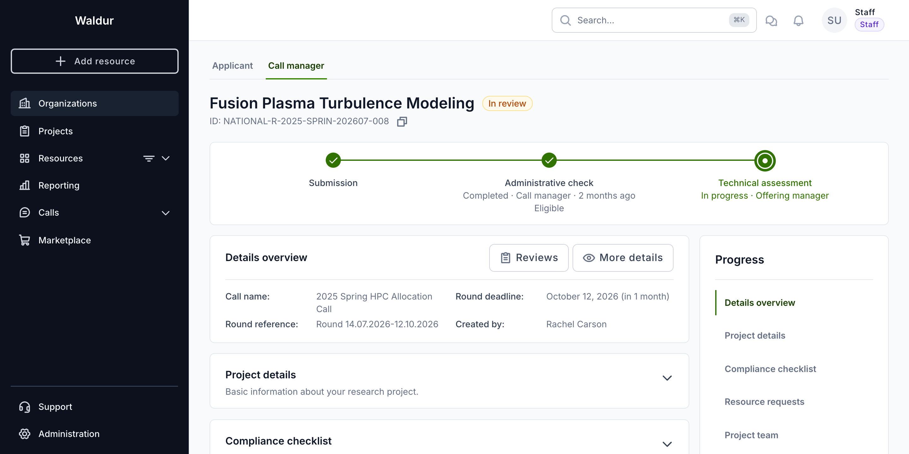

### Assigning evaluators

On a call with evaluator roles, the proposal's **Evaluators** section shows one
part per role, with how many of the required holders are assigned. **Assign
*role*** searches the people eligible for the role by name, e-mail or username.
Members of the applicant team are never offered; people who already hold a role
on the proposal or have a recorded conflict of interest with it are shown but
cannot be assigned.
Each holder's row offers **Mark as lead** and **Revoke**.

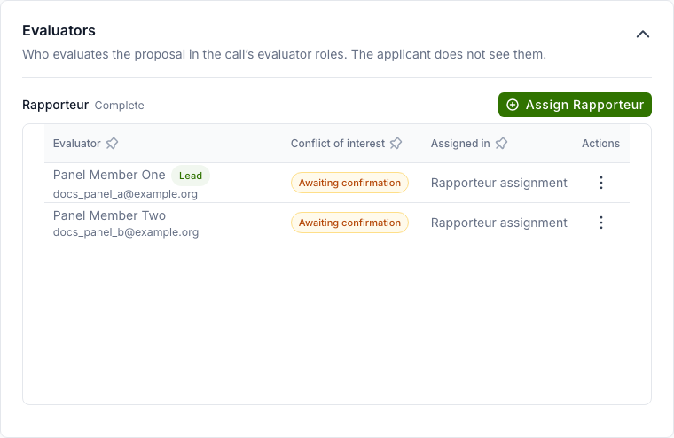

The completer of an assignment step assigns holders while the step runs, and
the step can be completed once every role it assigns has its required holders
and its lead. Call managers can assign and revoke holders and move the lead at
any time. Assigned holders are told by e-mail; when the step asks for
conflict-of-interest confirmation, a holder reaches the proposal only after
confirming from the **Evaluator roles** tab of their reviews page.

### Contributions and the technical assessment per partition

On an assessment step with contributors, the **contributions** section of the
proposal lists one card per contribution with its status, outcome, conditions
and comment. Contributors fill in the step's form and **Submit contribution**
from their own card (a contribution without a form is its outcome and comment); call managers and the step's completer read them all.

When the step takes **one contribution per requested offering**, each partition
the proposal requests gets its own card, which only that offering's team can
fill in. A partition is an offering of the service provider that runs it, such
as an HPC centre, so its assessment comes from that provider's offering
managers, not from the call-managing organisation: the call requests the
partitions and runs the evaluation, and each centre assesses its own partition.
A centre's team sees its own partition's card, not the other centres'
assessments; the call managers read them all. Each team answers **Accepted**, **Conditionally accepted** (stating the
conditions) or **Rejected**, and the last answer completes the step: *Infeasible*
if any partition rejected, *Feasible* otherwise. With **On a negative outcome:
Continue to the next step**, a proposal that one partition rejected still moves
on, and the allocation decision shows each partition's outcome and conditions.

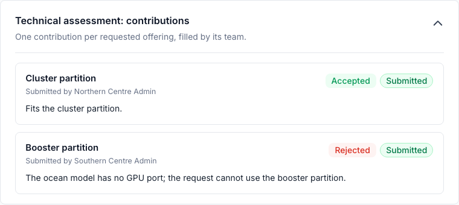

### Reviewer suggestions

On a step that **collects reviewer suggestions**, each holder of the step's
evaluator role — each rapporteur — can **Suggest a reviewer** from their own
**Suggested reviewers** section: an existing user, or an e-mail address for someone without an account,
with a **Note** on their expertise. A rapporteur can take a suggestion back
while it is pending.

Call managers read them in the proposal's **Reviewers suggested by the
evaluators** section, merged per person with who suggested them and their notes, and flagged when the
person has a known conflict of interest, holds an evaluator role, is on the
applicant team or is already in the pool. From there:

- **Invite to pool** sends the call's ordinary reviewer-pool invitation, with
  its response window. Someone already in the pool is linked instead of
  invited again, an expired invitation is sent again, and someone who declined
  is not re-invited — the result says so.
- **Discard** drops a suggestion.
- **Assign to review** appears once a suggested reviewer has accepted, and
  assigns them through the usual manual assignment.

A suggestion's status — *Suggested*, *Invited*, *Accepted*, *Declined*,
*Invitation expired* or *Discarded* — follows the pool invitation. The
applicant team never sees suggestions.

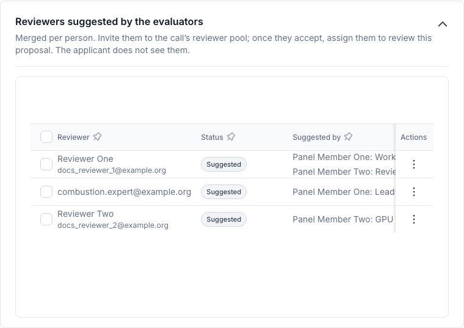

### Input steps and the response to reviews

A step with **input steps** shows a ***step*: inputs** section on the proposal
with what those earlier steps produced: their submitted contributions and
answers, and their reviews. Those overseeing the call always read it; the
step's contributors and completer read it once the step has started.

A **response to reviews** is an applicant step whose inputs are the reviews and
questions the applicant should answer. The applicant reads them without the
reviewers' names or private comments, fills in the step's form and submits the
response; the steps after it can list the response as one of their inputs, as
the individual and consolidated reports do in the Extreme Scale template. If
the applicant does not answer before the deadline, the step ends as *No
response* and the workflow moves on.

!!! warning
    An applicant step shows the applicant every submitted contribution of its
    input steps. Do not list a step whose contributions are meant to stay
    internal, such as the rapporteurs' individual reports.

### Releasing the consolidated report

When an assessment step is set to **Release the report to the applicant**, the
proposal's **Feedback to the applicant** section shows it to the call team as
*Not released* once the step is completed. **Release to applicant** opens a
dialog where you can leave the report as it is or enter an **Edited text** that
the applicant reads instead. A report is released once; the section then shows
when and by whom.

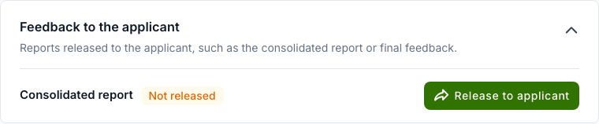

The step's completer — the rapporteurs on the Extreme Scale template — or a call
manager can release it. The applicant reads released reports even on calls that
keep reviews hidden, but not while the allocation decision is held for the
round's publication. Completing the step notifies the call managers when the
call has that rule, as the template does.

### Completing or rejecting a step

Click **Complete step** to record the step's outcome. Choose an outcome from the
step's allow-list (for the administrative check, *Eligible* or *Ineligible*) and
add an optional comment.

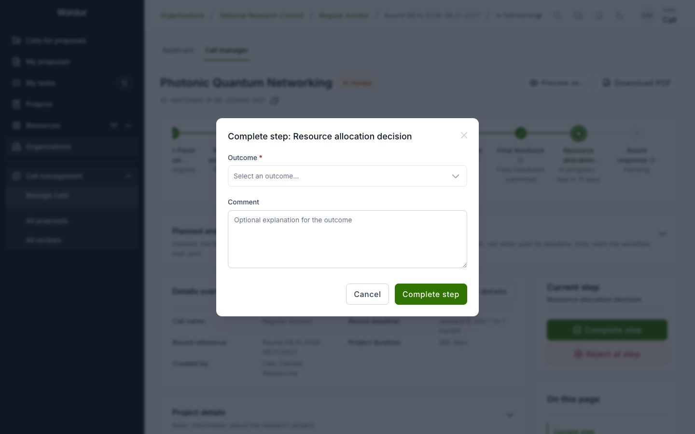

If the step's checklist is **required** and any required question is still
unanswered, **Complete step** is disabled and explains why on hover — *Answer the
required checklist questions before completing this step*. Answer the checklist
first, then complete the step.

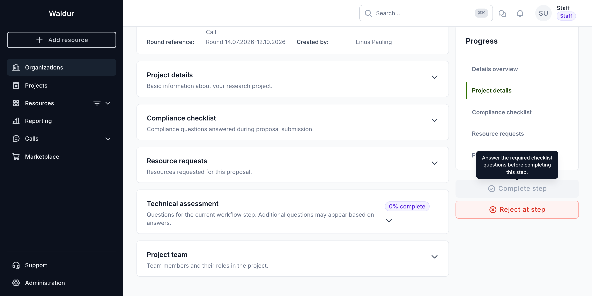

!!! warning
    The required-checklist gate is enforced by the backend, not just the UI: a
    step with a required checklist cannot be completed — via any client — until
    all required questions are answered. Advisory checklists never block.

    The same applies to the **Minimum contributions**, **Minimum reviewers** and
    **Minimum score threshold** gates, which count only the step's *submitted*
    contributions — on a review step, its submitted reviews.

    One exception cuts across all three: a **Declined** outcome is never blocked,
    so a weak proposal can always be turned down regardless of how much of the
    evaluation was completed.

To send a proposal back or knock it out at the current step, use **Reject at
step** instead and record the reason.

### Completing a step for the whole round

Committee steps are often decided for all proposals of a round in one meeting.
On the call's **Rounds** tab, a round's actions menu offers **Complete a step
for the round**. Pick the **Step** — the dialog then lists the round's proposals
at that step, each with an optional feedback field — and the **Outcome**, click
**Continue**, and confirm with **Complete for *n* proposal(s)**.

Each proposal of the round that stands at that step is completed on its own, as
if you had completed it on the proposal: the step's gates, notifications and
records apply to each. The result, shown below, lists which proposals were **Completed**,
which were **Skipped** (not at the step, or a step you cannot act on), and which
failed with the reason — a failure leaves that proposal as it was and does not
stop the others. Running it again completes only what is still open.

The **allocation decision** cannot be completed for a round: awards are decided
per proposal. Feedback on a step whose report is released to the applicant
stays withheld until the report is released.

A step set to **Runs once per round** — the committee meeting of the Extreme
Scale template, say — is not completed this way, nor on a proposal. Expanding a
round on the **Rounds** tab shows its **Steps**; **Open for round** opens such a
step for the round's proposals that have reached it, its contributors each write
one round report covering those proposals, and the step completes for the round
once the reports are in.

### Ranking and meeting notes

Expanding a round on the **Rounds** tab also shows its **Ranking** and
**Meeting notes** tabs: the committee's record of the round, kept beside the workflow.

- **Ranking** — **Rank proposal** gives a proposal of the round its **Rank**, a
  **Final score**, **Recommended resources** per requested offering and
  component, and **Notes**. Ranks are unique within the round. Only proposals
  that are submitted or in review can be ranked. The table's export
  **Ranking for import** downloads the ranking, followed by the round's unranked
  proposals so the file can be filled in; **Import CSV** creates or updates rankings from such a file, all or
  nothing, and can swap ranks.
- **Meeting notes** — **Add note** records a meeting with a **Title**, **Notes**
  and attached documents.

The ranking is locked once the round moves to deciding; meeting notes stay
editable. A ranked proposal's [Awarded resources](#awarded-resources) section
shows the recommendation, and **Prefill from recommendation** copies it into the
awarded resources.

Call managers and staff edit both; panel members and support read them;
reviewers and applicants see neither. Anyone on the applicant team of a proposal
in the round, or with a conflict of interest on record with one of them, sees
nothing of that round's ranking or notes, and nobody can rank a proposal whose
applicant team they are on.

### The allocation decision

**Allocation decision** is owned by the call manager. Exactly one enabled
decision step of every call is its allocation decision; a call cannot be
activated without one. Completing it with an *Approved* outcome advances the
proposal to the next enabled step.

Provisioning happens when the **last enabled step** completes, not at the
allocation decision as such:

- If **Award response** is disabled, the allocation decision is the last step, so
  approving it immediately marks the proposal **Accepted**, creates a project
  under the applicant's organisation, provisions the requested resources and
  grants the team access.
- If **Award response** is enabled, the proposal moves to that step instead and
  waits for the applicant to accept before anything is provisioned. See
  [Responding to an award](applicant-guide.md#responding-to-an-award).

An accepted proposal shows the full workflow completed, each step stamped with
its outcome and completion time.

### Awarded resources

The allocation decision can grant something other than what was requested. When
the **Allocation decision** step starts, the proposal gets an **Awarded
resources** section — also listed in the page's section navigation — that starts
as a copy of the resource requests. While the step is in progress, a call
manager can:

- change the amounts of an item,
- move an item to another offering of the call that its provider has accepted,
  or pick another plan of that offering,
- add items and remove them.

Each row is marked **As requested** or **Changed**, and a changed amount shows
the requested one beneath it. The **Summary of the award** in the side panel
totals the estimated cost of what is awarded.

An item on an offering sold by amount must name an amount; approving the
decision is refused while an awarded item has none. Declining is never blocked.

What is provisioned on acceptance is the award, not the request — the resource
requests stay as the applicant submitted them. A purchase order attached to a
request follows its item only while the item stays on the offering it was
requested for.

The section is editable only while the allocation decision is in progress, and
only by the call's managers and staff. Once the decision is completed, rejected
or held for the round's publication, the rows lose their actions and the award
is read-only.

Who sees the award:

- staff, support, the call's managers and the managing organisation's call
  organisers, and managers of the offerings requested or awarded — at any time;
- the applicant team — once the decision is released: when the proposal is
  accepted, when the applicant is asked to respond to the award, or when the
  call shows the allocation step to applicants; never while the decision is held
  for the round's publication;
- reviewers and panel members — never.

### Held decisions

On a call whose applicants learn the decision **Together for the whole round**
(see [Publishing a round's results](call_management.md#publishing-a-rounds-results)),
completing or rejecting the **Allocation decision** step records the outcome
but holds it. The proposal stays **In review**; the proposals list shows its
tentative outcome — *Awarded (tentative)*, *Not awarded (tentative)* or
*Decision lapsed (tentative)* — and its step as *Held until the round publishes
results*.

On the proposal's **Call manager** tab, the stepper shows the held outcome on
the allocation decision, the awarded resources are read-only, and the
**Progress** panel offers **Reopen decision**. The **Applicant** tab shows the
proposal as the applicant sees it, with the decision still the current step.

**Reopen decision** takes a held decision back, for example when the board
changed the outcome while adopting the list. The allocation decision becomes
active again with its outcome cleared, and the proposal counts as undecided when
the round's results are published. A **Reason** is required; a **New deadline**
is optional — without one, a deadline that has passed is cleared and one still
ahead is kept.

Reopening is possible only before the round's results are published, and only
for staff and users who can update the call — not support, and not the
applicant even if they also manage the call. Nothing is sent to the applicant.
The proposal's event feed records that the decision was reopened and by whom,
without the outcome or the reason; the reason goes to the server log only. Until
the round's results are published that event is hidden from everyone who may not
see held decisions, the applicant team included.

## Related guides

- [Call management](call_management.md) — full call lifecycle and rounds
- [Workflow configuration](workflow-configuration.md) — step kinds, contributors, evaluator roles and input steps
- [Extreme Scale call template](extreme-scale-template.md) — a call template with rapporteurs, reviews and a committee meeting
- [Checklists and forms](checklists-and-forms.md) — question types and form building
- [Reviewer management](reviewer-management.md) — pool, matching and assignments
- [COI management](coi-management.md) — conflict types, severities and handling
- [Reviewer guide](reviewer-guide.md) — the reviewer's perspective
