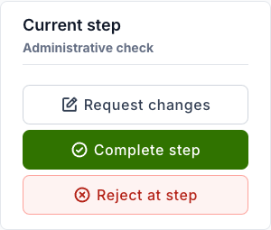

# Running the evaluation

**Performed by:** Call manager, and whoever acts on the current step

This page follows a submitted proposal through the call's evaluation workflow from the call
team's side: finding it, answering a step's checklist, assigning evaluators, reading
contributions and inputs, releasing reports, and completing or rejecting each step. How the
workflow itself is configured is described in [Workflow configuration](workflow-configuration.md).

!!! note
    Most screenshots on this page use the *2025 Spring HPC Allocation Call*
    demo call; those of evaluator roles, contributions, reviewer suggestions and
    released reports use a call created from the
    [Extreme Scale template](extreme-scale-template.md). Your calls will show
    different names, offerings and reviewers, and which steps you see depends on
    how the call is configured.

## Driving proposals through the workflow

### The proposals list

The **Proposals** tab (under either call management or the call's Manage view)
lists every proposal for the call with its **Name**, **Applicant**, current
**Step** and the step's responsible role, **Panel** (on calls that route
proposals to panels), **Created** date, **State** and, when the call has a
compliance checklist, **Compliance**. Click a proposal to open it. A decision held for the round's publication shows its
tentative outcome in place of the state (see [Held decisions](allocation-decision.md#held-decisions)).

Select proposals to act on several at once from **All actions**:

- **Decide a step** — records one outcome, with a reason, on every selected
  proposal standing at the chosen decision step, each as if completed from its
  own page. The result lists the proposals **Completed**, those **Refused** with
  why, and those **Not at this step, so left alone**. The allocation decision,
  assessments and steps run once per round are decided on each proposal.
- **Assign a reviewer**, **Message the applicants**, **Export the proposals
  (CSV)** and **Export their reviews (CSV)**.

### Opening a proposal

A proposal opens on the **Call manager** view. The **workflow stepper** at the
top shows each step with its status and outcome. The sidebar on the right starts
with the **Current step** panel, which names the active step, says why it cannot
move on yet or that all contributions are in, and offers the step's actions —
**Complete step**, **Reject at step**, **Request changes**, **Advance workflow**,
**Reopen decision** and **Cancel request for changes**, as they apply. Below it
come **On this page**, listing the proposal's sections, the cost summary, and
**Assign reviewer**.

The stepper makes the proposal's position obvious at a glance: completed steps
carry their outcome (for example *Eligible*, *Accepted*, *Approved*), the active
step is marked *In progress*, and downstream steps are *Pending*.

### Answering a step checklist

When the active step has a checklist and you are its responsible role, the
checklist appears as a section on the proposal. Answer the questions and click
**Submit answers**. Once every required question is answered, the section shows
an **OK** completion badge.

Whether the checklist blocks completion depends on its **Checklist required** toggle (see
[Evaluation checklists](workflow-configuration.md#evaluation-checklists)).

### Assigning evaluators

On a call with [evaluator roles](workflow-configuration.md#evaluator-roles), the proposal's
**Evaluators** section shows one part per role, with how many of the required holders are
assigned. **Assign *role*** searches the people eligible for the role by name, e-mail or
username. Members of the applicant team are never offered; people who already hold a role
on the proposal or have a recorded conflict of interest with it are shown but
cannot be assigned.
Each holder's row offers **Mark as lead** and **Revoke**.

The completer of an assignment step assigns holders while the step runs, and
the step can be completed once every role it assigns has its required holders
and its lead. Call managers can assign and revoke holders and move the lead at
any time. Assigned holders are told by e-mail; when the step asks for
conflict-of-interest confirmation, a holder reaches the proposal only after
confirming from the **Evaluator roles** tab of their reviews page.

### Contributions and the technical assessment per partition

On an assessment step with contributors, the **contributions** section of the
proposal lists one card per contribution with its status, outcome, conditions
and comment. Contributors fill in the step's form and **Submit contribution**
from their own card, using **Fill in form** and **Close form** to open and
close the step's form (a contribution without a form is its outcome and
comment); call managers and the step's completer read them all.

On a step whose contributions **can be handed to** someone (see
[Contributors](workflow-configuration.md#contributors)), the holder of a
contribution, or a call manager, uses **Hand on** to pass it to someone else,
who can **Accept** or **Decline** it; **Take back** returns it to its holder.
Call managers can reopen a submitted contribution with **Request changes** and a
message to its contributor; its answers are kept, and the applicant is not told.

When the step takes **one contribution per requested offering**, each partition
the proposal requests gets its own card, which only that offering's team can
fill in. A partition is an offering of the service provider that runs it, such
as an HPC centre, so its assessment comes from that provider's offering
managers, not from the call-managing organisation: the call requests the
partitions and runs the evaluation, and each centre assesses its own partition.
A centre's team sees its own partition's card, not the other centres'
assessments; the call managers read them all. Each team answers **Accepted**, **Conditionally accepted** (stating the
conditions) or **Rejected**, and the last answer completes the step: *Infeasible*
if any partition rejected, *Feasible* otherwise. With **On a negative outcome:
Continue to the next step**, a proposal that one partition rejected still moves
on, and the allocation decision shows each partition's outcome and conditions.

### Reviewer suggestions

On a step that **collects reviewer suggestions**, each holder of the step's
evaluator role — each rapporteur — can **Suggest a reviewer** from their own
**Suggested reviewers** section: an existing user, or an e-mail address for someone without an account,
with a **Note** on their expertise. A rapporteur can take a suggestion back
while it is pending.

Call managers read them in the proposal's **Reviewers suggested by the
evaluators** section, merged per person with who suggested them and their notes, and flagged when the
person has a known conflict of interest, holds an evaluator role, is on the
applicant team or is already in the pool. From there:

- **Invite to pool** sends the call's ordinary reviewer-pool invitation, with
  its response window. Someone already in the pool is linked instead of
  invited again, an expired invitation is sent again, and someone who declined
  is not re-invited — the result says so.
- **Discard** drops a suggestion.
- **Assign to review** appears once a suggested reviewer has accepted, and
  assigns them through the usual manual assignment.

A suggestion's status — *Suggested*, *Invited*, *Accepted*, *Declined*,
*Invitation expired* or *Discarded* — follows the pool invitation. The
applicant team never sees suggestions.

### Input steps and the response to reviews

A step with **input steps** shows a ***step*: inputs** section on the proposal
with what those earlier steps produced: their submitted contributions and
answers, and their reviews. Those overseeing the call always read it; the
step's contributors and completer read it once the step has started.

A **response to reviews** is an applicant step whose inputs are the reviews and
questions the applicant should answer. The applicant reads them without the
reviewers' names or private comments, fills in the step's form and submits the
response. If the applicant does not answer before the deadline, the step ends as
*No response* and the workflow moves on. Who reads which inputs, and which steps
are safe to show the applicant, is described under
[Input steps](workflow-configuration.md#input-steps).

### Releasing the consolidated report

When an assessment step is set to **Release the report to the applicant**, the
proposal's **Feedback to the applicant** section shows it to the call team as
*Not released* once the step is completed. **Release to applicant** opens a
dialog where you can leave the report as it is or enter an **Edited text** that
the applicant reads instead. A report is released once; the section then shows
when and by whom.

The step's completer — the rapporteurs on the Extreme Scale template — or a call
manager can release it. The applicant reads released reports even on calls that
keep reviews hidden, but not while the allocation decision is held for the
round's publication. Completing the step notifies the call managers when the
call has that rule, as the template does.

### Completing or rejecting a step

On the proposal page, a user who may complete the active step can:

- **Complete step** — opens a dialog asking for an **Outcome** (required) and an optional **Comment**. When the step advances immediately, this also moves the proposal to the next enabled step.
- **Reject at step** — asks for a **Rejection reason** (required) and ends the workflow.
- **Advance workflow** — shown only when the step is held for manual advance and is waiting to be advanced.
- **Reopen decision** — takes back a decision held for the round's publication; see [Held decisions](allocation-decision.md#held-decisions).

Choose an outcome from the step's allow-list (for the administrative check, *Eligible* or
*Ineligible*) and add an optional comment. The dialog may also show:

- that the step is waiting for a lead, or **cannot move on yet** because work is missing — tick **Complete it without that work** to let your outcome stand in for it;
- **Completing now leaves a later step short**, for example of reviewers — tick **Complete the step anyway** to go ahead;
- the score gate: while the average score is below the step's threshold, only the declining outcome can be chosen;
- on the allocation decision, the **Call budget** table; when the award exceeds what remains, **Override the budget** with a reason (on a call that enforces its budget strictly, only staff may);
- on an applicant step answered by staff, **You answer for the applicant** and a required reason, which the applicant is told along with who answered.

If the step's checklist is **required** and any required question is still
unanswered, **Complete step** is disabled and explains why on hover — *Answer the
required checklist questions before completing this step*. Answer the checklist
first, then complete the step. On a step with contributors, the hover text says
instead that the required questions are answered on the step's contributions, by
those who contribute to it.

!!! warning
    The required-checklist gate is enforced by the backend, not just the UI: a
    step with a required checklist cannot be completed — via any client — until
    all required questions are answered. Advisory checklists never block.

    The same applies to the **Minimum contributions**, **Minimum reviewers** and
    **Minimum score threshold** gates, which count only the step's *submitted*
    contributions — on a review step, its submitted reviews.

    One exception cuts across all three: a **Declined** outcome is never blocked,
    so a weak proposal can always be turned down regardless of how much of the
    evaluation was completed.

To send a proposal back or knock it out at the current step, use **Reject at
step** instead and record the reason. To have the applicant fix part of the proposal while it
stays at the step, use a [request for changes](requests-for-changes.md).

What an outcome does next — continue, reject or cancel, and what happens when the last step
completes — is described under [Step completion](workflow-configuration.md#step-completion).

## Topics on other pages

This page used to cover the whole call manager journey. Those parts now live with their topic:

### The evaluation workflow

Step kinds, outcomes and the rules across a call's steps: see
[Workflow configuration](workflow-configuration.md).

### Landing in call management

The organisation's **Call management** dashboard: see
[Dashboards and reports](dashboards-and-reports.md#call-management-dashboard). The calls list:
see [Creating and configuring a call](creating-a-call.md#finding-your-calls).

### Setting up a call

General settings and configuration: see [Creating and configuring a call](creating-a-call.md).
The workflow steps: see [Configuring workflow steps](workflow-configuration.md#configuring-workflow-steps).

### Configuring a workflow step

See [The step dialog](workflow-configuration.md#the-step-dialog) and
[Per-step settings](workflow-configuration.md#per-step-settings).

### Required vs advisory checklists

See [Evaluation checklists](workflow-configuration.md#evaluation-checklists).

### Evaluator roles

Defining the roles: see [Evaluator roles](workflow-configuration.md#evaluator-roles). Assigning
holders on a proposal: see [Assigning evaluators](#assigning-evaluators) above.

### Building the reviewer pool

See [Reviewer management](reviewer-management.md#reviewer-pool-management).

### Conflict of interest

See [Conflict of interest management](coi-management.md).

### Completing a step for the whole round

See [Round steps and rankings](round-rankings.md#completing-a-step-for-the-whole-round).

### Ranking and meeting notes

See [Round steps and rankings](round-rankings.md#ranking-and-meeting-notes).

### The allocation decision

See [Allocation decision and award](allocation-decision.md#the-allocation-decision).

### Awarded resources

See [Allocation decision and award](allocation-decision.md#awarded-resources).

### Held decisions

See [Allocation decision and award](allocation-decision.md#held-decisions).
