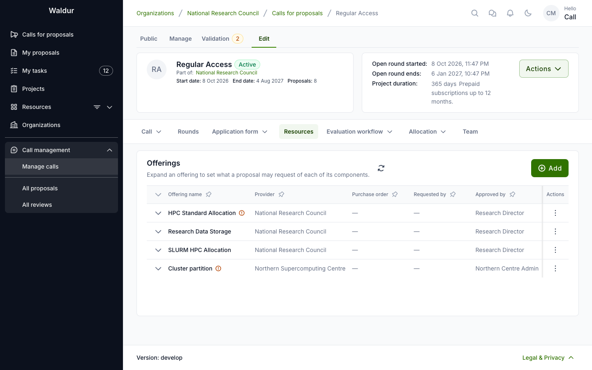
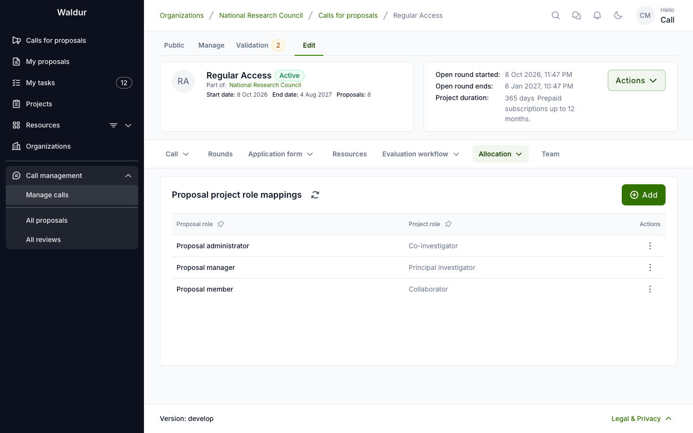
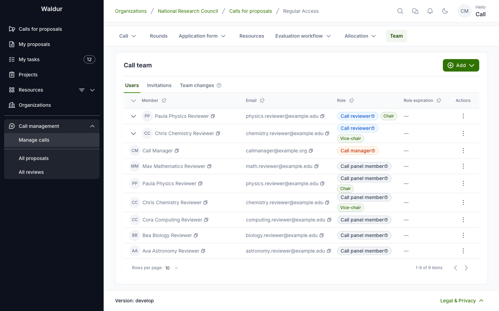

# Resources, role mapping and team

**Performed by:** Call manager

Three parts of a call's configuration decide what it hands out and who works on it: the
offerings on its **Resources** tab, the role mapping under **Allocation**, and the people on its
**Team** tab.

## Offerings

Define available resources on the **Resources** tab:

- **Add Offerings**: the **New offering** dialog walks through **Select offering** and
  **Configure request**, then submits the request to the offering's service provider
- Ensure all required offerings have been approved by service providers: the list shows each
  offering's **Offering name**, **Provider**, **State**, **Requested by**, **Approved by** and
  **Purchase order**, and a pending request reads *Waiting for* the provider
- Expand an offering to set what a proposal may request of each of its components: **Any
  amount**, **Fixed at**, **At least** or **Up to** an amount
- Offerings that require a purchase order pass that requirement on to the call — see [Purchase orders in calls](purchase-orders.md)

What applicants can request from these offerings is narrowed further by the call's
[resource templates](application-form.md#resource-templates).

## Role mapping

Configure project role assignments under **Allocation → Role mapping**:

- **Proposal project role mappings**: Map each proposal role to corresponding project roles
- Map every proposal role whose holders should get access to the project. Mappings are not
  required — activation only warns with **No role mappings** — but without them projects
  allocated from approved proposals have nobody on them, not even the applicant
- Mappings can be added at any time, but apply only to proposals approved afterwards

## Call team

The **Team** tab grants the **Call manager**, **Call panel member** and **Call reviewer** roles
on the call. Its sub-tabs are **Users**, **Invitations** and **Team changes**. Granting the
**Call reviewer** role adds its holder to the call's reviewer pool as accepted; revoking it
declines their pool entry.

A panel member's row offers **Set as panel chair** and **Set as vice-chair**. Steps can name
the panel members, or the panel chair or vice-chair, as the role that completes or contributes to them (see
[Workflow configuration](workflow-configuration.md#per-step-settings)).

The reviewer pool itself is managed on the call's **Manage → Reviewer pool** tab. See
[Reviewer management](reviewer-management.md#reviewer-pool-management).
