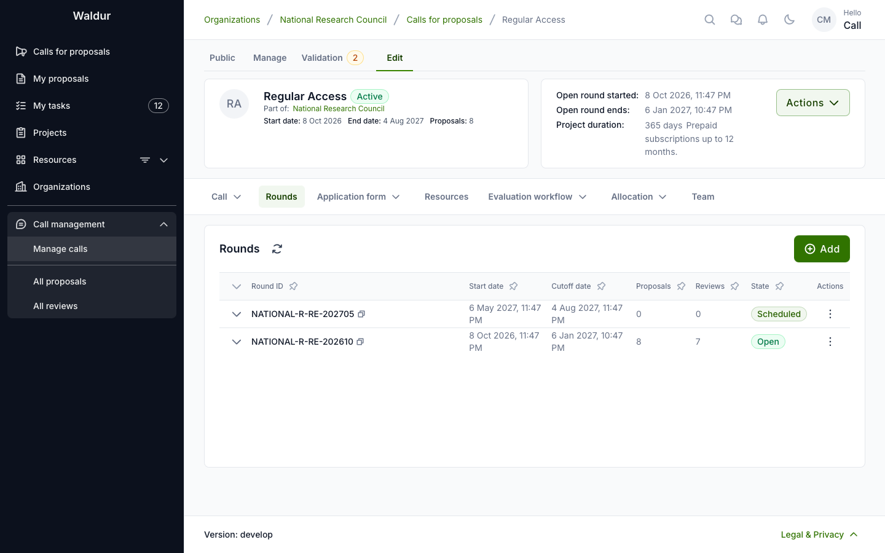

# Rounds

A round schedules one submission period of a call: when proposals can be submitted, how long
review takes, and when resources are allocated. A call needs at least one round before it can
be activated.

## Configuring rounds

**Performed by:** Call manager

1. On the call's **Rounds** tab, open the **New round** dialog.
2. On the **Submission** step, set:
      - **Time zone**, **Start date** and **Cutoff date** — or tick **No cut-off (continuously open)**
      - Optionally **Repeats**, to create several rounds at once: pick a **Cadence** (**Monthly**,
        **Quarterly**, **Biannual**, **Yearly** or **Custom**), the **Number of rounds** and the
        **Submission window (days)** each round stays open, in place of the cutoff date
3. On the **Allocation** step, set the **Allocation date** — asked only when the call's
   allocation decision step allocates on a fixed date.
4. Click **Create**.

A round's row actions edit it afterwards: **Edit submission settings**, **Edit review settings**
(where **Review duration without a step deadline (days)** is set), **Edit allocation settings**,
the round's lifecycle actions, and **Delete**.

A round only schedules submission, review and allocation. How many reviewers a
proposal needs, the minimum score, who decides and when resources are allocated
are set on the call's [workflow steps](workflow-configuration.md#per-step-settings).

A round can only be deleted while it has **no proposals at all**, in any state —
drafts, and rejected or cancelled proposals, included. Deleting a round would
delete its proposals with it, and a rejection or a cancelled draft is an outcome
of the round that stays on record. The **Delete** action is disabled with that
reason on such a round.

After the cut-off a round moves through its own lifecycle — evaluating,
deciding, results published, closed — described under
[Round lifecycle after the cut-off](round-results.md#round-lifecycle-after-the-cut-off).
Committee work on a round — completing a step for all its proposals, round steps, the ranking
and meeting notes — is described in [Round steps and rankings](round-rankings.md).

## Drafts at the cut-off

A proposal left in **Draft** when its round's cut-off passes has no submitted
content to evaluate. By default it is **not** cancelled: it moves on to the
call's next round, keeping its sections and answers, and its creator is emailed
to say which round it now belongs to and when that round's deadline is. Nothing
is submitted on the applicant's behalf — the proposal stays a draft until they
submit it themselves.

Two things end this:

- **No later round.** If the round that closed is the call's last one, the draft
  is cancelled; there is nowhere for it to move on to.
- **The setting is off.** With **Carry unsubmitted drafts over to the next round**
  turned off under **Call → General configuration**, every draft left at
  the cut-off is cancelled, as Waldur did before the setting existed.

Only drafts carry over. A submitted proposal stays with the round it was
submitted to, whatever its outcome.

## When evaluation starts

Each call decides when a submitted proposal's evaluation starts:

- **On submission** (the default) — the first enabled workflow step starts as
  soon as the applicant submits.
- **At the round cut-off** — every proposal stays **Submitted** until its
  round's cutoff date, and the evaluation of all of them starts together after
  the cut-off, so a panel can assess a round's proposals as one batch. A
  background job checks for such proposals every hour, so they move to
  **In review** within about an hour of the cut-off.

Choose it with **Evaluation starts** under **Call → General
configuration** (the call's `evaluation_start` field in the API). It cannot be
changed while the call has proposals that are submitted or in review.
