# Call management

This guide walks you through the entire lifecycle of call management in Waldur, from setup to final resource allocation. It is structured in a step-by-step format to help each stakeholder understand their responsibilities in the process.

## Detailed process guide

## Step 1: Organization setup

**Performed by:** Organization owner

1. **Verify organization type**:
      - Confirm your organization is registered as a **Call managing organization**
      - If not, contact your Waldur administrator: staff turn it on with **Manages calls** under the organization's **Edit → Call manager** tab

2. **Decide on a per-applicant limit** (optional):
      - The same **Call manager** tab holds **Active proposals per applicant** — see [Limiting proposals per applicant](#limiting-proposals-per-applicant)

3. **Review available offerings**:
      - Check that there are **marketplace offerings** available to be requested in calls
      - These offerings will form the resource pool available for allocation

4. **Assign Call organisers**:
      - Go to the **Team** section of your organization
      - Click on the **Add member** button
      - Search for users to assign as Call organisers
      - Select the **Call organiser** role from the dropdown menu
      - Click **Add** to confirm the assignment

### Limiting proposals per applicant

**Set by:** Staff, on the organization's **Edit → Call manager** tab

**Active proposals per applicant** caps how many proposals one applicant may
hold with the organization at a time, across **all** of its calls. Leave it
empty for no limit (the default).

A proposal holds a place:

- while it is **Submitted** or **In review**, and
- once **Accepted**, for as long as its project runs — until the project is
  completed, removed or past its end date.

Drafts, rejected and cancelled proposals hold none, and an accepted proposal
and its project count as one place, not two. Only the proposal's **creator**
is counted: being a member or co-manager of someone else's proposal team takes
no place.

The limit is checked when a proposal is created and again when it is
submitted, where it holds: a draft takes no place until it is submitted, so an
applicant at the limit cannot submit another one. They are refused with
*You have reached the maximum of N active projects or pending proposals. You
cannot submit another proposal until one of them is completed or closed.*

Once a limit is set, every call of the organization carries the catalogue
warning *This call restricts who may apply* (see
[When eligibility is checked](#when-eligibility-is-checked)), and an applicant
at the limit sees **Apply to call** disabled with *You are not eligible to
apply to this call.* State the limit in the call descriptions.

## Step 2: Call creation

**Performed by:** Call organiser or Organization owner

1. Navigate to the **Call management** section, in the organisation dashboard.
2. Go to the **Calls** section and click **Create call**. It offers two ways to
   start:
      - **Blank call** — asks for the call's **Name**, **Description**,
        **External URL** and an optional **Compliance checklist**.
      - **From template** — see [Starting from a call template](#starting-from-a-call-template).
3. Either way the call is created as a **Draft**. Assign its call managers on
   the call's **Team** tab.

### Starting from a call template

**From template** opens **Create call from template**: pick a **Template**,
optionally give a **Call name**, and click **Create**. The call is created as
a draft with the template's settings, workflow steps, evaluator roles,
evaluation forms and notification rules, ready to complete with the parts that
belong to your portal: offerings, rounds, people, role mapping and resource
templates.

The dialog lists the templates staff have published, each with the process it
models and a description. Staff manage them under **Administration → Call
templates**: **Load preset** adds templates from the presets shipped with
Waldur — among them *Rapid access*, *Staff-reviewed allocation*,
*Peer-reviewed allocation*, *Technical and scientific review*, *Regular
Access*, *Extreme Scale Access*, beamtime proposals and classroom allocations —
and each template's row shows its workflow as steps, a diagram, a timeline and
scenarios. Staff also see unpublished templates in the dialog, marked
**Unpublished**. With no template published, the dialog says so: start from a
blank call, or import a call file.

A call created from a template remembers it: the calls list shows **Created
from template**, and the call's **Validation → Changes** tab lists how the
call now differs from the template.

## Step 3: Configure call rounds

**Performed by:** Call manager

1. Create a **Round** within the call.
2. Configure the round settings:
      - Start and cutoff dates (or a start date with a repeat cadence to create several rounds at once)
      - Review duration (in days)
      - Allocation date, when the call allocates on a fixed date
3. Save the round.

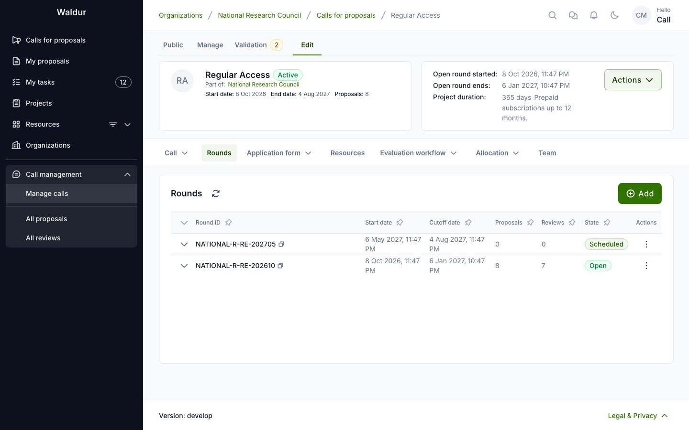

A round only schedules submission, review and allocation. How many reviewers a
proposal needs, the minimum score, who decides and when resources are allocated
are set on the call's [workflow steps](workflow-configuration.md#per-step-settings).

A round can only be deleted while it has **no proposals at all**, in any state —
drafts, and rejected or cancelled proposals, included. Deleting a round would
delete its proposals with it, and a rejection or a cancelled draft is an outcome
of the round that stays on record. The **Delete** action is disabled with that
reason on such a round.

After the cut-off a round moves through its own lifecycle — evaluating,
deciding, results published, closed — described under
[Round lifecycle after the cut-off](#round-lifecycle-after-the-cut-off).

### Drafts at the cut-off

A proposal left in **Draft** when its round's cut-off passes has no submitted
content to evaluate. By default it is **not** cancelled: it moves on to the
call's next round, keeping its sections and answers, and its creator is emailed
to say which round it now belongs to and when that round's deadline is. Nothing
is submitted on the applicant's behalf — the proposal stays a draft until they
submit it themselves.

Two things end this:

- **No later round.** If the round that closed is the call's last one, the draft
  is cancelled; there is nowhere for it to move on to.
- **The setting is off.** With **Carry unsubmitted drafts over to the next round**
  turned off under **Call → General configuration**, every draft left at
  the cut-off is cancelled, as Waldur did before the setting existed.

Only drafts carry over. A submitted proposal stays with the round it was
submitted to, whatever its outcome.

### When evaluation starts

Each call decides when a submitted proposal's evaluation starts:

- **On submission** (the default) — the first enabled workflow step starts as
  soon as the applicant submits.
- **At the round cut-off** — every proposal stays **Submitted** until its
  round's cutoff date, and the evaluation of all of them starts together after
  the cut-off, so a panel can assess a round's proposals as one batch. A
  background job checks for such proposals every hour, so they move to
  **In review** within about an hour of the cut-off.

Choose it with **Evaluation starts** under **Call → General
configuration** (the call's `evaluation_start` field in the API). It cannot be
changed while the call has proposals that are submitted or in review.

## Step 4: Call configuration and activation

**Performed by:** Call manager

Before activating a call, the Call manager must configure all necessary settings.

The call's **Edit** page groups its settings into tabs:

| Tab | Sub-tabs |
|---|---|
| **Call** | **General** (name, description, reference code, proposal slug template, external URL), **General configuration**, **Documents** |
| **Rounds** | — |
| **Application form** | **Project details fields**, **Applicant eligibility**, **Applicant data visibility**, **Resource templates** |
| **Resources** | the call's offerings |
| **Evaluation workflow** | **Steps & settings**, **Evaluator roles**, **Panels**, **COI settings**, **Reviewer eligibility**, **Matching settings** |
| **Allocation** | **Allocation settings**, **Role mapping** |
| **Team** | — |

### Call configuration settings

#### 1. General configuration

Under **Call → General configuration**, set the basic call parameters. They are
grouped into tabs.

On the **Duration** tab:

- **Fixed duration for granted projects (in days)**: how long every granted project runs. When it is set, it decides the project's end date, and applicants can only choose subscription lengths that fit inside it. Applicants see the resulting length in the submission form; they are not asked for a duration. See [How long a granted project runs](#how-long-a-granted-project-runs).
- **Durations the applicant chooses from**: instead of a fixed duration, a list of project lengths the applicant picks from; the award may move a proposal to another of them. No prepaid subscription may run longer than the chosen length. Setting a list clears the fixed duration, and setting a fixed duration clears the list.

On the **Evaluation** tab:

- **Evaluation starts**: **On submission** or **At the round cut-off** — when a submitted proposal's evaluation starts. It cannot be changed while the call has submitted or in-review proposals. See [When evaluation starts](#when-evaluation-starts).
- **Target days from cut-off to decision**: how long the evaluation is planned to take after a round's cut-off. A round with an allocation date uses that date instead. The [workflow check](#checking-the-workflow-before-activation) warns when the step durations up to the decision take longer.

On the **Decisions and rounds** tab:

- **Applicants learn the decision**: **As each decision is made** (the default) or **Together for the whole round** — whether each allocation decision is announced as soon as it is made, or held until a call manager publishes the round's results. It cannot be changed while the call holds decisions that have not been published. See [Publishing a round's results](#publishing-a-rounds-results).
- **Results are adopted before publication**: for results a body such as a governing board must adopt first. The adoption is recorded while the round is deciding, the round's results cannot be published until it is, and once adopted a held decision can no longer be reopened. See [Recording adoption](#recording-adoption).
- **Undecided proposals when a round is completed**: **Block completion until every proposal is decided** (the default) or **Reject them automatically** — what completing a round does with proposals that still have no decision. A round can override it. See [Completing a round](#completing-a-round).
- **Carry unsubmitted drafts over to the next round**: on by default. A draft still open when its round's cut-off passes moves to the call's next round instead of being cancelled, and its creator is told which round it moved to and when the new deadline is. With it off the draft is cancelled at the cut-off, as are drafts left at the last round's cut-off either way. See [Drafts at the cut-off](#drafts-at-the-cut-off).

On the **Compliance** tab:

- **Compliance checklist**: an optional checklist for proposal compliance evaluation. It can only be changed while the call has no proposals.
- **Conflict-of-interest declaration**: the wording evaluators confirm on steps that ask them to declare having no conflict of interest, unless a step words its own. Leave it empty for the platform's standard declaration. A change applies only to confirmations made after it.

On the **Applicants** tab:

- **Copied on mail to the applicant**: the proposal team roles (for example the proposal managers, that is the principal investigators) whose holders are copied on every mail to the applicant — submission, step outcomes they are told of, requests for changes and results.
- **Reviewer identity visible to applicants**: whether applicants can see who is reviewing their proposals (Yes/No)
- **Reviews visible to applicants**: whether applicants can read the reviews and feedback (Yes/No)

On the **Orders** tab:

- **Resource orders created by**: who the orders for granted resources are attributed to — the proposal applicant (the default), the project manager, the call manager, or a **Named contact**, such as a shared mailbox, who must hold a role on the call or its organization. That person is named on each order and receives the order notifications.

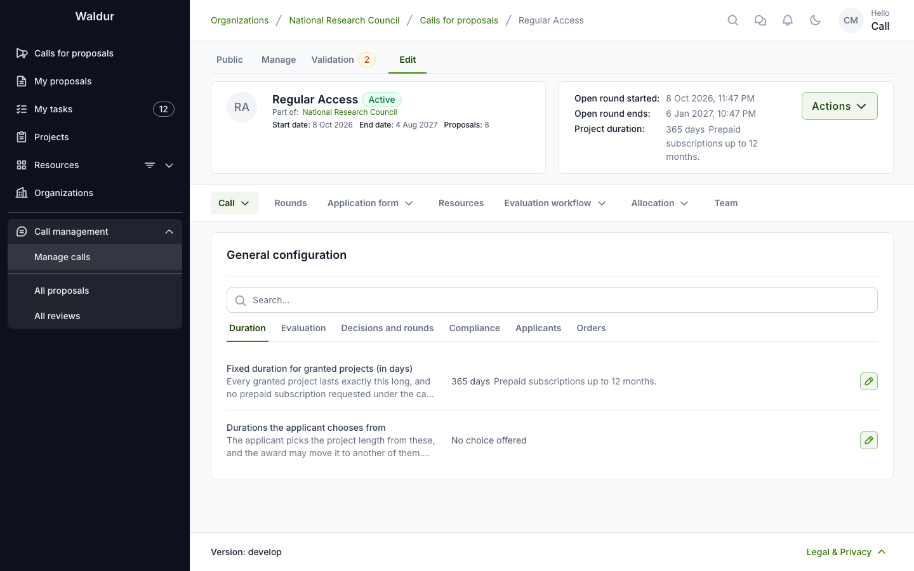

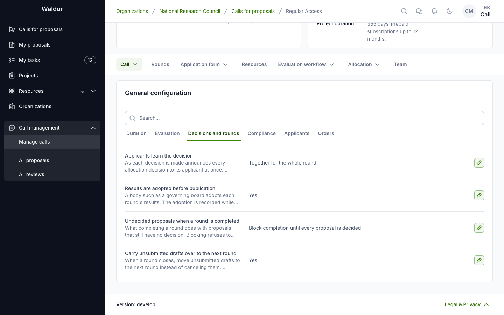

#### How long a granted project runs

When a proposal is granted, the project's end date is decided in this order:

1. **The call's fixed duration**, when it is set. The project ends that many days after it starts. Subscription lengths requested under the call are limited to fit inside it, and a resource never outlasts its project.
2. **The longest awarded subscription**, when the call sets no fixed duration. The project lasts as long as the longest subscription in its [awarded resources](call-manager-workflow.md#awarded-resources), which start as a copy of the resource requests.
3. **No end date**, when the call sets no fixed duration and nothing requested is sold by the month. The project runs until someone sets an end date on it.

!!! warning "Awards that must expire"
    If every award from the call must end, set a fixed duration. Without one, a proposal that requests only resources not sold by the month creates a project with no end date.

The **Application form** tab holds what the call asks of applicants:

- **Project details fields** — what this call asks applicants for (see below)
- **Applicant eligibility** — who may submit a proposal at all (see below)
- **Applicant data visibility** — which applicant data is exposed during evaluation
- **Resource templates** — what applicants can request, and how many templates (see below)

#### 1a. Project details fields

Under **Application form → Project details fields**, choose what the Project details
step asks the applicant for. Each field is one of:

| State | On the form | On submission |
|---|---|---|
| **Required** | shown, marked with a red asterisk | blocked while empty |
| **Optional** | shown | may be left empty |
| **Not asked** | not shown at all | — |

**Name** is always required and is not configurable: it identifies the
proposal and forms the last part of the awarded project's name — a granted
project is named `<call reference or slug> - <round start date> - <proposal name>`.
The project duration is not a field the applicant fills in either; it is derived
from the subscription lengths requested and the call's fixed duration, and shown
read-only. The configurable fields are **Summary**,
**Description**, **Science domain** and **Supporting documentation**.

Each row lists what the field feeds, so the cost of switching one off is visible
before you do. Fields marked with a warning have a functional consumer — the
summary and description are the text that **automatic reviewer matching** scores
against reviewer profiles, so a call that does not collect them gets less
accurate reviewer suggestions.

A field **cannot be made required once the call has proposals**. Drafts that were
complete under the published form would silently stop being submittable, and
nothing notifies the applicants who wrote them. Relaxing a field — making it
optional, or not asking for it at all — stays possible at any time. To run a
stricter round, duplicate the call: the copy starts in draft with no proposals,
and its field configuration is carried over ready to tighten.

New calls start from the deployment defaults, which an administrator sets under
**Proposal settings** in the Constance configuration
(`DEFAULT_PROPOSAL_REQUIRED_FIELDS`, `DEFAULT_PROPOSAL_HIDDEN_FIELDS`). Those
defaults are applied when the call is created; changing them later never alters
a call that already exists.

#### 1b. Applicant eligibility

Under **Application form → Applicant eligibility**, restrict who may submit a
proposal to this call. Each row holds a list of values; a row left empty is not
checked, and a call with every row empty is open to anyone who can sign in.

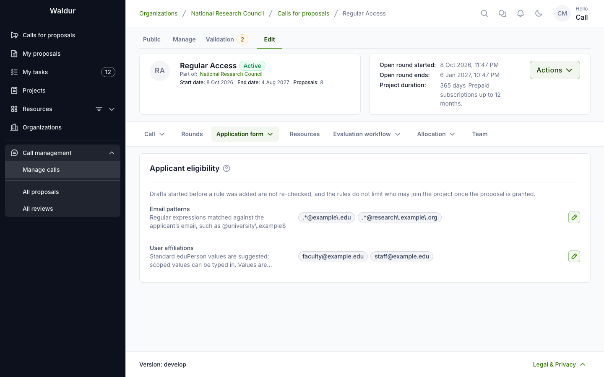

| Restriction | Matched against | Values |
|---|---|---|
| **Email patterns** | the applicant's email address | regular expressions, for example `.*@(helsinki\.fi\|kth\.se)$` |
| **User affiliations** | the affiliations the identity provider asserts | standard eduPerson values are offered as suggestions; any other value can be typed in |
| **Identity sources** | the institution that authenticated the applicant, exactly as reported at login | free text — no suggestions, because the value comes from the applicant's home institution rather than from the providers this installation is configured with |
| **Nationalities** | the applicant's nationality or nationalities | picked from the country list, stored as ISO country codes |
| **Organization types** | the applicant's organization type | standard SCHAC values are offered as suggestions |
| **Assurance levels** | the assurance levels the identity provider asserts | standard REFEDS values are offered as suggestions |

Values are lists rather than one comma-separated box on purpose: a regular
expression may itself contain a comma, and splitting on it would turn one
working pattern into two that match nobody.

##### How the rows combine

This is the part worth reading twice, because the intuitive reading is the wrong
one. The rows are **not** six independent requirements:

- **Email patterns, user affiliations and identity sources form one group.** An
  applicant who matches *any one* value in *any one* of those three rows passes
  the group. Listing both an affiliation and an email pattern therefore *widens*
  the call — it admits anyone matching either — rather than narrowing it to
  applicants who match both.
- **Nationalities, organization types and assurance levels are each an extra
  requirement on top of that group.** A configured row here must also be
  satisfied, so these do narrow the call.
- **Assurance levels are stricter still**: the applicant must hold *every* level
  listed, not just one of them.

The call in the screenshot above therefore admits an applicant who is either
`faculty` or `staff`, **or** has a `helsinki.fi` or `kth.se` address — and who,
in addition, holds a Finnish, Swedish or Norwegian nationality, comes from an
organization of type *University*, and carries the *IAP Medium* assurance level.

!!! warning
    Combinations that match nobody are accepted without complaint. Restricting a
    call to an assurance level the identity providers in use never assert, or to
    an organization type nobody's home organization reports, produces a call
    that every applicant is turned away from. If applicants report being refused,
    check these rows first.

##### Entering values

Click the pencil on a row to edit it. Rows that have a standard vocabulary offer
it as a list of suggestions — but the list is not closed, and typing a value
that is not in it is deliberately allowed:

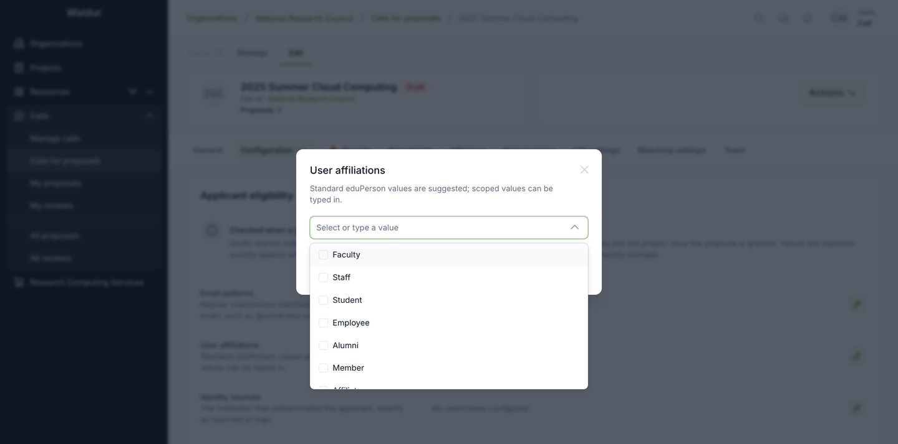

That matters most for affiliations. Identity providers routinely send *scoped*
values — `faculty@university.example` rather than plain `faculty` — and the
value is matched exactly, character for character, against what the provider
sends. If applicants who should qualify are refused, compare the stored value
with what actually arrives at login rather than assuming the plain form.

!!! note
    Only attributes this installation collects get a row. A deployment that does
    not collect nationality, for instance, does not show the **Nationalities**
    row at all — an administrator controls this with
    `ENABLED_USER_PROFILE_ATTRIBUTES` in the Constance configuration. A row that
    already holds values stays visible even if its attribute is later switched
    off, carrying a warning: the restriction keeps being enforced, so leaving it
    in place behind a hidden row would turn every applicant away.

##### When eligibility is checked

Eligibility is checked when a proposal is **created**. Two consequences follow:

- A draft started before a restriction was added is not re-checked when it is
  submitted. Tightening a call that already has drafts does not retract them.
- Eligibility does not limit who may join the project once the proposal is
  granted. It gates who may apply, nothing further.

Applicants are not shown the restrictions themselves. A call that has any of
them carries a warning in the call catalogue — *This call restricts who may
apply. Check the terms before submitting* — and an applicant who does not
qualify is refused when the proposal is created, with a message naming the
restriction that failed. Spell the rules out in the call description or the
external URL, so nobody writes a proposal they cannot submit.

The same warning appears when the call-managing organization
[limits proposals per applicant](#limiting-proposals-per-applicant); that limit
is checked on creation and again on submission.

#### 1c. Resource templates

Under **Application form → Resource templates**, define what applicants can
request. A template names one of the call's offerings with a plan, its amounts
(usage limits) and any preset attributes. Its attributes and subscription
length are checked against the offering when you save it.

Once a call has a template, templates are the only way to request resources
in it. Applicants cannot request an offering directly or change a template's
amounts or attributes, and can request each template at most once. A proposal
with a request that is not from a template, for example because its template
was deleted, cannot be submitted until that request is replaced.

The **Template selection** card above the templates sets how many an applicant
may choose:

| Applicants can request | On the applicant's form | Rule |
|---|---|---|
| **Several templates** (default) | a checkbox per template | any combination |
| **One template** | a radio button per template | exactly one, required to submit |

Use **One template** when the templates are alternatives, such as access
tiers. It cannot be set while a draft proposal holds several requests.

Editing a template updates the requests made from it on **draft** proposals;
submitted proposals keep their amounts.

#### 2. Offerings configuration

Define available resources on the **Resources** tab:

- **Add Offerings**: Select which service provider offerings will be available for this call
- Ensure all required offerings have been approved by service providers
- Offerings that require a purchase order pass that requirement on to the call — see [Purchase orders in calls](purchase-orders.md)

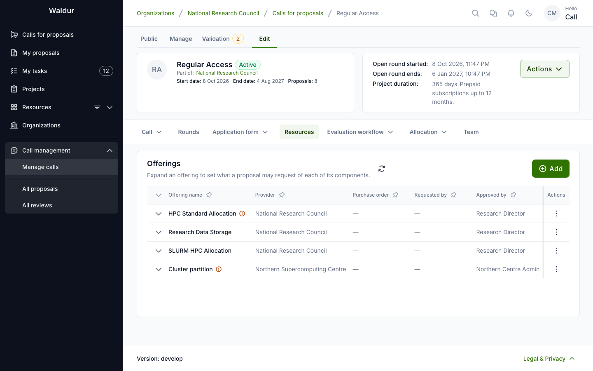

#### 3. Role mapping

Configure project role assignments under **Allocation → Role mapping**:

- **Proposal project role mappings**: Map each proposal role to corresponding project roles
- Each proposal role must be mapped to a project role to ensure proper access when projects are created

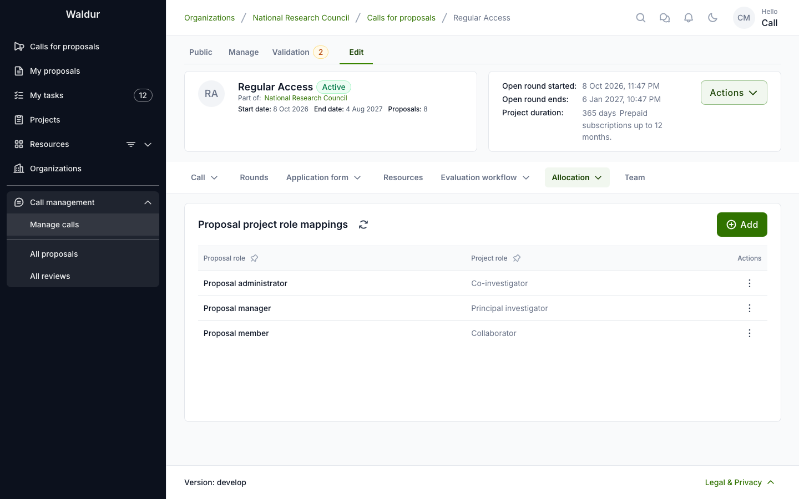

#### 4. Workflow steps

Under **Evaluation workflow → Steps & settings**, configure the evaluation pipeline that submitted proposals progress through: add, name, reorder and configure call steps of four kinds, and define the call's evaluator roles under **Evaluator roles**. See [Workflow configuration](workflow-configuration.md) for details. To start from a complete process, create the call from the [Extreme Scale call template](extreme-scale-template.md).

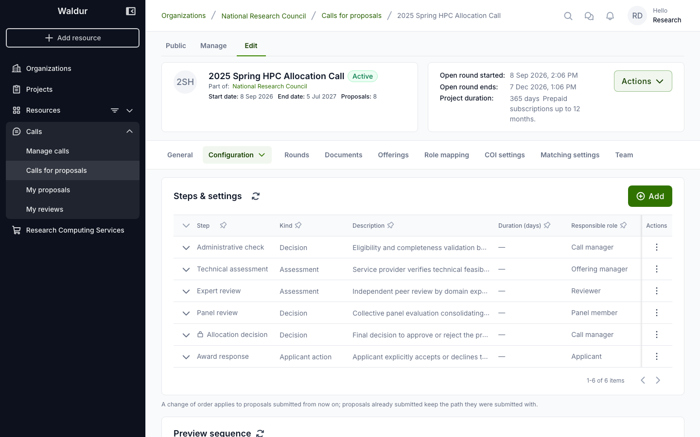

#### 5. COI settings

Configure conflict of interest detection parameters under **Evaluation workflow → COI settings**. See [Reviewer management](reviewer-management.md#conflict-of-interest-coi-detection) for details.

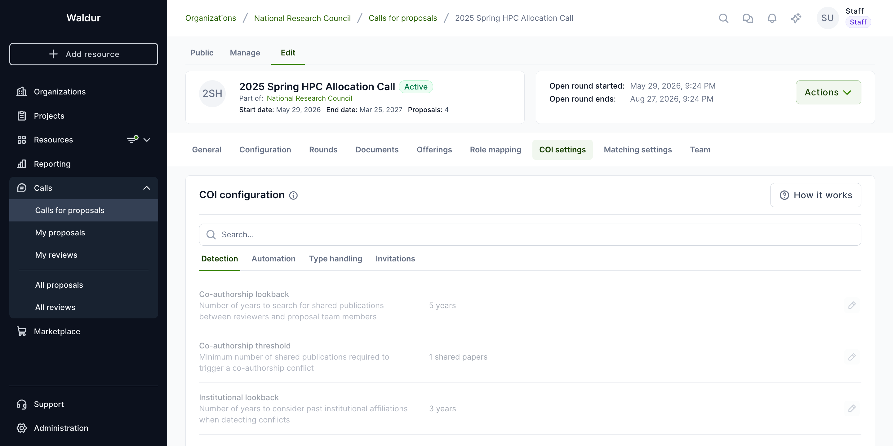

#### 6. Matching settings

Configure the reviewer-proposal matching algorithm under **Evaluation workflow → Matching settings**. See [Reviewer management](reviewer-management.md#reviewer-proposal-matching) for details.

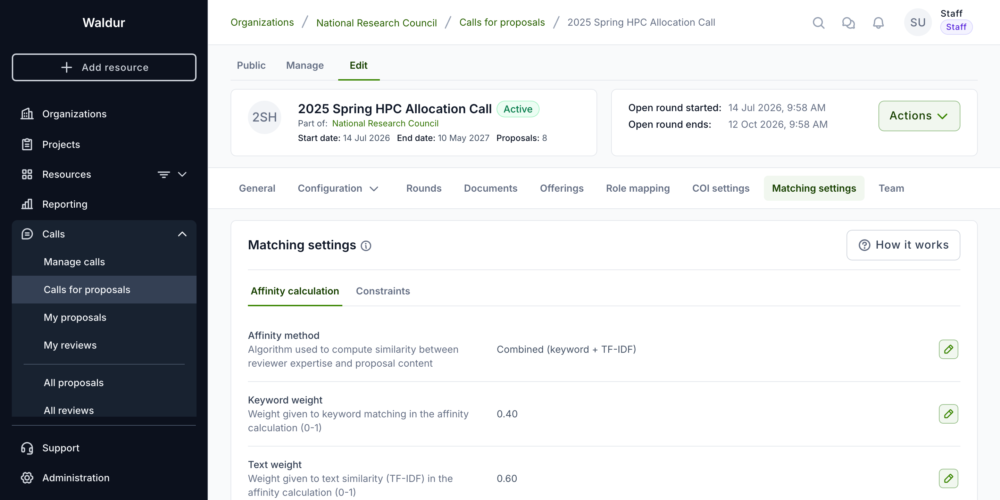

#### 7. Call team

The **Team** tab assigns **call managers** and **panel members** to the call.

A panel member's row offers setting them as the call's panel **Chair** or
**Vice-chair**.

Reviewers are not managed here — they are added to the call's reviewer pool on the call manage page. See [Reviewer management](reviewer-management.md#reviewer-pool-management).

*Important: The round must be created and configured first. Only after round configuration is complete can the call be fully configured and activated.*

### Call activation process

Once all configurations are complete:

1. **Review all configurations**:
      - Verify general settings are correct
      - Confirm team assignments are complete
      - Check that offerings are properly configured
      - Ensure role mappings are defined

2. **Run the workflow check** — see [Checking the workflow before activation](#checking-the-workflow-before-activation).

3. **Activate the call**:
      - Choose **Activate** from the call's actions to open it for proposal submissions
      - Once activated, the call becomes visible to potential applicants
      - Applicants can now submit proposals during active rounds

### Checking the workflow before activation

The call's **Validation** tab, between **Manage** and **Edit**, says whether
the call's workflow works as configured. Its **Check** sub-tab lists every
finding with its severity and a link that opens the setting to fix:

- **Errors** mean the call cannot run as configured — for example no round, no
  enabled step, no or several allocation decisions, an award response before
  the decision, a step that nobody can complete, a run condition naming a
  missing or later step, an accepted offering missing, or a notification rule
  that can never reach anyone.
- **Warnings** never block — for example step durations up to the decision
  that exceed the round's time to decision (the allocation date, else **Target
  days from cut-off to decision**), steps without a duration, or an empty
  reviewer pool.
- **Info** lists, for example, the roles the call managers assign by hand and
  the steps that differ from the template the call was created from.

**Activate** runs the same check and refuses the call while there are errors;
the action shows their number (*Activate (2 errors)*), and a refused activation
lists all of them at once. There is no override. The calls list shows the
verdict too, under **Workflow check**.

The other sub-tabs of **Validation** help confirm that the workflow does what
you intend: **Roles**, **Notifications**, **Diagram**, **Timeline**,
**Paths**, **Dry run**, **Scenarios**, and **Changes** — the call's saved
workflow versions, compared with each other or with the template the call was
created from.

## Step 5: Submit proposal  

**Performed by:** Call member (Applicant)

Applicants follow these steps to request resources through an active call:

1. Navigate to the **active call** in the public calls listing.

    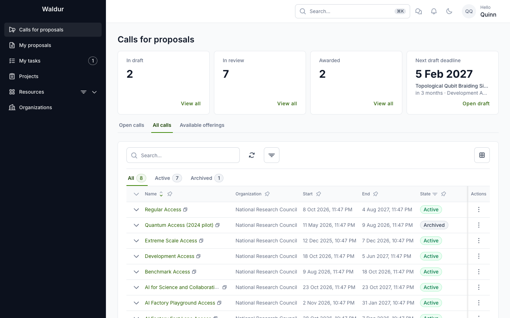

2. Click **"Apply to round"** on the call detail page.

    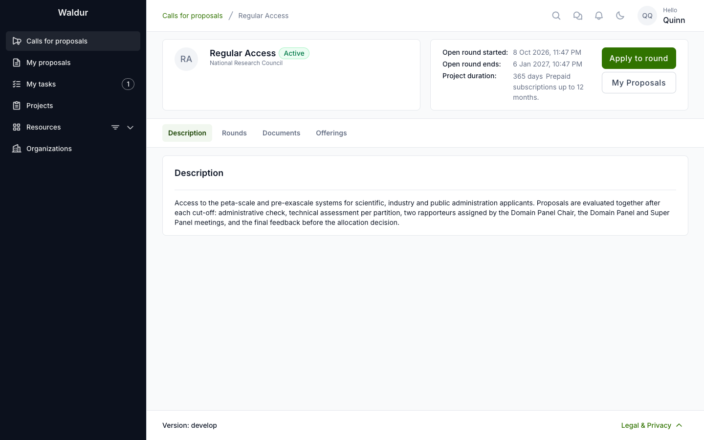

3. Fill in the required fields.
      -     The project duration is not asked for. It is the call's fixed duration when the Call manager set one, otherwise the longest subscription chosen on the resource requests, and is shown read-only (see [How long a granted project runs](#how-long-a-granted-project-runs)).
4. Select required **offerings and allocations**.
      -     When the call has resource templates, applicants choose from them instead (see [1c. Resource templates](#1c-resource-templates)).
5. Add **team members** (optional).
6. Upload required documentation.
      -     When an offering requires a purchase order, supply its reference or document on the resource request. The request can be saved without one, but the proposal cannot be submitted until it is there — see [Purchase orders in calls](purchase-orders.md).
7. Submit the proposal.

## Step 6: Review assignment and process  

### Building the reviewer pool

**Performed by:** Call manager

Before assigning reviews, the call manager builds a pool of qualified reviewers:

1. Navigate to the call manage page and select the **Reviewer pool** tab
2. Add reviewers by profile or email invitation
3. Review the pool members with their acceptance status

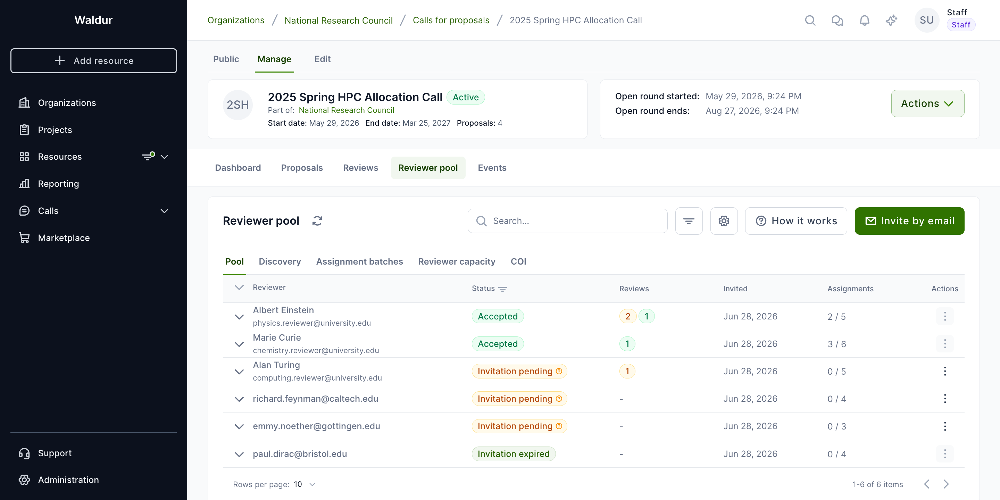

### Reviewer discovery and matching

Use the **Discovery** tab to find reviewers using algorithmic matching:

1. Click **Generate Suggestions** to run the matching algorithm
2. Review suggestions with affinity scores
3. Confirm or reject each suggestion

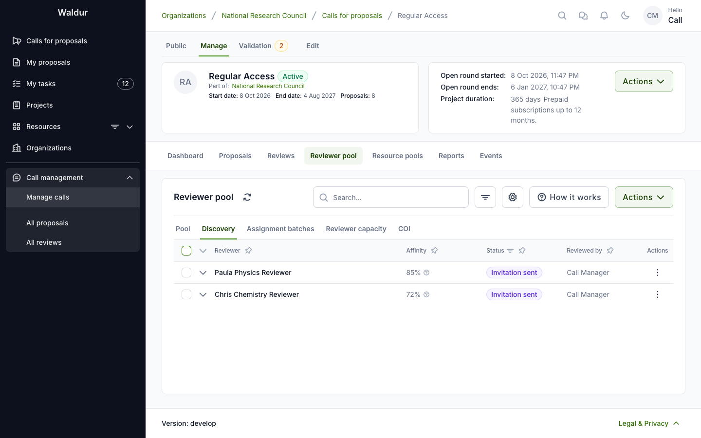

### Managing conflicts of interest

The **COI** tab shows detected conflicts between reviewers and proposals:

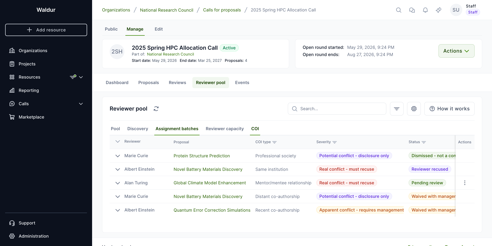

Expand a record to see evidence details and management options:

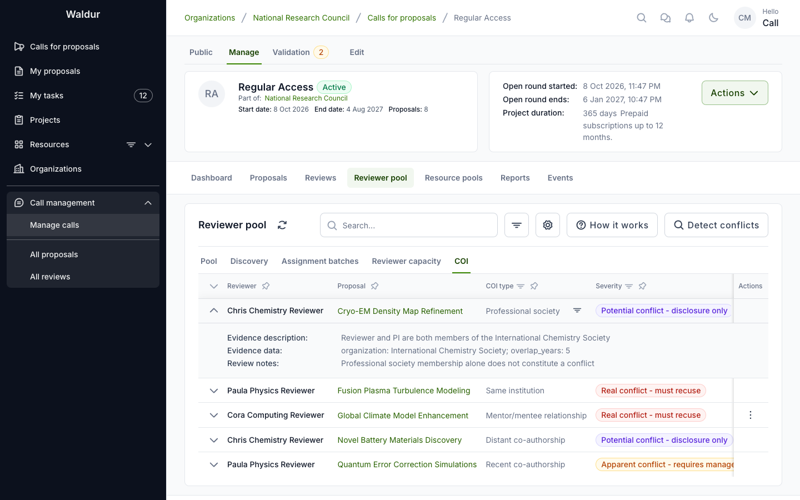

### Creating assignment batches

After matching, create formal assignment batches to assign proposals to reviewers:

1. Go to the **Assignments** tab in the reviewer pool
2. Create batches grouping proposals per reviewer. A reviewer is not given more
   open assignments than their maximum (see
   [Managing reviewer capacity](reviewer-management.md#managing-reviewer-capacity)).
3. Send batches. The reviewer only sees a batch once it is sent, and is emailed
   the list of proposals and the response deadline when the
   `proposal.reviewer_assignment_invitation` notification is enabled on the
   deployment.

A sent batch expires after the call's assignment expiration period (7 days by
default). Before that, the reviewer gets one reminder (2 days before the
deadline by default); when a batch expires with proposals still unanswered, the
call managers are emailed. Both emails, too, are sent only when their
notifications are enabled. Use **Extend deadline** on a sent or expired batch to
give the reviewer more time: an expired batch returns to **Sent**, its
unanswered proposals become pending again, and a new reminder is sent before the
new deadline. Reviews already accepted from the batch are not due before the
batch's new deadline.

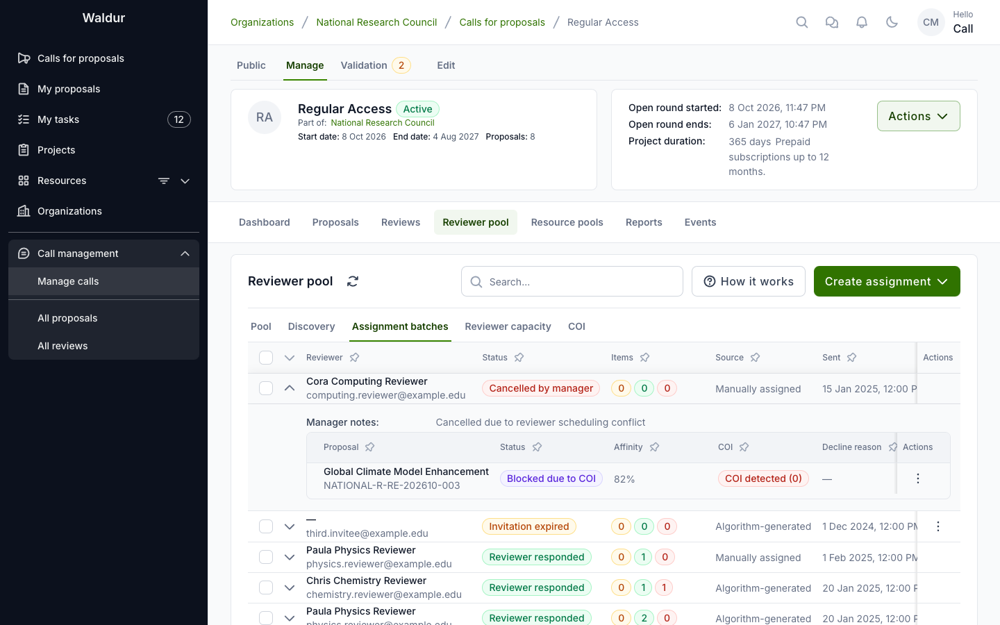

Reviewers can accept or decline each proposal. Expanded batches show individual item responses:

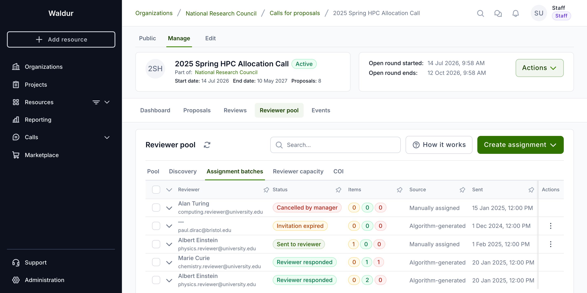

### Review process

**Performed by:** Reviewer

Reviewers see their assignments on the reviewer dashboard:

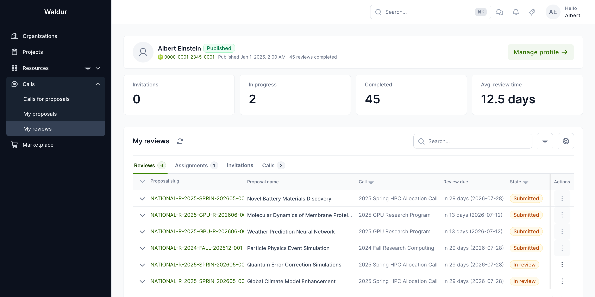

The **Assignments** tab shows pending batches with accept/decline actions:

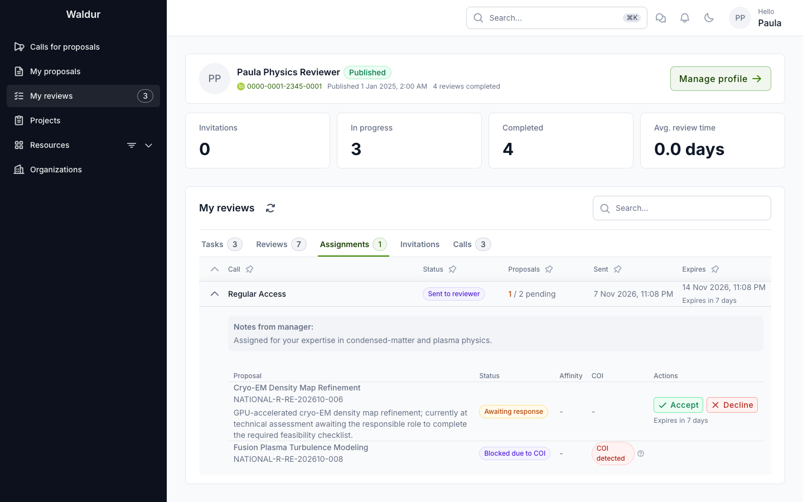

Reviewers evaluate proposals using a structured assessment process:

1. Open a review from the **My reviews** list
2. Read the proposal summary, team composition, and resource requests
3. Score the proposal and provide feedback
4. Submit the review

Every review is scored on the same 1–5 scale. When the review step names
scoring **criteria** (for example *Excellence*, *Impact*, *Quality of
implementation*), the reviewer rates each criterion and the overall score is
derived from them: their average weighted by each criterion's **Weight**,
rounded half up. A review cannot be submitted until every criterion is rated.
Without criteria the reviewer gives the overall score directly.

Weights are relative to the step's other criteria (1–100); the step's settings
show each criterion's resulting **Share**, and reviewers see it next to the
criterion's name when the weights differ. Once a reviewer has scored the
criteria, or submitted a review in the step, the criteria and their weights
are fixed: they can be reordered, but not renamed, added, removed or
reweighted. The proposal and review exports carry a column per criterion.

### Requesting changes from the applicant

**Performed by:** Whoever acts on the current step (call manager by default)

A step with **Allow requesting changes** turned on (in the step's settings,
under **Inputs and visibility**) can send a proposal back to its applicant
without rejecting it — to fix a missing document or clarify a resource
request, say. It is not available on the allocation decision or on a step the
applicant completes.

1. On the proposal, click **Request changes** in the **Progress** panel.
2. Write a **Message to the applicant**, choose the **Parts the applicant may
   change** — for example *Summary*, *Description*, *Supporting
   documentation*, *Resource requests*, *Project team* or *Compliance
   checklist* — and optionally a **Due date**.

The proposal stays **In review** on its step. Only the chosen parts become
editable for the applicant, who is notified and sees *Changes requested at
<step>* with the parts they may edit; they make the changes and click **Submit
changes**. The step's deadline does not run out while the request is open, and
the step cannot be completed or rejected until the request is closed: the step
shows *Waiting for the applicant's changes*.

The request closes in one of three ways, and each returns the step to whoever
acts on it with its full duration again:

- the applicant submits the changes;
- the call manager uses **Cancel request for changes**;
- its due date passes without changes — the request lapses and the step's
  actor is told. Nothing is decided on anyone's behalf.

A step may send the proposal back as often as needed, one open request at a
time.

### Withdrawn proposals

A proposal manager of the applicant team can use **Withdraw proposal**, with
an optional reason, while the proposal is **Submitted** or **In review**. The
proposal is **Canceled**: its unfinished steps are skipped, reviews still
being written are closed, unanswered review assignments lapse, and the call
managers are emailed. Once an award awaits the applicant's answer, withdrawing
is refused — declining the award is the way out then.

## Step 7: Decision and allocation

**Performed by:** The responsible role of the **Allocation decision** step (Call manager by default)

The call manager monitors all proposals and their review status:

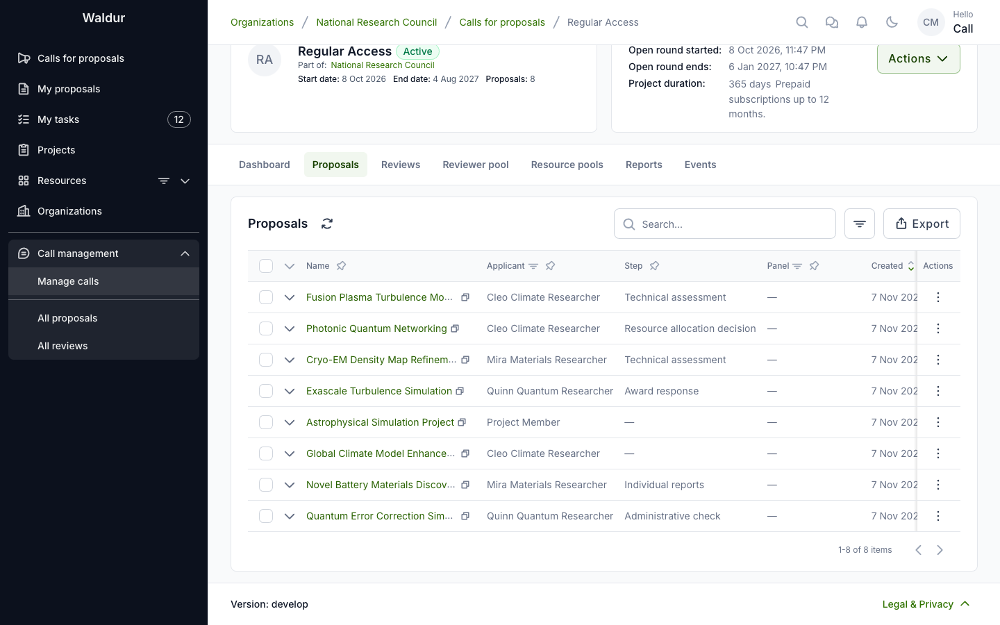

The reviews list shows every review with its reviewer, round and state:

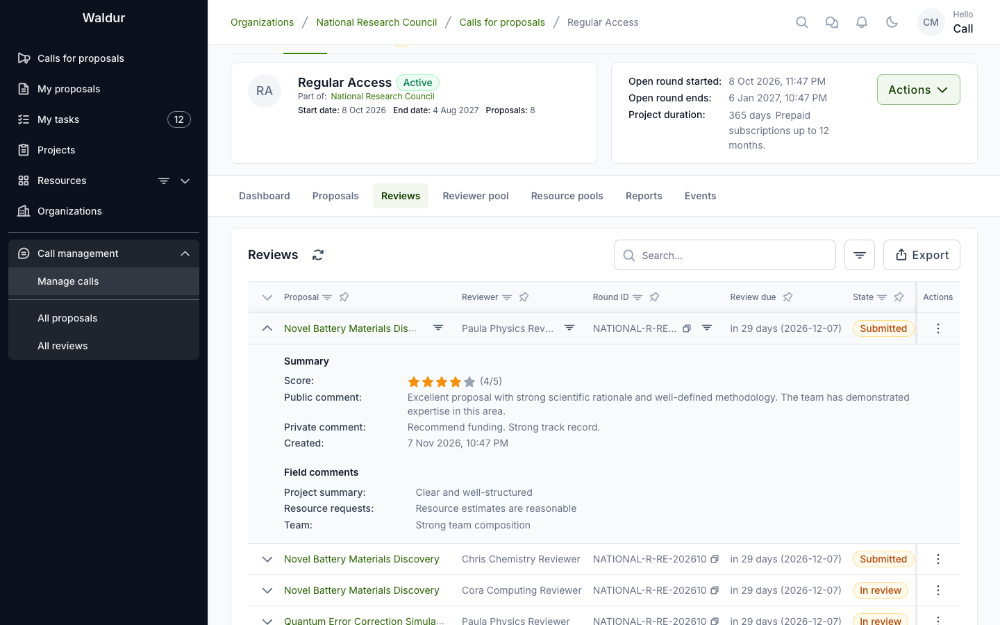

The final decision process determines which proposals receive resource allocations:

1. The responsible user completes the **Allocation decision** step after weighing the reviews.
   While the step is in progress, the call manager can adjust what is granted in
   the proposal's [awarded resources](call-manager-workflow.md#awarded-resources).
2. Proposal is **accepted** or **rejected** — at once, or, on a call that
   publishes results together for the whole round, when the round's results are
   [published](#publishing-a-rounds-results).
3. If accepted:
      - A **new project** is created under the call-managing organization.
      - The awarded resources are provisioned.
      - Team members are added to the project.

### Round lifecycle after the cut-off

Before its cut-off a round is **Scheduled** or **Open**, derived from its dates.
Once the cut-off has passed, the round enters a stored lifecycle that the call
manager drives from the round's **⋮** menu on the call's **Rounds** tab:

| Stage | Entered | What it means |
|---|---|---|
| **Evaluating** | automatically after the cut-off (an hourly job), when the round is closed early, or on the first lifecycle action | The round's proposals are being evaluated |
| **Deciding** | **Start deciding** | The evaluated batch has gone to the decision body. Optional — results can be published straight from *Evaluating* |
| **Results published** | **Publish results** | Every decision of the round has been announced |
| **Closed** | **Complete round** | Nothing more happens in the round |

The rounds list shows the stage next to the round's status, and, for call
managers, a **held** count of decisions recorded but not yet announced. Expand a
row to see when each stage started, who published the results, the rule for
undecided proposals and the adoption record.

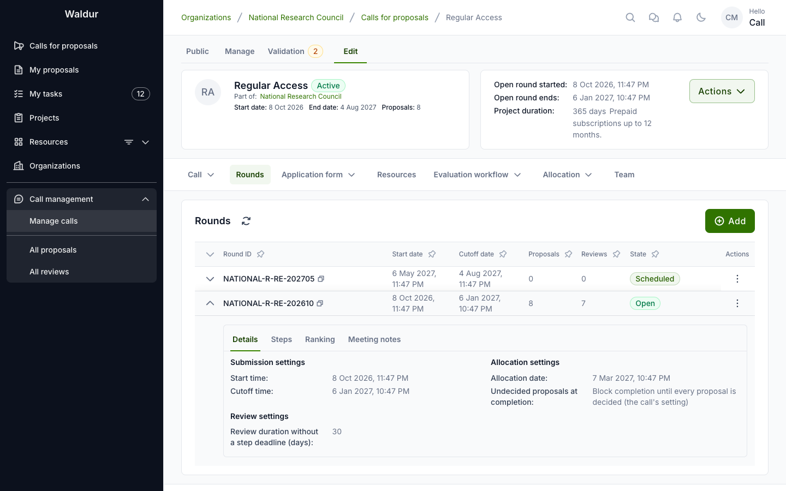

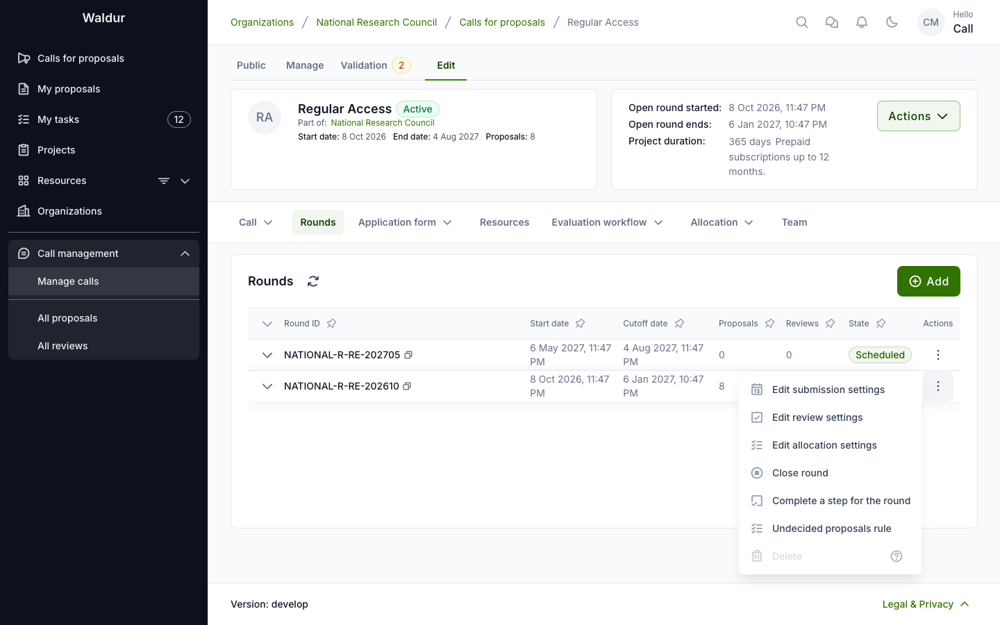

Each step is logged as an event of the call. The lifecycle actions require the
same permission as closing a round, and are available only while the call is
active.

### Publishing a round's results

**Applicants learn the decision** under **Call → General
configuration** decides when an applicant hears the outcome:

- **As each decision is made** — completing or rejecting the **Allocation
  decision** step announces the outcome at once, as before.
- **Together for the whole round** — the decision is recorded but **held**. The
  proposal stays **In review** for the applicant, the notification is not sent,
  and nothing is provisioned. The call team sees the tentative outcome
  (*Awarded (tentative)*, *Not awarded (tentative)*) in the proposals list. When
  the round is ready, a call manager publishes its results and every applicant
  of the round is told at the same time.

**Publish results** announces every held decision of the round and carries it
out as if it had just been made: an approved proposal continues to the award
response step, or is accepted and provisioned; a declined one is rejected. Each
applicant receives the same notification an immediate decision would have sent.

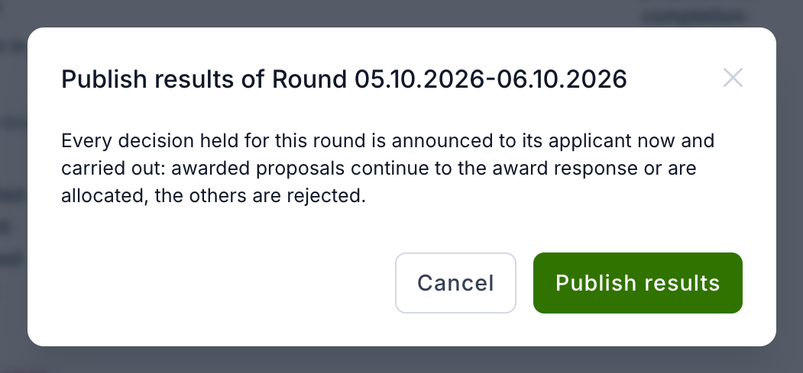

Publishing is refused while some proposals of the round are still being
evaluated without a decision. The dialog says how many; to publish anyway, use
**Publish anyway** and give a **Reason for publishing early**. The reason is
kept on the round, and the undecided proposals carry on — their decisions are
announced as they are made.

If a held decision cannot be carried out (for example, its allocation cannot be
provisioned), it stays held and the dialog lists it; the rest are published.
**Publish results** remains available on the round while anything is still held,
and publishing again retries it.

On a call that announces each decision as it is made, **Publish results** holds
nothing back: it only records the round's stage.

Until results are published, a call manager can take a held decision back with
**Reopen decision** on the proposal — see
[Held decisions](call-manager-workflow.md#held-decisions).

!!! note "Who sees a held decision"
    Only staff, support, and users who can update the call (its call managers and
    the managing organisation's call organisers) see that a decision is held and
    what it is. Applicants, reviewers, panel members and offering managers see
    the allocation decision as still in progress until the results are published.
    An applicant who also manages the call is treated as an applicant for their
    own proposal.

### Completing a round

**Complete round** closes a round whose results have been published. What
happens to proposals that still have no decision follows
**Undecided proposals when a round is completed** — set on the call and
overridable per round with **Undecided proposals rule**:

- **Block completion until every proposal is decided** — completing is refused
  and the dialog says how many proposals have no decision yet.
- **Reject them automatically** — each undecided proposal is rejected at the
  workflow step it stands in, with the reason *Not decided when the round was
  completed.*, and its applicant is notified at once. The round is then closed.

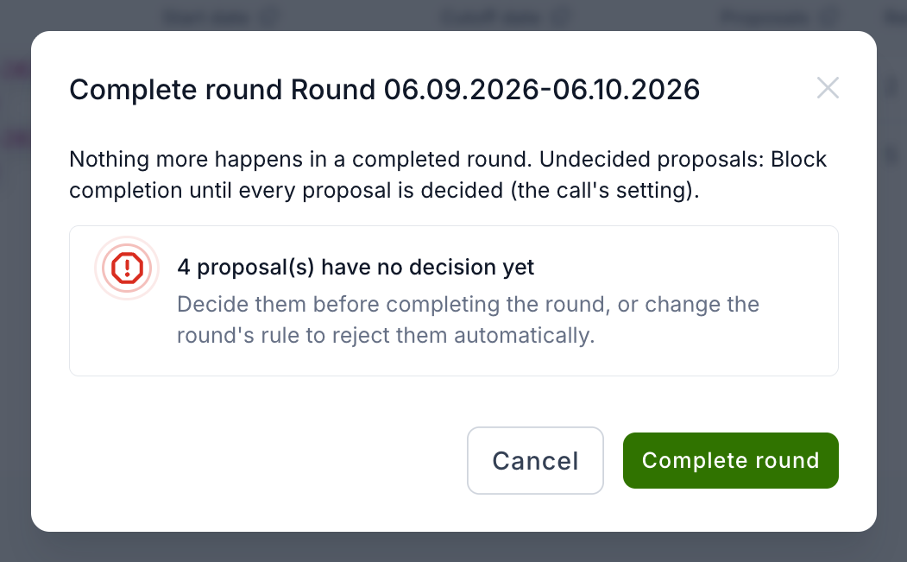

Completing is also refused while a decision of the round is still held because
its release failed at publication; publish the results again first.

### Recording adoption

Where the results must be adopted by another body (a board, for example), record
it with **Record adoption** on the round: the adoption date, a note and
optionally the adopting document. It can be recorded at any time after the
cut-off. While the round still holds its decisions, the adoption note, the
document and the reason for publishing early are shown only to those who may see
held decisions.

## Step 8: Monitoring and reporting  

**Performed by:** Call manager and Call organiser

The call dashboard provides an overview of the entire call:

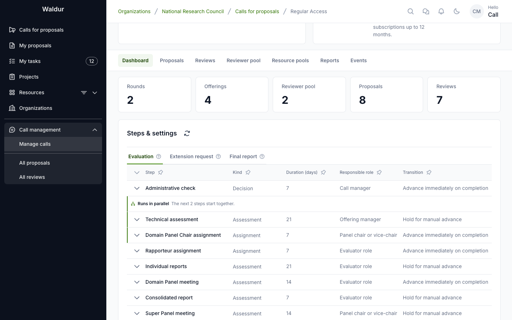

- Use the dashboard to monitor:
      - Round statuses
      - Proposal pipeline
      - Review progress
      - Reviewer pool capacity

The organization's **Call management** dashboard counts only the calls you may
configure: a call manager's figures cover the calls they manage, while call
organisers, staff and support see every call of the organization. Its
statistics are refused to anyone who may read none of the organization's call
reports.

### Admin reviews

Staff users can view all reviews across all calls from the admin reviews page:

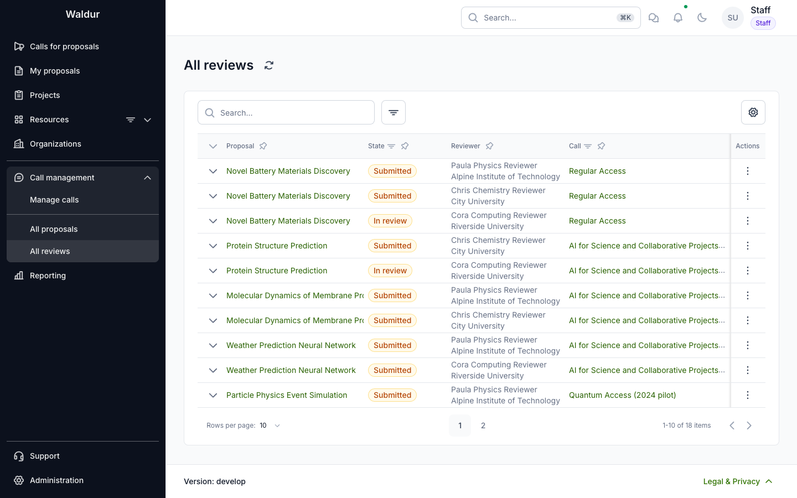

Reviews can be filtered by specific call:

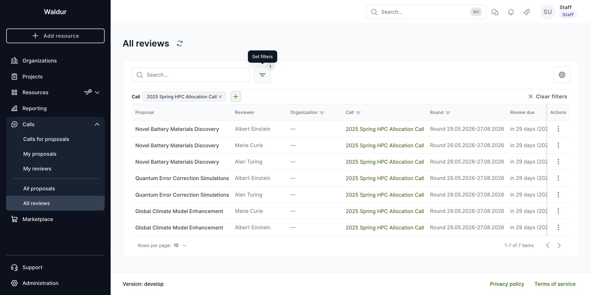

## Additional tips

- Always check round and call status before making edits.
- Assign enough reviewers early to avoid bottlenecks.
- Communicate with applicants when revisions are needed.
- Keep documentation clear and up to date.

## Troubleshooting

Solutions for common issues encountered during the call management process:

| Issue | Possible Cause | Solution |
| --- | --- | --- |
| Unable to create call | Insufficient permissions | Verify user has Call Organiser role |
| Round cannot be activated | Missing required configuration | Check that all mandatory fields are completed |
| Offering request pending | Service provider hasn't responded | Contact provider directly or through system notification |
| Reviewer cannot access proposal | Incorrect assignment | Verify reviewer assignment in call settings |
| Applicant cannot see active call | Call visibility settings | Check call publication status and visibility settings |
| Resource allocation failed | Insufficient provider capacity | Contact service provider to resolve capacity issue |
| Round cannot be deleted | The round has proposals, in any state | Rounds with proposals stay on record; only an empty round can be deleted |
| **Activate** is refused or shows a number of errors | The workflow check found errors | Open the call's **Validation → Check** tab and fix each error from its link |
| Applicant refused with *You have reached the maximum of N active projects or pending proposals* | The call-managing organization limits proposals per applicant | The applicant waits until a proposal is decided or a project ends, or staff raise **Active proposals per applicant** (see [Limiting proposals per applicant](#limiting-proposals-per-applicant)) |
| **Applicants learn the decision** cannot be changed | The call holds decisions that have not been published | Publish the results of the rounds that hold them first |
| **Complete round** is refused | Proposals of the round have no decision, or a held decision failed to publish | Decide them (or set the round's rule to reject them), or publish the results again |

## FAQ

**Q: What's the difference between a Call Organiser and a Call Manager?**
A: A Call Organiser is appointed by the Organization Owner to create calls and assign Call Managers. The Call Manager is responsible for the detailed configuration of calls assigned to them including setting up rounds, assigning reviewers, and managing the review process.

**Q: Can a call have multiple rounds running simultaneously?**
A: No, Waldur supports multiple rounds within a single call, allowing for different resource types or applicant categories to be handled separately, but they cannot be active at the same time.

**Q: What happens if insufficient reviewers complete their evaluations?**
A: **Minimum contributions** on an assessment step (**Minimum reviewers** on a decision) is a completion gate: the step cannot be completed with a positive outcome until that many reviews have been submitted, though declining the proposal is always possible. If the step has a duration and its deadline passes first, the step is marked **Overdue** and the workflow moves on to the next step, or rejects the proposal if it was the last one (see [Deadline handling](workflow-configuration.md#deadline-handling)). To avoid this, assign further reviewers in time, or leave the step's duration unset so it waits.

**Q: Can applicants edit their proposals after submission?**
A: Not on their own. Once a proposal is submitted its requested resources and documents are fixed: what was submitted is what gets evaluated. The exception is a [request for changes](#requesting-changes-from-the-applicant): on a step that allows it, whoever acts on the step can unlock chosen parts for the applicant to change and submit again. Call managers and staff can still adjust a proposal at any time. A draft left open at its round's cut-off is the exception only in that it survives into the next round (see [Drafts at the cut-off](#drafts-at-the-cut-off)); it is still a draft until the applicant submits it.

**Q: Is it possible to transfer allocated resources between approved projects?**
A: Resource transfer between projects requires administrative approval. Contact your Call manager to request a resource transfer.

**Q: How are applicants notified about proposal decisions?**
A: Waldur automatically sends email notifications to all team members listed in a proposal when a decision (approval or rejection) is announced — when it is made, or, on a call that publishes results together for the whole round, when the round's results are published.

**Q: Can a Call manager override reviewer scores?**  
A: Decisions are always made by a person completing a workflow step; scores never decide on their own. A step can be declined regardless of scores, but approving is blocked while a **Minimum contributions**, **Minimum reviewers** or **Minimum score threshold** set on that step is not met. All reviewer feedback remains visible and documented.
