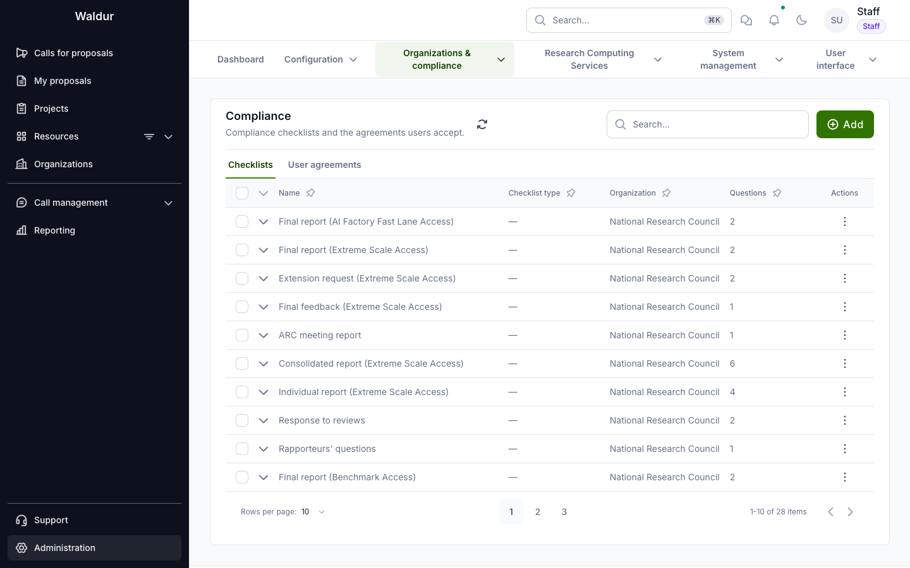

# Checklists and forms

Waldur uses a flexible checklist system to create customizable forms for proposals, compliance checks, and onboarding workflows. This guide covers how to configure and manage checklists within call management.

## Overview

Checklists in Waldur serve multiple purposes:

| Checklist Type | Purpose |
|---|---|
| **Proposal compliance** | Questions that proposal submitters must answer |
| **Workflow step evaluation** | The form evaluators (or the applicant, on an applicant step) fill in at a workflow step — see [Workflow configuration](workflow-configuration.md#evaluation-checklists) |
| **Offering compliance** | Compliance checks for service provider offerings |
| **Project compliance** | Compliance checks for projects |
| **Project metadata** | Additional project information collection |
| **Onboarding customer data** / **Onboarding intent/purpose data** | Data collection during organization onboarding |
| **Feedback survey** | Feedback surveys |

## Supported question types

Waldur supports 18 question types for building forms:

| Question Type | Description | Validation |
|---|---|---|
| **Yes/No** | Boolean with Yes/No/N/A options | — |
| **Text input** | Single-line short text | — |
| **Text area** | Multi-line long text | — |
| **Number** | Numeric input (integer or decimal) | Optional min/max value |
| **Date** | Date picker (YYYY-MM-DD) | Date format validation |
| **Date and time** | Date with time picker | DateTime format validation |
| **File** | Single file upload | Optional: allowed types, MIME types, max size |
| **Multiple files** | Multi-file upload | Optional: allowed types, max count, max size |
| **Single selection** | Dropdown with one selectable option | Options defined via Question Options |
| **Multiple selection** | Dropdown with multiple selectable options | Options defined via Question Options |
| **Phone number** | Phone number input | Phone format validation |
| **Year** | Year input | Optional min/max year |
| **Email** | Email address input | Email format validation |
| **URL** | URL input | URL format validation |
| **Country** | Country selector (ISO 3166) | Country code validation |
| **Rating** | Numeric rating scale | Configurable min/max (e.g., 1-5) |
| **Likert** | Agreement scale with labelled ends | 3, 5 or 7 points; optional N/A |
| **Rich text** | Formatted long text | Optional character limit |

## File upload configuration

For **File** and **Multiple files** question types, you can configure:

- **Allowed file extensions**: e.g., `.pdf`, `.doc`, `.docx`
- **Allowed MIME types**: e.g., `application/pdf`, `application/msword`
- **Maximum file size**: In megabytes
- **Maximum file count**: For multiple files type only

!!! tip
    When both extensions and MIME types are specified, files must match both criteria for security.

## Conditional visibility (question dependencies)

Questions can be shown or hidden based on answers to other questions, enabling dynamic forms.

### Setting up conditional visibility

1. Create the base question (the one that controls visibility)
2. Create the dependent question
3. Add a **dependency** linking the dependent question to the base question
4. Configure:
    - **Depends on question**: The base question
    - **Required answer value**: The answer that makes the dependent question visible
    - **Operator**: How to compare (equals, not equals, contains, in list, not in list)

### Dependency logic operators

When a question has multiple dependencies:

- **AND**: All dependencies must be satisfied for the question to be visible
- **OR**: At least one dependency must be satisfied

### Available comparison operators

| Operator | Description | Example |
|---|---|---|
| **Equals** | Exact match | Answer = "Yes" |
| **Not equals** | Inverse match | Answer ≠ "No" |
| **Contains** | Substring match | Answer contains "GPU" |
| **In list** | Value in set | Answer in ["Option A", "Option B"] |
| **Not in list** | Value not in set | Answer not in ["N/A"] |

!!! note
    The system prevents circular dependencies. If Question A depends on Question B, then Question B cannot depend on Question A (directly or through a chain).

## Review trigger configuration

Questions can be configured to flag answers for review by call managers:

- **Review answer value**: The answer that triggers a review flag
- **Operator**: Comparison method (same operators as above)
- **Always requires review**: Flag for review regardless of answer

When a triggered answer is submitted, the checklist completion is marked as requiring review.

## Attaching checklists to calls

**Performed by:** Call manager

1. Open the call's **Edit** page
2. Under **Call → General configuration**, on its **Compliance** tab, select a **Compliance checklist** (it can also be chosen when creating a blank call)
3. The selected checklist will be presented to all proposal submitters

The compliance checklist can only be changed while the call has no proposals.
Evaluation checklists for individual workflow steps are attached in each step's
settings instead (see [Workflow configuration](workflow-configuration.md)).

When a proposal is created, the system automatically creates a checklist completion record for that proposal. Submitters must answer all required questions before submitting.

## Checklist completion tracking

For each proposal with an attached checklist:

- **Completion percentage**: Tracks how many questions have been answered
- **Review status**: Indicates if any answers require manager review
- **Review notes**: Managers can add notes after reviewing flagged answers

## Managing checklists (administrators)

Staff manage checklists under **Administration → Compliance → Checklists**:

1. **Create checklist**: Define name, type, description and, optionally, the **Organization** it belongs to (see below)
2. **Add questions**: Create questions with type, ordering, required flag, and guidance text
3. **Add options**: For selection types, add option labels with sort order
4. **Add dependencies**: Configure conditional visibility between questions
5. **Attach to calls**: Link the checklist to specific calls via call configuration

### Shared and organization checklists

A checklist either belongs to one organization or is shared by the whole
portal:

- **Organization checklist** — only that organization's calls can use it, and
  only its people see it. Use it for an evaluation form that is internal to one
  call-managing organization.
- **Shared** (no organization) — every call on the portal can use it.

Leave **Organization** empty for a shared checklist. A call created from a
template or imported from a file gets its own copies of the template's
evaluation forms, so editing them changes no other call.

!!! warning
    Modifying checklist questions after proposals have been submitted may affect existing answers. Consider creating a new checklist version for significant changes.

    A checklist, or a question, that already has answers cannot be deleted —
    deleting it would delete the answers with it. Detach the checklist from
    the call or step that uses it instead.
