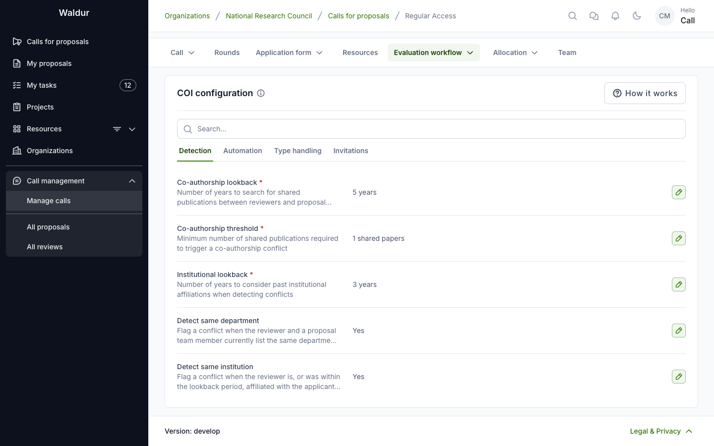
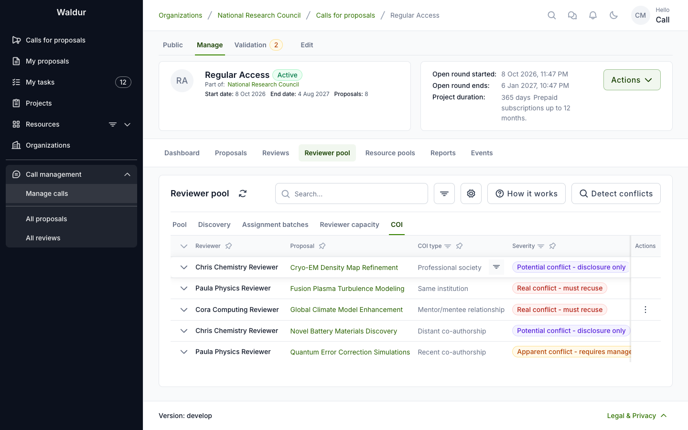
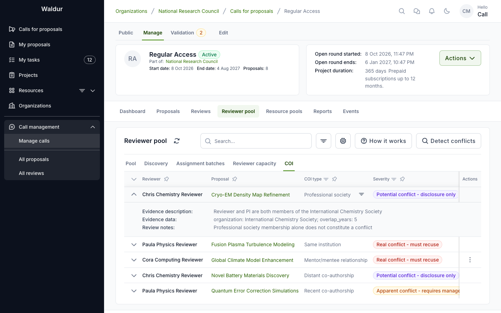
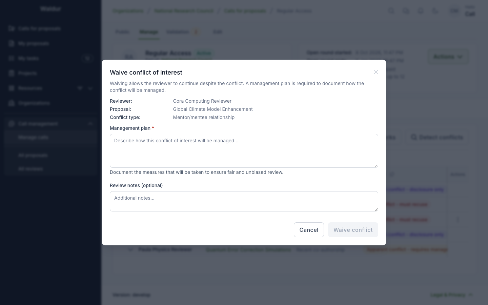
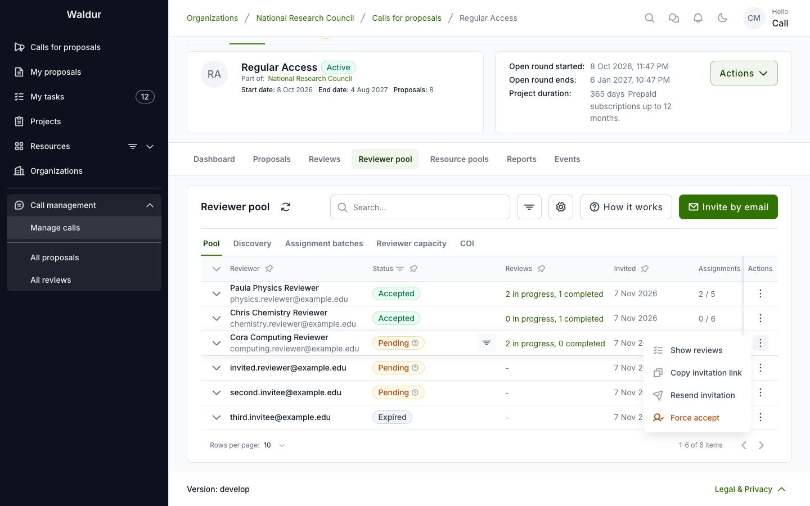
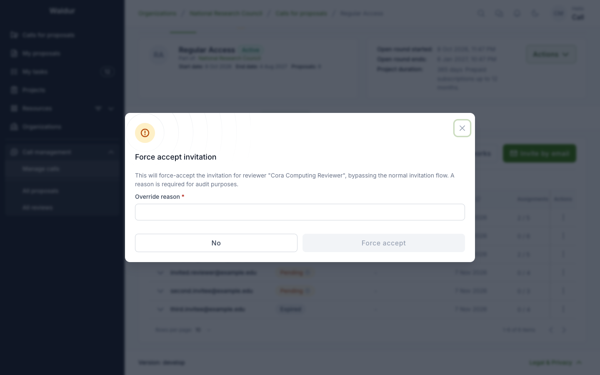

# Conflict of interest management

Waldur includes a conflict of interest (COI) detection and management system for the call-for-proposals workflow, to ensure fair and unbiased peer review. This guide covers how call managers configure detection, review the conflicts found, and use staff override capabilities when the automated workflow gets blocked. What reviewers see and do is described in [Reviewing proposals](reviewer-workflow.md#declaring-a-conflict-of-interest).

## Overview

COIs are detected automatically or declared by the reviewer. Each COI has:

- **Type**: Same institution, co-authorship, family relationship, mentor/mentee, financial interest, etc.
- **Severity**: Real (must recuse), Apparent (requires management plan), or Potential (disclosure only)
- **Status**: Pending, Dismissed, Waived, or Recused

### COI types detected

Waldur recognises around twenty specific conflict types, grouped into broad families:

| Family | Specific types (examples) |
|---|---|
| Institutional | Same institution, same department, former institution, consortium membership |
| Financial | Direct financial interest related to the proposal |
| Relational | Family, supervisor, mentor/mentee, or editorial relationship |
| Co-authorship | Recent or older co-authored publications |
| Collaboration & role | Active or grant collaboration, named on the proposal, conference organiser, competitor, professional-society membership |

Each specific type is mapped to a severity and a handling rule in the call's **Type handling** COI settings (see [Configuring COI detection](#configuring-coi-detection)).

### Severity levels

| Severity | Meaning | Required action |
|---|---|---|
| **Real conflict — must recuse** | Confirmed conflict that must be addressed | Reviewer is recused from the proposal |
| **Apparent conflict — requires management** | Circumstantial conflict that may need review | Call manager waives with a written management plan, or recuses |
| **Potential conflict — disclosure only** | Possible conflict flagged for awareness | Acknowledge; review may proceed |

### Detection methods

- **Automated**: System cross-references reviewer affiliations and publications against proposal team data
- **Self-disclosed**: Conflicts declared by the reviewer when accepting a pool invitation (through the API; the invitation page has no declaration form)
- **Reported** and **Manager-identified**: recorded detection methods, but there is no screen for a third party or a call manager to flag a conflict

Keeping reviewer profiles (affiliations and publications) up to date makes the automated detection accurate.

## Configuring COI detection

**Performed by:** Call manager

1. Open the call's **Edit** view
2. Select **Evaluation workflow → COI settings**

You control co-authorship and institutional lookback windows, matching thresholds, and which relationships are flagged. The COI configuration is organised into four tabs:

| Tab | Purpose |
|---|---|
| **Detection** | Lookback periods (co-authorship, institutional), shared-publication thresholds, "same department" / "same institution" toggles |
| **Automation** | Auto-detect toggles per source (co-authorship, institutional, named personnel) — determines what runs without manual triggering |
| **Type handling** | For each conflict type, choose whether it triggers **recusal**, requires a **management plan**, or is **disclosure only** — used by the detector when assigning severities |
| **Invitations** | How much of each proposal a reviewer sees in an assignment batch before accepting it — in the assignment invitation email and on their **Assignments** tab: **Titles only** (the default), **Titles and summaries**, or **Full proposal details**, which currently shows the same as titles and summaries. A proposal blocked by a conflict of interest is always shown by title only. After accepting, the reviewer reads the full proposal through their review. |

A summary dialog (from the section header) lists every setting at a glance, and inline tooltips explain each COI concept.

!!! note
    COI settings stay editable while the call is active; they are read-only only on an archived call or for users without permission to edit the call. Re-run detection after changing them.

When a review step has **Conflict of interest confirmation** enabled, reviewers
must additionally attest to being conflict-free before they can submit their
review — the **Submit review** button stays disabled until they do (see
[Per-step settings](workflow-configuration.md#per-step-settings)).

## Running COI detection

1. Open the call's **Reviewer pool** and its **COI** tab, and click **Detect conflicts** (shown only when COI detection is enabled on the platform)
2. The system runs a batch detection job in the background; the button shows that detection is running, and you are told how many new conflicts were found when it finishes
3. Review the detected conflicts in the same **COI** tab
4. For each conflict, choose to **Dismiss**, **Waive** (with justification), or **Recuse** the reviewer

## Reviewing conflicts of interest

Navigate to your call's **Manage** page and select the **Reviewer pool** tab, then the **COI** sub-tab. It lists conflicts detected between reviewers and proposal teams.

The COI table has **Reviewer**, **Proposal**, **Round**, **COI type**, **Severity**, **Status** and **Detected** columns, plus an optional **Detection** (method) column. It is the operational view used to triage all detected and declared conflicts on the call:

- **Filters** — narrow the list by status (*Pending*, *Dismissed*, *Waived*, *Recused*), severity, COI type or round.
- **Severity badges** — the **Severity** column shows each conflict's severity (Real conflict / Apparent conflict / Potential conflict) as a coloured badge.
- **Expandable rows** — expand a row to see the evidence description and evidence data behind a conflict, the conflicting person or organisation, and, once it has been handled, who reviewed it and when, the review notes and any management plan.

For each pending COI, the call manager can take one of three actions. Only a pending conflict can be resolved, and only once:

### Dismiss

Mark the COI as a false positive. The reviewer can continue reviewing the proposal without restrictions. Related assignment items that were blocked by this COI are automatically unblocked.

### Waive

Approve the reviewer to continue despite the conflict, but with a mandatory **management plan** describing the mitigation measures. Choosing **Waive** opens a dialog that requires this written **Management plan** (and accepts optional **Review notes**) before the conflict can be cleared. The management plan, the manager, and the timestamp are recorded on the conflict and stay visible to staff users. Related blocked assignments are automatically unblocked.

**Waive** is disabled for a conflict type that the call's **Type handling** settings require recusal for.

### Recuse

Permanently remove the reviewer from the proposal: their pending or accepted assignment items for it are marked as blocked, a review still in progress is rejected, and an evaluator role they hold on the proposal is revoked.

!!! note
    When a COI is dismissed or waived, any assignment items that were blocked solely because of that COI are automatically changed from "blocked" to "pending". If multiple COIs exist for the same reviewer-proposal pair, the assignment remains blocked until all COIs are resolved.

### COI gating on assignments

When a conflict exists between a reviewer and a proposal, the corresponding assignment item is **blocked** until the conflict is resolved (dismissed, waived, or the reviewer recused). Call managers and staff can **force-unblock** a blocked assignment when a strong operational reason exists; the override is flagged on the assignment (see [Force-unblocking COI-blocked assignments](#force-unblocking-coi-blocked-assignments)).

### Evaluator role holders

A pending or recused conflict of interest between an evaluator role holder and the proposal stops their access at once; dismissing or waiving it gives it back (see [Evaluator roles](workflow-configuration.md#evaluator-roles)).

### Evaluators who join the applicant team

Whoever joins the team of a proposal they evaluate is treated as having a
recorded conflict of interest with it: their evaluator role on it is revoked
(*Joined the applicant team.*), a review in progress is rejected, assignments
not yet answered are blocked and their open contributions are withdrawn. An
offering manager on the team no longer fills their offering's technical
assessment of it, and a panel member on the team reads the proposal as an
applicant.

## Staff override capabilities

When the automated workflow gets stuck — for example, a reviewer cannot answer their invitation or an assignment is blocked by a COI that the manager wants to override — staff and call managers can use manual overrides.

### Force-accepting reviewer pool invitations

If a reviewer's invitation is stuck in **pending**, **declined**, or **expired** status, a call manager can force-accept it. An invitation sent by email to someone without a reviewer profile cannot be force-accepted, nor can the invitation of a reviewer whom the platform operator has suspended or blocked, or who does not meet the call's reviewer eligibility rules.

!!! tip
    For an invitation that simply expired or went unanswered, resend it instead: the reviewer gets a new link and a new expiry date and accepts it themselves (see [Invitation expiry and resending](reviewer-management.md#invitation-expiry-and-resending)). Keep force-accept for cases where the reviewer has agreed through other channels but cannot answer the invitation.

1. Navigate to the **Reviewer pool** tab
2. Find the invitation with the stuck status
3. Click the three-dot action menu and select **Force accept**

    

4. In the dialog, provide a mandatory **override reason** explaining why the override is necessary

    

5. Click **Force accept** to confirm

The invitation status changes to "Accepted" with an "Overridden" badge indicating it was manually accepted.

!!! warning
    Force-accepting an invitation bypasses the reviewer's consent. Only use this when you have confirmed with the reviewer through other channels. The override reason is recorded for audit purposes.

### Force-unblocking COI-blocked assignments

If an assignment item is blocked due to a COI and the manager wants to proceed regardless:

1. Navigate to the **Assignment batches** sub-tab in the Reviewer pool
2. Expand the assignment batch to see individual items
3. Find the item with **Blocked due to COI** status
4. Click the action menu and select **Force unblock**
5. Provide a mandatory **Override reason**
6. The item status changes from "blocked" to "pending"

!!! warning
    Force-unblocking an assignment allows a reviewer with a known conflict of interest to review a proposal. Use this only when the conflict has been evaluated and the risk is acceptable. The override is recorded with the reason, user, and timestamp for compliance purposes.

## Audit trail

All override actions are recorded with:

- **Who** performed the override
- **When** it was performed
- **Why** (the mandatory override reason)

This information is visible in the reviewer pool table (as an "Overridden" badge with tooltip) and in assignment item details.
