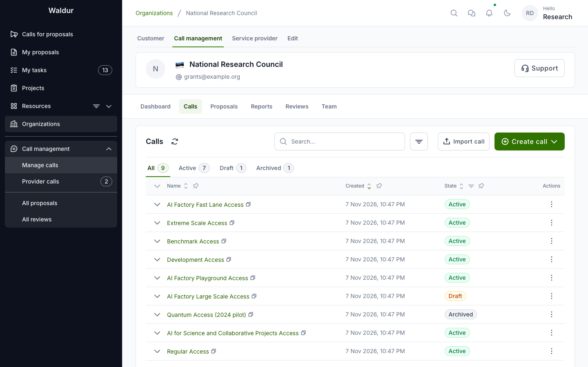
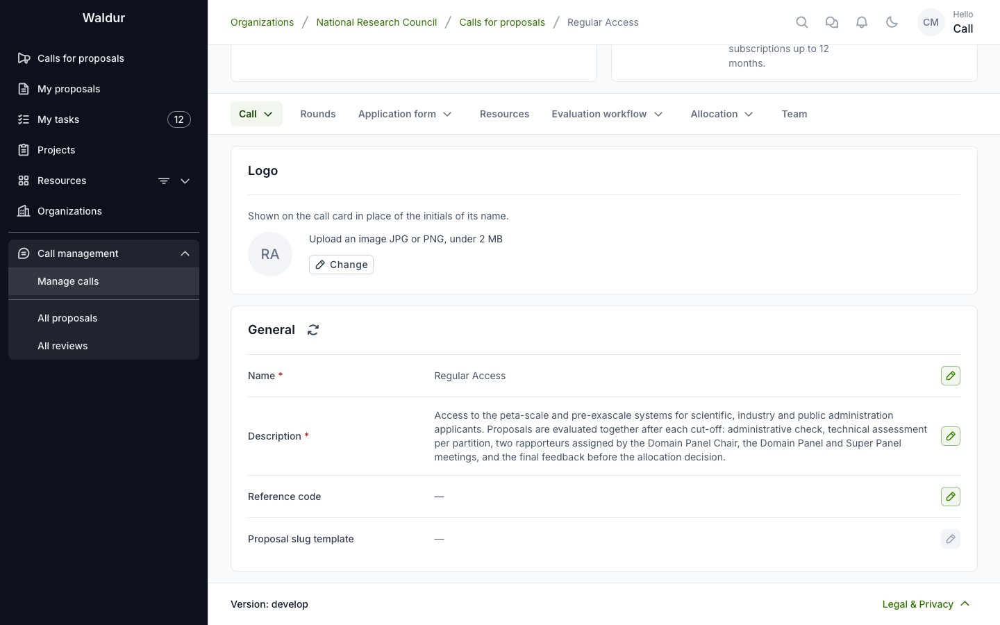
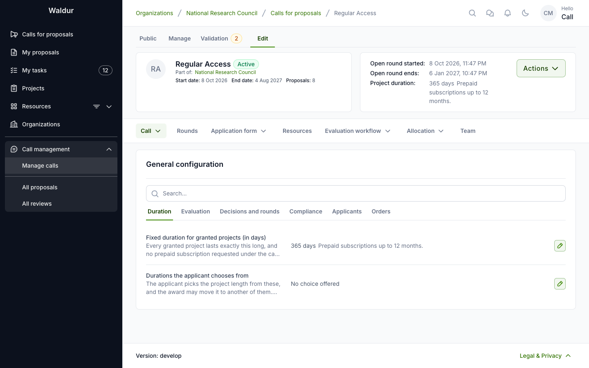
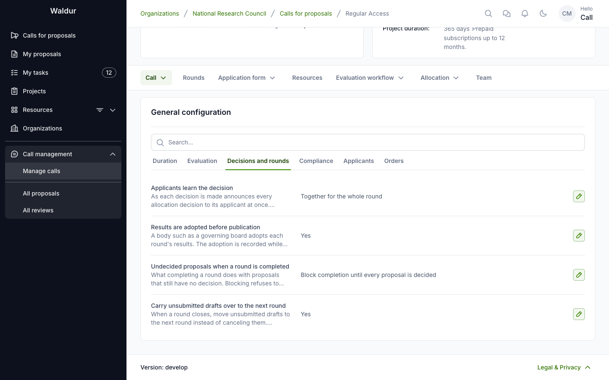
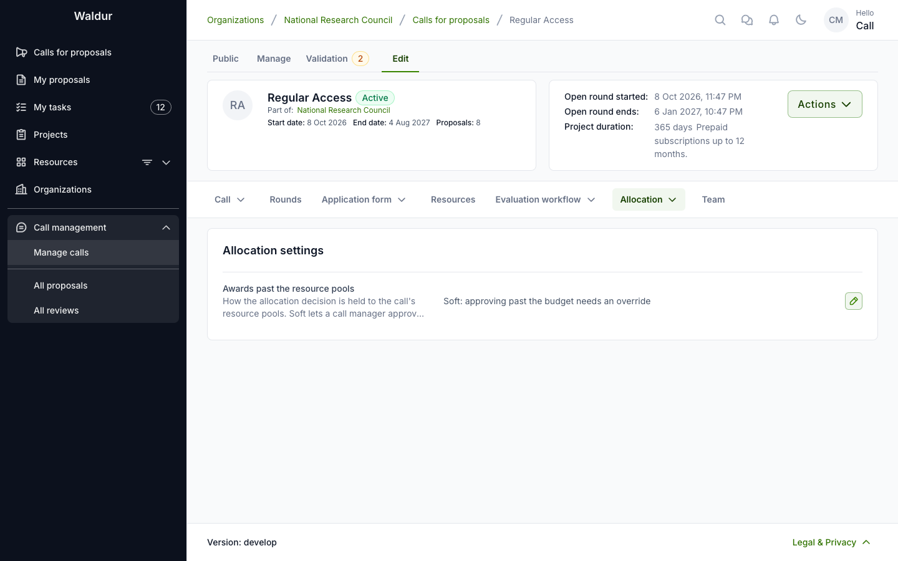

# Creating and configuring a call

A call is created as a **draft**, blank or from a template, and configured on its **Edit**
page before it is activated. This page covers creating the call and its general settings; the
other parts of the configuration have pages of their own, linked from the
[table of tabs](#the-calls-edit-page) below.

## Finding your calls

Open your call-managing organisation and switch to the **Call management** tab. The **Calls**
section lists every call your organisation manages, grouped by state (All / Active / Draft /
Archived). Click a call name to open its **Manage** page, and switch to **Edit** to configure it.
Expand a call's row for its readiness — including the **Workflow check** verdict — its setup
and, for a call created from a template, **Created from template**.

## Creating a call

**Performed by:** Call organiser (or staff)

1. Navigate to the **Call management** section, in the organisation dashboard.
2. Go to the **Calls** section and click **Create call**. It offers two ways to
   start:
      - **Blank call** — asks for the call's **Name** and an optional
        **Compliance checklist**; the rest is filled in on the call's **Edit** page.
      - **From template** — see [Starting from a call template](#starting-from-a-call-template).
3. Either way the call is created as a **Draft**. Assign its call managers on
   the call's **Team** tab (see [Call team](call-resources-and-team.md#call-team)).

**Create call** is also on the **Manage calls** page, which lists the calls of every
organisation you run calls for; there it asks which organisation the call belongs to. Next to
it, **Import call** creates a call from an exported call file. A call's actions menu offers
**Duplicate call** and **Export**, which saves its configuration to such a file.

### Starting from a call template

**From template** opens **Create call from template**: pick a **Template**,
optionally give a **Call name**, and click **Create**. The call is created as
a draft with the template's settings, workflow steps, evaluator roles,
evaluation forms and notification rules, ready to complete with the parts that
belong to your portal: offerings, rounds, people, role mapping and resource
templates.

The dialog lists the templates staff have published, each with the process it
models and a description. Staff manage them under **Administration → Call
templates**: **Load preset** adds templates from the presets shipped with
Waldur — among them *Rapid access*, *Staff-reviewed allocation*,
*Peer-reviewed allocation*, *Technical and scientific review*, *Regular
Access*, *Extreme Scale Access*, beamtime proposals and classroom allocations —
and each template's row shows its workflow as steps, a diagram, a timeline and
scenarios. Staff also see unpublished templates in the dialog, marked
**Unpublished**. With no template published, the dialog says so: start from a
blank call, or import a call file.

A call created from a template remembers it: its expanded row in the calls list shows
**Created from template**, and the call's **Validation → Changes** tab lists how the
call now differs from the template.

For a worked example, see the [Extreme Scale call template](extreme-scale-template.md).

## The call's Edit page

**Performed by:** Call manager

The call's **Edit** page groups its settings into tabs:

| Tab | Sub-tabs | Described in |
|---|---|---|
| **Call** | **General** (name, description, reference code, proposal slug template, project name template, logo), **General configuration**, **Documents** | this page; [Proposal ID configuration](proposal-id-configuration.md) |
| **Rounds** | — | [Rounds](call-rounds.md) |
| **Application form** | **Project details fields**, **Applicant eligibility**, **Applicant data visibility**, **Resource templates** | [Application form](application-form.md) |
| **Resources** | the call's offerings | [Resources, role mapping and team](call-resources-and-team.md) |
| **Evaluation workflow** | **Steps & settings**, **Evaluator roles**, **Panels**, **COI settings**, **Reviewer eligibility**, **Matching settings** | [Workflow configuration](workflow-configuration.md), [Conflict of interest management](coi-management.md#configuring-coi-detection), [Reviewer management](reviewer-management.md#configuring-matching) |
| **Allocation** | **Allocation settings**, **Role mapping** | [Allocation settings](#allocation-settings); [Resources, role mapping and team](call-resources-and-team.md#role-mapping) |
| **Team** | — | [Resources, role mapping and team](call-resources-and-team.md#call-team) |

Next to **Edit**, the call has a **Manage** page (dashboard, proposals, reviews, reviewer pool,
resource pools, reports and events) and a **Validation** page (see
[Checking and activating a call](call-activation.md)).

The tabs can be configured in any order. Only activation needs a round: until the call has
one, the **Rounds** tab carries a warning icon.

## General settings

The **Call → General** sub-tab holds the call's identity: name, description, reference code,
the proposal slug template used to generate human-readable proposal IDs, and the **Project name
template** that names the project an accepted proposal creates (see
[Projects and resources](allocation-decision.md#projects-and-resources)), with a card for the
call's logo. On deployments that run their calls outside Waldur (the `marketplace.call_only`
feature) it also holds the call's **External URL**, which is then required. See
[Proposal ID configuration](proposal-id-configuration.md) for slug placeholders.

## General configuration

Under **Call → General configuration**, set the basic call parameters. They are
grouped into tabs.

On the **Duration** tab:

- **Fixed duration for granted projects (in days)**: how long every granted project runs. When it is set, it decides the project's end date, and applicants can only choose subscription lengths that fit inside it. Applicants see the resulting length in the submission form; they are not asked for a duration. See [How long a granted project runs](allocation-decision.md#how-long-a-granted-project-runs).
- **Durations the applicant chooses from**: instead of a fixed duration, a list of project lengths the applicant picks from; the award may move a proposal to another of them. No prepaid subscription may run longer than the chosen length. Setting a list clears the fixed duration, and setting a fixed duration clears the list.

On the **Evaluation** tab:

- **Evaluation starts**: **On submission** or **At the round cut-off** — when a submitted proposal's evaluation starts. It cannot be changed while the call has submitted or in-review proposals. See [When evaluation starts](call-rounds.md#when-evaluation-starts).
- **Target days from cut-off to decision**: how long the evaluation is planned to take after a round's cut-off. A round with an allocation date uses that date instead. The [workflow check](call-activation.md#checking-the-workflow-before-activation) warns when the step durations up to the decision take longer.

On the **Decisions and rounds** tab:

- **Applicants learn the decision**: **As each decision is made** (the default) or **Together for the whole round** — whether each allocation decision is announced as soon as it is made, or held until a call manager publishes the round's results. It cannot be changed while the call holds decisions that have not been published. See [Publishing a round's results](round-results.md#publishing-a-rounds-results).
- **Results are adopted before publication**: for results a body such as a governing board must adopt first. The adoption is recorded while the round is deciding, the round's results cannot be published until it is, and once adopted a held decision can no longer be reopened. See [Recording adoption](round-results.md#recording-adoption).
- **Undecided proposals when a round is completed**: **Block completion until every proposal is decided** (the default) or **Reject them automatically** — what completing a round does with proposals that still have no decision. A round can override it. See [Completing a round](round-results.md#completing-a-round).
- **Carry unsubmitted drafts over to the next round**: on by default. A draft still open when its round's cut-off passes moves to the call's next round instead of being cancelled, and its creator is told which round it moved to and when the new deadline is. With it off the draft is cancelled at the cut-off, as are drafts left at the last round's cut-off either way. See [Drafts at the cut-off](call-rounds.md#drafts-at-the-cut-off).

On the **Compliance** tab:

- **Compliance checklist**: an optional checklist for proposal compliance evaluation. It can only be changed while the call has no proposals. See [Checklists and forms](checklists-and-forms.md#attaching-checklists-to-calls).
- **Conflict-of-interest declaration**: the wording evaluators confirm on steps that ask them to declare having no conflict of interest, unless a step words its own. Leave it empty for the platform's standard declaration. A change applies only to confirmations made after it.

On the **Applicants** tab:

- **Copied on mail to the applicant**: the proposal team roles (for example the proposal managers, that is the principal investigators) whose holders are copied on every mail to the applicant — submission, step outcomes they are told of, requests for changes and results.
- **Reviewer identity visible to applicants**: whether applicants can see who is reviewing their proposals (Yes/No)
- **Reviews visible to applicants**: whether applicants can read the reviews and feedback (Yes/No)

On the **Orders** tab:

- **Resource orders created by**: who the orders for granted resources are attributed to — the proposal applicant (the default), the project manager, the call manager, or a **Named contact**, such as a shared mailbox, who must hold a role on the call or its organization. That person is named on each order and receives the order notifications.

## Allocation settings

Under **Allocation → Allocation settings**, **Awards past the resource pools** sets how the
allocation decision is held to the call's resource pools:

- **Soft** — a call manager can approve an award past what remains, with an override and a
  reason.
- **Hard** — an award past what remains is refused; only staff may override.

A change affects only later decisions.
