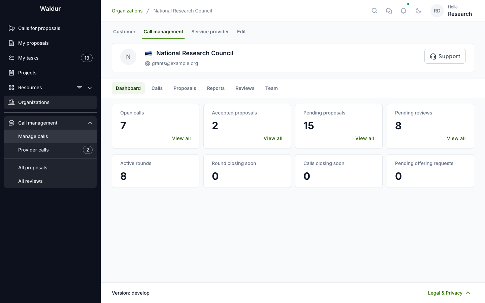
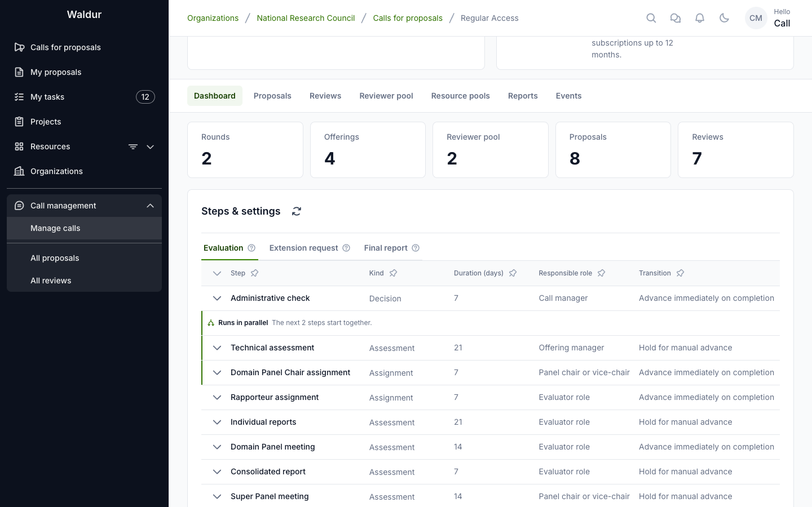
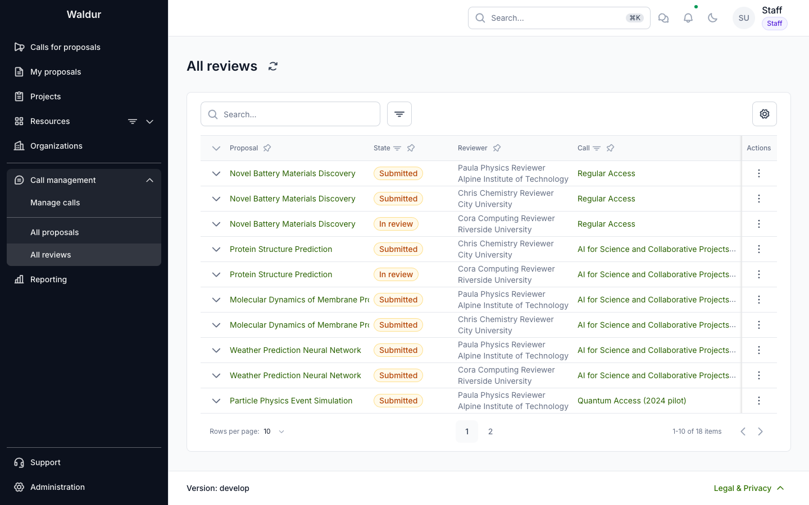
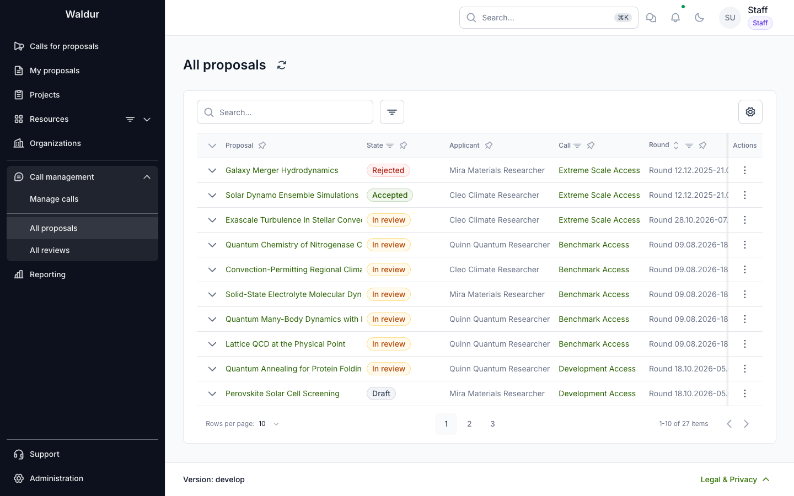

# Dashboards and reports

**Performed by:** Call manager and Call organiser

Waldur shows how calls are doing at three levels: the organisation's **Call management**
dashboard, each call's dashboard, and the **Reports** that summarise proposals, workflow,
reviewers, rounds and budgets. Staff also have portal-wide lists of reviews and proposals.
To take data out of Waldur, see [Data export](data-export.md).

## Call management dashboard

After signing in, open your call-managing organisation and switch to the
**Call management** tab. Its **Dashboard** counts open calls, accepted proposals,
pending proposals and pending reviews — each with a **View all** shortcut into
the matching list — above a second row tracking **Active rounds**, **Round closing
soon**, **Calls closing soon** and **Pending offering requests**.

The organization's **Call management** dashboard counts only the calls you may
configure: a call manager's figures cover the calls they manage, while call
organisers, staff and support see every call of the organization. Its
statistics are refused to anyone who may read none of the organization's call
reports.

## Call dashboard

The call dashboard provides an overview of the entire call. It counts the call's
**Rounds**, **Offerings**, **Reviewer pool**, **Proposals** and **Reviews**, and shows the
call's workflow steps read-only below the figures:

- Use the dashboard to monitor:
      - Round statuses
      - Proposal pipeline
      - Review progress
      - Reviewer pool capacity

## Call reports

**Call management → Reports** on a call-managing organisation, and the
**Reports** tab of a call's **Manage** page, summarise the calls you may
configure. Filter them by call, round and dates, and switch between:

| Report | Answers |
|---|---|
| **Portfolio** | Proposals per call and round: how many were submitted, where they stand, how many were accepted, success rate and mean score |
| **Workflow** | Where proposals wait: proposals at each step now, those past the step deadline, and how long each step takes |
| **Reviewers** | How reviewers answer their invitations and how fast they review |
| **Rounds** | How long each round takes from its cut-off to publishing results, and whether results came after the allocation date |
| **Budgets** | What each resource pool offers, what proposals ask for, and what has been awarded |

Staff and support find the same reports across every organisation under **Reporting →
Proposals**, filtered additionally by organisation.

## Admin reviews and proposals

Staff, support, call organisers and call managers find **All reviews** and **All
proposals** in the calls section of the sidebar. **All reviews** lists reviews across the
calls, filterable by state, call, round, organisation, reviewer and proposal:

Reviews can be filtered by specific call to focus on a particular review round:

**All proposals** lists proposals with their call, round, and state, helping staff
track which proposals are progressing through review.

