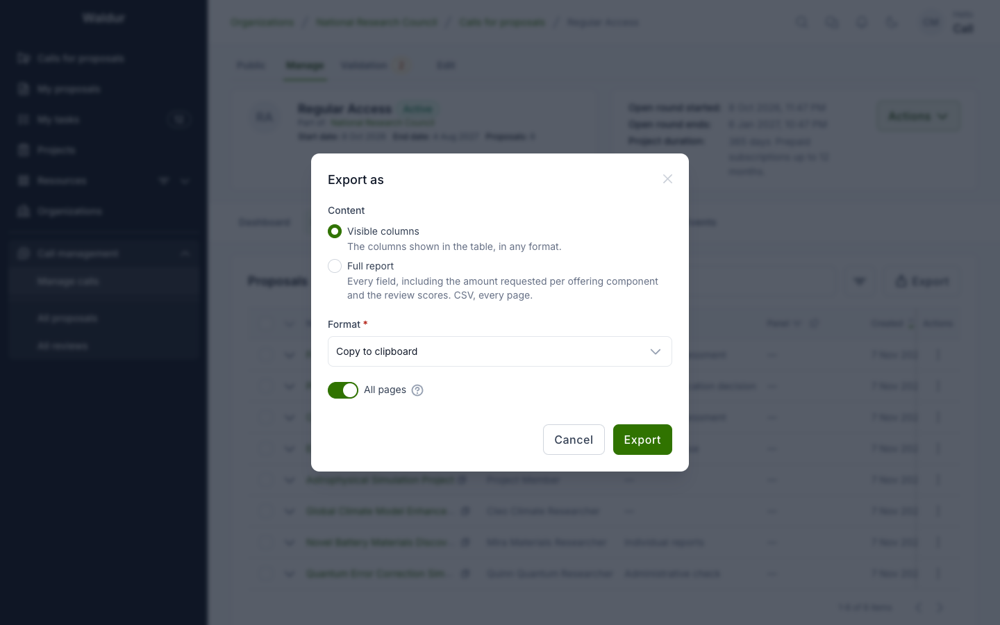

# Data export

Waldur provides multiple ways to export data from the platform. This guide covers the export capabilities available for call management. For dashboards and the **Reports** page, see [Dashboards and reports](dashboards-and-reports.md).



## Table export

Every data table in Waldur supports direct export to multiple formats.

### Available formats

| Format | Description | Use Case |
|---|---|---|
| **CSV** | Comma-separated values | Data analysis in Excel, Google Sheets, or scripts |
| **Excel** | Microsoft Excel format | Formatted spreadsheets with styling |
| **PDF** | Portable document format | Reports and printable documents |
| **JSON** | Structured data | Scripts and other tools |
| **Copy to clipboard** | Copy to clipboard | Quick paste into other applications |

### How to export

1. Navigate to any data table (proposals list, users list, reviews, etc.)
2. Click the **Export** button in the table toolbar
3. In the **Export as** dialog, choose:
    - **Format**: Copy to clipboard, CSV, PDF, Excel or JSON
    - **All pages**: Export all records or only the current page
4. Click **Export** to download the file

The export always covers what the table shows: its active filters apply, and
only the visible columns are written.

!!! tip
    Apply table filters before exporting to narrow down the data.

### Full proposal and review reports

On a call's **Manage** page, the **Proposals** and **Reviews** tables offer a
second kind of export to call managers, call organisers and staff: under
**Content**, choose **Full report** instead of **Visible columns**. The server
writes it as a CSV of every page, with the table's filters applied:

- **Proposals** — one row per proposal: identity, created and submitted dates,
  applicant and organisation, state and current step, science sub-domain,
  requested duration, **one column per requested offering component** with the
  amount asked for, the review counts, average score and individual scores, and
  a column per scoring criterion.
- **Reviews** — one row per review: the proposal, round, step, reviewer,
  state, score (and criterion scores), public comment and review deadline.

Reviewers' private notes are never exported, and text that would start a
spreadsheet formula is written with a leading apostrophe.

### One proposal as a PDF

**Download PDF** on a proposal (on the proposal page, or in a proposal row's
actions) renders the proposal as one document, for archiving or a panel
meeting. Waldur builds it on the server, from what the person downloading it
may read, so each reader gets their own version:

- **Everyone who can open the proposal** gets the application as the applicant
  filled it: fields, summary and description, requested resources, team and the
  names of its attachments. Applicant details follow the call's applicant
  visibility settings, and an offering's provider sees only their own
  offerings' requests.
- **The call team** (call managers, call organisers, staff and support) also
  gets the evaluation record: each workflow step with its status, outcome,
  reasons, dates, internal notes and, unless the step is blind or its
  decision is held, who completed it; the contributions;
  the technical assessment per offering; released reports; the round's
  ranking, final score and recommendation; and the award.
- **The applicant team** sees an evaluation step's outcome and reports once
  they are released to them, and the award once the decision is released. They
  never see internal notes, reviewers' private comments or the ranking.
- **Evaluators** (reviewers, rapporteurs, panel members) get what they can read
  on the proposal page, and no more.

The attachments themselves are not included.

The round's ranking has its own export and import — see
[Ranking and meeting notes](round-rankings.md#ranking-and-meeting-notes).

## Call reports

The **Reports** page (Portfolio, Workflow, Reviewers, Rounds and Budgets) is described in
[Dashboards and reports](dashboards-and-reports.md#call-reports).

## Saved filters

Table filters can be saved for reuse:

1. Configure your desired filters on any data table
2. Click the **Save filter** button
3. Enter a name for the saved filter
4. The saved filter appears in the filter dropdown for quick access

## Management command export

For administrators, Waldur provides management commands for comprehensive data export:

```bash
# Export full platform structure to JSON
waldur export_structure --output backup.json --verbose

# Export with event history
waldur export_structure --output full_backup.json --include-events
```

The structure export includes:

- Users and permissions
- Organizations and projects
- Marketplace data (categories, offerings, plans, resources, orders)
- Billing information (invoices, credits, usage)
- Checklists and answers
- Calls for proposals (call-managing organisations, calls and their offerings, rounds,
  resource pools, proposals with their requested and awarded resources, reviews, reviewer
  assignment batches, step contributions, reviewer suggestions and project role mappings)

## API-based export

All data accessible through the Waldur REST API can be exported programmatically:

```bash
# Export proposals for a specific call
curl -H "Authorization: Token YOUR_TOKEN" \
  "https://waldur.example.com/api/proposal-proposals/?call_uuid=CALL_UUID&page_size=1000"
```

See the Integrator Guide for API documentation.
