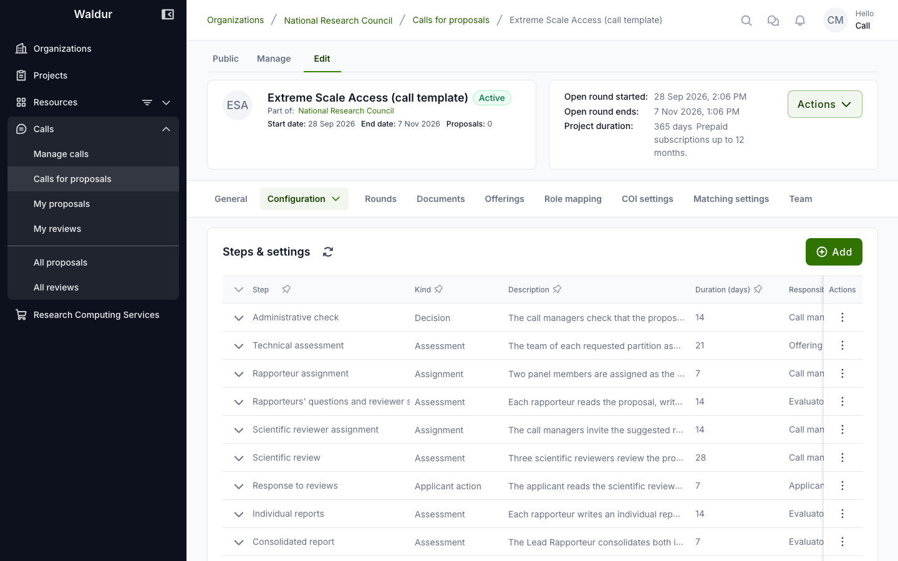

# Extreme Scale call template

The **Extreme Scale Access** template is a ready-made call configuration for allocating the largest partitions of a set of systems to projects of high scientific impact. It configures thirteen evaluation steps, a request for extension and a final report after the award, an evaluator role for rapporteurs, contributor sources, input steps, evaluation forms and notification rules, so a call-managing organisation does not have to build that process by hand. Create a call from it, fill in what is specific to your portal, and adapt the steps to your own allocation process.

The template is one of the call template presets that ship with Waldur. Staff make it available to call managers under **Administration → Call templates** with **Load preset**; once it is published, call managers pick it when they create a call (see [Creating a call from the template](#creating-a-call-from-the-template)).

## What the template sets up

### Call settings

- Evaluation starts **at the round cut-off**: proposals submitted to a round wait until its cut-off and then enter evaluation together.
- Results are published **with the round**, and a round's results must be **adopted** (by the governing board, say) before they are published.
- Reviews and reviewer identities are **hidden from applicants**. Applicants read the reviews through the response step instead, without the reviewers' names or private comments.
- Drafts carry over to the next round, granted projects last 365 days, and a round cannot be completed while proposals are still undecided. The workflow is planned for a decision 180 days after the cut-off.

### The rapporteur role

One [evaluator role](workflow-configuration.md#evaluator-roles), **Rapporteur**, held by panel members of the call. Each proposal gets exactly two rapporteurs; one is marked as the lead. The lead is the Lead Rapporteur, the other the Second Rapporteur.

### The evaluation steps

| # | Step | Kind and outcomes | Completed by | Configuration |
|---|---|---|---|---|
| 1 | **Administrative check** | Decision — Eligible / Ineligible | Call manager | Rejects an ineligible proposal, and can send it back to the applicant for changes; shown to applicants |
| 2 | **Technical assessment** | Assessment — per requested offering | Offering manager | One contribution per requested partition, from that offering's team: Accepted, Conditionally accepted or Rejected. A rejected partition does not stop the proposal; the step is held for a manual advance |
| 3 | **Rapporteur assignment** | Assignment — Done | Panel chair or vice-chair | Runs alongside the technical assessment; assigns the two rapporteurs and the lead; rapporteurs confirm they have no conflict of interest |
| 4 | **Rapporteurs' questions and reviewer suggestions** | Assessment — Done | Rapporteurs | Each rapporteur records questions for the applicant and suggests scientific reviewers |
| 5 | **Scientific reviewer assignment** | Assignment — Done | Call manager | The call manager invites suggested reviewers to the pool and assigns reviewers, then completes the step |
| 6 | **Scientific review** | Assessment — Reviewed | Call manager | Three reviews from the assigned reviewers (minimum and maximum 3), blind, with conflict-of-interest confirmation; criteria *Excellence*, *Innovation and impact* and *Quality and efficiency of the implementation* |
| 7 | **Response to reviews** | Applicant action — Submitted | Applicant | Reads the technical assessment, the rapporteurs' questions and the reviews |
| 8 | **Individual reports** | Assessment — Done | Rapporteurs | One report from each rapporteur, blind; reads the technical assessment, questions, reviews and response |
| 9 | **Consolidated report** | Assessment — Done | Rapporteurs | One report, from the Lead Rapporteur only, released to the applicant; reads the technical assessment, reviews, response and individual reports |
| 10 | **Committee meeting** | Assessment — Done | Panel chair or vice-chair | Runs once per round: the call managers open it for the round, and the chair and vice-chair each write a round report on the meeting; held for a manual advance |
| 11 | **Final feedback** | Assessment — Done | Rapporteurs | One text from the Lead Rapporteur only, released to the applicant; reads the consolidated report and the committee meeting |
| 12 | **Allocation decision** | Decision — Approved / Declined | Call manager | The allocation decision; allocation starts on the decision; completed per proposal |
| 13 | **Award response** | Applicant action — Accepted / Declined | Applicant | A declined award cancels the proposal |

Each step has a duration, from 7 days for the administrative check, the rapporteur assignment, the response and the consolidated report to 30 days for the committee meeting. Adjust them to your calendar.

The committee's ranking itself — final scores, rank and recommended resources — is recorded on the round, not in a step (see [Ranking and meeting notes](call-manager-workflow.md#ranking-and-meeting-notes)).

### After the award

Two further phases run on an accepted proposal, each as a run of its own:

- **Extension** — the applicant files an **Extension request** (until 30 days before the project ends), the team of each partition hosting the project assesses it in **Extension request assessment**, and the call manager decides in **Extension request results**. An approved extension moves the project's end date.
- **Closing** — the **Final report** opens when the project ends, extension included; the call manager accepts it in **Final report approval**, which completes the project.

### Evaluation forms

The template carries the forms its steps use, each required: *Rapporteurs' questions*, *Response to reviews*, *Individual report*, *Consolidated report*, *ARC meeting report* (the committee's round reports), *Final feedback*, *Extension request* and *Final report*.

### Notification rules

Every step keeps the reminders a new step of its kind gets (see [Notification rules](workflow-configuration.md#notification-rules)). The template adds, among others:

- a notice when the step starts to the people who complete it, on the technical assessment (the requested partitions' offering managers), the rapporteur assignment (the panel chair), the questions step, the individual reports, the consolidated report and the final feedback (the rapporteurs);
- a notice to the rapporteurs when the rapporteur assignment is completed, and when an individual report is submitted;
- a notice to the assigned reviewers when the scientific review starts, and a reminder three days before its deadline;
- a notice to the call managers when the consolidated report or the final feedback is completed, so they know it is ready to release;
- notices to the applicant on the outcome of the administrative check and of an extension request, and to the partitions' teams when the award is accepted or an extension decided.

## Creating a call from the template

**Performed by:** Someone who may create calls in the call-managing organisation (its owner, say), or staff

1. Open the call-managing organisation's **Call management** tab and go to **Calls**.
2. Click **Create call** and choose **From template**.
3. Pick **Extreme Scale Access** as the **Template** and optionally enter a **Call name**.
4. Click **Create**. The call is created as a **draft** with the template's settings and workflow.

If **Extreme Scale Access** is not offered, the template has not been loaded on your portal yet: ask staff to load and publish it.

Integrators can create the call through the API: `POST /api/proposal-protected-calls/import_call/` with the call-managing organisation as `manager`, the published template as `template` and, optionally, a `name`.

## Completing the call

The template leaves out everything that belongs to your portal. Before activating the call:

1. **Describe the call**: its name, description and reference code under **Call → General**.
2. **Add the offerings** (one per partition) on the **Resources** tab. Each partition is an offering of the service provider that runs it, and that provider accepts the request. The technical assessment asks each partition's provider team (its offering managers) on its own; the call-managing organisation does not assess the partitions itself.
3. **Add rounds** with their cut-off and allocation dates.
4. **Check the evaluation forms.** The call gets its own copies of the template's forms, so editing them changes no other call. Attach a form to the steps that have none — the technical assessment and the scientific review, say — under **Steps & settings**, and mark each form required or advisory; without a form, a contribution is its outcome and comment. See [Checklists and forms](checklists-and-forms.md).
5. **Add people** on the call's **Team** tab: call managers, panel members (the rapporteurs are chosen from them) with the panel's **Chair** and **Vice-chair**, who assign the rapporteurs and write the committee's round reports. Invite the scientific reviewers under **Manage → Reviewer pool**.
6. **Set up role mapping and resource templates**, as for any call (see [Call management](call_management.md)).
7. **Activate** the call.

## Adapting the template

The template is a starting point. Under **Evaluation workflow → Steps & settings** you can change anything it sets up:

- **Rename a step** freely. Its key stays and is what the API and imports refer to.
- **Remove a step** by disabling or deleting it. Keep one enabled allocation decision, and keep a decision after the response step: the call refuses a response step that no decision follows.
- **Add a step** of any kind at any position. A step that reads earlier work lists those steps as **Input steps**, and they must come before it.
- **Change who contributes** (**Contributors**), how many contributions a step needs (**Minimum contributions** / **Maximum contributions**), **Blind review**, and what a negative outcome does (**On a negative outcome**: reject, cancel or continue).
- **Use another evaluator vocabulary.** A domain panel chair, say, is another [evaluator role](workflow-configuration.md#evaluator-roles): define it under **Evaluator roles**, assign it in an assignment step, and name it as the contributors and responsible role of the steps its holders work on.
- **Change notification rules** per step through the API (see [Notification rules](workflow-configuration.md#notification-rules)).

For example, a process without rapporteurs could disable the rapporteur assignment, the questions step, the two report steps and the final feedback, list only the scientific review as the input of the response step, and let the committee decide from the reviews and the response.

When removing steps, keep in mind:

- **Steps that read a removed step lose it** from their input steps (the delete confirmation names them), and the descriptions of the template's steps still mention it — the allocation decision "following the committee's ranking", say. Review both.
- **Remove the role with its steps.** Without the rapporteur assignment and the steps the rapporteurs work on, the *Rapporteur* role is marked **Not used by any enabled step** and proposals stop asking for rapporteurs; delete it under **Evaluator roles** to tidy up.
- **One rapporteur.** Lower the individual reports' minimum and maximum contributions to 1 first, then the role's required and maximum holders to 1: the call refuses a role with fewer holders than a step's minimum. Without the consolidated report and the final feedback, nothing is released to the applicant; tick **Release the report to the applicant** on the individual reports if the applicant should read the report.
- **No award response.** Deleting or disabling the award response step lets the allocation decision create the resources as soon as it is published.

## What the template does not enforce

Some parts of the process are left to convention because the call configuration cannot express them:

- **Scientific reviewer assignment** stays a manual gate: an assignment step without an evaluator role, completed by the call manager once reviewers are assigned through the reviewer pool and assignment batches. The three-review minimum is enforced on the review step itself.
- **The ranking and meeting notes** are records of the round, not step settings, so the template carries nothing for them. See [Ranking and meeting notes](call-manager-workflow.md#ranking-and-meeting-notes).

## Related guides

- [Workflow configuration](workflow-configuration.md) — step kinds, contributors, evaluator roles and input steps
- [Call manager workflow](call-manager-workflow.md) — running the evaluation the template sets up
- [Applicant guide](applicant-guide.md) — responding to reviews and reading released reports
- [Reviewer workflow](reviewer-workflow.md) — the reviewer's and rapporteur's side
