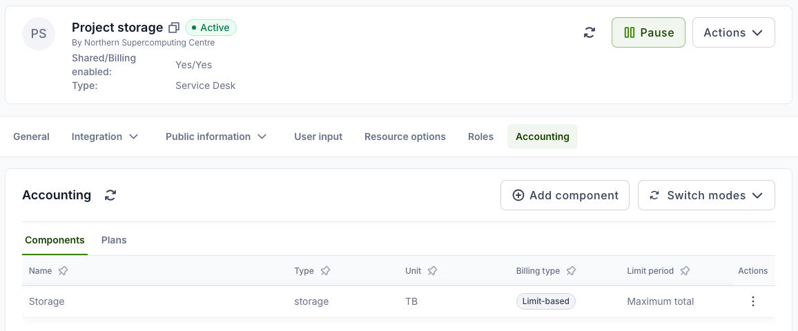
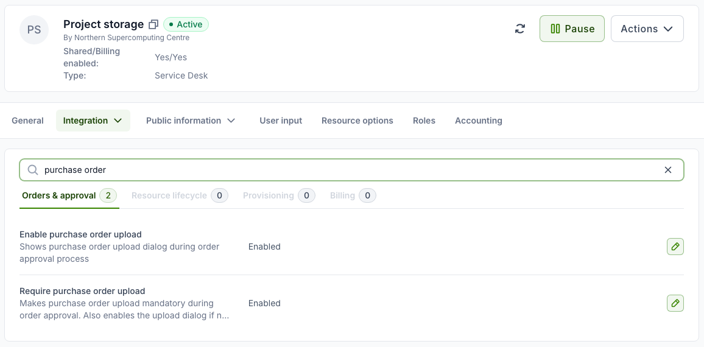
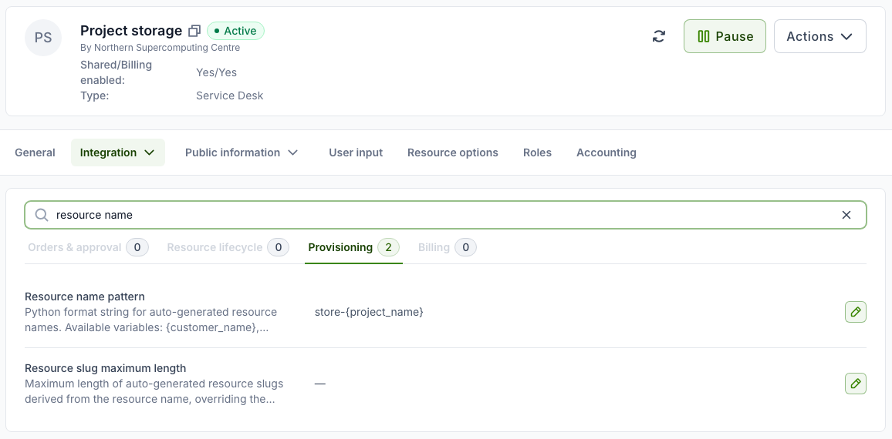
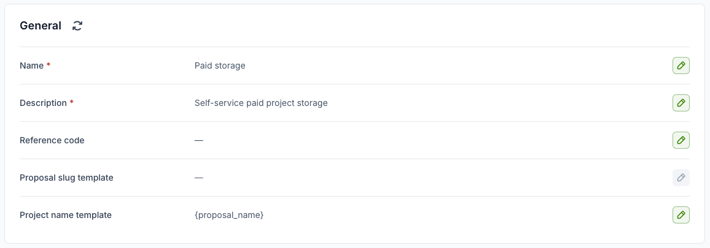
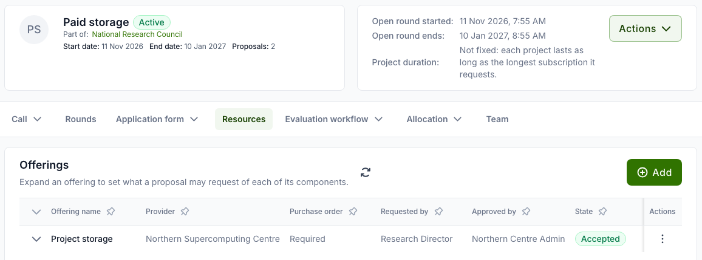
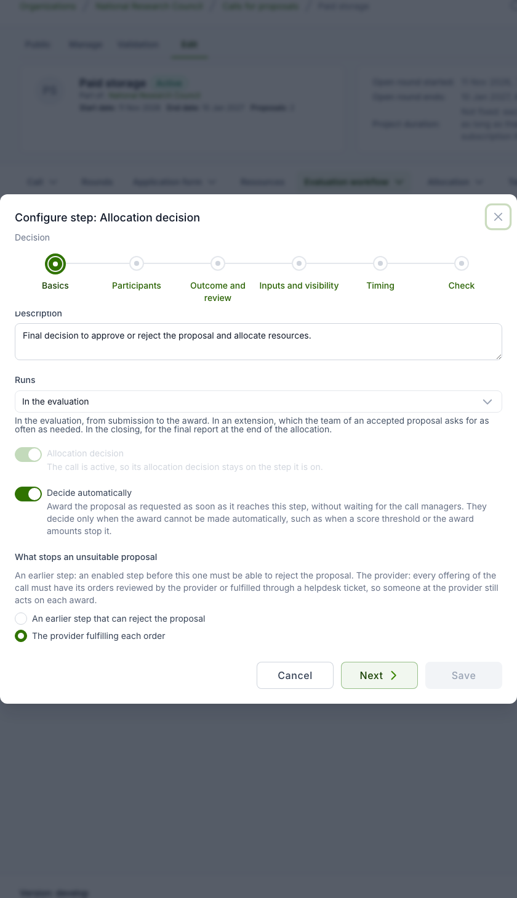

# Example: a paid self-service call

Not every call evaluates science. An organisation may use a call to sell a service, such as
project storage, to research groups that pay for what they request. The applicant names the
project, requests an amount, attaches the purchase order from their finance office and
submits. There is nothing for a panel to judge, so the call manager does not want to click
through every proposal. The provider still sets up each service by hand, through a helpdesk
ticket.

This page builds such a call from the settings Waldur already has. With it, a proposal is
accepted when it is submitted. The project is named after the proposal and the resource is
named by the provider's own pattern. The provider's team fulfils each order through a ticket
that carries the purchase order.

| What happens | With this setup |
|---|---|
| The applicant submits proposal *Clinical school* with a purchase order | The proposal is **accepted** on submission and the applicant is told at once |
| The project is created | It is named **Clinical school**, the proposal's name, without the call's reference code or the round's start date |
| The storage is ordered | The resource is named **store-clinical-school**, from the offering's pattern |
| The provider fulfils it | The order opens a helpdesk ticket. Resolving the ticket creates the resource |

The names and amounts on this page are examples. Use your own.

## What you need

- A **service provider** offering for the service. In this example it is a helpdesk
  offering, *Project storage*, whose orders become helpdesk tickets.
- A **call-managing organisation** that runs the call (see
  [Organization setup](organization-setup.md)).
- A **call** with one open round.

## Setting up the offering

**Performed by:** Service provider (on the offering)

All settings below are on the offering's **Edit** page. The search box above each settings
tab filters the settings by name, which is the quickest way to find one.

### 1. Make it a helpdesk offering

Create the offering with the type **Service Desk** (see
[Adding an offering](../service-provider-organization/adding-an-offering.md)). The type is
shown at the top of the offering's page. Each order on it opens a ticket for the provider's
team, and the ticket's resolution decides the order. Another type works too, as long as the
provider reviews its orders (see [Which offerings qualify](#which-offerings-qualify)).

### 2. Let the applicant size the request

Under **Accounting → Components**, give the offering a **Limit-based** component for what
the applicant buys. Here that is *Storage*, measured in TB, and priced per TB in the
offering's plan on the **Plans** tab. The applicant enters the amount in the resource
request, and the amount travels to the order and the ticket. Do not use a fixed component
for it (see [Things to decide](#things-to-decide)).



### 3. Require the purchase order

Under **Integration → Operations → Orders & approval**, set **Require purchase order upload**
to **Enabled**. This also enables **Enable purchase order upload** (see
[Purchase orders in calls](purchase-orders.md)). Do this **before** adding the offering to
the call, because the call copies the setting when the offering is added.



### 4. Name the resources

Under **Integration → Operations → Provisioning**, set **Resource name pattern** to
`store-{project_name}`. A resource created for project *Clinical school* is then named
`store-clinical-school`. The pattern's result is lower-cased, and any character other than
a letter, digit, dot or hyphen becomes a hyphen. Other variables include `{project_slug}`,
`{customer_slug}`, `{offering_slug}` and `{plan_name}`. A second resource of the same
offering in the same project gets `-2`, unless the pattern places `{counter}` itself.



The pattern belongs to the offering, so it names that offering's resources whether they are
ordered in the marketplace or through a call.

## Setting up the call

**Performed by:** Call manager

### Name the project after the proposal

Under **Call → General**, set **Project name template** to `{proposal_name}`.



Without a template, a project is named
`<call reference code> - <round start date> - <proposal name>`. That dates the project for
its whole life by the round it was submitted in. The template can use these placeholders:
`{proposal_name}`, `{proposal_slug}`, `{call_prefix}` (the reference code, or the call's
slug), `{call_slug}`, `{call_name}`, `{round_start}`, `{round_slug}`, `{org_slug}` and
`{year}`. Any other text in the template stays as written, so `Storage {year}: {proposal_name}`
is valid too.

When the applicant creates the proposal, the **Create proposal** dialog shows the
resulting **Project name** under the name field. A change to the template affects only
proposals accepted after it. Projects that exist keep their names.

### Start the evaluation at submission and announce it at once

Under **Call → General configuration**:

- **Evaluation** tab: **Evaluation starts** — **On submission**.
- **Decisions and rounds** tab: **Applicants learn the decision** — **As each decision is
  made**.

### Add the offering

On the **Resources** tab, add *Project storage*. The service provider must accept it (see
[Resources, role mapping and team](call-resources-and-team.md)). The call takes the
offering's purchase order requirement as it is at this moment: the **Purchase order** column
reads **Required**.



### Keep only the allocation decision

Under **Evaluation workflow → Steps & settings**:

1. **Disable the Administrative check**, along with any other step before the allocation
   decision. A new call has the administrative check enabled.
2. Make sure there is **no Award response** step. If the call has one, disable or delete
   it, otherwise each award waits for the applicant to accept it.
3. Open the **Allocation decision** row's **Configure** action and, on the **Basics** page:
      - tick **Decide automatically**;
      - under **What stops an unsuitable proposal**, choose **The provider fulfilling each
        order**.
4. On the **Timing** page of the same dialog, leave **Allocation timing** at
   **On decision**, so the order is placed when the proposal is accepted rather than on the
   round's allocation date.



### Check and activate

Add a round that is open now (see [Rounds](call-rounds.md)). The call's
**Validation → Check** tab should then list no errors (see
[Checking and activating a call](call-activation.md)). Then **Activate** the call.

## Why the provider is the guard

An automatic decision normally needs an enabled step before it that can reject the proposal,
such as a technical assessment. Otherwise every submission would be awarded with nobody
having looked at it. With **An earlier step that can reject the proposal** chosen, the call
above cannot be activated, and the workflow check reports *Unguarded automatic decision*:

```text
An automatic allocation decision needs an enabled step before it that can reject a
proposal, such as a technical assessment; otherwise every submission would be awarded.
```

A paid service has no such step to offer, but it still has someone checking each award: the
provider's team that fulfils the order. They check the purchase order and the amounts before
they set anything up. **The provider fulfilling each order** lets that check stand in for the
rejecting step. The call allows it only while every accepted offering of the call puts a
person at the provider between the award and the resource.

### Which offerings qualify

| Offering | Qualifies | Why |
|---|---|---|
| Helpdesk offering (**Service Desk**) | Yes | Each order opens a ticket, and resolving the ticket decides the order |
| Basic or site agent offering | Yes | The provider approves each order |
| Script offering | Only with **Auto-approve script orders** off | Otherwise its orders run without the provider |
| Remote offering | No | Orders placed by the call are approved for the provider automatically |
| Any other type | No | Its orders are fulfilled with nobody at the provider acting on them |

The call checks this in its workflow check and on activation, when a step of an active call
is saved, and again for each proposal when it reaches the decision. Accepting an offering
that does not qualify gives the workflow check the error *Orders fulfilled unattended*,
which names the offering. If a
proposal reaches the decision while such an offering is on the call, it is not awarded
automatically. The decision falls back to the call managers, and the reason is shown on the
proposal.

## What happens on submission

1. The applicant creates the proposal *Clinical school*. The **Create proposal** dialog shows
   **Project name: Clinical school**.
2. They add a resource request on *Project storage*, attach the purchase order in the
   request's **Additional configuration** step, and submit. Submission is refused while the
   purchase order is missing.
3. The allocation decision starts and approves the proposal at once, so the proposal is
   **Accepted** as soon as it is submitted. The decision is recorded as made by the system,
   and the applicant is notified of it.
4. The project **Clinical school** is created in the call-managing organisation, and the
   proposal's team is added to it with the roles set under
   [Role mapping](call-resources-and-team.md#role-mapping).
5. An order for **store-clinical-school** is placed. The purchase order travels with the
   order, so its consumer approval is completed automatically. The order goes to the
   provider, and a helpdesk ticket is opened for it. The ticket names the resource, the
   project, the requested amounts and the proposal, and has the purchase order document
   attached.
6. The provider's team sets up the storage and resolves the ticket. The resource is then
   created.

The proposal's **Allocation outcome** section shows the applicant the project and the state
of each awarded resource (see [After acceptance](applicant-guide.md#after-acceptance)).

## Things to decide

- **Components the applicant can size.** Price the requested amounts with limit components,
  which the applicant sets in the resource request. An amount requested on a fixed
  component is accepted at submission, but the order then fails with *does not accept the
  limits*, after the proposal has already been accepted.
- **The purchase order document, not only a reference.** The call accepts either a reference
  or a document to submit. An offering that requires the upload needs the document on the
  order, so an order that carries only a reference waits for the applicant to upload the
  file. Ask applicants to attach the PDF. See
  [The provider's requirement always applies](purchase-orders.md#the-providers-requirement-always-applies).
- **When the provider declines.** A ticket resolved without fulfilling the order cancels the
  order, and no resource is created. The award is not undone: the proposal stays accepted
  and its project stays in the call-managing organisation. Agree with the provider who
  tells the applicant and who removes the project.
- **Proposals with the same name.** With `{proposal_name}` alone, two proposals called the
  same create two projects called the same. To tell them apart, add a placeholder, such as
  `{proposal_name} ({year})`.
- **The project's slug follows its name.** Anything derived from the slug, such as an
  account name on a provider's system, changes with the template too.
- **How many proposals one applicant may hold.** Nobody screens submissions, so consider
  capping them with **Active proposals per applicant** (see
  [Limiting proposals per applicant](organization-setup.md#limiting-proposals-per-applicant)).
- **How long the project runs.** Set a fixed duration if every purchase must expire (see
  [How long a granted project runs](allocation-decision.md#how-long-a-granted-project-runs)).

## Configuring it through the API

| Setting | API field | Value |
|---|---|---|
| Project name template | call `project_name_template` | `{proposal_name}` |
| Evaluation starts | call `evaluation_start` | `on_submission` |
| Applicants learn the decision | call `publish_results` | `immediately` |
| Disable the administrative check | workflow step `is_enabled` | `false` |
| Decide automatically | workflow step `decides_automatically` | `true` |
| What stops an unsuitable proposal | workflow step `automatic_decision_guard` | `provider_fulfilment` (the default is `earlier_step`) |
| Allocation timing | workflow step `allocation_time` | `on_decision` |
| Require purchase order upload | offering `plugin_options.require_purchase_order_upload` | `true` |
| Resource name pattern | offering `plugin_options.resource_name_pattern` | `store-{project_name}` |

## Related guides

- [Allocation decision and award](allocation-decision.md)
- [Workflow configuration](workflow-configuration.md)
- [Purchase orders in calls](purchase-orders.md)
- [Creating and configuring a call](creating-a-call.md)
