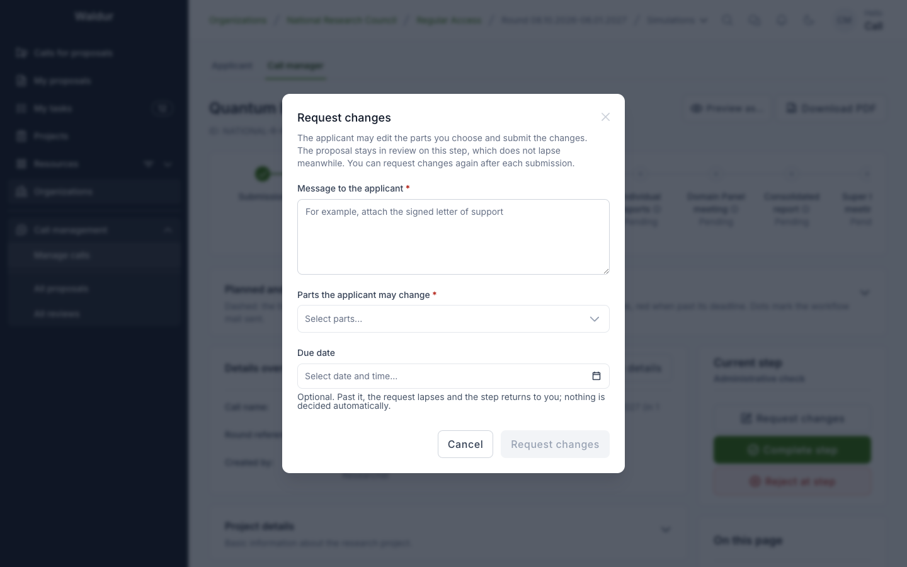

# Requests for changes and withdrawals

A submitted proposal is fixed: what was submitted is what gets evaluated. Two things change
that during evaluation — a step can send the proposal back to its applicant for changes, and
the applicant can withdraw it.

## Requesting changes from the applicant

**Performed by:** Whoever acts on the current step (call manager by default)

A step with **Allow requesting changes** turned on (in the step's settings,
under **Inputs and visibility**) can send a proposal back to its applicant
without rejecting it — to fix a missing document or clarify a resource
request, say. It is available on assessment and decision steps, but not on the
allocation decision, a step the applicant completes, an assignment step or a
step that runs once per round.

1. On the proposal, click **Request changes** in the **Current step** panel.
2. Write a **Message to the applicant**, choose the **Parts the applicant may
   change** — for example *Summary*, *Description*, *Supporting
   documentation*, *Resource requests*, *Project team* or *Compliance
   checklist* — and optionally a **Due date**. At a step of an extension or a
   final report, the parts are that run's own instead: *Form answers* and, in an
   extension, *Requested end date and resources*.

The proposal stays **In review** on its step (or, in an extension or final report, stays accepted). Only the chosen parts become
editable for the applicant, who is notified and sees *Changes requested at
<step>* with the parts they may edit; they make the changes and click **Submit
changes**. The step's deadline does not run out while the request is open, and
the step cannot be completed or rejected until the request is closed: the step
shows *Waiting for the applicant's changes*.

The request closes in one of three ways, and each returns the step to whoever
acts on it with its full duration again:

- the applicant submits the changes;
- the call manager uses **Cancel request for changes**;
- its due date passes without changes — the request lapses and the step's
  actor is told. Nothing is decided on anyone's behalf.

A step may send the proposal back as often as needed, one open request at a
time. Steps running alongside each other can each have a request open; the
applicant answers them together. What the applicant sees is described in the
[Applicant guide](applicant-guide.md#when-changes-are-requested).

## Withdrawn proposals

A proposal manager of the applicant team can use **Withdraw proposal**, with
an optional reason, while the proposal is **Submitted** or **In review**. The
proposal is **Canceled**: its unfinished steps are skipped, reviews still
being written are closed, unanswered review assignments lapse, and the call
managers are emailed. Once an award awaits the applicant's answer, withdrawing
is refused — declining the award is the way out then.
