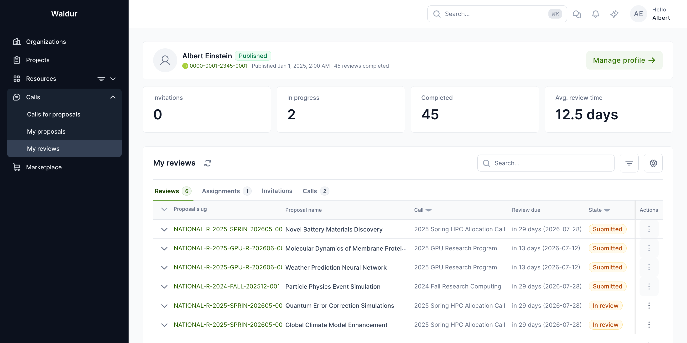
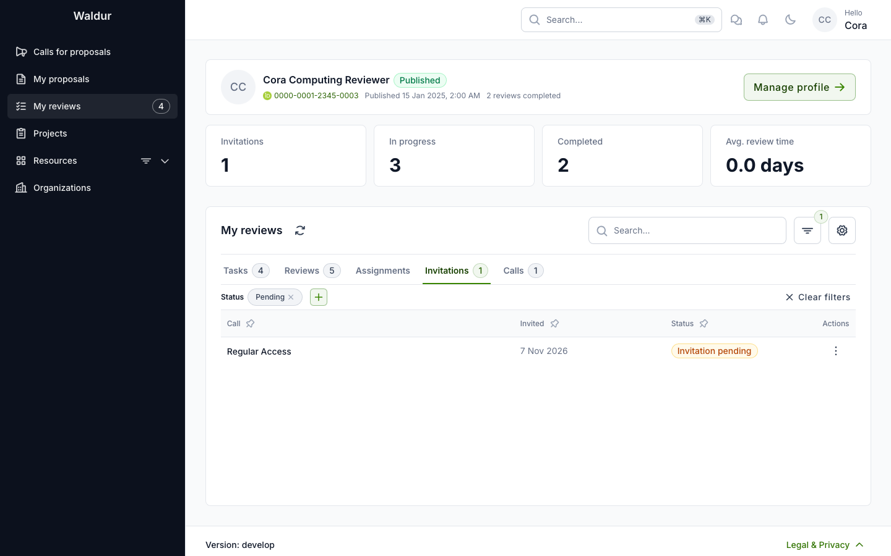
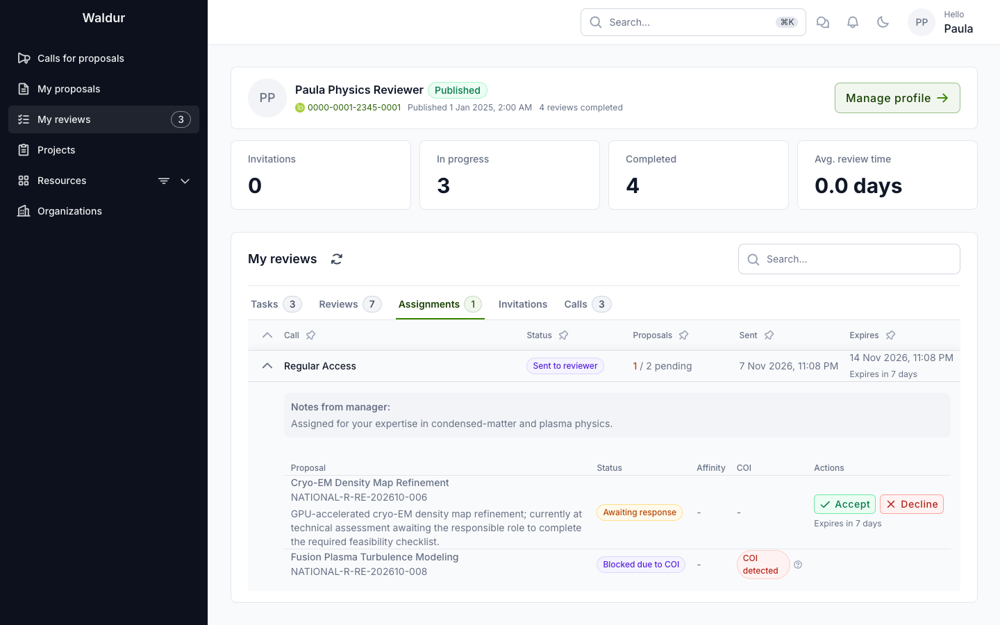
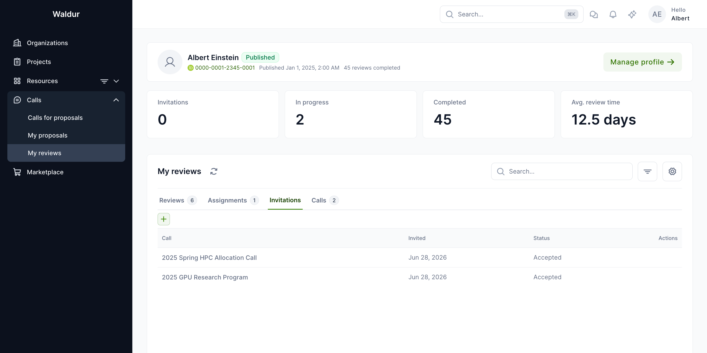
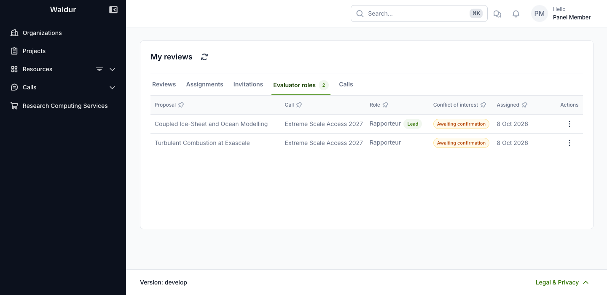
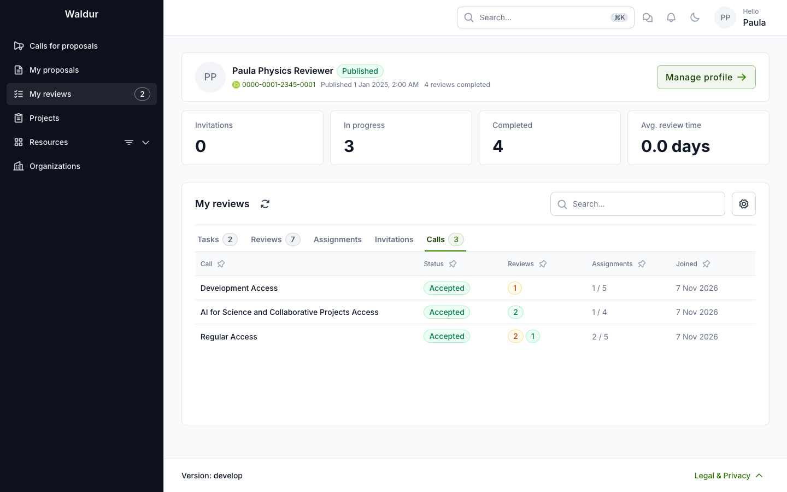

# Reviewer profile and invitations

This guide covers getting set up as a reviewer in Waldur: managing your reviewer profile, accepting pool invitations and assignments, and finding your way around your reviews page. Reviewing and scoring a proposal, declaring conflicts of interest and working as a rapporteur are described in [Reviewing proposals](reviewer-workflow.md).

## Getting started as a reviewer

To review proposals you need:

1. A **published** reviewer profile.
2. An **accepted** invitation to the call's reviewer pool.
3. At least one proposal **assigned** to you by the call manager.

### Creating your profile

1. Navigate to the **My reviews** page from the sidebar
2. Click **Create profile** in the profile banner

The profile editor is organised into four tabs:

| Tab | Content |
|---|---|
| **Profile info** | Biography, ORCID ID, alternative names, availability status (whether you are available for new review assignments) |
| **Affiliations** | Current and past institutional affiliations with type (employment, education, visiting, honorary, consulting), organisation, department, and date range |
| **Expertise** | Self-declared expertise categories with a proficiency level for each (expert, familiar, basic) |
| **Publications** | Academic publications with title, authors, venue (journal, conference, preprint, book, thesis, report), and year |

Each list (affiliations, expertise, publications) uses a per-row **Add** dropdown for quick item creation, an inline edit button per row, and a **Bulk remove** action for clearing several rows at once. You can also connect and sync your **ORCID** record to import affiliations and publications automatically.

!!! tip
    Keep your expertise and affiliations up to date. This data is used for automated reviewer-proposal matching and conflict of interest detection.

### Publishing your profile

Set the profile to **Published** when ready to receive review invitations. The status is shown as a badge next to your name on the reviews page. Unpublished profiles are not visible to call managers and you will not receive new invitations until the profile is published.

## Accepting a pool invitation

When a call manager adds you to a reviewer pool you receive an email with a
personal acceptance link, and the invitation also appears on the **Invitations**
tab of your **My reviews** page.

Each invitation shows the call, the date you were invited, and its status.
Opening the invitation link shows the call, who invited you and when the
invitation expires, along with the call's **COI policy** so you understand the
rules before joining, and a note that you will be able to disclose conflicts
later, when specific proposals are assigned to you. Choose **Accept** to join
the pool, or **Decline**; the buttons show a loading state while your response
is recorded. Once you have accepted, the status flips to **Accepted** and the
call manager can begin assigning you proposals. You can also answer from the
**Invitations** tab.

!!! tip
    You must be signed in to open the invitation link, and **Accept** stays
    disabled until you have a **published** reviewer profile. If you do not, the
    page prompts you to create or publish one, and you can publish it without
    leaving the page. The invitation can be addressed to you before you have a
    Waldur account; you sign in to answer it.

Invitation statuses: **Invitation pending** | **Accepted** | **Declined** |
**Invitation expired**.

!!! note
    Conflict-of-interest disclosure is handled at the assignment stage and through the call's COI policy, not on the pool-invitation page. The acceptance page only displays the COI policy for the call so you understand the rules before joining the pool.

## Review dashboard

Open **My reviews** from the sidebar. The tabs organise your workload:

| Tab | Content |
|---|---|
| **Tasks** | Everything waiting for you across calls — what is needed, on which proposal, step and round, and when it is due, with overdue items marked |
| **Reviews** | Reviews assigned to you, with state (*In review*, *Submitted*, *Rejected*) and deadline |
| **Assignments** | Pending assignment batches to accept or decline |
| **Invitations** | Pool invitations awaiting your response |
| **Evaluator roles** | Proposals on which you hold an evaluator role, such as rapporteur; shown only when you hold one |
| **Calls** | Calls you are pooled for, with review deadlines |

The reviewer tabs appear once you review for a call — you hold a reviewer or
panel member role, or have been invited to a pool or assigned a review. Without
them the page shows **Tasks** alone.

### Reviews

The **Reviews** tab shows all reviews assigned to you with their status (in review, submitted, rejected) and deadlines, alongside your reviewer profile stats (Invitations / In progress / Completed / Avg. review time).

How to evaluate and score one is described in [Reviewing proposals](reviewer-workflow.md#evaluating-a-proposal).

### Assignments

Shows pending assignment batches — proposals you've been asked to accept or decline for review.

When a call manager sends you a batch, you receive an email listing its
proposals, any note from the call manager and the date by which to respond,
with a link to this tab. If you have not answered every proposal as the deadline
approaches, you get one reminder email (by default 2 days before it). After the
deadline the unanswered proposals expire and can no longer be accepted, unless
the call manager extends the deadline. Whether these emails are sent depends on
the notifications the deployment has enabled.

Before you accept, a batch shows each proposal's title, and its summary if the
call discloses summaries to reviewers. A proposal blocked by a conflict of
interest is shown by title only and cannot be accepted until the call manager
resolves the conflict.

For each assignment, you can:

- **Accept** — creates a review in "in review" state; you can begin evaluation
- **Decline** — records your reason; the call manager may assign the proposal to another reviewer. If you have a conflict of interest with the proposal, decline it and give the conflict as the reason.

### Invitations

Shows pool invitations from call managers. You must accept an invitation before you can be assigned proposals.

### Evaluator roles

Lists the proposals on which you hold an evaluator role, such as rapporteur: the proposal, its call, your role, whether you are the lead, and your conflict-of-interest status. Click a proposal to open it. When the call asks evaluators to confirm the absence of a conflict, the proposal opens to you only after you choose **Confirm no conflict of interest** from its row's actions menu. See [Working as a rapporteur](reviewer-workflow.md#working-as-a-rapporteur).

### Calls

Shows calls you are pooled for, with their current status and review deadlines.

## Topics on other pages

This page used to describe the call manager's side of reviewing as well. Those parts now live with their topic:

### Completing a review

See [Reviewing proposals](reviewer-workflow.md#scoring-and-commenting).

### Conflict of interest

Declaring a conflict: see [Reviewing proposals](reviewer-workflow.md#declaring-a-conflict-of-interest). Severities and how call managers handle conflicts: see [Conflict of interest management](coi-management.md).

### Reviewer pool management

See [Reviewer management](reviewer-management.md#reviewer-pool-management).

### Assignment workflow

See [Reviewer management](reviewer-management.md#assignment-workflow-stage-2).

### Conflict of interest management

See [Conflict of interest management](coi-management.md).

### Reviewer-proposal matching

See [Reviewer management](reviewer-management.md#reviewer-proposal-matching).

### Admin reviews overview

See [Dashboards and reports](dashboards-and-reports.md#admin-reviews-and-proposals).
