# Reviewer management

This guide covers the call manager's side of reviewing: building reviewer pools, configuring reviewer-proposal matching, sending assignment batches and managing reviewer capacity. Conflicts of interest are covered in [Conflict of interest management](coi-management.md); the reviewer's side in [Reviewer profile and invitations](reviewer-guide.md) and [Reviewing proposals](reviewer-workflow.md).

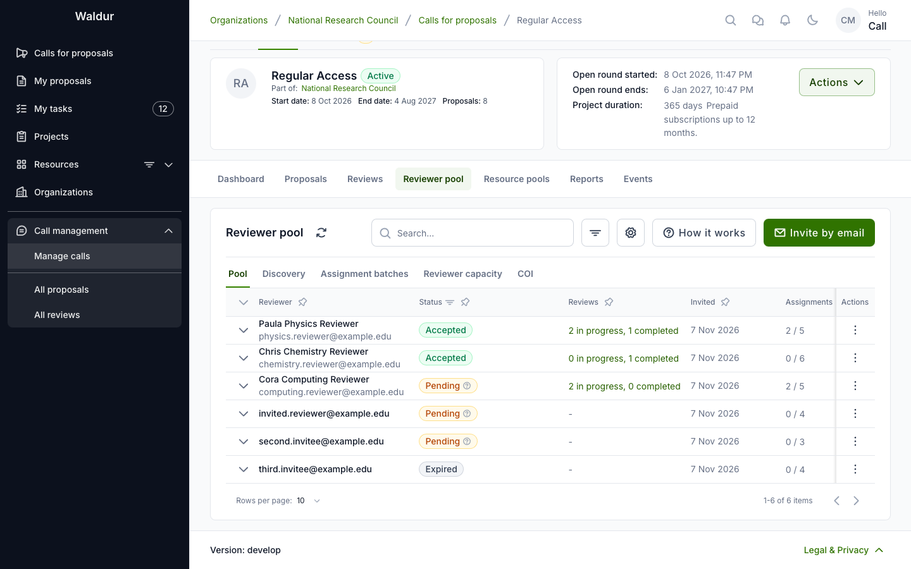

## Reviewer profiles

Reviewers maintain profiles — biography, ORCID ID, affiliations, expertise, publications and availability — that enable matching with proposals and conflict of interest detection. Only **published** profiles are visible to call managers. How reviewers create and publish them is described in [Getting started as a reviewer](reviewer-guide.md#getting-started-as-a-reviewer).

## Reviewer pool management

Call managers build a curated pool of reviewers for each call.

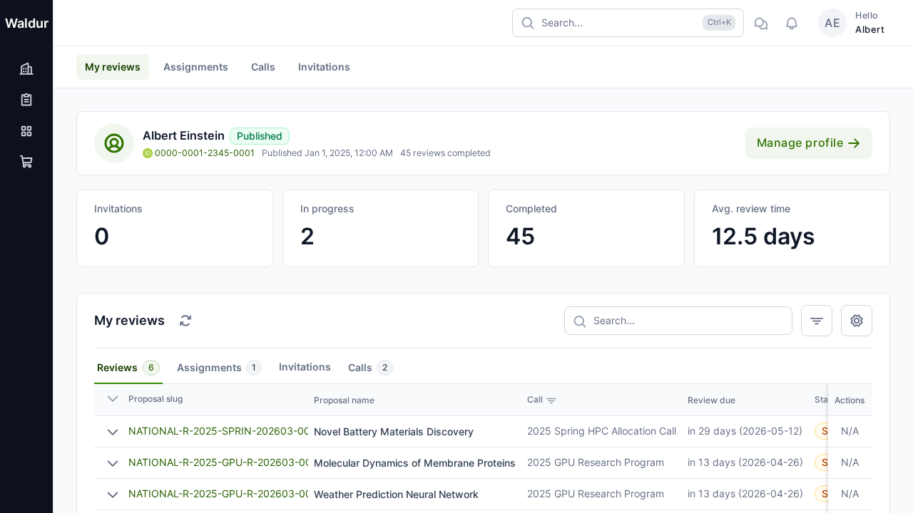

### Building a reviewer pool

**Performed by:** Call manager

1. Open the call's **Manage** page
2. Select the **Reviewer pool** tab
3. Add reviewers using one of these methods:
    - **By profile**: Search and select from published reviewer profiles
    - **By email**: Invite reviewers via email who may not yet have accounts

The **Pool** table lists each reviewer with their acceptance status, review counts, invitation date and assignment load; an **Expertise match** column is available from the column settings, and expanding a row reveals the reviewer's expertise in full.

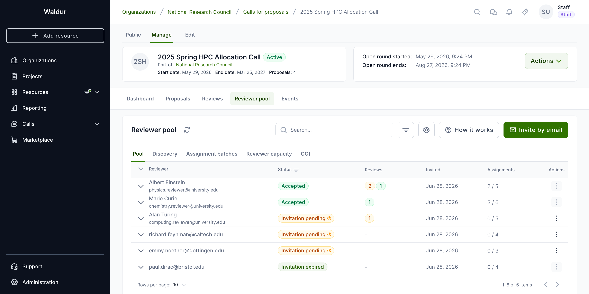

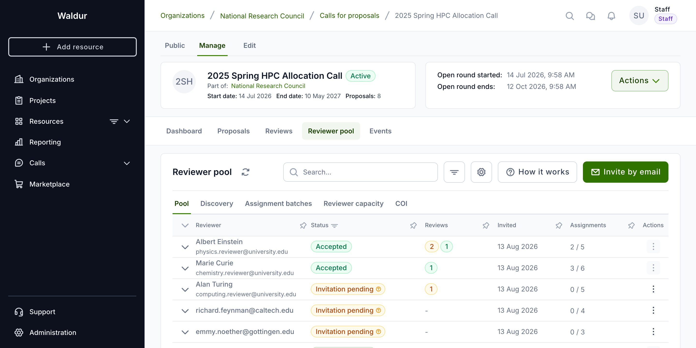

### Invitation workflow

When a reviewer is added to a pool:

1. An email invitation is sent with a personal invitation link
2. The reviewer opens the link and signs in — the invitation page requires it — then **accepts** or **declines**
3. To accept, the reviewer must have a published profile (they are prompted to create or publish one if they do not); an invitation addressed to a specific reviewer can only be accepted by that reviewer's account
4. The call's COI policy is shown on the acceptance page

Invitation statuses in the pool table:

- **Accepted** — the reviewer has accepted the invitation and is ready for assignments
- **Pending** — invitation sent, awaiting response (a reviewer may still need to create or publish a profile before they can accept)
- **Declined** — the reviewer declined the invitation
- **Expired** — the invitation lapsed without a response

### Invitation expiry and resending

A pool invitation can be answered for the call's **assignment expiration** period
(7 days by default) — the same response window the call gives reviewers for
assignment batches. After that it can no longer be accepted or declined. An
hourly job marks such invitations **Expired** and emails the call manager who
sent the invitation (or the call's managers, if the sender has no email), when
the `proposal.reviewer_pool_invitation_expired` notification is enabled.

A pending or expired invitation can be sent again. In the **Reviewer pool**,
open the invitation's row 3-dot menu, choose **Resend invitation** and confirm
with **Resend**. The action is offered to call managers, and only on **Pending**
and **Expired** rows. Resending returns the invitation to **Pending** with a new
expiry date and emails the invitee a new link; the link from the earlier email
stops working. A declined invitation cannot be resent. (API: the
`resend-invitation` action of the call reviewer pool.)

!!! note
    An invitation can be sent by email to someone who has no Waldur account yet; the link carries a secure random token. Opening it still requires signing in.

A call manager can also force-accept an invitation the reviewer cannot answer — see
[Force-accepting reviewer pool invitations](coi-management.md#force-accepting-reviewer-pool-invitations).

## Conflict of interest (COI) detection

COI types, severities, detection settings, the **COI** tab and the gating of assignments are
described in [Conflict of interest management](coi-management.md).

## Reviewer-proposal matching

Waldur uses algorithmic matching to suggest optimal reviewer-proposal assignments.

### Matching methods

| Method | Description |
|---|---|
| **Keyword** | Matches reviewer expertise keywords against proposal text |
| **TF-IDF** | Text similarity using Term Frequency-Inverse Document Frequency |
| **Combined** (default) | Weighted combination of keyword and TF-IDF scores |

### Configuring matching

**Performed by:** Call manager

1. Open the call's **Edit** page
2. Select **Evaluation workflow → Matching settings**
3. Configure:
    - **Affinity method**: Keyword, TF-IDF, or Combined
    - **Weights**: Keyword weight and text weight, which should sum to 1.0 (the form warns when they do not)
    - **Constraints**: Min/max reviewers per proposal, max proposals per reviewer
    - **Threshold**: Minimum affinity score for suggestions
    - **Response window**: days a reviewer has to answer an assignment batch, and the reminder before it expires

!!! note
    The **Assignment algorithm** (MinMax, FairFlow, Hungarian) is stored but not
    used yet. **Generate assignments** picks reviewers for each proposal in one
    greedy pass: accepted pool members by their affinity for the proposal,
    highest first, skipping reviewers with a pending or recused conflict of
    interest, and topping up with other accepted pool members when affinity
    yields too few.

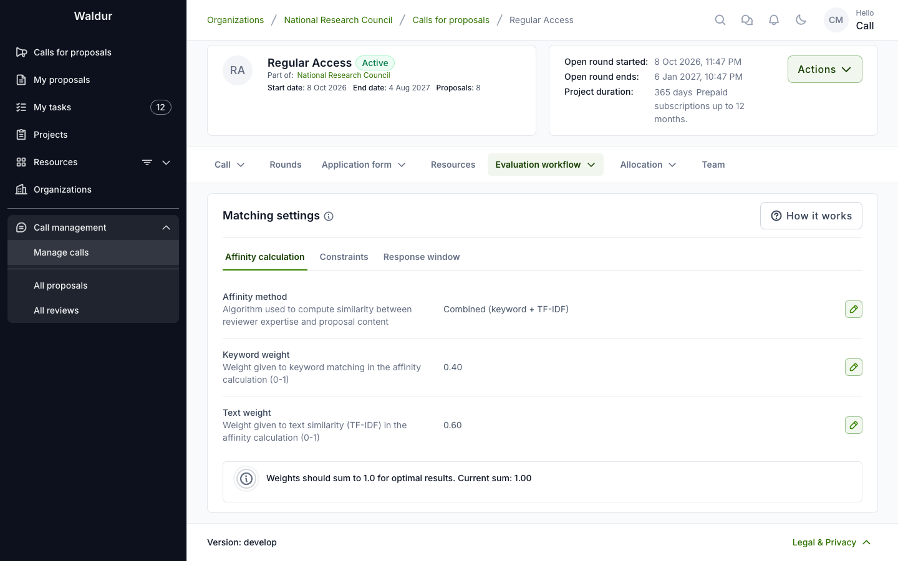

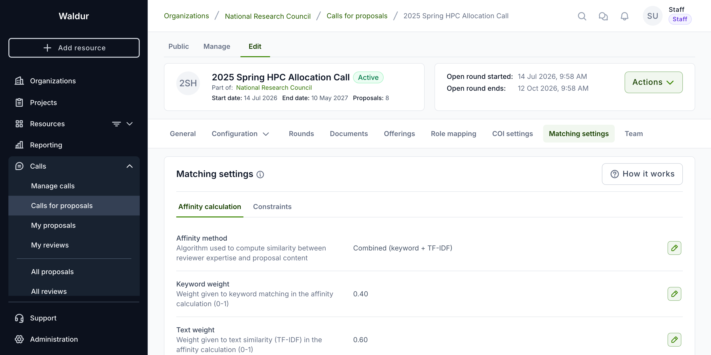

### Generating suggestions

1. In the **Reviewer pool > Discovery** tab, click **Generate matches**
2. In the **Generate reviewer matches** dialog, choose what to match reviewers against:
    - **Call description** — match against the call's own description
    - **All proposals** — match each reviewer against every proposal
    - **Selected proposals** — match against a chosen subset
    - **Custom keywords** — supply your own keywords and pick a search mode (*Expertise keywords only* or *Full text search*)
3. Optionally open **Advanced options** to set a **Minimum match score (%)** cut-off
4. The system computes affinity scores and the results appear in the Discovery table

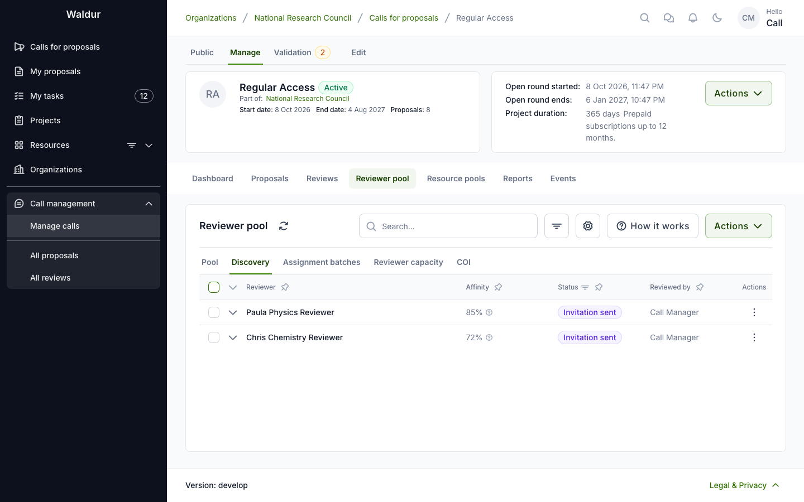

The Discovery table has **Reviewer / Affinity / Status / Reviewed by / Actions** columns. Each suggestion row shows:

- **Affinity score** as a percentage. Hovering the score reveals the **Score breakdown** tooltip — the *Keyword match*, *Text similarity*, and *Combined* components.
- **Status** — *Awaiting manager review* (newly generated), *Manager approved*, *Manager rejected*, or *Invitation sent*.
- **Reviewed by** — the manager who last actioned the suggestion.
- **Expand row** to see the full reviewer profile summary (biography, expertise, recent publications) without leaving the page.

For each suggestion you can **Confirm** (queue for invitation) or **Reject**, or use **Invite by email** to send a direct invitation to a candidate who is not yet in the pool. Bulk **Confirm all**, **Reject all**, and **Delete all** actions act on the whole table.

### Reviewer bidding

Reviewers can record a **bid** per proposal — *eager*, *willing*, *not willing* or *conflict* — through the API (`/api/reviewer-bids/`); there is no bidding screen in the interface. Only the reviewer who placed a bid can change or withdraw it. Bids are stored and listed only: neither affinity scoring nor assignment reads them, whatever the matching configuration's bid settings say, and a *conflict* bid does not record a conflict of interest — declare conflicts through the COI tooling instead.

## Assignment workflow (Stage 2)

After matching, call managers create assignment batches to formally assign proposals to reviewers.

### Reviewer pool navigation

The **Reviewer pool** panel groups the call manager's reviewer-related views under a single tab strip:

- **Pool** — the curated list of invited reviewers and their status.
- **Discovery** — algorithm-suggested reviewers based on expertise and affinity.
- **Assignment batches** — the per-reviewer assignment batches you've created, with status, item counts, sent/expiry dates, and per-row actions.
- **Reviewer capacity** — how many active assignments each pool member has, with their configured maximum.
- **COI** — flagged conflicts of interest awaiting manager review.

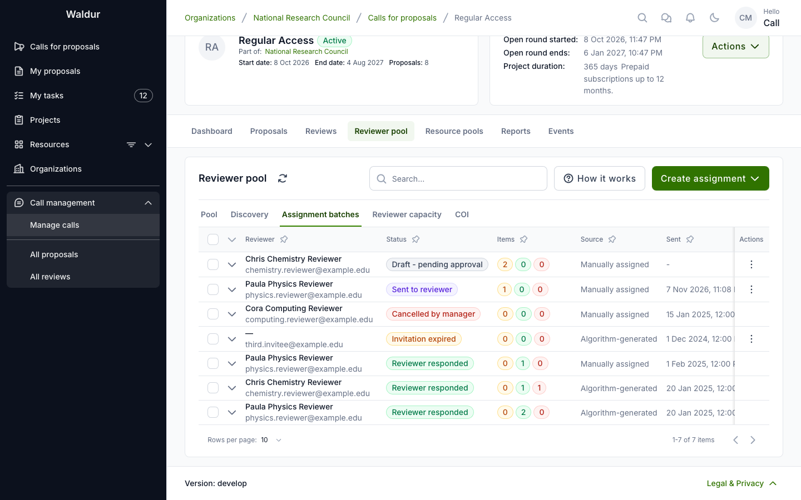

The header buttons on **Assignment batches** are:

- **How it works** — open an explainer of the assignment flow.
- **Manual assignment** — create a draft batch for a single reviewer with hand-picked proposals.
- **Generate assignments** — let the matching algorithm build batches from the current reviewer pool and unassigned proposals.

### Creating a manual assignment batch

**Performed by:** Call manager

1. Click **Manual assignment** on the **Assignment batches** tab.
2. Pick a **reviewer** from the pool. The dropdown shows each reviewer's email and current load (e.g. `2/5 assigned`). An assignment that would take the reviewer above their maximum is refused (see [Managing reviewer capacity](#managing-reviewer-capacity)); the dialog then offers **Assign anyway**.
3. Pick one or more **proposals**. The selector keeps a single chip visible with a `+N more` indicator so the dialog stays compact when many proposals are added.
4. Optionally add **manager notes** — internal context visible to other managers but not to the reviewer.
5. Click **Create assignment**. A draft batch is created. The reviewer is **not** notified yet.

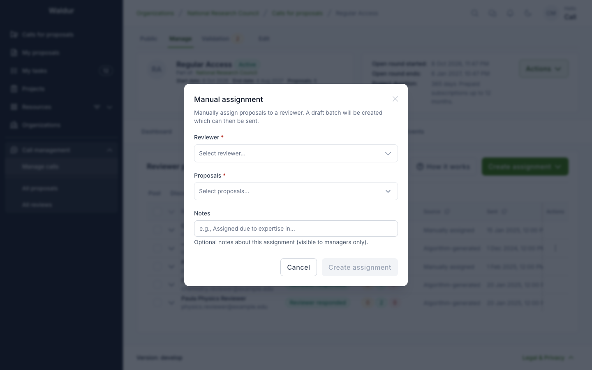

### Sending draft batches

Drafts give you a final review checkpoint before reviewers see the assignment.

1. Tick the checkbox next to one or more **Draft** batches. The toolbar shows `(N) Selected` and a **Send drafts (N)** button.
2. Click **Send drafts (N)** to dispatch the selected batches. The batch status moves from **Draft** to **Sent**, the batch appears on the reviewer's **Assignments** tab, and the reviewer is emailed the list of proposals, any manager notes, the response deadline and a link to that tab — provided the `proposal.reviewer_assignment_invitation` notification is enabled. Until a batch is sent the reviewer does not see it at all.
3. Non-draft batches in the selection are ignored automatically.

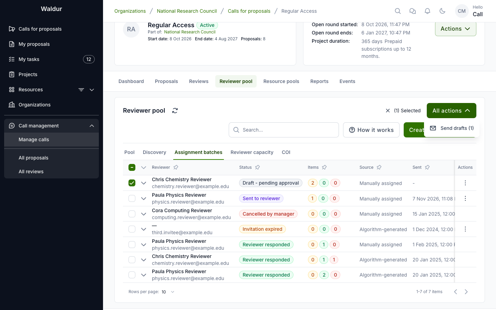

You can also send a single batch from the per-row 3-dot menu (**Send**).

### Reviewing a batch

Expanding a batch row shows its items — proposals, status, affinity, COI flags, decline reasons — and any **manager notes** captured at creation time.

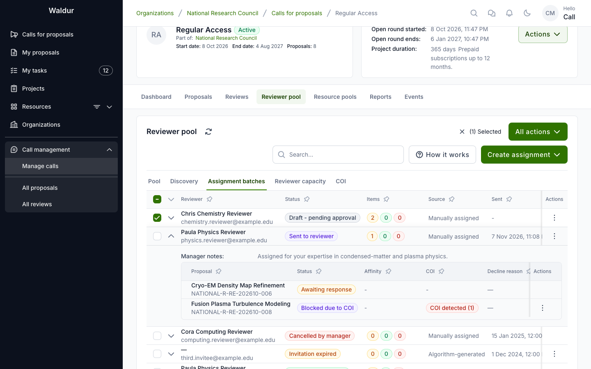

### Batch lifecycle

```text
DRAFT → SENT → RESPONDED / EXPIRED / CANCELLED
```

- **Draft**: Manager is preparing the batch
- **Sent**: Invitation sent to reviewer
- **Responded**: Reviewer has accepted or declined all items
- **Expired**: Batch expired without full response (the call's assignment expiration days, 7 by default); its unanswered items expire with it
- **Cancelled**: Withdrawn by the call manager; the reviewer no longer sees it

Before a sent batch expires, the reviewer is sent one reminder, by default 2 days
before the deadline. When a batch expires, the call managers are emailed so they
can extend the deadline or reassign the proposals. Both emails depend on the
`proposal.assignment_expiry_reminder` and `proposal.assignment_batch_expired`
notifications being enabled.

**Extend deadline** in the row menu of a sent or expired batch sets a new
deadline in the future. An expired batch goes back to **Sent** and its expired
items to pending, and the reviewer gets a new reminder before the new deadline.
Reviews the reviewer already accepted from the batch are not due before the
batch's deadline, so extending it gives them more time as well.

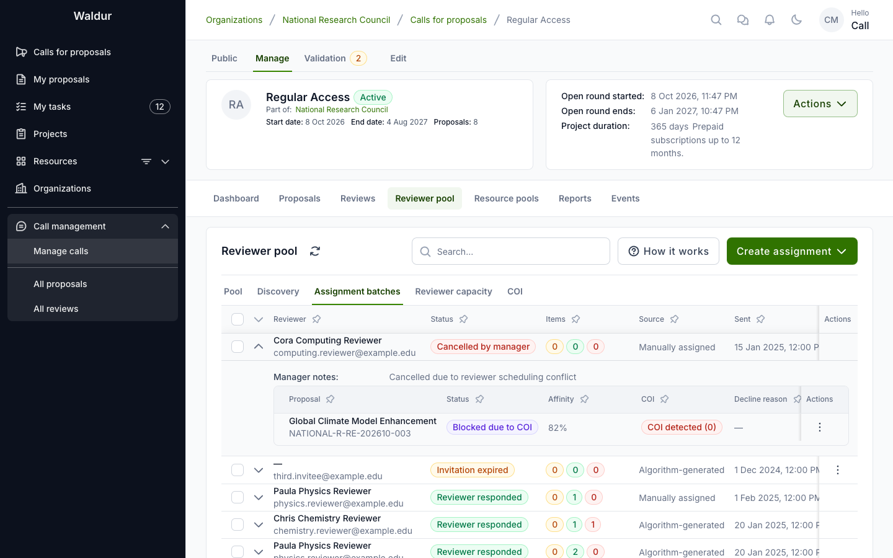

### Assignment item responses

For each proposal in a batch, the reviewer can:

- **Accept**: Creates a Review in IN_REVIEW state — reviewer can begin evaluation
- **Decline**: Records decline reason; the proposal can then be assigned to another reviewer

Expanded batches show individual item responses:

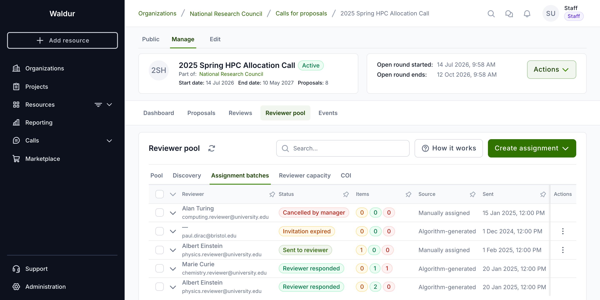

What the reviewer sees is described in [Reviewer profile and invitations](reviewer-guide.md#assignments).

### Auto-reassignment

A declined proposal is **not** reassigned automatically. The call's assignment
configuration stores an *auto-reassign on decline* switch and a maximum number
of attempts (API only), but no reassignment is carried out yet: assign the
proposal to another reviewer yourself, with **Manual assignment** or
**Generate assignments**.

Reminder emails before a batch expires are sent (2 days before by default);
set the response window and the reminder under **Evaluation workflow →
Matching settings**.

### Managing reviewer capacity

The **Reviewer capacity** tab lists every pool member and their current load. Use it to adjust the **Maximum assignments** per reviewer when workload, sabbaticals, or expertise concentration change during a call.

The maximum is enforced. A reviewer's current load is counted live from their
open assignments in the call:

- proposals in their draft or sent batches that are still pending;
- accepted assignments whose review is not yet submitted or rejected;
- reviews in progress that were created directly rather than from an assignment.

Declined, expired, reassigned and COI-blocked items do not count, nor do items
of cancelled or expired batches.

- **Generate assignments** skips reviewers who have reached their maximum, also
  counting the assignments it creates in the same run.
- A **manual assignment**, or a review created directly, that would take the
  reviewer above the maximum is refused with a message giving the reviewer's
  open assignments and limit. In the **Manual assignment** dialog the refusal
  appears as a **Reviewer workload limit exceeded** warning, and the submit
  button becomes **Assign anyway**; clicking it creates the assignment above
  the limit. Changing the reviewer or the proposals clears the warning, so a
  different choice is checked again. The override is recorded as a
  `reviewer_workload_limit_overridden` event on the call. (API:
  `override_workload_limit` on `create-manual-assignment`; a review created
  directly is overridden the same way, through the API only.)

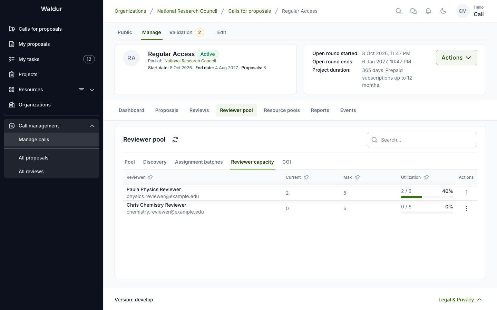

1. Switch to the **Reviewer capacity** tab in the Reviewer pool panel.
2. Open the row 3-dot menu and choose **Edit capacity**.
3. Update **Maximum assignments** and save.

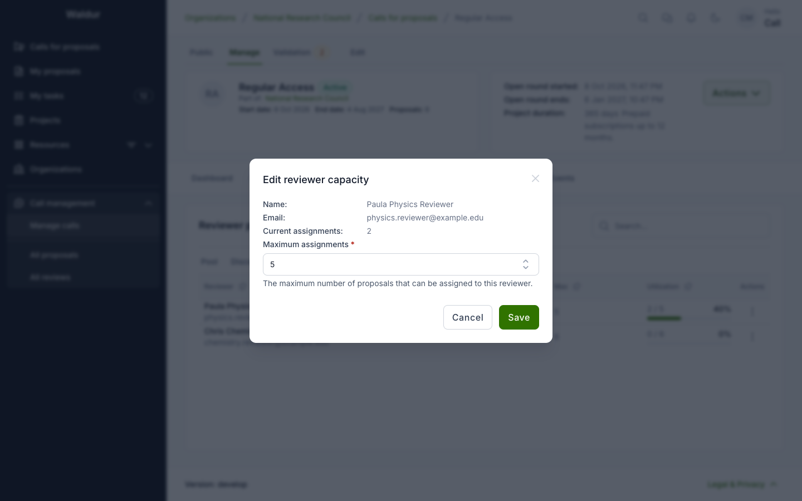

!!! tip
    Lowering the maximum below a reviewer's current count won't unassign existing work — it just refuses new assignments until the load drops back below the maximum.
