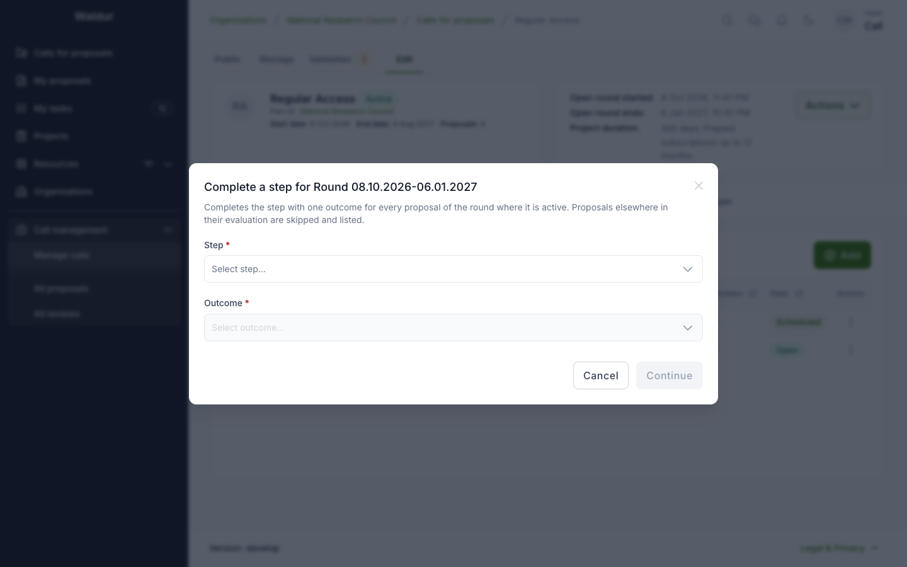
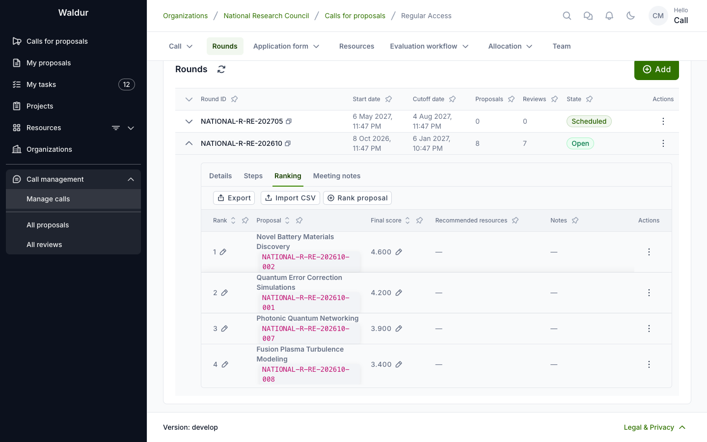

# Round steps and rankings

**Performed by:** Call manager

Committees usually work on a round's proposals together rather than one at a time. The call's
**Rounds** tab gives them three tools: completing a step for every proposal of a round,
round steps that collect one report per contributor for the whole round, and the round's
ranking and meeting notes. What happens after the committee — publishing the round's results
and completing it — is described in [Publishing a round's results](round-results.md).

## Completing a step for the whole round

Committee steps are often decided for all proposals of a round in one meeting.
On the call's **Rounds** tab, a round's actions menu offers **Complete a step
for the round**. Pick the **Step** — the dialog then lists the round's proposals
at that step, each with an optional feedback field — and the **Outcome**, click
**Continue**, and confirm with **Complete for *n* proposal(s)**.

Each proposal of the round that stands at that step is completed on its own, as
if you had completed it on the proposal: the step's gates, notifications and
records apply to each. The result, shown below, lists which proposals were **Completed**,
which were **Skipped** (not at the step, or a step you cannot act on), and which
failed with the reason — a failure leaves that proposal as it was and does not
stop the others. Running it again completes only what is still open.

The **allocation decision** cannot be completed for a round: awards are decided
per proposal. Feedback on a step whose report is released to the applicant
stays withheld until the report is released.

## Round steps and round reports

A step set to **Runs once per round** (see
[Per-step settings](workflow-configuration.md#per-step-settings)) — the committee meeting of
the Extreme Scale template, say — is not completed for the round as above, nor on a proposal.
Expanding a round on the **Rounds** tab shows its **Steps**; **Open for round** opens such a
step for the round's proposals that have reached it, its contributors each write
one round report covering those proposals, and the step completes for the round
once the reports are in.

## Ranking and meeting notes

Expanding a round on the **Rounds** tab also shows its **Ranking** and
**Meeting notes** tabs: the committee's record of the round, kept beside the workflow.

- **Ranking** — **Rank proposal** gives a proposal of the round its **Rank**, a
  **Final score**, **Recommended resources** per requested offering and
  component, and **Notes**. Ranks are unique within the round. Only proposals
  that are submitted or in review can be ranked. The table's export
  **Ranking for import** downloads the ranking, followed by the round's unranked
  proposals so the file can be filled in; **Import CSV** creates or updates rankings from such a file, all or
  nothing, and can swap ranks.
- **Meeting notes** — **Add note** records a meeting with a **Title**, **Notes**
  and attached documents.

The ranking is locked once the round moves to deciding; meeting notes stay
editable. A ranked proposal's [Awarded resources](allocation-decision.md#awarded-resources) section
shows the recommendation, and **Prefill from recommendation** copies it into the
awarded resources.

Call managers and staff edit both; panel members and support read them;
reviewers and applicants see neither. Anyone on the applicant team of a proposal
in the round, or with a conflict of interest on record with one of them, sees
nothing of that round's ranking or notes, and nobody can rank a proposal whose
applicant team they are on.
