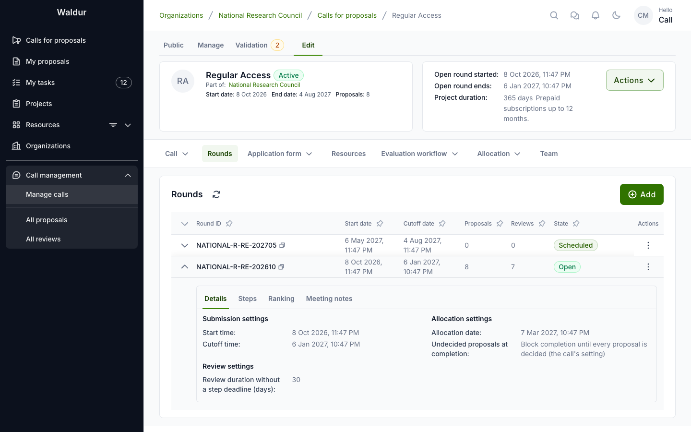
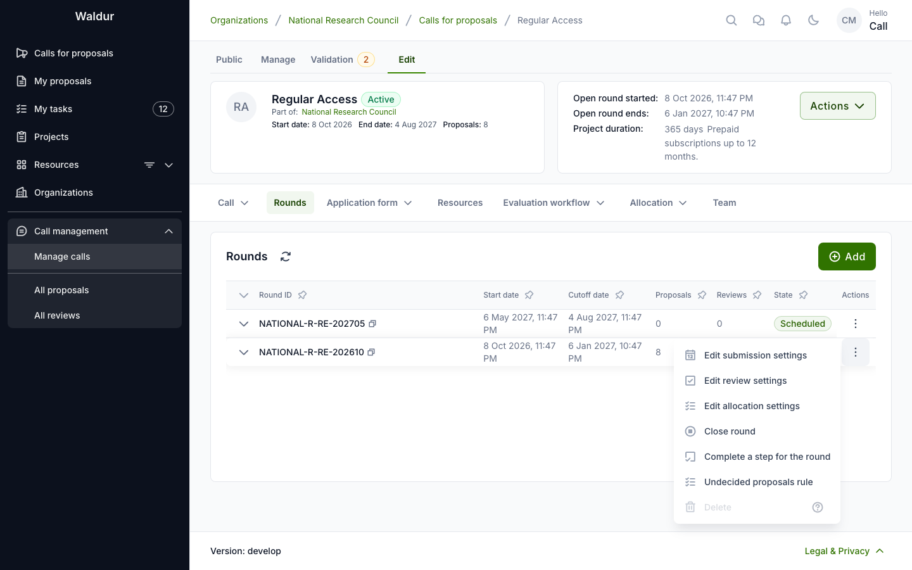
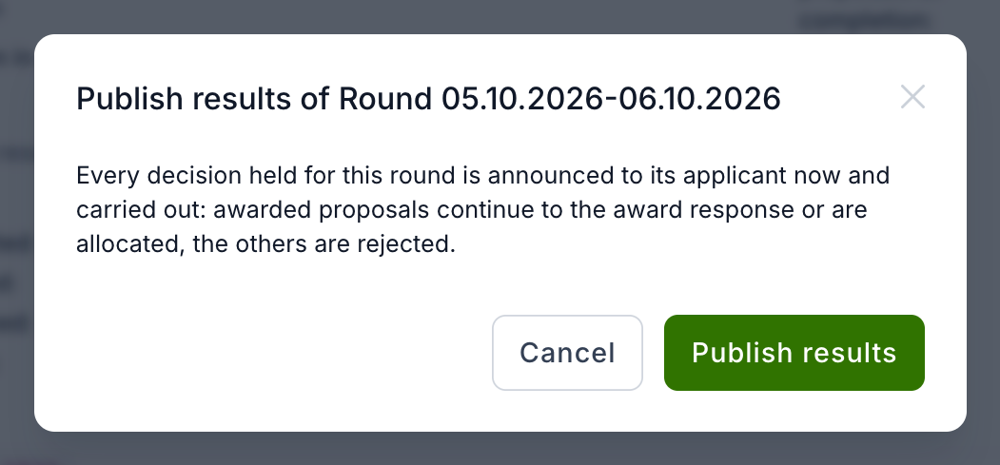
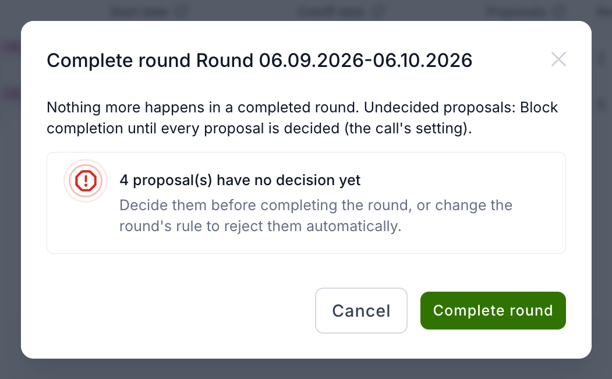

# Publishing a round's results

**Performed by:** Call manager

After its cut-off, a round moves through a lifecycle of its own: its proposals are evaluated,
decided, the results announced and the round closed. On calls whose applicants learn the
decision together for the whole round, publishing the round's results is what announces the
held [allocation decisions](allocation-decision.md#held-decisions).

## Round lifecycle after the cut-off

Before its cut-off a round is **Scheduled** or **Open**, derived from its dates.
Once the cut-off has passed, the round enters a stored lifecycle that the call
manager drives from the round's **⋮** menu on the call's **Rounds** tab:

| Stage | Entered | What it means |
|---|---|---|
| **Evaluating** | automatically after the cut-off (an hourly job), when the round is closed early, or on the first lifecycle action | The round's proposals are being evaluated |
| **Deciding** | **Start deciding** | The evaluated batch has gone to the decision body. Optional — results can be published straight from *Evaluating* |
| **Results published** | **Publish results** | Every decision of the round has been announced |
| **Closed** | **Complete round** | Nothing more happens in the round |

The rounds list shows the stage next to the round's status, and, for call
managers, a **held** count of decisions recorded but not yet announced. Expand a
row to see when each stage started, who published the results, the rule for
undecided proposals and the adoption record.

Each step is logged as an event of the call. The lifecycle actions require the
same permission as closing a round, and are available only while the call is
active.

## Publishing a round's results

**Applicants learn the decision** under **Call → General
configuration** decides when an applicant hears the outcome:

- **As each decision is made** — completing or rejecting the **Allocation
  decision** step announces the outcome at once, as before.
- **Together for the whole round** — the decision is recorded but **held**. The
  proposal stays **In review** for the applicant, the notification is not sent,
  and nothing is provisioned. The call team sees the tentative outcome
  (*Awarded (tentative)*, *Not awarded (tentative)*) in the proposals list. When
  the round is ready, a call manager publishes its results and every applicant
  of the round is told at the same time.

**Publish results** announces every held decision of the round and carries it
out as if it had just been made: an approved proposal continues to the award
response step, or is accepted and provisioned; a declined one is rejected. Each
applicant receives the same notification an immediate decision would have sent.

Publishing is refused while some proposals of the round are still being
evaluated without a decision. The dialog says how many; to publish anyway, use
**Publish anyway** and give a **Reason for publishing early**. The reason is
kept on the round, and the undecided proposals carry on — their decisions are
announced as they are made.

If a held decision cannot be carried out (for example, its allocation cannot be
provisioned), it stays held and the dialog lists it; the rest are published.
**Publish results** remains available on the round while anything is still held,
and publishing again retries it.

On a call that announces each decision as it is made, **Publish results** holds
nothing back: it only records the round's stage.

Until results are published, a call manager can take a held decision back with
**Reopen decision** on the proposal — see
[Held decisions](allocation-decision.md#held-decisions).

!!! note "Who sees a held decision"
    Only staff, support, and users who can update the call (its call managers and
    the managing organisation's call organisers) see that a decision is held and
    what it is. Applicants, reviewers, panel members and offering managers see
    the allocation decision as still in progress until the results are published.
    An applicant who also manages the call is treated as an applicant for their
    own proposal.

## Completing a round

**Complete round** closes a round whose results have been published. What
happens to proposals that still have no decision follows
**Undecided proposals when a round is completed** — set on the call and
overridable per round with **Undecided proposals rule**:

- **Block completion until every proposal is decided** — completing is refused
  and the dialog says how many proposals have no decision yet.
- **Reject them automatically** — each undecided proposal is rejected at the
  workflow step it stands in, with the reason *Not decided when the round was
  completed.*, and its applicant is notified at once. The round is then closed.

Completing is also refused while a decision of the round is still held because
its release failed at publication; publish the results again first.

## Recording adoption

Where the results must be adopted by another body (a board, for example), record
it with **Record adoption** on the round: the adoption date, a note and
optionally the adopting document. It can be recorded at any time after the
cut-off. While the round still holds its decisions, the adoption note, the
document and the reason for publishing early are shown only to those who may see
held decisions.
