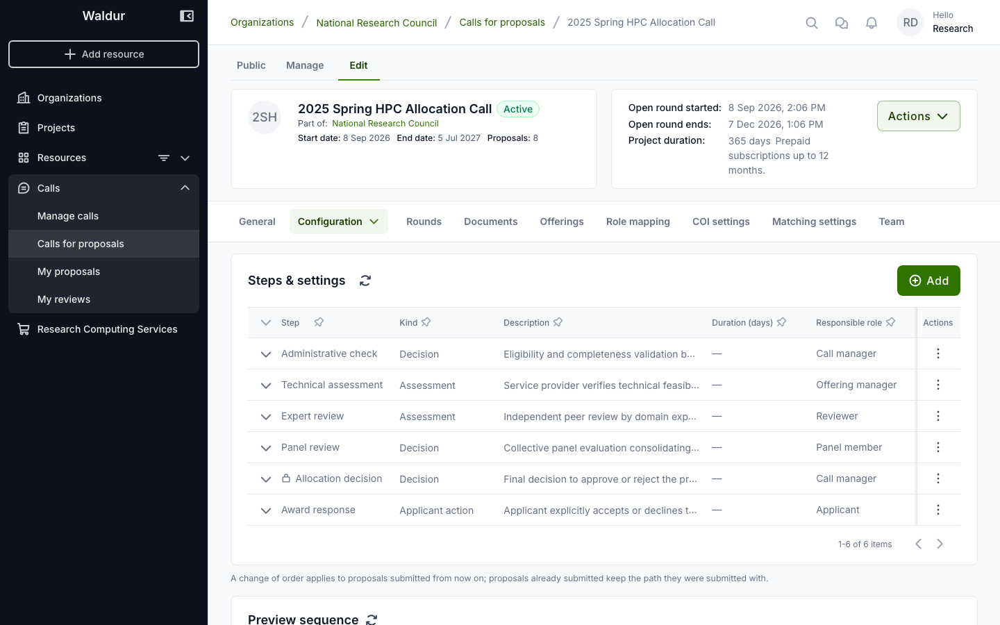
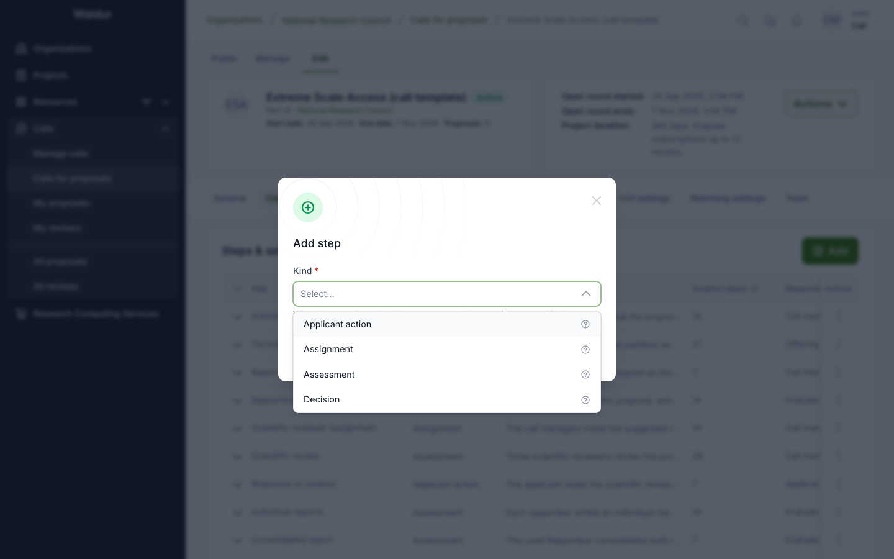
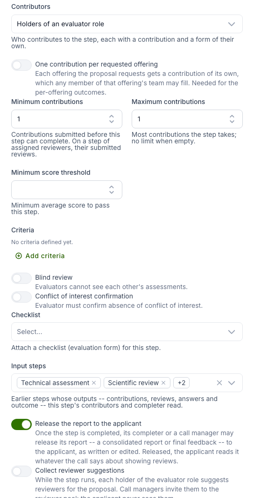
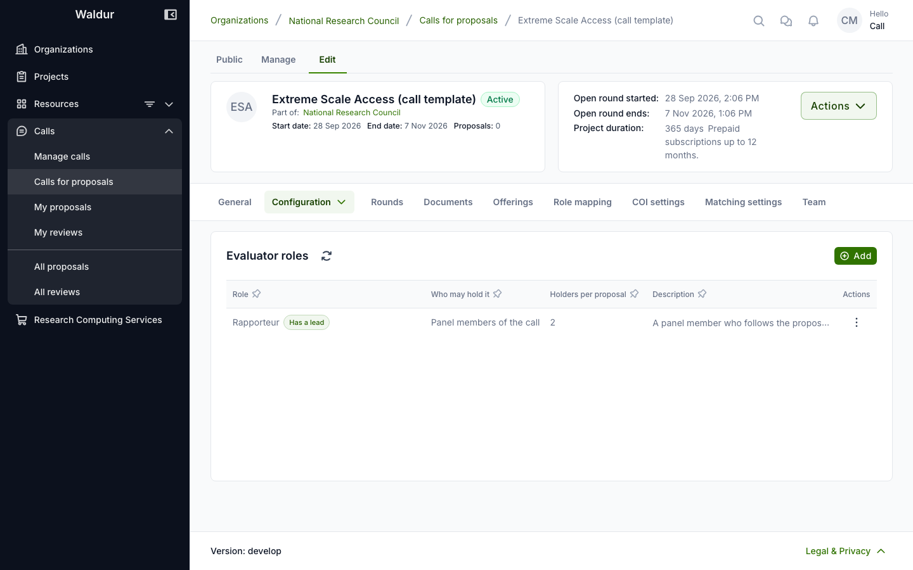
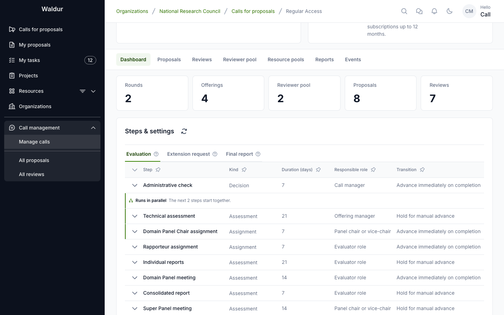
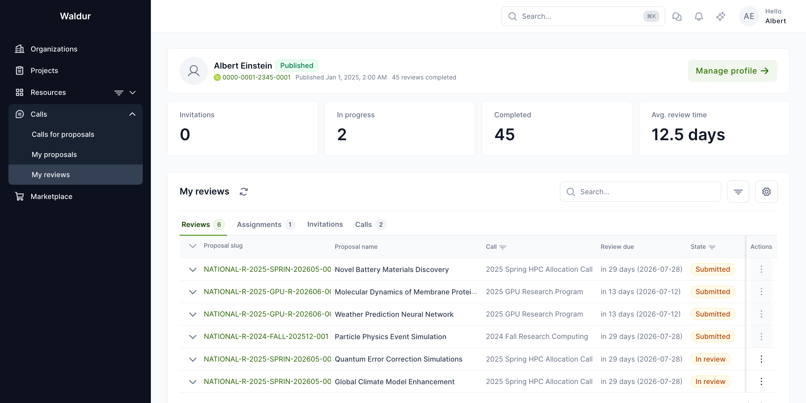

# Workflow configuration

A call's evaluation workflow is an ordered list of **call steps** that every submitted proposal walks through. The call manager decides which steps the call has, what each is called, in which order they run, who completes them, who contributes to them and what they read from earlier steps. A step is one of four **kinds**, and a call can use a kind as many times as its process needs — two assessments and a decision in a light call, or a dozen steps for a call with rapporteurs, peer review and a committee.

For a ready-made example, create a call from the [Extreme Scale call template](extreme-scale-template.md): it sets up a thirteen-step evaluation with rapporteurs, three scientific reviews, a response to reviews, a consolidated report, a committee meeting and final feedback, followed by an extension request and a final report after the award, which you can then adapt.

## Step kinds

| Kind | What it is for | Outcomes it can use | Completed by default by |
|---|---|---|---|
| **Applicant action** | The applicant answers or acts, for example responds to the reviews or accepts the award | *Submitted*; *Accepted* / *Declined*; *Done* | Applicant |
| **Assignment** | Someone picks the people who act on the proposal later, for example the rapporteurs | *Done* | Call manager |
| **Assessment** | Assigned people assess the proposal: a technical assessment, a peer review, a report | *Reviewed*; *Feasible* / *Infeasible*; *Done*; per requested offering | Reviewer |
| **Decision** | One completer picks an outcome: an eligibility check, a panel recommendation, the allocation decision | *Approved* / *Declined*; *Eligible* / *Ineligible* | Call manager |

Each step picks one of its kind's **outcome sets**, shown in the step settings as **Outcomes**:

| Outcome set | Outcomes | Negative outcome |
|---|---|---|
| Eligibility | Eligible, Ineligible | Ineligible |
| Feasibility | Feasible, Infeasible | Infeasible |
| Approval | Approved, Declined | Declined |
| Acceptance | Accepted, Declined | Declined |
| Reviewed | Reviewed | — |
| Submitted | Submitted | — |
| Done | Done | — |
| Per requested offering | Each requested offering's team answers Accepted, Conditionally accepted or Rejected; the step is *Infeasible* if any offering rejected, *Feasible* otherwise | Infeasible |

A step's **name** and **description** are free text and can be changed at any time. Each step also has a **key**, made from its name when the step is created, which stays the same when the step is renamed: the API, call exports and the call import refer to steps by key. A step's kind and key cannot be changed once it exists; add a new step instead.

### Rules across a call's steps

- **Exactly one allocation decision.** One enabled decision step is the call's **allocation decision**: completing it with *Approved* settles the award. A call cannot be activated without one, the allocation decision cannot be disabled, and once a proposal has been submitted to the call the flag cannot move to another step.
- **A response step needs a decision after it.** An applicant step that reads earlier steps (a response to reviews) must be followed by an enabled decision step. The call refuses a configuration that would leave the response last.
- **Input steps come first.** A step can only read steps that come before it, and a step that a later one reads cannot be moved after it.
- **Removing a step removes it from the steps that read it.** A step listed as an input of later steps disappears from their input steps when it is deleted; the confirmation names those steps. Check the descriptions that mention the removed step too.
- **Assign an evaluator role before the steps its holders work on.** A step whose contributors or completer hold an evaluator role must come after the assignment step that assigns the role: the call refuses to add, move or enable a step, or import a call, that would put it the other way round. A role no assignment step assigns is allowed: the call managers assign it on each proposal's **Evaluators** section, and a proposal reaching a step whose role nobody holds gives them an *Assign evaluators* task.
- **Used steps are disabled, not deleted.** A step that a proposal has already walked cannot be removed; disable it instead.
- **Each proposal keeps the path it was submitted with.** The order of steps, which ones are enabled, the allocation decision and each step's input steps are fixed on a proposal when it is submitted. Reconfiguring a call affects proposals submitted afterwards; proposals already in evaluation carry on as they were. Step **durations** are the exception: a step reads its duration when it starts.

### Defaults on call creation

A new call starts with five steps:

| Step | Kind | Enabled |
|---|---|---|
| **Administrative check** | Decision (eligibility) | Yes |
| **Technical assessment** | Assessment (feasibility), contributed by the requested offerings' teams | No |
| **Expert review** | Assessment (reviewed), contributed by the assigned reviewers | No |
| **Panel review** | Decision (approval), completed by panel members | No |
| **Allocation decision** | Decision (approval), the allocation decision | Yes |

Enable, rename, reorder or remove them, and add others, to build the call's process. A new call has no **Award response** step; a call created from a template or imported from a file brings one where it has it — an applicant step right after the allocation decision that cancels the proposal when the applicant declines. Disabling or deleting it lets the allocation decision allocate directly.

## Configuring workflow steps

**Performed by:** Call organiser or staff

1. Open the call's **Edit** page
2. Select the **Configuration** tab, then the **Steps & settings** sub-tab

The table lists the steps in order with their **Step** name, **Kind**, **Duration (days)**, **Responsible role** and **Transition**; steps that run alongside each other are grouped together. When the call has steps after the award, the table has a tab per phase: **Evaluation**, **Extension** and **Final report**. Expanding a row shows the rest of its configuration: description, outcomes, what a negative outcome does, its evaluators and contributors, input steps and flags. **Preview sequence** beneath the table shows the resulting order.

- **Add** opens the **Add step** dialog. Pick the step's **Kind** first; the dialog then shows the settings that kind supports. A new step is appended at the end unless you give it a position, and it starts with its kind's default notification rules.
- Each row's actions menu offers **Configure**, **Move up**, **Move down**, **Enable** or **Disable**, and **Remove**.

Steps stay editable while the call is in **Draft** or **Active**; the table becomes read-only once the call is **Archived**.

### Per-step settings

Every step has these settings:

| Setting | Meaning |
|---|---|
| **Name**, **Description** | What the step is called everywhere in the portal, and what it is for. |
| **Step enabled** | A disabled step is skipped by proposals submitted while it is disabled. |
| **Outcomes** | The step's outcome set (see [Step kinds](#step-kinds)). |
| **On a negative outcome** | Shown when the outcome set has a negative outcome: **Reject the proposal** (default), **Cancel the proposal**, or **Continue to the next step**. |
| **Estimated duration (days)** | Deadline for completing the step. Optional — when unset, the step has no deadline. |
| **Responsible role** | Who completes the step: Call manager, Offering manager, Reviewer, Panel member, **Panel chair or vice-chair** (marked on the call's **Team** tab), Applicant, or the holders of an **Evaluator role** of the call (pick the role in the field that appears). |
| **Transition mode options** | **Advance immediately on completion** moves to the next step as soon as the step is completed; **Hold for manual advance** parks the proposal so a manager advances it explicitly. |
| **Checklist**, **Checklist required** | An evaluation form for the step, and whether it must be answered before the step can be completed. |
| **Input steps** | Earlier steps whose work this step reads (see [Input steps](#input-steps)). |
| **Runs** | The phase the step belongs to: **In the evaluation** (default), **In an extension request**, which the team of an accepted proposal asks for as often as needed, or **In the closing (final report)**. The first step of an extension or closing sets **Days before the project ends**. |
| **Runs alongside the previous step** | Starts the step together with the one before it; the next step starts when both have ended. |
| **Run only when** | Runs the step only when an earlier step ended with chosen outcomes, or when the scores its contributions gave lie more than a number of points apart; otherwise proposals skip it. |
| **Allow requesting changes** | Whoever acts on the step may send the proposal back to the applicant for changes while it stays at the step. Not on the allocation decision or an applicant step. |
| **Applicant visible** | Whether the applicant sees this step by name on their progress tracker. Off by default: while an invisible step is the current one the applicant sees only that the proposal is in review, and once it has passed it leaves no trace on their tracker at all. Call managers and evaluators always see every step. |

Settings that depend on the kind:

| Kind | Settings |
|---|---|
| **Assignment** | **Assigns roles** — the evaluator roles the step fills; **Conflict of interest confirmation** |
| **Assessment** | **Contributors**; **One contribution per requested offering** (with **Allow conditional acceptance**); **Minimum contributions** and **Maximum contributions**; **Can be handed to**; **Minimum score threshold**; **Criteria**; **Blind review**; **Conflict of interest confirmation** (with its **Conflict-of-interest declaration**); **Release the report to the applicant**; **Collect reviewer suggestions**; **Runs once per round** |
| **Decision** | **Minimum reviewers**; **Minimum score threshold**; **Allocation decision**; **Allocation timing** and **Decide automatically** (on the allocation decision); **Runs once per round** |

On the allocation decision, **Allocation timing** chooses between **On decision**, which starts allocation immediately, and **Fixed date**, which defers it to the round's allocation date. **Decide automatically** awards the proposal as requested as soon as it reaches the step; the call managers decide only when the award cannot be made automatically.

**Runs once per round** makes a step a round step, such as a committee meeting after the cut-off: the call managers open it for the round's proposals together from the round's steps, its contributors each write one round report covering their proposals, and it is completed for the round, never on one proposal. A round step needs evaluation to start at the round cut-off, and is never the allocation decision or a per-offering step.

!!! note
    **Transition** governs only whether advancing needs a second manual action after a human completes the step. It never decides the outcome from review scores — **Minimum contributions**, **Minimum reviewers** and **Minimum score threshold** remain completion gates that a human must clear.

### Contributors

An assessment step's work is kept as **contributions**: one per contributor, or one per requested offering. Each contribution has its own outcome, comment and answers to the step's checklist, so two contributors never overwrite each other. **Contributors** says who contributes:

| Contributors | Who contributes |
|---|---|
| **Whoever completes the step** | No separate contributors; the completer's own answers are the step's work. |
| **The team of each requested offering** | The offering managers of each offering the proposal requests. |
| **Assigned reviewers** | The reviewers assigned to the proposal through assignment batches; each review is a contribution. |
| **Holders of an evaluator role** | The current holders of one of the call's evaluator roles on this proposal, for example its rapporteurs. |
| **Call managers**, **Call reviewers**, **Panel members** | Everyone holding that role on the call. |
| **Panel chair and vice-chair** | The call's panel chair and vice-chair. |

- **One contribution per requested offering** gives each requested offering its own slot when the step starts — the technical assessment per partition. Only that offering's team can fill it in. With the **Per requested offering** outcome set, each team answers *Accepted*, *Conditionally accepted* (with the conditions) or *Rejected*, and the last answer completes the step. Combine it with **On a negative outcome: Continue to the next step** to let a proposal carry on after one partition rejected it; the allocation decision then shows each offering's outcome and conditions.
- **Minimum contributions** is a completion gate: the step cannot be completed with a positive outcome until that many contributions are submitted. **Maximum contributions** is checked when a contribution is submitted.
- **Only the lead of this role contributes** limits the contributors of a step to the lead holder of its evaluator role, for example the Lead Rapporteur writing the consolidated report. It needs a role that **Has a lead**, and the role keeps its lead while a step relies on it.
- **The minimum stays within reach.** With an evaluator role as contributors, the minimum cannot exceed the role's **Maximum holders**, or one on a step only the lead contributes to; the call refuses it rather than let proposals wait at the step for good. For the same reason a role's maximum cannot drop below the minimum of a step its holders contribute to: lower the step's minimum first.
- **Blind review** keeps contributors from reading each other's contributions.
- Completing or rejecting a step withdraws its open contributions; a step that lapses expires them.

### Evaluator roles

An **evaluator role** is a role a person holds on one proposal, such as *Lead rapporteur* or *Rapporteur*. Holders are not part of the applicant team: they never see the applicant team's mail, are never added to the awarded project, and the applicant team never learns who they are.

Define the roles under **Evaluation workflow → Evaluator roles**:

| Field | Meaning |
|---|---|
| **Name**, **Description** | The role as evaluators and call managers see it. |
| **Who may hold it** | **Panel members of the call**, **Members of the proposal's panel**, **The chair of the proposal's panel**, **Reviewers of the call**, **Call managers of the call**, **Reviewers who submitted a review of the proposal**, or **Any user**. |
| **Required holders** | An assignment step for the role completes once this many are assigned. |
| **Maximum holders** | Per proposal. Leave empty for no limit. |
| **Has a lead** | One holder is marked as the lead, for example the rapporteur who writes the consolidated report. |

Rules that apply to every holder:

- **One evaluator role per person per proposal.** Someone who holds one role on a proposal cannot be given another on the same proposal. A revoked holder may be given another role.
- **One assignment step can fill several roles.** List them under **Assigns roles**; the step completes once each role has its required holders, and its lead where the role has one.
- **A conflict of interest removes access.** A pending or recused conflict of interest between a holder and the proposal stops their access and their part in the steps at once, whenever it was recorded. Dismissing or waiving the conflict gives it back; recusing also revokes the assignment.
- **Conflict-of-interest confirmation.** On an assignment step with **Conflict of interest confirmation**, a new holder gets no access until they confirm that they have no conflict.
- Members of the applicant team, ineligible users and users with a recorded conflict cannot be assigned.

A role that no enabled step assigns, takes contributions from or is completed by is marked **Not used by any enabled step** under **Evaluator roles**, and proposals do not ask for its holders. A role is used by naming it: as **Assigns roles** on an assignment step, as the **Responsible role** of a step its holders complete, as the **Contributors** of a step they contribute to, and as a notification recipient. A role that was ever assigned, or that a step or rule uses, cannot be deleted.

### Input steps

A step can read what earlier steps produced for the same proposal: list them under **Input steps**. The step's people then see an **inputs** section on the proposal with the input steps' submitted contributions, answers and reviews.

- Those overseeing the call always read the inputs; otherwise whoever holds the step's work — its contributors and completer — reads them once the step has started, and afterwards. A revoked holder, or one with a standing conflict of interest, reads nothing.
- An offering team reads only its own offering's slot of a per-offering input.
- An evaluator reads a per-offering input step's outcome, not each offering's assessment.
- On an **applicant step**, the applicant team reads the inputs in an applicant-safe form: reviews without their private comments and without reviewer names (unless the call shows reviewer identities), and the submitted contributions of input steps without the contributors' names.

!!! warning
    Choosing a step as an input of an applicant step shows the applicant every submitted contribution of that step. Pick the input steps of a response step accordingly.

**Response to reviews.** An applicant step with the **Submitted** outcome set and input steps is a response step: the applicant reads the reviews and questions it lists, fills in the step's form and submits the response. The whole applicant team reads the submitted response; later steps that list the response step as an input read it too. If the response step lapses unanswered, it is completed as *No response* and the workflow moves on.

### Releasing a report

An assessment step with **Release the report to the applicant** produces a report the applicant can be given, such as the consolidated report. It is on by default for a new assessment whose contributors are an evaluator role with **Maximum contributions** set to 1.

Once the step is completed, its completer or a call manager can release the report from the proposal's **Feedback to the applicant** section — once, optionally with an edited text that the applicant reads in place of the report. The applicant reads released reports whatever the call says about showing reviews, but not while the allocation decision is held for the round. The call team sees who released a report and when. Switching the setting off takes a released report back from the applicant.

### Collecting reviewer suggestions

An assessment step can **Collect reviewer suggestions** when its **Contributors** and its **Responsible role** are both the holders of an evaluator role. While it runs, each holder suggests reviewers for the proposal — an existing user or an e-mail address, with a note on their expertise. Call managers see the suggestions on the proposal, merged per person and flagged for known conflicts, and invite the suggested people to the reviewer pool from there. See [Reviewer suggestions](call-manager-workflow.md#reviewer-suggestions).

The applicant team never sees suggestions or who made them.

### Notification rules

Each step sends e-mail according to its notification rules. A new step gets its kind's defaults: a reminder a day before the deadline and a notice on expiry to the completer and the call managers, and for applicant steps a notice to the applicant when the step starts and a reminder before it lapses. Rules can name the holders of an evaluator role as recipients. They are managed through the API, at `/api/call-workflow-step-notification-rules/`, and are carried by call export, import and duplication.

## How proposals progress through the workflow

### On submission

When an applicant submits a proposal to a call with workflow steps configured:

1. A **step instance** is created for every call step, fixing the step's order, its input steps and the allocation decision for this proposal
2. Instances for enabled steps start as **Pending**; instances for disabled steps are marked **Skipped**
3. The first enabled step becomes **Active**. If that step has a duration set, its deadline is calculated from the duration; otherwise it has no deadline
4. The proposal state changes to **In review**

Steps 3 and 4 happen at once only when the call starts evaluation **on submission**, the default. When the call starts evaluation **at the round cut-off**, the proposal stays **Submitted** with every enabled step **Pending** until its round's cutoff date. An hourly job then activates the first enabled step of each such proposal and moves it to **In review**; the step's deadline counts from that moment, not from submission. See [When evaluation starts](call_management.md#when-evaluation-starts).

!!! note
    A proposal must have a project team before it can be submitted. If the call has no enabled steps at all, the proposal goes to **Submitted** rather than **In review**.

### Step completion

On the proposal page, a user who may complete the active step can:

- **Complete step** — opens a dialog asking for an **Outcome** (required) and an optional **Comment**. When the step advances immediately, this also moves the proposal to the next enabled step.
- **Reject at step** — asks for a **Rejection reason** (required) and ends the workflow
- **Advance workflow** — shown only when the step is held for manual advance and is waiting to be advanced

Contributors submit their own contribution from the step's **contributions** section instead; a per-offering step completes itself once every requested offering has answered. Steps completed by the **Applicant** are acted on by the applicant: the award response offers **Accept award** and **Decline award**, a response step **Submit response**. Staff users can act on applicant steps as well.

Call managers can also complete one step for every proposal of a round at once — see [Completing a step for the whole round](call-manager-workflow.md#completing-a-step-for-the-whole-round).

A negative outcome — **Ineligible**, **Infeasible** or **Declined** — does what the step's **On a negative outcome** says: reject the proposal, cancel it, or continue to the next step. The default award response cancels the proposal when the applicant declines.

When the last enabled step completes with a positive outcome, the proposal is **Accepted**, the project and its awarded resources are provisioned, and the approving user is recorded.

### Step statuses

| Status | Meaning |
|---|---|
| **Pending** | Not yet reached in the workflow |
| **In progress** | Current step, work under way |
| **Completed** | Step finished with a recorded outcome |
| **Overdue** | Deadline passed before the step was completed |
| **Skipped** | Step was disabled for this call when the proposal was submitted |

A contribution has its own status: **Pending**, **In progress**, **Submitted**, **Declined**, **Withdrawn** (the step was completed or rejected without it) or **Expired** (the step lapsed).

### Deadline handling

Deadlines are enforced automatically. An hourly job checks active steps against their deadlines:

- When a step's deadline passes, the step is marked **Overdue** and records an **Expired** outcome
- A response step that lapses is completed as **No response** instead, and the workflow moves on
- The workflow then **advances to the next enabled step**
- If the overdue step was the last enabled step, the **proposal is rejected**

!!! warning
    Expiry is enforced, not advisory. An overdue step can no longer be completed — attempting to complete it fails. Set **Duration** only where the deadline should carry that consequence, and leave it unset for steps that should wait indefinitely.

## Viewing workflow progress

### For applicants

Applicants see a timeline on the proposal page showing its progress, starting from submission. Only steps marked **Applicant visible** are named there — the setting is off by default, so a call that has not turned it on for any step shows the applicant the coarse Submission → Review → Decision tracker instead of the evaluation steps.

While an invisible step is the current one, it appears under the name of its stage rather than its own — **Decision** for the allocation decision, **Awaiting your response** for the award response, **Evaluation** for any other step — so the tracker still shows where the proposal has got to; once it has passed, it leaves no trace. Steps that were not reached because of an earlier rejection are struck through and marked **Not reached**. The timeline appears once the proposal leaves draft state; calls without a configured workflow fall back to the coarse tracker as well.

A short line under the tracker says what is happening — the expected decision date where the step has a deadline, or that the applicant's own confirmation is needed on an award response.

### For call managers

Call managers see the same timeline with full details — each step's status, responsible role, date and recorded outcome. The **Proposals** list on the call manage page also carries a **Step** column showing each proposal's current step and its responsible role.

### For reviewers and evaluators

Reviewers open their assigned reviews from the **Reviews** page. The current workflow step is shown on the individual review page as a badge reading "Step *n* of *N*", not on the reviews list itself. Holders of an evaluator role find their proposals on the **Evaluator roles** tab of the same page.

## Evaluation checklists

Each workflow step can have an attached **checklist** — a structured form filled in during evaluation. Checklists support 18 question types, including yes/no, single and multiple select, text and rich text, numbers, dates, file uploads, ratings and Likert scales, with conditional visibility. On a step with contributors, each contribution has its own answers.

For example:

- **Administrative check** checklist: "Is institution eligible?" (yes/no), "Rejection reason" (conditional text)
- **Technical assessment** checklist: "Is proposal feasible?" (yes/no), "Assessment notes" (text area)
- **Response to reviews** checklist: "Response to the reviewers' comments" (rich text)
- **Allocation decision** checklist: "Decision" (single select), "Allocation notes" (text area)

When a checklist is attached and marked as required, the step can only be completed after all required questions are answered.

See [Checklists and forms](checklists-and-forms.md) for details on configuring evaluation checklists.
