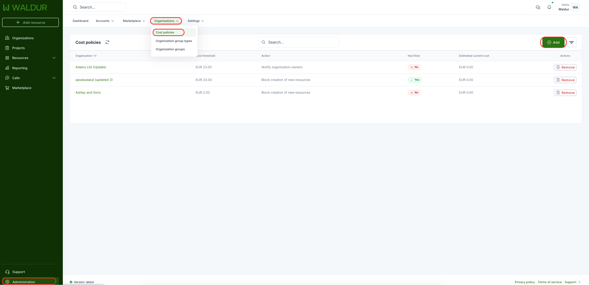
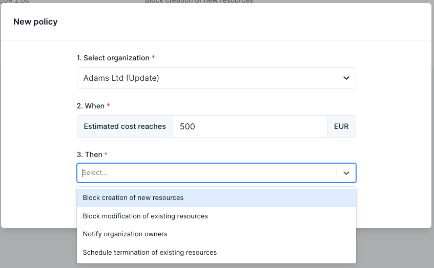
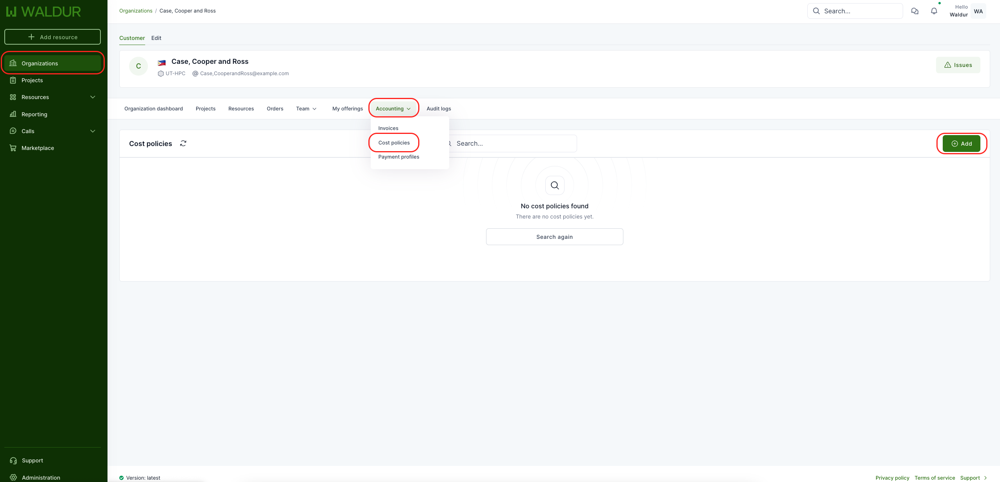
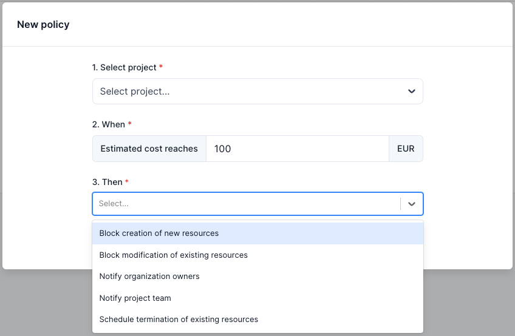
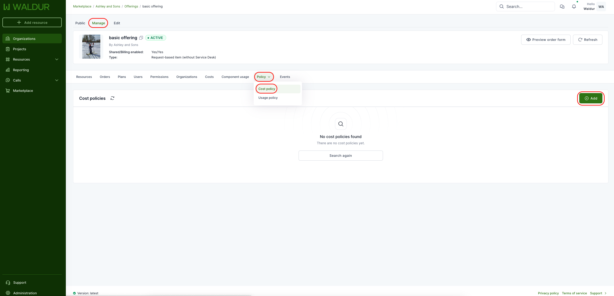
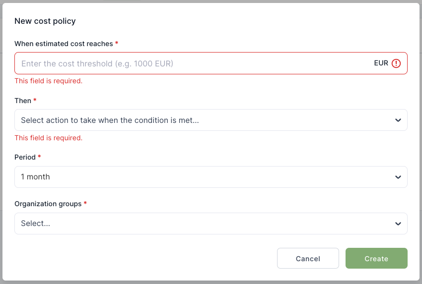
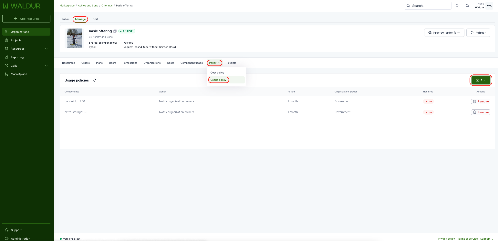
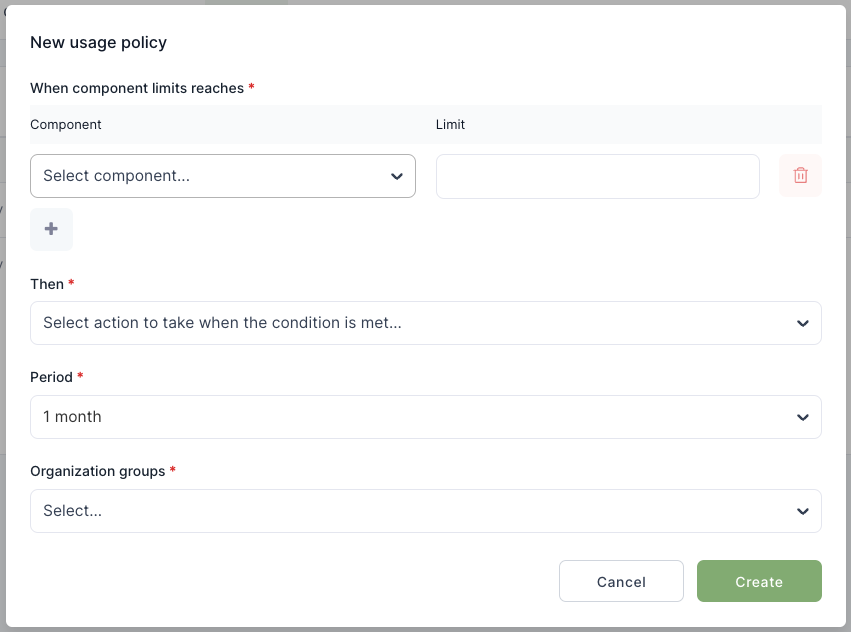

# Cost and usage policies

Define cost and usage policies on organization, project, or offering level to trigger
actions when consumption crosses a threshold. For the concept and the trigger / action
model, see [Policies](../../about/concepts/policies.md).

## Cost policies for organizations

Staff role can define cost policies for organizations. To add a new policy, open Administrations menu from the left and then Organizations -> Cost policies from the top. This view provides an overview about already defined policies. To create a new one, select "Add" from the right.
    

From the popup, select organization, then set estimated cost limit and finally choose the action (what happens, when the limit is reached).
    

## Cost policies for projects

Organization owners can set different cost policies for projects under particular organization. To add a new policy, open Organizations menu from the left and then Policy -> Cost policies from the top. This view provides an overview about already defined policies. To create a new one, select "Add" from the right.
    

From the popup, select project, then set estimated cost limit and finally choose the action (what happens, when the limit is reached).
    

When exactly one project is selected, the policy can optionally be limited to a single resource. Use the "Limit to resource" field to pick a resource: only that resource's cost is then measured against the limit, and the policy's actions (for example pausing, downscaling or scheduled termination) apply only to that resource. Leaving the field empty keeps the policy scoped to the whole project. Blocking the creation of new resources is not available for resource-scoped policies, since that action is project-wide.

By default, the policy accounts for any available project or organization credit — credit is subtracted before the limit is enforced, so a project with sufficient credit does not trigger the policy. Disable "Account for available credit" to enforce the limit against the raw invoice cost, regardless of credit balance.

The credit that counts is what is left after this month's usage so far, so the policy acts as soon as usage has spent the credit down to the limit — it does not wait for the month-end billing run. With the period set to **Total**, cost from earlier months stays in the total; once that alone exceeds the limit, the limit effectively means "act when less than this much credit remains". To cap a single month's spend instead, use a monthly period.

### What a cost policy is doing now

The cost policy list shows, next to **Action triggered**, what the policy's latest evaluation found, so a policy that is over its limit but waiting for credit does not look broken. **Current cost** is the figure the policy compares with its threshold: the cost in the policy's period, less what credit pays.
    

| Status | Meaning |
|---|---|
| **Below limit** | The cost after credit is at or below the threshold. |
| **Waiting for project credit** / **Waiting for organization credit** | The cost is over the threshold, but that credit still has more left than the threshold. The line under it shows how much is left; the policy fires once it falls to the threshold. |
| **Limit reached, actions pending** | The policy fires on the current figures, and its actions run at its next evaluation. |
| **Limit reached** | The policy has fired and its actions have run. |
| **Resets at next evaluation** | The policy fired earlier but is no longer over its limit, for example after a credit top-up; its actions are undone at its next evaluation. |

Point at the status, or move to it with the keyboard, to see the full reason with the figures:
    

Project managers and members see the same statuses, but not the organization's credit: for a policy held by the organization credit they see "Credit left is above the limit" without the amount.

On a project's dashboard, the credit card shows a warning when one of the project's cost policies has reached its limit and its actions are about to run, or when the credit left is within 20 % of a policy's threshold.

### Why a cost policy fired or reset

When a project or organization cost policy fires or resets, the event of each action it runs (for example "request downscaling" or "reset downscaling") records why. These events are listed under **Audit logs** for the project and the organization. The audit log does not show the figures yet; they are in the event's `context`, which the API returns (`GET /api/events/?event_type=request_downscaling`).

The policy compares two things:

1. **Cost after credit:** the cost in the policy's period, minus what credit pays. If this is at or below the limit, the policy does not fire.
2. **Credit left:** if the cost is over the limit and the policy accounts for credit, the policy fires only once the credit left is at or below the limit.

**Example.** A project with:

- a project credit allocation of 2 900 CHF, funded by a 100 000 CHF organization credit;
- 7 701.67 CHF of cost last month that no credit covered;
- 3 000 CHF of usage this month;
- a policy with limit 100, period **Total**, and "Account for available credit" on.

The credit pays 2 900 of this month's 3 000, so the cost after credit is 7 701.67 + 3 000 − 2 900 = 7 801.67, which is over 100. The allocation is spent, so the credit left is 0, at or below 100. The policy fires. Its event contains:

| Field | What it means | Example |
|---|---|---|
| `triggered` | Whether the policy fired: `true` means its actions ran, `false` means it did not fire or was reset | `true` |
| `gate` | Which check decided; see the next table | `credit_exhausted` |
| `evaluated_cost` | The cost after credit that was compared with the limit: the invoices of the policy's period, with the credit already applied to them, minus `credit_deduction` | `7801.67` |
| `credit_deduction` | Credit that this month's usage will use but that is not on the invoice yet. Credit is applied to an invoice when the month is billed; until then the policy subtracts it here. Credit already applied, for example in earlier months, is part of the invoices' totals and is not counted again | `2900.00` |
| `credit_value_compared` | The credit left, as it stands now: the balance after this month's usage so far. For a project with its own credit allocation, it is the lower of the allocation and the organization credit that funds it. Empty when the cost was not over the limit, because the credit was not checked | `0.00` |
| `limit_cost` | The policy's limit | `100` |
| `period` | The policy's period: `1` Total (all months), `2` one month, `3` three months, `4` twelve months | `1` |
| `use_credit` | Whether "Account for available credit" is on | `true` |
| `credit_balance` | The organization credit as stored. It only goes down at the month-end billing run, so during the month it can be higher than what is really left | `100000` |
| `project_credit_balance` | The project credit allocation as stored, with the same month-end lag | `2900` |

To see why a policy fired, read `credit_value_compared`, not `credit_balance` or `project_credit_balance`. In the example, the stored allocation still reads 2 900, but this month's usage has already spent it, so the credit left is 0.

`gate` is one of:

| `gate` | Fires | Meaning |
|---|---|---|
| `cost_below_limit` | No | The cost after credit is at or below the limit |
| `held_by_project_credit` | No | The cost is over the limit, but the project's credit allocation still has more than the limit left |
| `held_by_customer_credit` | No | The cost is over the limit, but the organization credit still has more than the limit left |
| `credit_exhausted` | Yes | The cost is over the limit and the credit left is at or below it. A project allocation counts as 0 when the organization credit that funds it does not exist |
| `no_credit` | Yes | The cost is over the limit and there is no credit |
| `credit_ignored` | Yes | The cost is over the limit and "Account for available credit" is off |

A reset event, such as "reset downscaling" after a credit top-up, carries the same fields: `triggered` is `false` and `gate` says what is holding the policy back, for example `held_by_project_credit`.

Events of actions that run without a new evaluation do not have these fields. Examples are refusing an order because the policy has already fired, and undoing actions when a policy is deleted.

### What started an evaluation, and who

The same events also record what made Waldur check the policy, and whose action that was. The actions themselves are carried out by the platform: such an event names the `system_robot` account as its user, not the person whose change caused it.

| Field | What it means |
|---|---|
| `trigger` | What started the check; see the next table |
| `trigger_object_uuid` | The object behind it: the invoice item, credit, usage report, policy or resource. Empty for the periodic check |
| `initiated_by_username`, `initiated_by_uuid` | The person whose action started it. Empty when nobody did: the periodic check, usage reported by a site agent, or background jobs such as monthly invoicing |

| `trigger` | What happened |
|---|---|
| `policy_saved` | The policy was created or changed |
| `invoice_item_saved` | An invoice line was added or changed, for example by usage billing |
| `credit_changed` | An organization or project credit changed, or the offerings it covers |
| `usage_reported` | Usage was reported for a resource |
| `periodic_sweep` | Waldur's regular check of all policies |
| `reconcile` | That regular check re-applying the actions of a policy that had already fired, to resources that became eligible since |
| `resource_saved` | A resource was created or changed while the policy had already fired, for example an order refused. Here the person who made the change is the event's user |
| `policy_deleted` | The policy was deleted, and its actions were undone |

In the example above, the "reset downscaling" event after the top-up has `trigger` `credit_changed`, `trigger_object_uuid` the project credit, and `initiated_by_username` the person who topped it up.

When several changes come within a couple of minutes of each other, Waldur checks the policy once for all of them. The event then names the first change and the person who made it.

### Changes to a policy

Creating, changing and deleting a cost policy produce the events `policy_created`, `policy_updated` and `policy_deleted`, with the user who did it. `policy_updated` lists each changed setting with its old and new value. Staff and support users can also see every earlier version of a policy, and who saved it. In the cost policy list, open the policy's actions menu and select "Version history".
    

The dialog lists the versions, newest first, with the user who saved each one. Select a version to compare it with the one before it; the changed settings are listed first. To see the policy as it was at a given time, pick a date under "State at". A version saved by a change that also made the policy fire or reset shows that too, under "Action triggered".
    

The same history is available through the API: `GET /api/marketplace-project-estimated-cost-policies/<uuid>/history/`, and likewise for organization and offering policies.

## Cost policies for offerings

Offering managers can set cost policies for specific organization groups. This allows to trigger some actions, when cost is reached. To add new policy, offering manager should open offering management page (Organization from the left menu, then Service provider -> Marketplace -> Offering) and then Policy -> Cost policy from the top. This view provides an overview about already defined policies. To create a new one, select "Add" from the right.
    

From the popup, set estimated cost limit, choose the action what happens after cost is reached (block creation of new resources or notifying the organization owners). Then, it is needed to select period (is this policy per month, quarter, annual or total) and finally select organization group for which this policy applies to.
    

## Usage policies for offerings

Offering manager can set different usage policies for specific organization groups. This allows to trigger some actions, when usage of defined resource component is reached. To add new policy, offering manager should open offering management page (Organization from the left menu, then Service provider -> Marketplace -> Offering) and then Policy -> Usage policy from the top. This view provides an overview about already defined policies. To create a new one, select "Add" from the right.
    

From the popup, select accounting component and set limit for that. Several compoments can be defined in one policy. Then, it is needed to select period (is this policy per month, quarter, annual or total) and finally select organization group for which this policy applies to.
    
