# Cost and usage policies

Define cost and usage policies on organization, project, or offering level to trigger
actions when consumption crosses a threshold. For the concept and the trigger / action
model, see [Policies](../../about/concepts/policies.md).

## Cost policies for organizations

Staff users define cost policies for organizations. Open **Administration** in the sidebar, then
**Organizations & compliance → Credits & cost policies**, and select the **Cost policies** tab.
It lists the policies already defined. To create one, click **Add**.

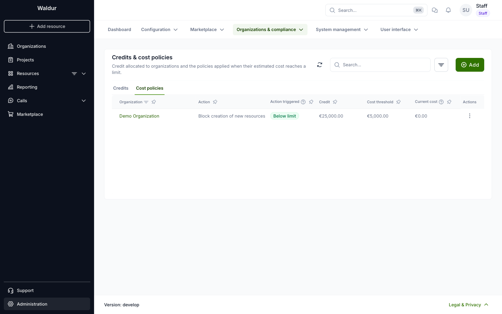

In the dialog, select one or more organizations and the period. The dialog shows each selected
organization's cost in previous months, this month and in total, to help you choose the limit.
Then enter the estimated cost limit and choose the action, which is what happens when the limit
is reached.

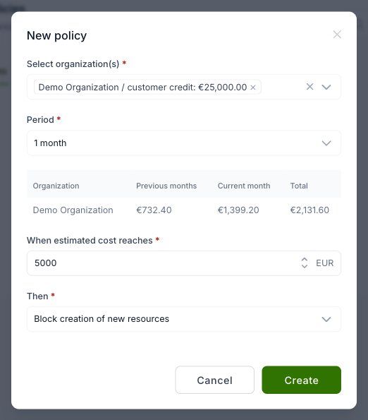

## Cost policies for projects

Organization owners can set different cost policies for the projects of their organization. Open
the organization, then **Policy → Cost policies**. The page lists the policies already defined. To
create one, click **Add**.

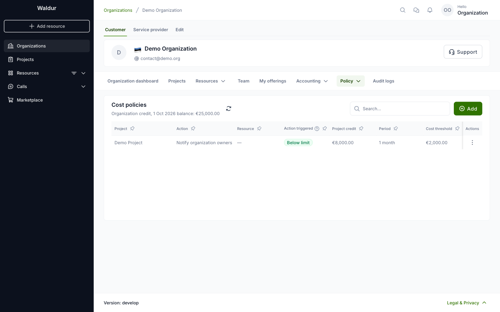

In the dialog, select one or more projects and the period; each project shows its estimated cost
for this month, and a table shows its cost so far. Then enter the estimated cost limit and choose
the action, which is what happens when the limit is reached.

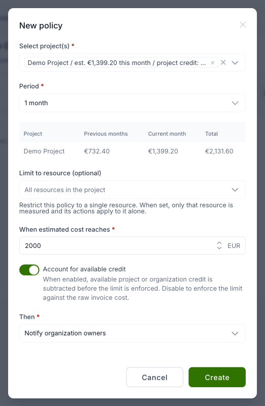

When exactly one project is selected, the policy can optionally be limited to a single resource. Use the "Limit to resource" field to pick a resource: only that resource's cost is then measured against the limit, and the policy's actions (for example pausing, downscaling or scheduled termination) apply only to that resource. Leaving the field empty keeps the policy scoped to the whole project. Blocking the creation of new resources is not available for resource-scoped policies, since that action is project-wide.

By default, the policy accounts for any available project or organization credit — credit is subtracted before the limit is enforced, so a project whose credit covers its cost does not trigger the policy. Disable "Account for available credit" to enforce the limit against the raw invoice cost, regardless of credit balance.

The policy fires when the cost after credit is over its limit; how much credit is still left does not matter. The credit that counts includes what this month's usage will draw before the month is billed, so the policy acts as soon as usage outgrows the credit — it does not wait for the month-end billing run.

With the period set to **Total**, the cost after credit also includes every earlier month that credit did not fully cover. Credit added now pays only the current month and later, so a top-up does not reset a Total policy whose earlier uncovered cost is over the limit by itself. That cost goes away only when it is paid: staff can let the project credit [pay earlier invoices](#paying-earlier-invoices). Otherwise, change the period to one month, which stops counting earlier months, or raise the limit. To cap a single month's spend, use a monthly period.

### What a cost policy is doing now

The **Action triggered** column shows one status per policy: what its latest evaluation found. **Current cost** is the figure the policy compares with its threshold: the cost in the policy's period, less what credit pays. The organization's credit, as its balance at the start of the month, is shown once under the list title.
    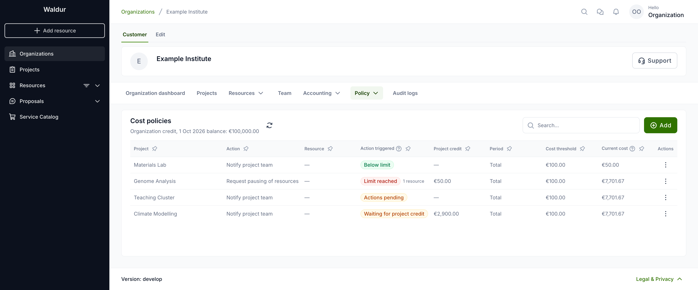

| Status | Meaning |
|---|---|
| **Below limit** | The cost after credit is at or below the threshold. |
| **Actions pending** | The cost is over the threshold and the policy fires on the current figures. Its actions run at its next evaluation. |
| **Limit reached** | The policy has fired and its actions have run. For an action that changes resources, such as pausing, the number of resources it changed is shown next to the status. |
| **Resets at next evaluation** | The policy fired earlier but is no longer over its limit, for example after a credit top-up or a payment of earlier invoices. Its actions are undone at its next evaluation. |

Point at the status, or move to it with the keyboard, to see the reason with the figures: the cost after credit and the limit, what the cost is made of (the cost before credit, the credit already used and the credit this month will still use), and how much of it is from earlier months that credit did not cover.
    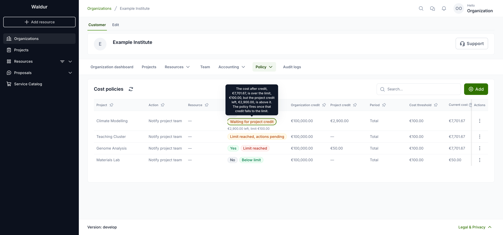

Project managers and members see the same statuses, but not the organization's credit.

On a project's dashboard, the credit card shows a warning when one of the project's cost policies has reached its limit and its actions are about to run.

### Details of a cost policy

Expand a policy's row to see what it counts:

- **Counted period:** the months the policy adds up. For **Total**, every month since the project's first invoice, the current one included.
- **Cost against the limit:** one box per month, with the month's cost and whether credit covered it. Months that credit did not fully cover are red, with the amount left over; the current month is shown so far. Below the boxes, the sum the policy compares with its limit, for example "€600.00 + €750.00 = €1,350.00, over the €1,000.00 limit".
- **When the actions are reset:** each change that would lower the cost after credit, what the cost would be then, and whether that is enough to reset the actions.
- **Affected resources:** the resources the policy changed, for example paused, and since when.

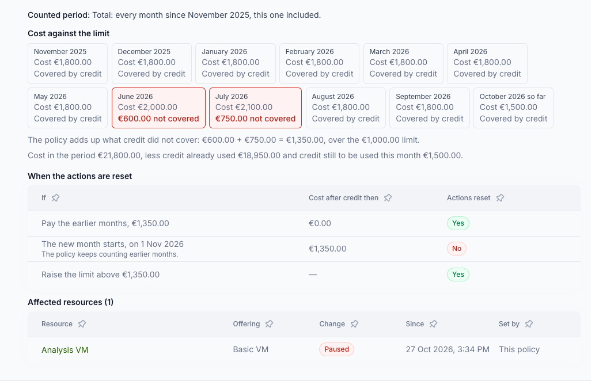

The row's actions menu has **Details** and, for those who may change the policy, **Fix…**.
    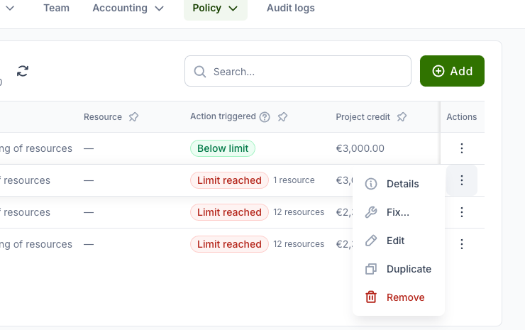

**Details** opens the same explanation in a dialog, with the figures the cost is made of and the **Earlier invoices** table: for each closed month, its cost that credit could pay, how much credit paid, and what is not covered.

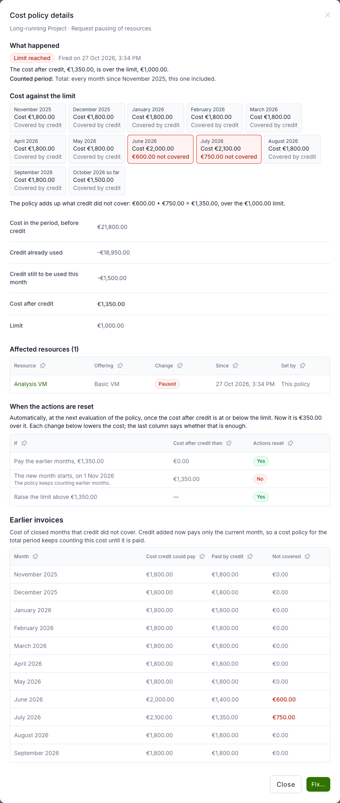

The months are shown to whoever may see the project's costs: staff, support, organization owners and users who may view the organization's accounting, and the project's own members when the organization shows billing information in projects. Others see the cost after credit as one bar, split into the earlier months' part and the current month's part.

### Fixing a cost policy over its limit

**Fix…** lists what would lower the cost after credit to the limit, and what each option leaves. An option that is enough by itself says **Resets the actions**; one that only helps says **Not enough on its own**. The actions are reset at the policy's next evaluation, which a change of the credit or of the policy starts.

| Option | Shown when | Who can do it |
|---|---|---|
| **Add project credit** | The project has a credit and the current month is not fully covered. The dialog says by how much to raise the allocation. | Organization owners and staff |
| **Pay earlier invoices from the project credit** | Earlier months are not covered and the project credit does not pay them yet. See [Paying earlier invoices](#paying-earlier-invoices). | Staff |
| **Count only the current month** | The period is longer than one month and earlier months are not covered. Earlier months then stop counting, paid or not. | Whoever may edit the policy |
| **Raise the limit** | Always. Opens the policy for editing. | Whoever may edit the policy |

Options the user cannot take are not listed. Organization owners can fix the policies of their projects; organization cost policies only staff can fix.

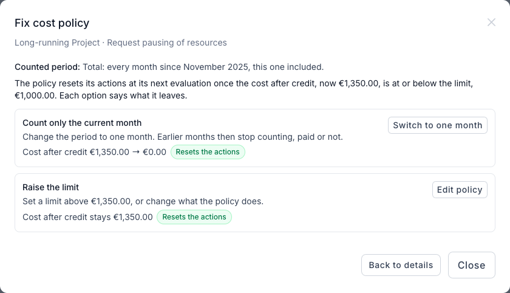

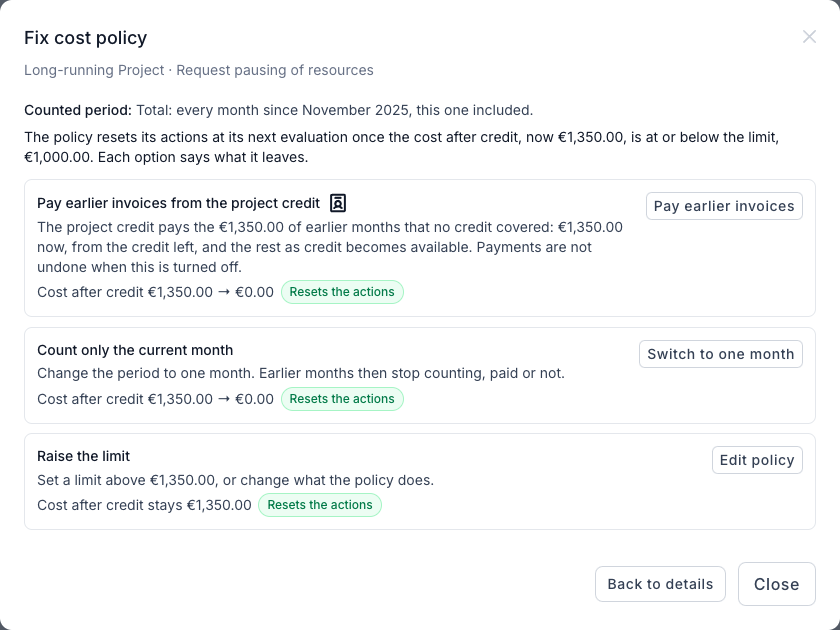

### Paying earlier invoices

A project credit can also pay the cost of the project's earlier, closed invoices that no credit covered. Only staff can turn this on, because it changes what the organization was billed for those months. In **Fix…**, staff select **Pay earlier invoices**. Before anything is written, the dialog shows what will be paid now:

- each compensation it writes: the month it pays, the invoice it is written on, the resource and the cost item, and the amount;
- the total paid now, and the project credit and the organization credit before and after.

Choose where the compensation is written:

- **Current month** (the default): on the invoice open when it is paid. Earlier invoices stay as they were issued, and the open invoice can go below zero.
- **Month the cost was incurred:** on the paid month's own invoice. This changes the total of an invoice already issued, and possibly paid.

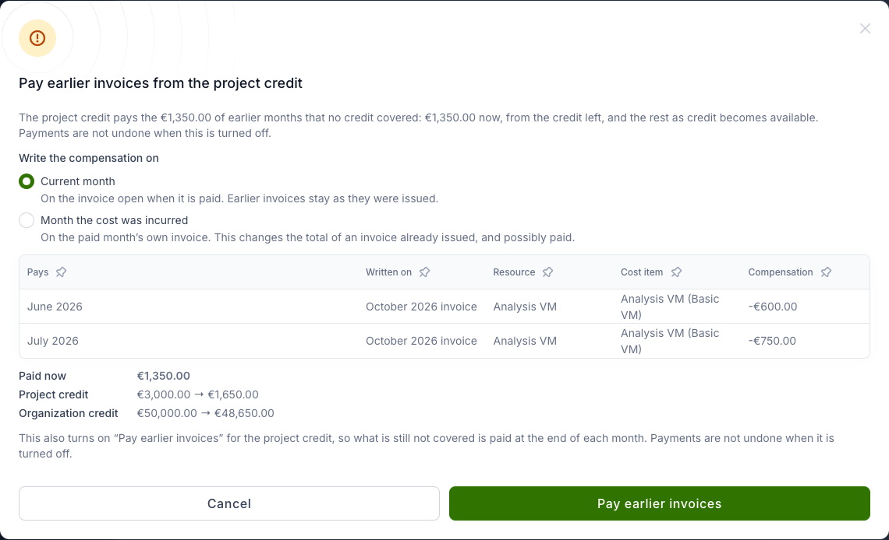

Paying turns on **Pay earlier invoices** for the project credit, so whatever is still not covered is paid at the end of each month, as credit becomes available. The cost policies count each payment in the month it pays, so a Total policy's cost goes down by the amount paid, and a monthly policy's cost for the current month does not change. Payments are not undone when the setting is turned off. Staff can also set this up, with a range of months, on the credit itself; see [Credit management for staff](../staff-users/credit-management-staff.md#paying-earlier-invoices).

### On the resource and the project dashboard

A resource that a cost policy paused or changed shows a banner with the reason in one line. **Details** opens the policy's details, and **Fix…** is there for those who may fix it.

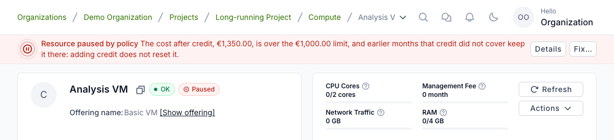

On the project dashboard, **What happens next** lists a policy that has reached its limit with the same **Details** and **Fix…** links.

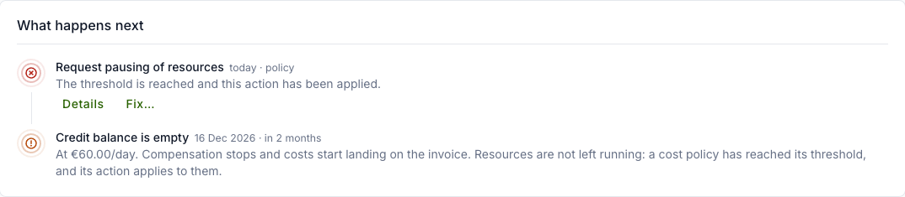

### Why a cost policy fired or reset

When a project or organization cost policy fires or resets, the event of each action it runs (for example "request downscaling" or "reset downscaling") records why. These events are listed under **Audit logs** for the project and the organization. The audit log does not show the figures yet; they are in the event's `context`, which the API returns (`GET /api/events/?event_type=request_downscaling`).

The policy compares the **cost after credit** with its limit: the cost in the policy's period, minus what credit pays. If it is over the limit, the policy fires; if it is at or below, it does not, or its actions are reset. How much credit is still left is not compared with the limit.

**Example.** A project with:

- a project credit allocation of 2 900 CHF, funded by a 100 000 CHF organization credit;
- 7 701.67 CHF of cost last month that no credit covered;
- 3 000 CHF of usage this month;
- a policy with limit 100, period **Total**, and "Account for available credit" on.

The credit pays 2 900 of this month's 3 000, so the cost after credit is 7 701.67 + 3 000 − 2 900 = 7 801.67, which is over 100. The policy fires. Its event contains:

| Field | What it means | Example |
|---|---|---|
| `triggered` | Whether the policy fired: `true` means its actions ran, `false` means it did not fire or was reset | `true` |
| `gate` | Which check decided; see the next table | `cost_over_limit` |
| `evaluated_cost` | The cost after credit that was compared with the limit: the invoices of the policy's period, with the credit already applied to them, minus `credit_deduction` | `7801.67` |
| `credit_deduction` | Credit that this month's usage will use but that is not on the invoice yet. Credit is applied to an invoice when the month is billed; until then the policy subtracts it here. Credit already applied, for example in earlier months, is part of the invoices' totals and is not counted again | `2900.00` |
| `credit_value_compared` | Not recorded: the credit left is no longer compared with the limit. Events recorded by earlier versions carry the credit left that was compared | — |
| `limit_cost` | The policy's limit | `100` |
| `period` | The policy's period: `1` Total (all months), `2` one month, `3` three months, `4` twelve months | `1` |
| `use_credit` | Whether "Account for available credit" is on | `true` |
| `credit_balance` | The organization credit as stored. It only goes down at the month-end billing run, so during the month it can be higher than what is really left | `100000` |
| `project_credit_balance` | The project credit allocation as stored, with the same month-end lag | `2900` |

Of the 7 801.67, 7 701.67 is from last month. Credit added now pays only this month, so raising the allocation lowers the cost after credit by at most this month's remaining 100, which leaves the policy over its limit. It resets once last month is paid, for example when staff let the project credit [pay earlier invoices](#paying-earlier-invoices), or when the policy counts only the current month.

`gate` is one of:

| `gate` | Fires | Meaning |
|---|---|---|
| `cost_below_limit` | No | The cost after credit is at or below the limit |
| `cost_over_limit` | Yes | The cost after credit is over the limit |
| `no_credit` | Yes | The cost is over the limit and there is no credit |
| `credit_ignored` | Yes | The cost is over the limit and "Account for available credit" is off |

Events recorded by earlier versions can also carry `held_by_project_credit` and `held_by_customer_credit`, when the policy was over its limit but held back while credit was left, and `credit_exhausted`, when it fired because the credit left had fallen to the limit. Policies no longer report them.

A reset event, such as "reset downscaling" after a payment of earlier invoices, carries the same fields: `triggered` is `false` and `gate` is `cost_below_limit`.

Events of actions that run without a new evaluation do not have these fields. Examples are refusing an order because the policy has already fired, and undoing actions when a policy is deleted.

### What started an evaluation, and who

The same events also record what made Waldur check the policy, and whose action that was. The actions themselves are carried out by the platform: such an event names the `system_robot` account as its user, not the person whose change caused it.

| Field | What it means |
|---|---|
| `trigger` | What started the check; see the next table |
| `trigger_object_uuid` | The object behind it: the invoice item, credit, usage report, policy or resource. Empty for the periodic check |
| `initiated_by_username`, `initiated_by_uuid` | The person whose action started it. Empty when nobody did: the periodic check, usage reported by a site agent, or background jobs such as monthly invoicing |

| `trigger` | What happened |
|---|---|
| `policy_saved` | The policy was created or changed |
| `invoice_item_saved` | An invoice line was added or changed, for example by usage billing |
| `credit_changed` | An organization or project credit changed, or the offerings it covers |
| `usage_reported` | Usage was reported for a resource |
| `periodic_sweep` | Waldur's regular check of all policies |
| `reconcile` | That regular check re-applying the actions of a policy that had already fired, to resources that became eligible since |
| `resource_saved` | A resource was created or changed while the policy had already fired, for example an order refused. Here the person who made the change is the event's user |
| `policy_deleted` | The policy was deleted, and its actions were undone |

In the example above, the "reset downscaling" event after earlier invoices are paid has `trigger` `credit_changed`, `trigger_object_uuid` the credit that changed, and `initiated_by_username` the user who made the change.

When several changes come within a couple of minutes of each other, Waldur checks the policy once for all of them. The event then names the first change and the person who made it.

### Changes to a policy

Creating, changing and deleting a cost policy produce the events `policy_created`, `policy_updated` and `policy_deleted`, with the user who did it. `policy_updated` lists each changed setting with its old and new value. Staff and support users can also see every earlier version of a policy, and who saved it. In the cost policy list, open the policy's actions menu and select "Version history".
    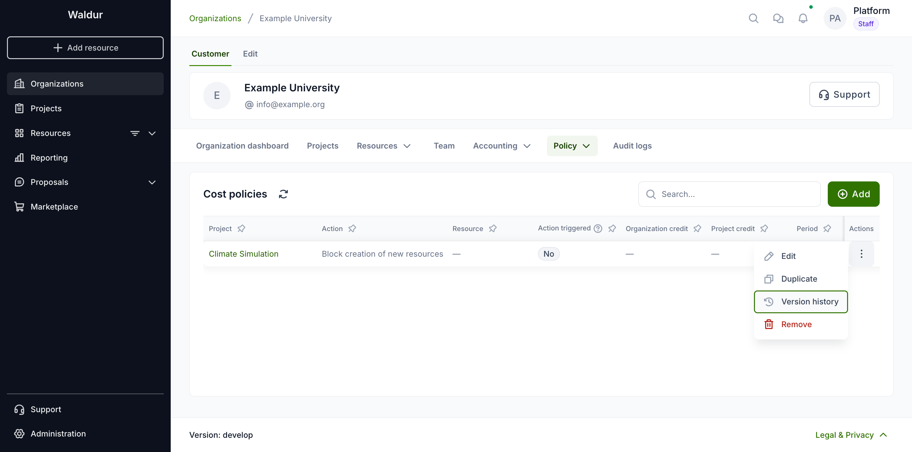

The dialog lists the versions, newest first, with the user who saved each one. Select a version to compare it with the one before it; the changed settings are listed first. To see the policy as it was at a given time, pick a date under "State at". A version saved by a change that also made the policy fire or reset shows that too, under "Action triggered".
    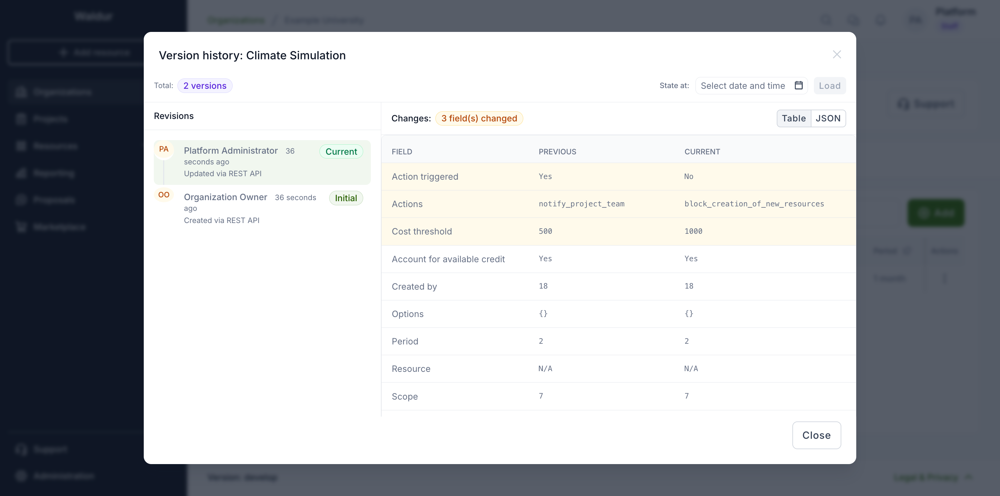

The same history is available through the API: `GET /api/marketplace-project-estimated-cost-policies/<uuid>/history/`, and likewise for organization and offering policies.

## Cost policies for offerings

Offering managers can set cost policies for specific organization groups, so that an action is
taken when the cost of the offering's resources reaches a limit. Open the organization, select the
**Service provider** tab, then **Marketplace → Offerings**, and open the offering. On its
**Manage** tab, select **Policy → Cost policy**.

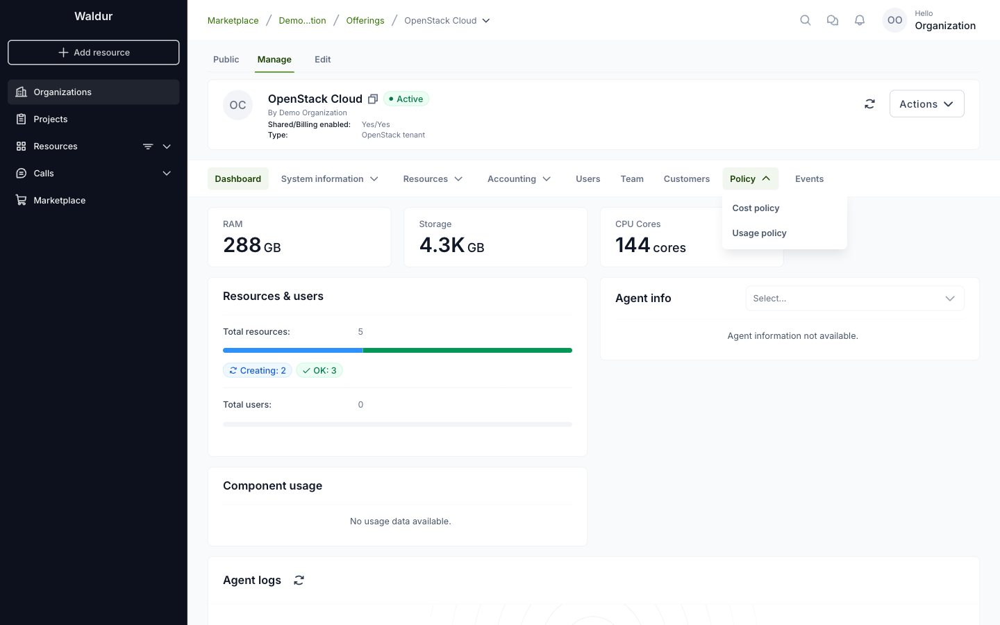

The **Cost** tab lists the policies already defined. To create one, click **Add**.

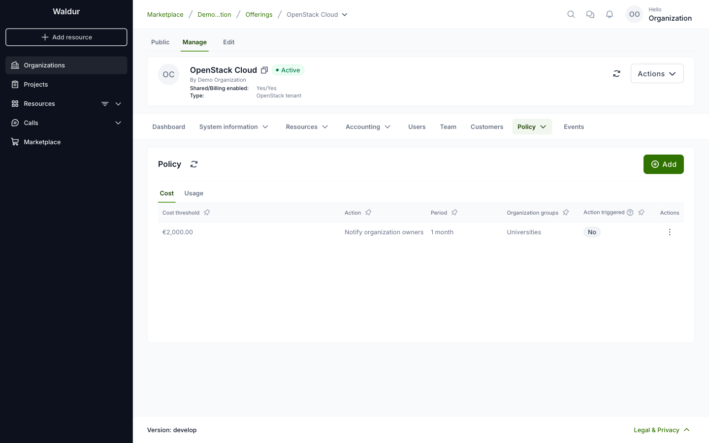

In the dialog, enter the estimated cost limit and choose the action: block creation of new
resources, or notify the organization owners. Then select the period (1, 3 or 12 months, or the
total) and the organization groups the policy applies to.

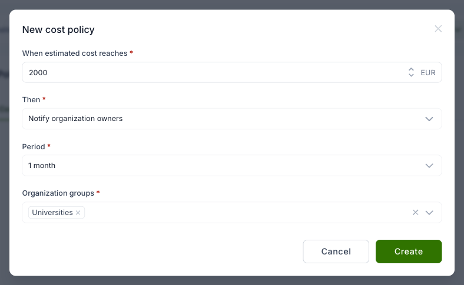

## Usage policies for offerings

Offering managers can set usage policies for specific organization groups, so that an action is
taken when the usage of a resource component reaches a limit. On the offering's **Manage** tab,
select **Policy → Usage policy**. The **Usage** tab lists the policies already defined. To create
one, click **Add**.

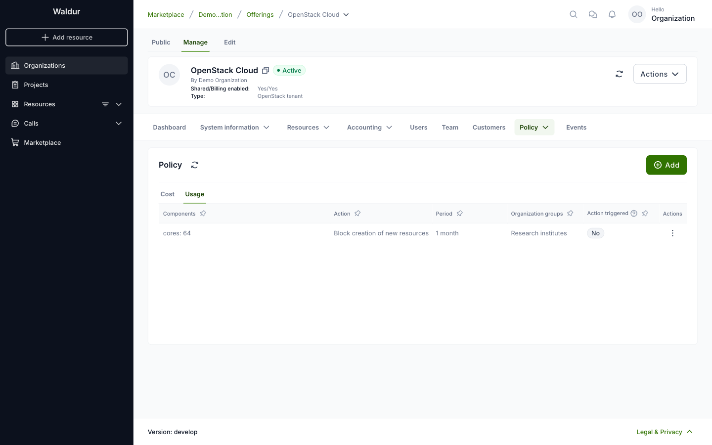

In the dialog, select a component and enter its limit. Click **Add** to limit more components in
the same policy. Then choose the action, the period and the organization groups the policy
applies to.

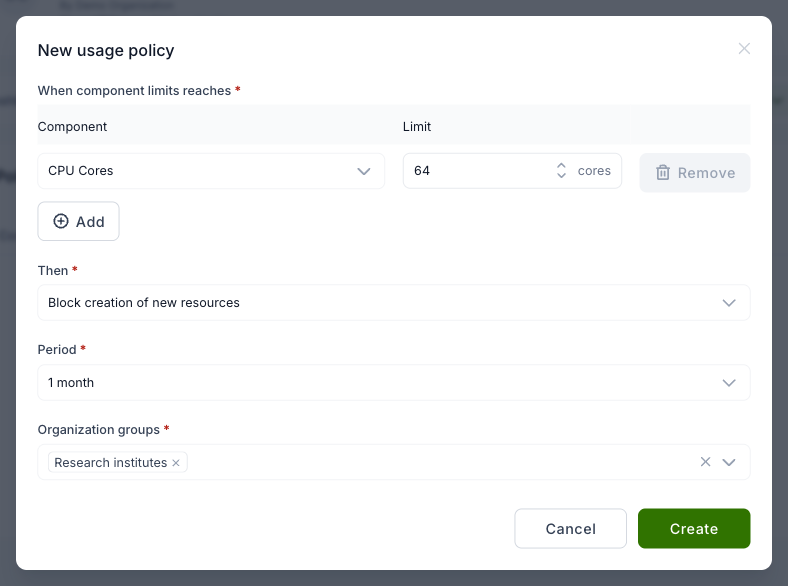
