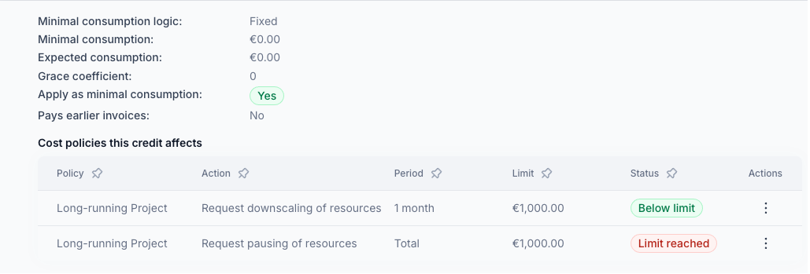
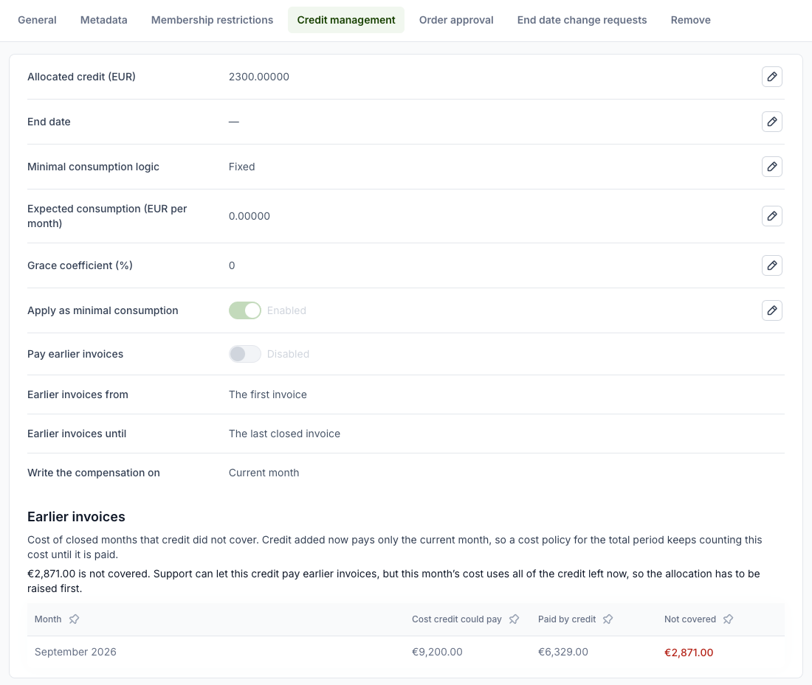

# Credit management for organization owners

Credit management establishes credit limits for organizations that can be used for purchasing eligible services.
The credit can optional be sub-allocated to projects and used in [cost policies](cost-and-usage-policies.md).

If credits are assigned to organizations by staff users (please see [Credit management for staff](../staff-users/credit-management-staff.md)),
organization owners can distribute allocated credits to projects. Projects can use credits for specific resources,
overused resources are invoiced according to the pricing plan. Organization owners can use credit management together
with the [cost and usage policies](cost-and-usage-policies.md) to handle overconsumption.

To see the credit allocated to projects, open the organization and then
**Accounting → Credit management**.

!!! note
    The **Credit management** entry only appears once staff have assigned a credit to the
    organization. If you do not see it, no credit has been granted yet.

To allocate credit to a project, click **Add**. A dialog opens with these fields:

1. **Project** - the project that can use the credit.
2. **Allocate credit** - the amount of credit. The sum of all project credits cannot exceed the
   organization's credit; the dialog shows how much is available.
3. **End date** - optional. On that date the remaining credit is set to 0. It must be the first
   day of a month.
4. **Minimal consumption logic**, **Expected consumption**, **Grace coefficient** and **Apply as
   minimal consumption** - how much the credit is reduced each month at least, even if the
   project uses less. They work as for organization credits, see
   [Credit management for staff](../staff-users/credit-management-staff.md).
5. Click **Confirm**.

When a project's credit is spent, further usage of its resources is invoiced according to the
pricing plan.

## Cost policies a credit affects

Expand a project credit's row to see its settings, including whether it **pays earlier invoices**, and
**Cost policies this credit affects**: the project's cost policies that account for credit, and the
organization's cost policies, with their period, limit and status. Each policy's actions menu has
**Details** and, for those who may fix it, **Fix…**, as in
[the cost policy list](cost-and-usage-policies.md#details-of-a-cost-policy).

## Earlier invoices

Credit pays the month it is used in. Cost of a closed month that the credit did not cover stays on
that month's invoice, and adding credit later does not pay it. A cost policy with the period
**Total** keeps counting that cost, so it can stay over its limit however much credit is added.

To see that cost, open the project, select the **Edit** tab, then **Credit management**. The
**Earlier invoices** table lists, for each closed month, its cost that credit could pay, how much
credit paid, and what is not covered.

Only staff can let the credit pay that cost; the **Pay earlier invoices**, **Earlier invoices
from**, **Earlier invoices until** and **Write the compensation on** rows show how they set it up.
See [Paying earlier invoices](../staff-users/credit-management-staff.md#paying-earlier-invoices).
