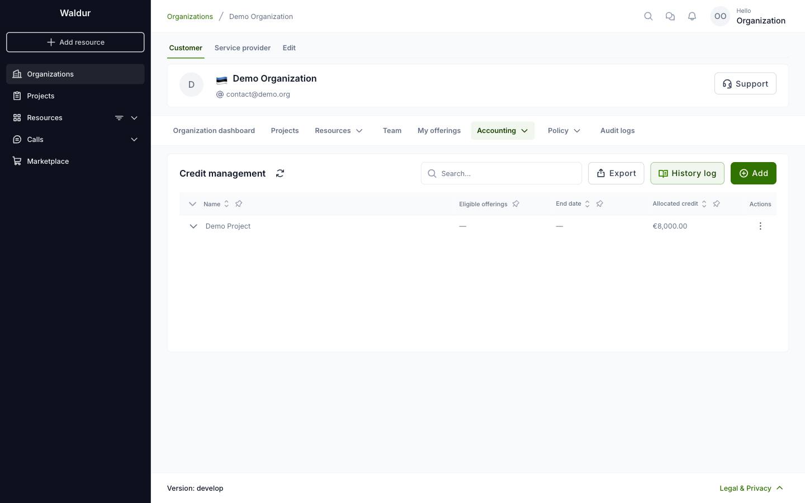
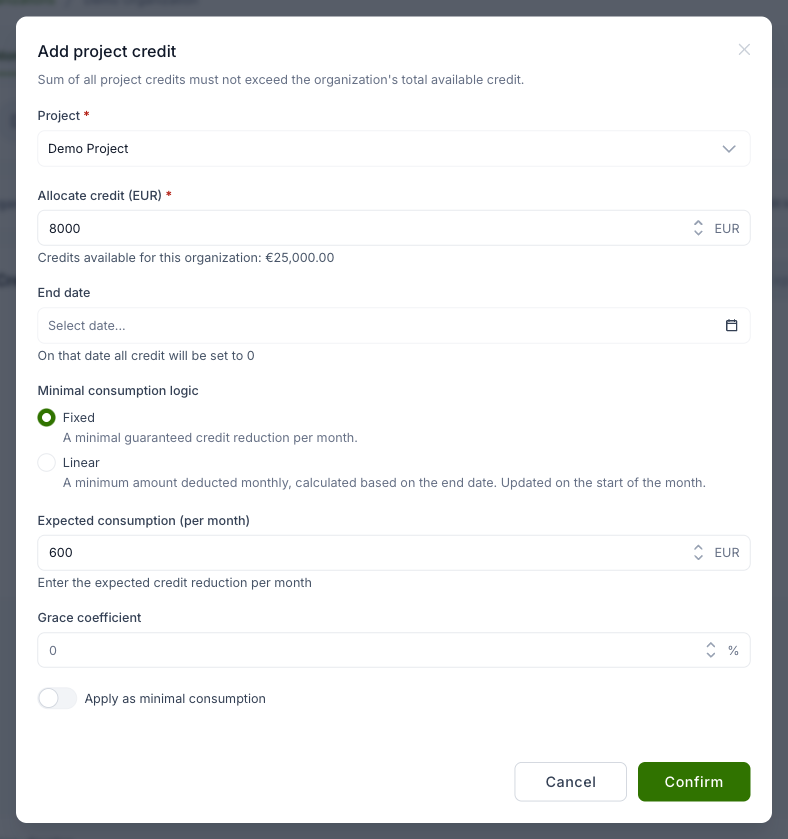

# Credit management for organization owners

Credit management establishes credit limits for organizations that can be used for purchasing eligible services.
The credit can optional be sub-allocated to projects and used in [cost policies](cost-and-usage-policies.md).

If credits are assigned to organizations by staff users (please see [Credit management for staff](../staff-users/credit-management-staff.md)),
organization owners can distribute allocated credits to projects. Projects can use credits for specific resources,
overused resources are invoiced according to the pricing plan. Organization owners can use credit management together
with the [cost and usage policies](cost-and-usage-policies.md) to handle overconsumption.

To see the credit allocated to projects, open the organization and then
**Accounting → Credit management**.

!!! note
    The **Credit management** entry only appears once staff have assigned a credit to the
    organization. If you do not see it, no credit has been granted yet.

To allocate credit to a project, click **Add**. A dialog opens with these fields:

1. **Project** - the project that can use the credit.
2. **Allocate credit** - the amount of credit. The sum of all project credits cannot exceed the
   organization's credit; the dialog shows how much is available.
3. **End date** - optional. On that date the remaining credit is set to 0. It must be the first
   day of a month.
4. **Minimal consumption logic**, **Expected consumption**, **Grace coefficient** and **Apply as
   minimal consumption** - how much the credit is reduced each month at least, even if the
   project uses less. They work as for organization credits, see
   [Credit management for staff](../staff-users/credit-management-staff.md).
5. Click **Confirm**.

When a project's credit is spent, further usage of its resources is invoiced according to the
pricing plan.
