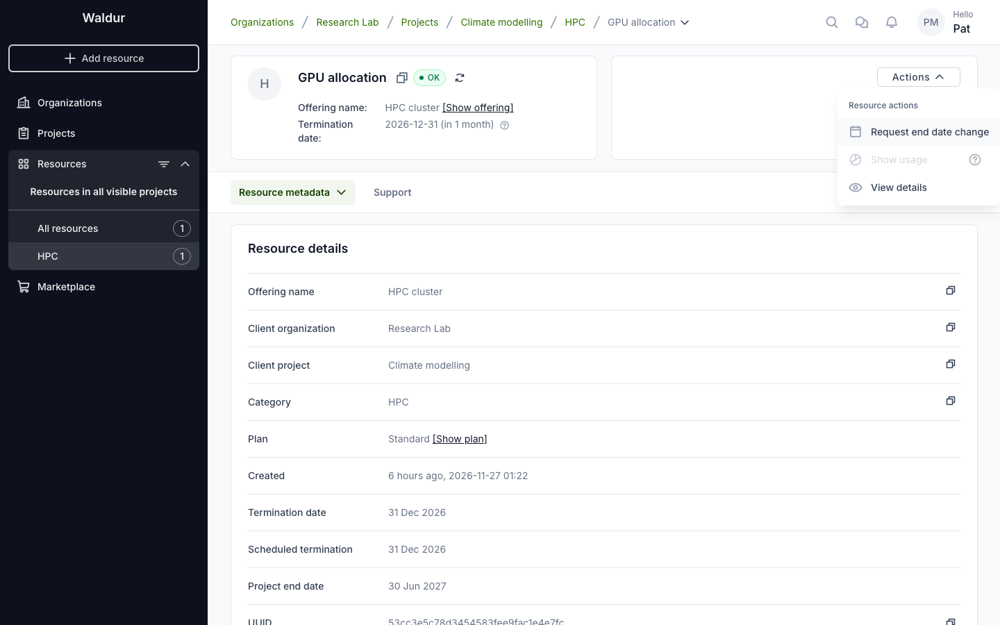
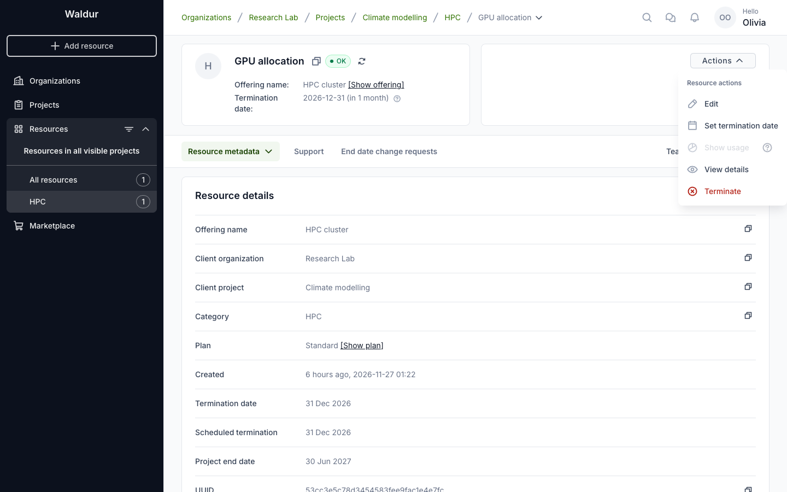
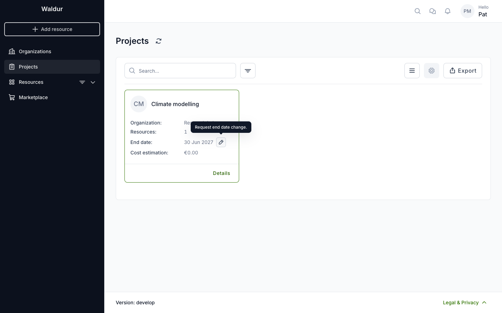
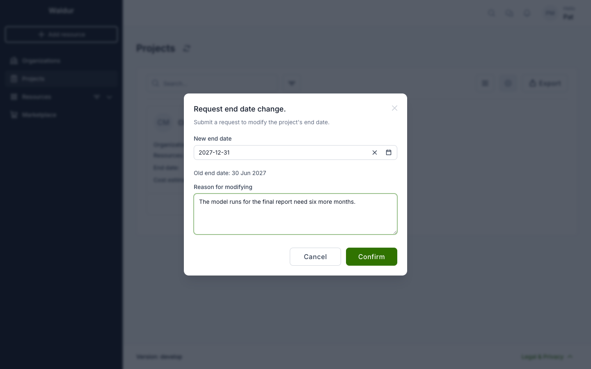
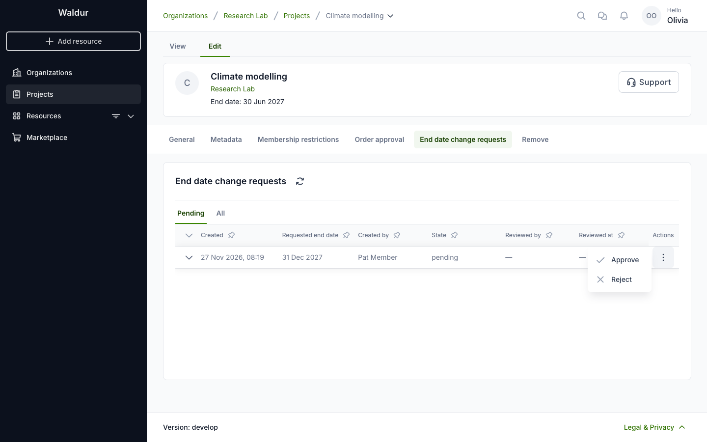
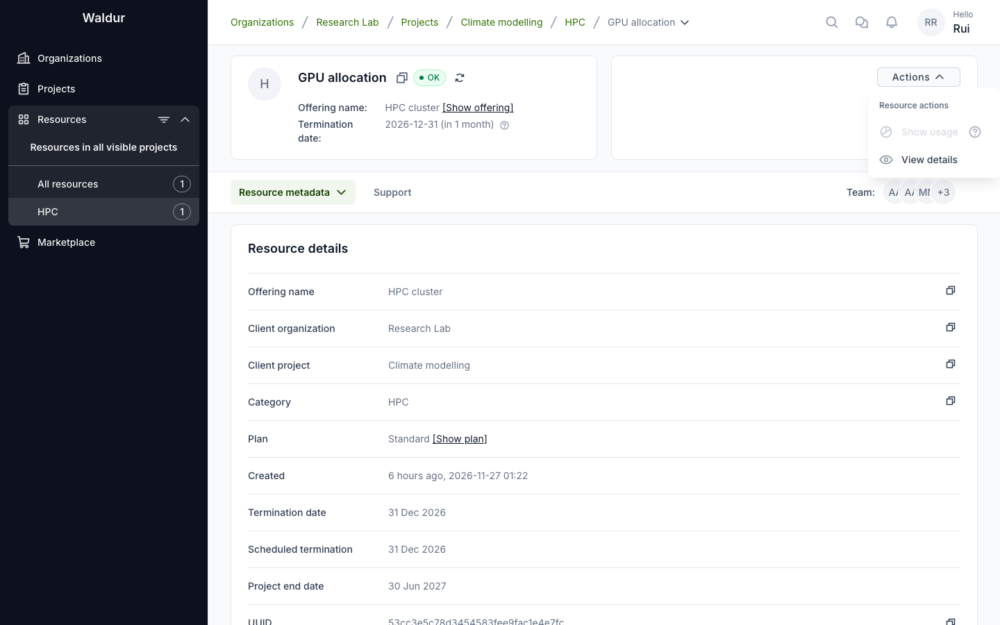
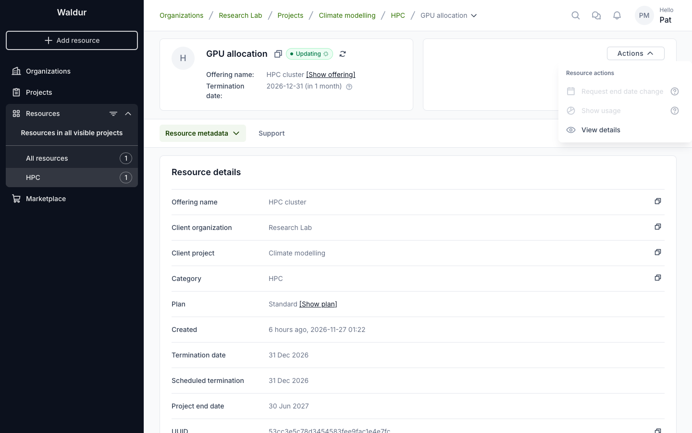

# Who can change an end date

Projects and resources both have an end date. For each of them, Waldur shows
one of two controls, never both:

- **Set the date**: the date changes as soon as you save it.
- **Request a change**: you ask for a new date, and someone who may set the
  date approves or rejects it.

Which one you see depends on your permissions, not on your role's name. This
page explains who gets which control, how a project end date request works, and
why the control can be missing.

For the resource request flow itself, see
[Changing a resource end date](resource-end-date-changes.md). For what the dates
do, see [Start and end dates](start-and-end-dates.md).

## Who gets which control

With the default permissions:

| Role | Project end date | Resource end date |
|------|------------------|-------------------|
| Organization owner | Sets it, approves requests | Sets it, approves requests |
| Project manager | Requests a change | Requests a change |
| Project administrator | Requests a change | Requests a change |
| Project member | Requests a change | Requests a change |
| Organization reader | Nothing | Nothing |
| Staff | Sets it, approves requests | Sets it, approves requests |
| Support | Nothing | Nothing |

!!! note "Project managers ask too"
    A project manager can edit the project's details, but not its end date.
    Moving the end date takes its own permission, which by default only
    organization owners hold, so a project manager requests the change like
    any other project member.

A member sees **Request end date change** on the resource. An organization owner
sees **Set termination date** in the same place.

Service providers set a resource's termination date from their own view of the
resource. That is separate from the requests described here. A role on the
service provider does not let you set or approve the date as the resource's
consumer.

## Requesting a project end date change

In your project list, the pencil next to the project's **End date** opens the
request. In the organization's project list, the same request is **Change end
date** in the project's row actions.

Pick the new date and say why you need it. The approver reads the reason when
deciding.

The organization's owners are notified of the new request. You get an email
when it is approved or rejected.

## Reviewing project end date requests

Requests are listed on the project's **Edit** tab, under **End date change
requests**. **Pending** shows the ones waiting for a decision; **All** keeps
the history.

Whoever may set the project's end date gets **Approve** and **Reject** in the
row actions. Approving changes the project's end date immediately.

## Why the request action is missing

The request is hidden, not disabled, when you could never use it. Check the
list below that matches what you are trying to change.

### Project end date

The request is hidden when any of these is true:

- **You may set the date yourself.** Use the project's **Edit** tab instead.
- **Your role does not allow asking.** Organization readers and support users
  cannot request a change, and an operator can take the permission away from
  any role.
- **You are staff.** Staff edit the date directly.

### Resource end date

The request is hidden when any of these is true:

- **You may set the date yourself.** You see **Set termination date** instead.
- **Your role does not allow asking.** Organization readers cannot request a
  change, and an operator can take the permission away from any role.
- **You are staff or support.** Staff use **Set termination date**.
- **The offering does not accept requests.** The service provider has to turn
  them on for each offering; see
  [Enabling the flow](resource-end-date-changes.md#enabling-the-flow-service-provider).
- **The offering is prepaid.** Prepaid resources are extended by renewal
  instead.
- **The resource is an OpenStack virtual machine or volume.** These end with
  their tenant, so request the change on the tenant.

An organization reader sees the resource but has no end date action at all:

The request is shown but **disabled** while the resource is not in the **OK**
state, for example while it is being updated. Hover over the help icon to see
why. Wait for the resource to settle, then ask again.

## Changing who may ask (staff)

Four permissions decide everything on this page. Staff can change them for
each role under **Administration → Configuration → User roles**; see
[User role management](../staff-users/user_role_management.md).

| Permission in the role editor | Permission name | Default holders |
|-------------------------------|-----------------|-----------------|
| Projects: **Request end date change** | `PROJECT.REQUEST_END_DATE_CHANGE` | Project manager, administrator and member |
| Projects: **Set end date** | `PROJECT.SET_END_DATE` | Organization owner |
| Resources: **Request end date change** | `RESOURCE.REQUEST_END_DATE_CHANGE` | Project manager, administrator and member |
| Resources: **Set end date for resource** | `RESOURCE.SET_END_DATE` | Organization owner |

A permission counts when it is held on the project, on its organization, or
through a site-wide role.

- **To stop a role from asking**, remove its request permission. Its holders
  then see no end date action at all.
- **To let a role set the date**, give it the set permission. Its holders stop
  seeing the request and can approve other people's requests.

!!! tip
    Holding the set permission always hides the request, even when the same
    role also holds the request permission. Nobody files a request they could
    approve themselves.

!!! note "Deployments configured from files"
    Operators who manage roles in `permissions-override.yaml` drop the
    permission there instead. A role cloned into an organization has its own
    name (for example `PROJECT.<slug>.MEMBER`) and has to be listed
    separately.
