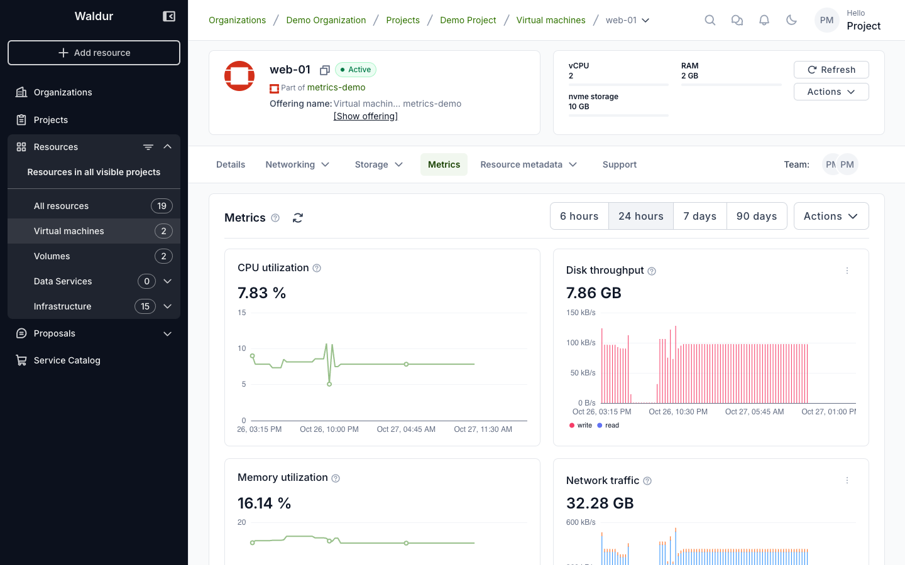
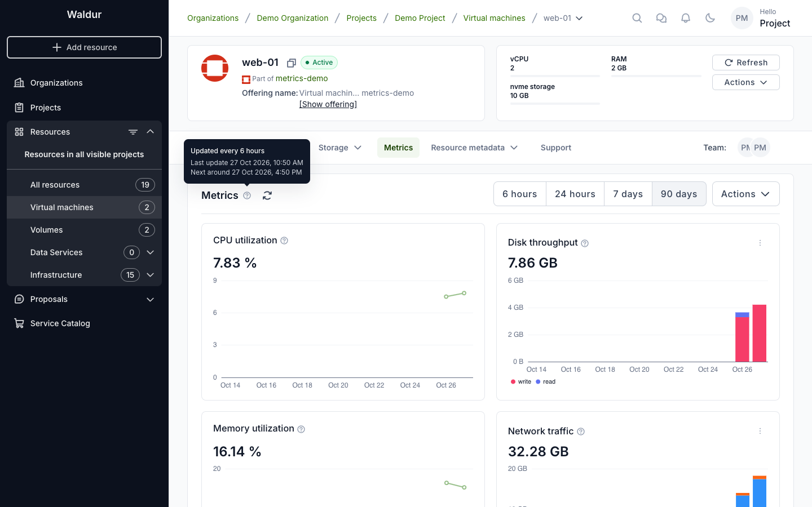
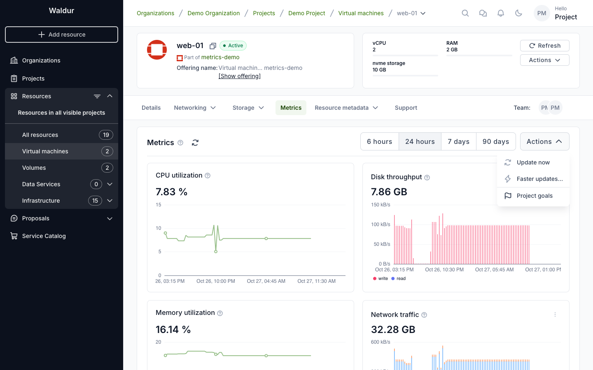
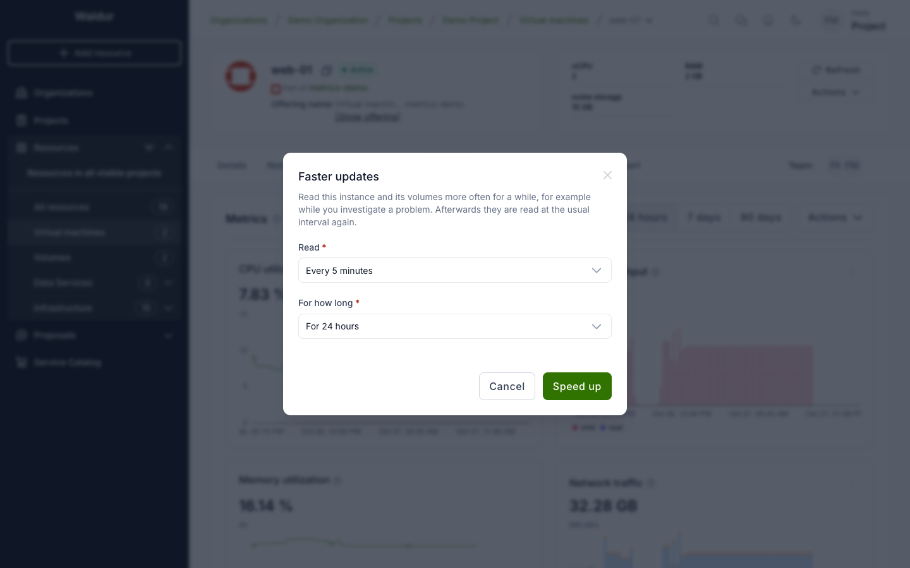
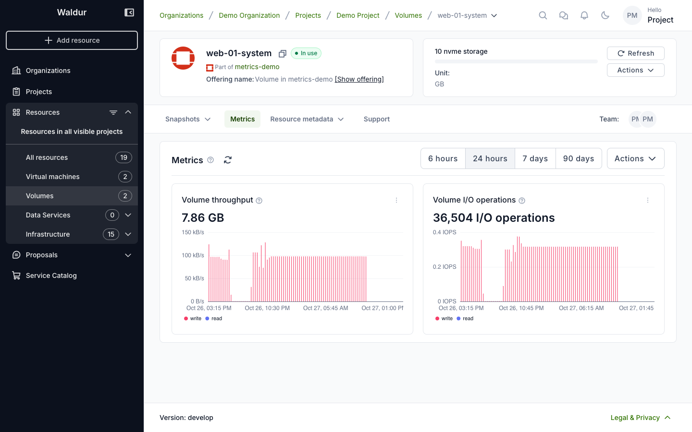

# Metrics of OpenStack virtual machines and volumes

When your OpenStack provider has turned on instance metrics, Waldur reads your
virtual machines' CPU, memory, network and disk figures from OpenStack, and
each virtual machine and volume gets a **Metrics** tab. The figures also add
up on the project's [Metrics tab](project-metrics.md).

## The Metrics tab

Open the virtual machine or volume and select **Metrics**.

Each card is one metric. Its figure is this month's so far: the total for
traffic, disk and CPU time, the latest level for CPU and memory utilization.
The question mark next to a metric's name says how the figure is computed.

Next to the **Metrics** title:

- **The question mark** says how often the virtual machine is read, when it
  was last read and when it is read next.

    

- **Refresh** shows Waldur's latest figures. It doesn't read the virtual
  machine; **Update now** does.

## Choosing a period

**6 hours**, **24 hours**, **7 days** or **90 days** — the chart's span. 90
days, one bar per day, is the default.

The shorter spans are for looking closely, for example while you investigate
a problem:

| Span | One bar per |
|---|---|
| 6 hours | 5 minutes |
| 24 hours | 15 minutes |
| 7 days | hour |

Over these spans, traffic and disk figures are rates — kB/s or MB/s, and
**IOPS**, I/O operations per second — averaged over each bar. Each read
covers the time since the one before, so with reads every few hours the bars
between two reads are even: the read tells how much was done, not when. For
detail, ask for faster updates. CPU and memory utilization are lines through
the reads.

Over 90 days, the bars are each day's totals: bytes and I/O operations, not
rates.

## Reading sooner

The **Actions** menu reads the virtual machine sooner for people who manage
it: organization owners, and project managers and administrators. Everyone
else sees only **Project goals** there.

- **Update now** reads the virtual machine at once; the figures follow within
  a minute. It can be used once every 5 minutes, and not while the virtual
  machine is stopped.
- **Faster updates…** reads it more often for a while: every 5, 15 or 60
  minutes, for 1, 6 or 24 hours. Only intervals faster than the provider's
  usual one are offered. Afterwards it is read at the usual interval again.
  The tab switches to the last 6 hours, to show the detail.

    

- **Back to usual updates** ends faster updates before their time.
- **Project goals** opens the project's Metrics tab, where goals are set.

A virtual machine is read only while it runs. When it is stopped, the
question mark says so, and **Update now** and **Faster updates…** are
unavailable.

## Volumes

A volume is read with the virtual machine it is attached to. Its Metrics tab
shows the volume's own throughput and I/O operations, and the question mark
names the virtual machine. **Update now** and **Faster updates…** on a volume
read that virtual machine, its other volumes included. A detached volume is
not read.

!!! tip "Disk or volume throughput?"
    A virtual machine's **Disk throughput** and **Disk I/O operations** cover
    all its disks; a volume's cover that volume only. For a virtual machine
    that boots from a volume and has no other disks, both count the same
    bytes.

## Related pages

- [Project metrics](project-metrics.md)
- [OpenStack instance metrics for service providers](../service-provider-organization/openstack-instance-metrics.md)
