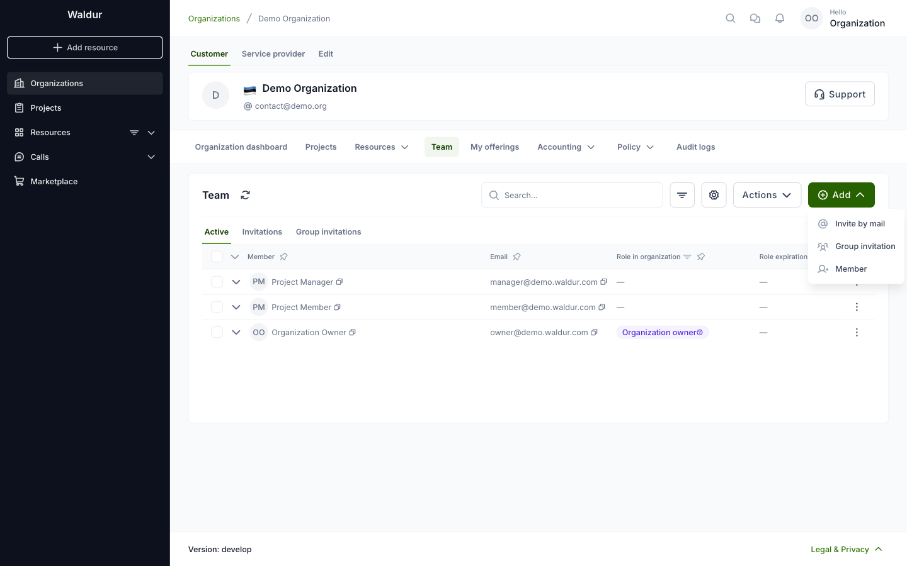
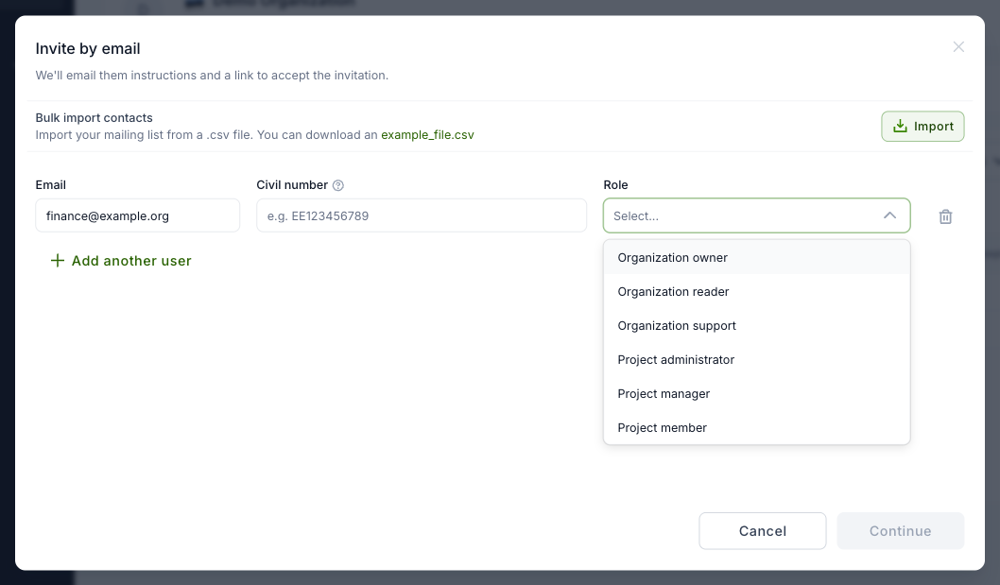

# Organization membership management

Organization team contains users with different roles. See
[Roles and permissions](../../about/terminology/roles_and_permissions.md#user-roles-in-organization)
for the per-role permission matrix.

The team is on the organization's **Team** tab. **Active** lists the members, **Invitations**
the email invitations that are not accepted yet, and **Group invitations** the shareable
invitation links. **Add** offers three ways to add people:

- **Invite by mail** sends an invitation to one or more email addresses.
- **Group invitation** creates a link that you can share with many people. Users who open it
  request the role, and the request is approved by an organization owner, or automatically if
  the link is set up that way.
- **Member** gives a role to a user who already has an account, see
  [Team management for staff](../staff-users/team-management-staff.md).

## Adding organization members

1. Open the organization and select the **Team** tab.
2. Click **Add** and select **Invite by mail**.
3. Enter the email address and select the role. Organization roles (**Organization owner**,
   **Organization reader**, **Organization support**) apply to the whole organization. For a
   project role, also select the project. Click **Add another user** to invite more people at
   once, or **Import** a list of addresses from a CSV file.

    

4. Click **Continue**. Optionally, write a **Custom message**; it is added to the invitation
   email.
5. Click **Send invitation**. The user gets an email with a link to accept the invitation.

The invitation is listed on the **Invitations** tab until the user accepts it. Use the row's
actions menu to **Resend** or **Cancel** it.
