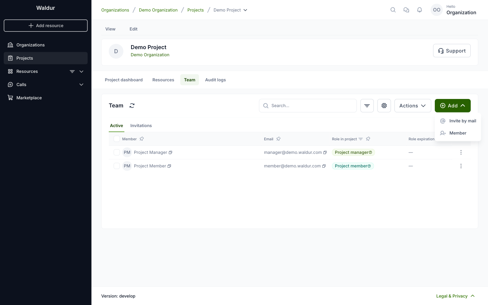
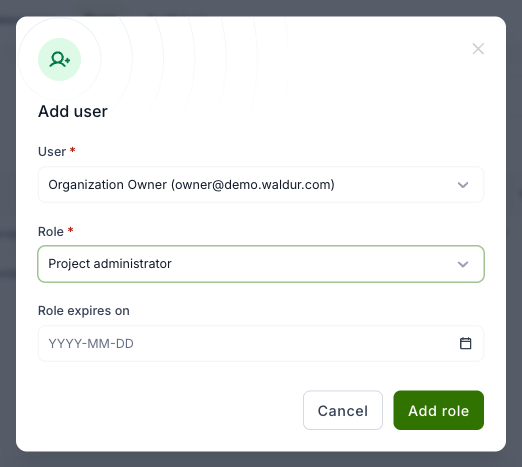
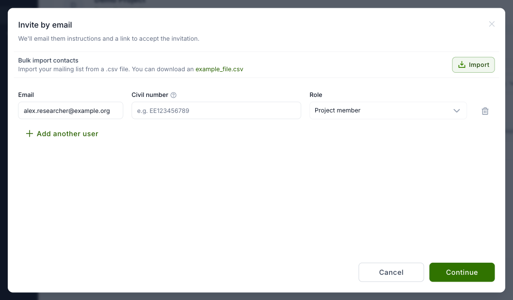
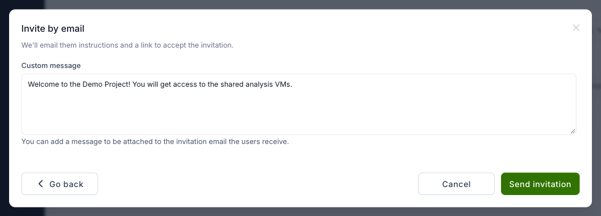
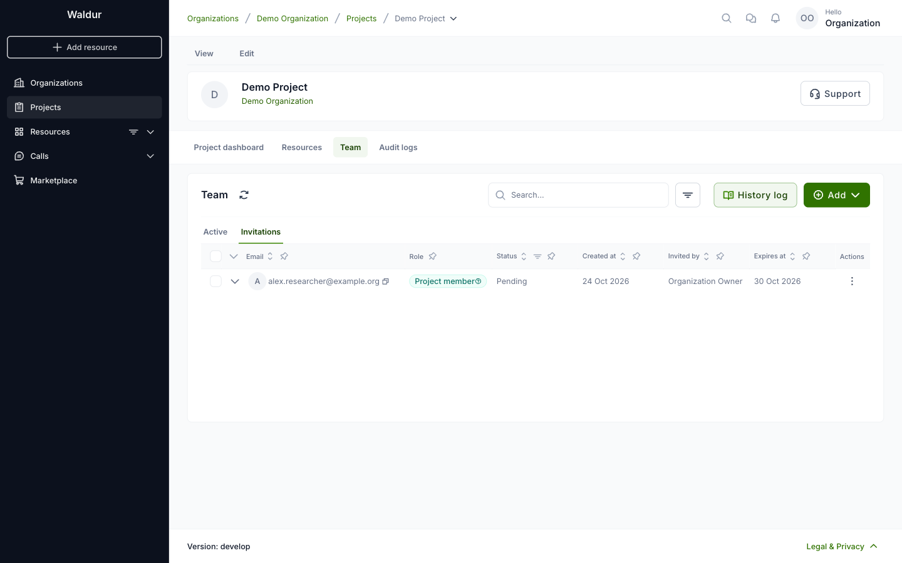

# Project membership management

Project team contains users with different roles. See
[Roles and permissions](../../about/terminology/roles_and_permissions.md#user-roles-in-organization)
for the per-role permission matrix.

The team is on the project's **Team** tab. **Active** lists the members and their roles,
**Invitations** the invitations that are not accepted yet. **Add** offers two ways to add
someone:

- **Member** gives a role to a user who already has an account.
- **Invite by mail** sends an invitation to an email address.

## Adding project members

### New user already has an account in current Waldur instance

1. Open the project and select the **Team** tab.
2. Click **Add** and select **Member**.
3. Select the user, then the role: **Project administrator**, **Project manager** or
   **Project member**.
4. Optionally, set **Role expires on**. The role is removed on that date.
5. Click **Add role**. The user gets the role right away; there is no invitation to accept.

!!! note
    The list offers the users of the organization (for organization owners) or of the projects
    you belong to (for project managers). To add anyone else, invite them by email.

### New user doesn't have an account in current Waldur instance

1. Open the project and select the **Team** tab.
2. Click **Add** and select **Invite by mail**.
3. Enter the email address and select the role. Click **Add another user** to invite more
   people at once, or **Import** a list of addresses from a CSV file.

    

4. Click **Continue**. Optionally, write a **Custom message**; it is added to the invitation
   email.

    

5. Click **Send invitation**. The user gets an email with a link to accept the invitation.

The invitation appears on the **Invitations** tab as **Pending** until the user accepts it, and
expires after the date in **Expires at**. Use the row's actions menu to **Resend** or **Cancel**
it.

