# Resource API keys

Some resources — inference services and other API gateways — are reached with an
**API key**. Waldur lists a resource's keys on its **API keys** tab. There you
can reveal and rotate a key, and, where the provider supports it, request new
keys, hand a key to one person, cap how much it may use, restrict it to some
models, and pause or delete it.

Waldur never generates key material itself. Every change is sent to the
provider's site agent, which carries it out on the backend and reports back. A
key therefore shows a transitional state (**Creating**, **Rotating**,
**Pausing**, **Resuming**, **Updating**, **Deleting**) until the agent confirms the change.

## The keys a new resource starts with

The keys a new resource starts with depend on whether the provider manages keys
one by one (see [For service providers](#for-service-providers)):

- **Without key management**, the resource is created with **two keys**, both
  shared by the project. There are two so that one keeps working while the other
  is rotated.
- **With key management**, the resource starts with **no keys**. Its **API
  keys** tab stays empty until someone [requests a key](#requesting-a-key). To
  replace a key without interruption, request a new one, move your clients to
  it, and then delete the old one.

A resource restored after termination follows the same rule. Turning key
management on or off later does not add or remove keys on existing resources.

## The API keys tab

Open the resource and select the **API keys** tab.

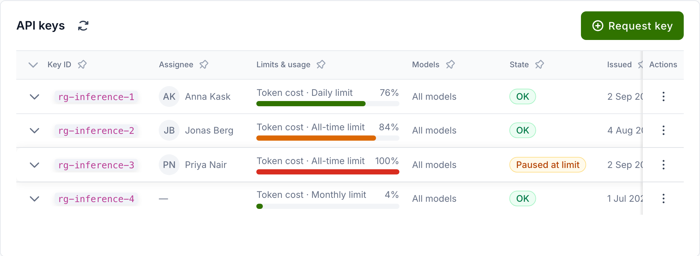

Each row is one key:

- **Key ID** — the identifier the backend knows the key by.
- **Assignee** — the person the key belongs to, or a dash for a key shared by
  the project.
- **Limits & usage** — how much of a limit the key has used, for the limit
  closest to being reached, of any component and period.
- **Models** — the models the key may call, **All models**, or **No models**
  for a key that cannot call any (see [Models](#models)).
- **State** — **OK**, **Paused**, **Paused at limit**, **Erred**, or a
  transitional state while a change is in progress.
- **Issued** — when the current key value was created or last rotated.

Expand a row to see every component: its usage this month, and each of the
key's limits on a shorter or longer period, such as **Token cost · Daily
limit**. A limit marked *(inherited)* is the resource's spending limit for that
component and period. It is the one in force because the key has no limit of
its own for that period, or because its own limit is higher than the
resource's.

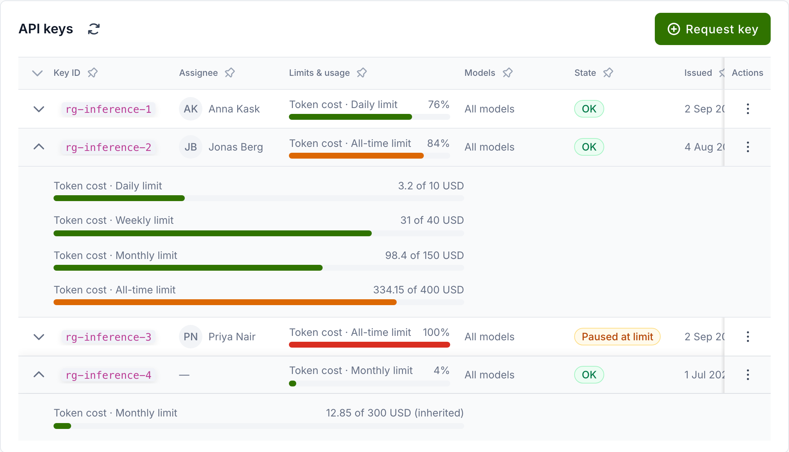

The **Actions** menu at the end of each row offers what the key's state allows.

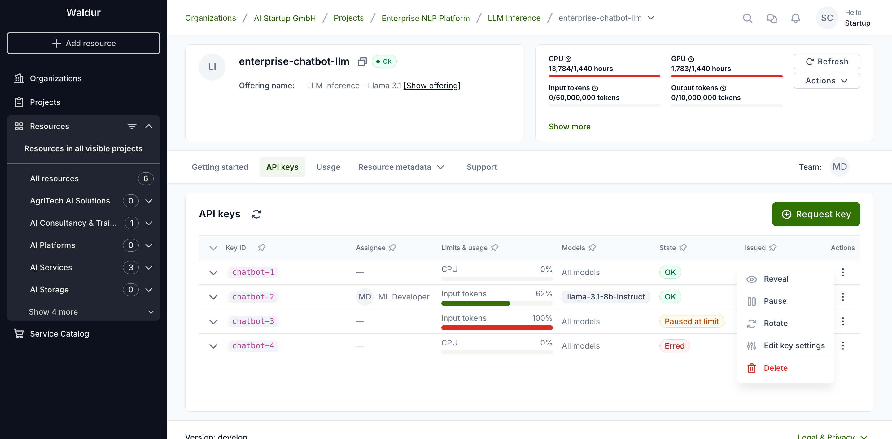

## Revealing a key

Choose **Reveal** to see the key value. The value is masked until you click the
eye icon, and the copy button puts it on the clipboard.

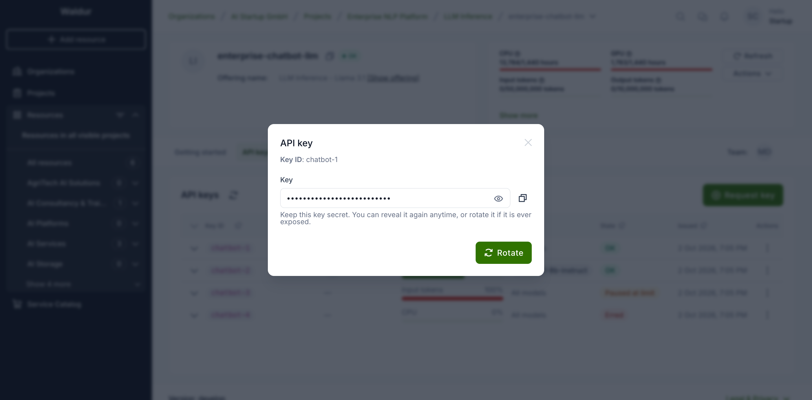

Anyone with a role in the resource's project or in its organization can reveal
a shared key. A key with an **assignee** can be revealed only by that person.

Being staff or support gives no extra right to reveal a key. Outside the
resource's project and organization **Reveal** is disabled for them; inside it
they reveal only what any other member could.
Staff who need a key impersonate its assignee, or for a shared key a member of
the project. Support users cannot impersonate, so they have no way to see a key
they could not reveal themselves.

Impersonation works only for a person who has signed in to Waldur before and
has not signed out since; it does not matter whether their session has expired.
Where passkeys are required for staff, the staff user must have signed in with
their passkey.

Each reveal appears in the resource's event log, and a reveal made through
impersonation names the staff user as the impersonator.

!!! tip
    If a key may have been exposed, [rotate it](#rotating-a-key).

## Rotating a key

Choose **Rotate** to replace a key's value. The backend issues a new value and
the old one stops working, so anything using the key needs the new value
afterwards. The resource's other keys are not affected.

Who can rotate a key:

- **Organization owners**, **project managers** and **project
  administrators** manage the resource's keys, and can rotate any of them.
- The **assignee** of a key can rotate their own key, from the **Actions** menu
  or with the **Rotate** button shown when revealing it. They do not need
  anyone who manages the keys for it, so a key that may have leaked can be
  replaced straight away.
- Project members cannot rotate a key that is not assigned to them. A key
  shared by the project has no assignee, so it is rotated by someone who
  manages the keys.

Rotating is the only change an assignee can make to their key. Pausing,
resuming, deleting and editing it stay with organization owners, project
managers and project administrators.

A paused key cannot be rotated until it has been resumed. Where limits are
enforced, an assignee also cannot rotate a key that has reached one of its
[limits](#limits), of any period: such a key is about to be paused.

## Requesting a key

Organization owners, project managers and project administrators can request
keys with **Request key**:

1. Optionally choose an **Assignee** — only project members are offered. Leave
   it empty for a key shared by the project. The assignee cannot be changed
   later (see [Giving a key to someone else](#giving-a-key-to-someone-else)), and
   a person can be the assignee of only one key of a resource: choosing someone
   who already holds one is refused.
2. Optionally set **limits** per component and period (see [Limits](#limits)).
   Each field shows the highest limit the key may have for that period; leave
   a field empty to let the key use up to the resource limit.
3. Choose the **Models** the key may call. **All models** is ticked to begin
   with. Untick it to choose models one by one (see [Models](#models)).
4. Click **Submit**.

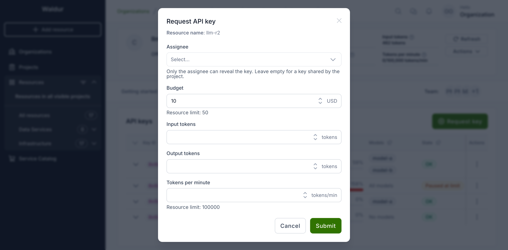

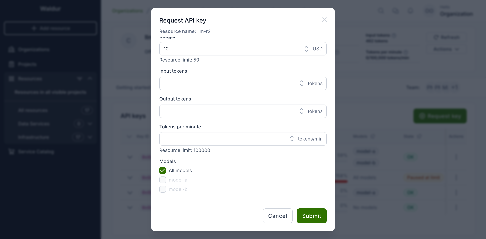

The new key appears as **Creating** and turns **OK** once the provider has
created it. Its key ID is assigned at that point.

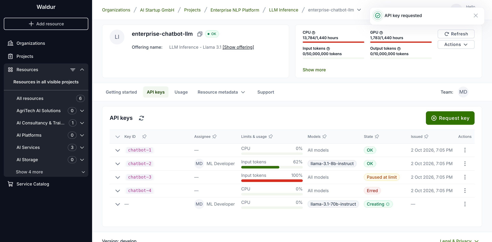

## Changing a key's limits and models

Choose **Edit key settings**. **Save** stays disabled until you change
something.

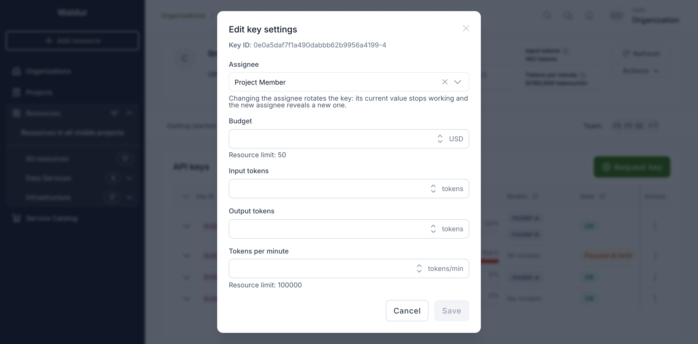

**Limits** and **models** can be changed while the key is **OK** or **Paused**.
On an active key the change is sent to the provider and the key shows
**Updating** until it is applied. On a paused key the change is stored and
applied when the key is resumed.

The assignee of a key can rotate it themselves, unless it has reached one of
its [limits](#limits). Every other change stays with whoever can request keys.

## Giving a key to someone else

A key's assignee is chosen when the key is requested and stays until the key is
deleted. It cannot be changed or cleared. A key's limits and its usage this
month belong to the key, not to whoever holds it, so a key that changed hands
would count one person's use against another person's allowance.

To give a key to someone else:

1. [Request a key](#requesting-a-key) with the new holder as its assignee, and
   the limits and models the old key had.
2. Once it is **OK**, move the clients that used the old key to the new one.
3. [Delete](#pausing-resuming-and-deleting) the old key.

Someone who leaves the project keeps any key assigned to them working until it
is deleted. To cut them off, delete their key, and request a new one if someone
else should take over their work. A key shared by the project stays shared: to
give someone a personal key, request one for them.

## Models

A key's model selection is one of three:

| Selection | The key may call | Shown as |
| --- | --- | --- |
| **All models** ticked | every model the resource allows | **All models** |
| Some models ticked | those models only | the list of models |
| Nothing ticked | no model | **No models** |

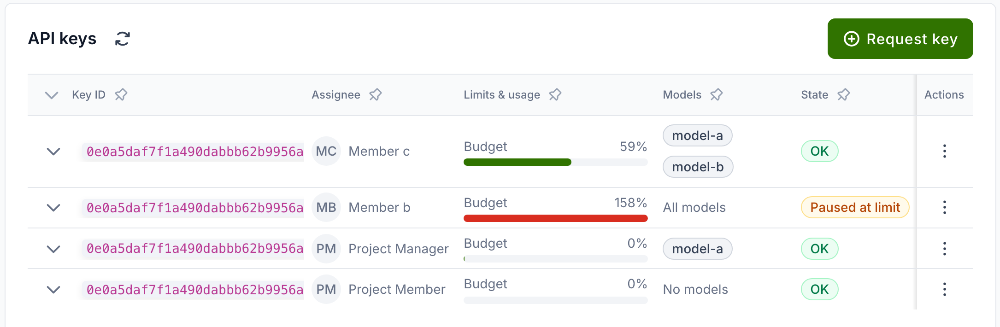

The dialogs list only the models the resource allows (see
[The resource's models](#the-resources-models)), so a key can narrow its
resource but never widen it.

**Request key** starts on **All models**. Ticking **All models** locks the
individual ticks. Untick it to choose models one by one again.

While nothing is selected, the dialog warns that the key will not be able to
call any model. The warning does not stop you from submitting.

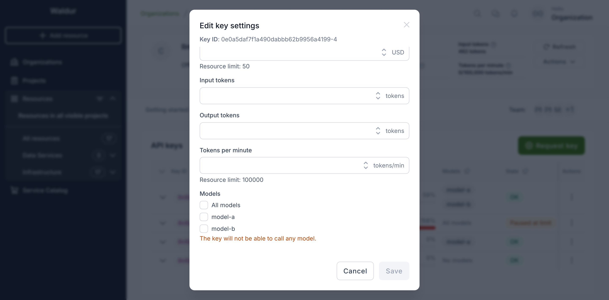

A model the provider retires, or the resource stops allowing, disappears from
the list, and the key is updated at the provider so it can no longer call it.
The key keeps it, and gets it back if the model returns. A key that
was limited to such models only can call none of them: it shows **No models**,
and its settings dialog opens with nothing ticked. Saving the dialog never
opens such a key to every model. Tick **All models**, or the models it should
call, to make it usable again.

!!! note
    Not every backend can restrict a key's models. On one that cannot, such as
    the Envoy AI Gateway, a request or an edit that leaves a key with anything
    but **All models** fails, and the key shows **Erred**. After a failed edit,
    set the key to **All models** with **Edit key settings**. After a failed
    request, delete the key and request it again with **All models** ticked.
    The resource has to stay on **All models** too, or every key's change
    fails.

## The resource's models

The resource's own **Models** option, in the resource's **Options**, decides
which models its keys can call at all, on an offering that manages keys one by
one. It takes the same three forms as a key:

| Selection | The resource's keys may call |
| --- | --- |
| **All models** ticked | every model of the offering, including ones the provider adds later |
| Some models ticked | those models only |
| Nothing ticked | no model |

A new resource starts on **All models**: the order form offers **All models**,
ticked to begin with, and refuses an order with no model selected. Change the
selection later with **Update option** on the **Models** row. There, nothing
ticked is allowed, and the dialog warns that the resource's keys will not be
able to call any model.

A key set to **All models** follows the resource: it can call whatever the
resource allows. A key set to some models can call those of them the resource
still allows. When the resource's selection changes, every key whose models
change with it is updated at the provider, and shows **Updating** until that is
applied. A paused key gets its new models when it is resumed.

## Limits

A key can have a limit per component for each **period** the provider offers:
daily, weekly, monthly, quarterly or yearly. A research group that puts a
monthly budget into a resource can, for example, give each member's key a daily
and a monthly limit, so one person's run cannot spend the group's month on a
Tuesday.

Which periods a key offers depends on how the provider set up the offering (see
[For service providers](#for-service-providers)):

- **Monthly** is available on every component of the offering, including one
  the plan prices at zero: a LiteLLM cost cap, for example, is priced at zero
  yet measures what the key spends.
- **Daily**, **weekly**, **quarterly** and **yearly** limits are available only
  where the provider's site agent reports each key's usage per day, and then on
  the periods the provider lets customers set
  [spending limits](resource-spending-limits.md) on for the component's
  resources. Elsewhere a key can be limited per month only.
- Where the provider does not let users limit keys, **Request key** and **Edit
  key settings** show no limit fields.

The limits themselves:

- Periods are calendar periods in UTC: a day resets at 00:00 UTC, a week on
  Monday, a month on the 1st, a quarter on 1 January, April, July and October,
  and a year on 1 January. The reset time is shown next to each field.
- A key's limit may not exceed the resource's own
  [spending limit](resource-spending-limits.md) for the same period or for any
  longer period ("Up to …" under the field). Under a resource limit of 40 a
  month, for example, a key cannot have a daily limit of 50. The provider's
  maximum caps the resource's limits, not the key's.
- A shorter period's limit may not exceed a longer one's: daily ≤ weekly ≤
  monthly ≤ quarterly ≤ yearly.
- A limit must be above **0**. To stop a key, pause it.

A limit the key already holds is kept, even once its period is no longer
offered or the resource's limit has dropped below it, so that editing one period
never forces a change to another. It is still enforced until you clear it.

Limits are enforced by Waldur:

- When a key's usage in a period reaches its limit for that period, Waldur
  pauses that key only. The resource and its other keys keep working. The key
  shows **Paused at limit**; hover over it to see which limit stopped it and
  when it resumes.
- A key paused at its limit is resumed automatically once it is under every
  limit it has reached — within a few minutes of the reset of the last of them,
  or when you raise or remove them. A longer limit reached while the key is
  paused holds it too: a key paused by its daily limit that then reaches its
  monthly one stays paused until the month resets.
- If you resume such a key by hand while it is still over its limit, it is
  paused again as soon as the provider confirms the resume.

!!! note
    Usage is reported by the provider periodically, so a key can go somewhat
    over its limit before it is paused.

## Pausing, resuming and deleting

- **Pause** stops the backend accepting the key. The key keeps its value, and
  **Resume** brings it back.
- **Delete** revokes the key at the backend. A deleted key disappears from the
  list, but the usage it reported still counts towards the resource.
- A requested key that has not been created yet can be withdrawn with
  **Delete**. It is removed at once, without waiting for the provider.

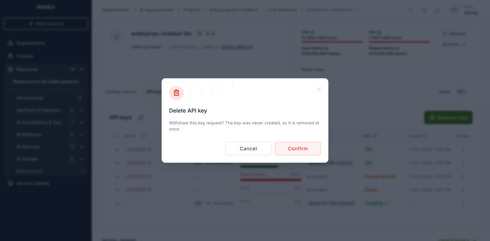

## When a change fails

If the provider cannot carry out a change, the key shows **Erred** and the row
keeps the error message. An erred key offers **Retry**, which repeats the failed
change, and **Delete**. A key whose settings update failed can also be corrected
with **Edit key settings**, which sends the update again.

The assignee of a key is offered **Retry** only when the change that failed was
a rotation of it. Any other failed change is retried by an organization owner,
a project manager or a project administrator.

A key whose pause at its [limit](#limits) failed is still active at the
provider, as the **Erred** state's tooltip says. Waldur sends the pause again
every few minutes while the key is still over its limit, until the provider
applies it. A key that is back under its limits by then is left **Erred** for
you to retry or delete.

## For service providers

The offering's **Integration → Resource display options** control the tab:

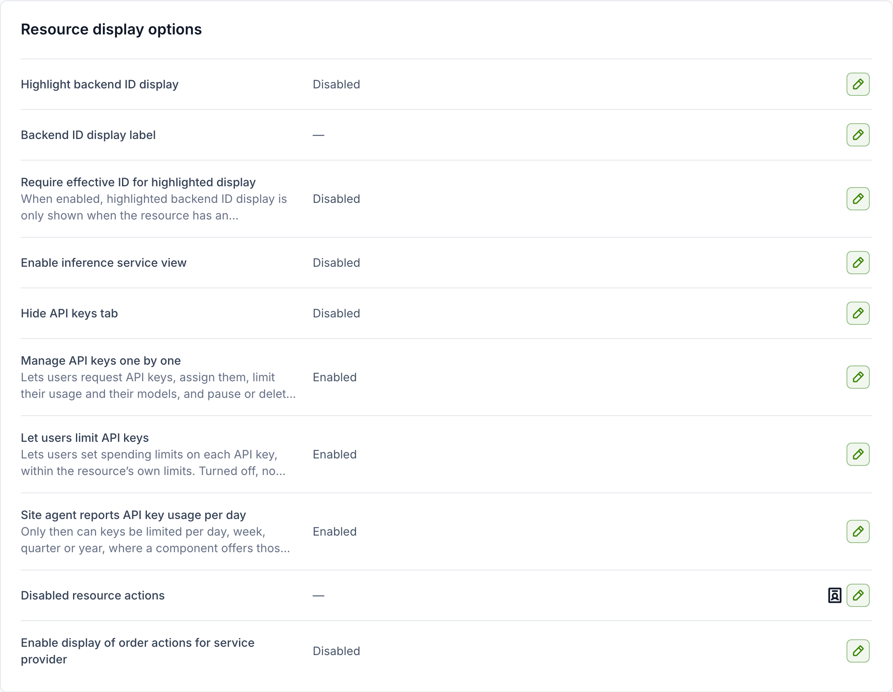

- **Manage API keys one by one** turns on everything above apart from
  revealing, rotating and resuming: requesting keys, assignees, limits, model
  restrictions, pausing and deleting. It is available on site-agent offerings.
  Turn it on only if the backend behind the site agent supports per-key
  management, such as the Envoy AI Gateway. Other backends, such as Ceph S3,
  fail those actions. With it on, new resources start with no keys instead of
  two shared ones; existing resources keep theirs.
- **Let users limit API keys**, shown once **Manage API keys one by one** is
  on, lets users set [limits](#limits) on each key, within the resource's own
  limits. It is on by default. Turned off, the key dialogs show no limit fields
  and no new key limit is accepted; limits keys already hold stay, and are
  enforced, until they are cleared.
- **Site agent reports API key usage per day**, also shown once **Manage API
  keys one by one** is on, is off by default. Keys are then limited per month
  only. Turn it on to offer keys daily, weekly, quarterly and yearly limits, on
  the periods each component offers to resources. Nothing checks it: turn it on
  only if the site agent reports each key's usage per day, or those limits are
  never reached. Limits keys already hold are kept when it is turned off.
- **Hide API keys tab** removes the tab from the offering's resources.

The models offered in the key dialogs are the choices of the offering's
`models` resource option, narrowed to the resource's own selection. Without
that option, the key dialogs show no model list and every requested key may
call every model. **All models** on a resource is a setting of its own, not a
choice: an offering that lists an "All models" entry among its model choices
should drop it, and resources that had it selected should be switched to
**All models** by hand.

A `models` option that allows several choices offers **All models** on any
offering, and new resources start on it, so turning on **Manage API keys one by
one** later finds them on every model. A single-choice `models` option has no
**All models** and does not narrow the keys.

Removing a model from the option's choices retires it: every key restricted
to named models that included it is updated at the backend without it. A key
on **All models**, on a resource on **All models**, is not restricted by name,
so it can still call a retired model as long as the backend serves it — and on
a backend that cannot restrict keys at all, such as the Envoy AI Gateway, every
key can. Remove a retired model from the backend as well.

!!! warning
    Without **Manage API keys one by one**, consumers can only reveal and rotate
    keys, and resume keys that were paused earlier. Per-key usage is not
    recorded, so limits are no longer enforced, but a key keeps its assignee:
    only that person can still reveal it. Keys can be neither requested nor
    deleted then, so such a key stays with its assignee.
