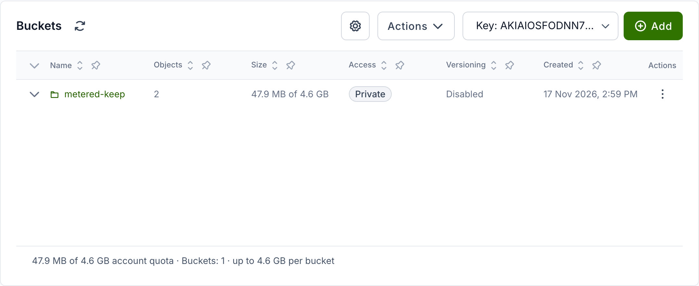
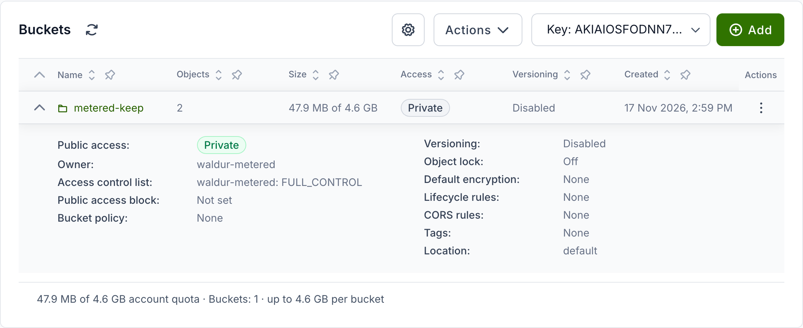
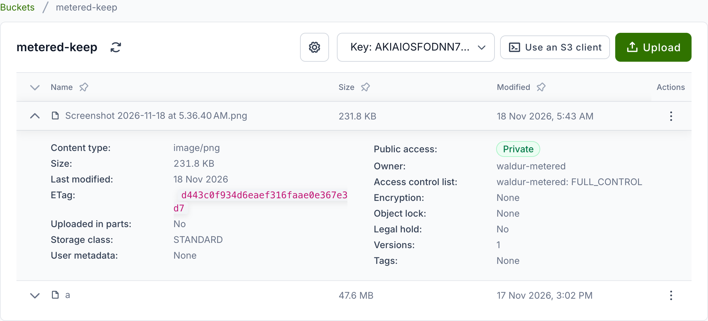
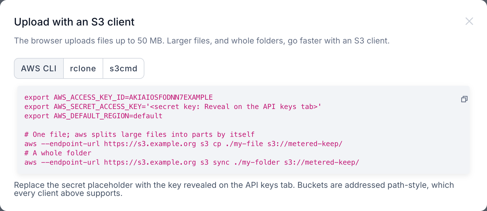
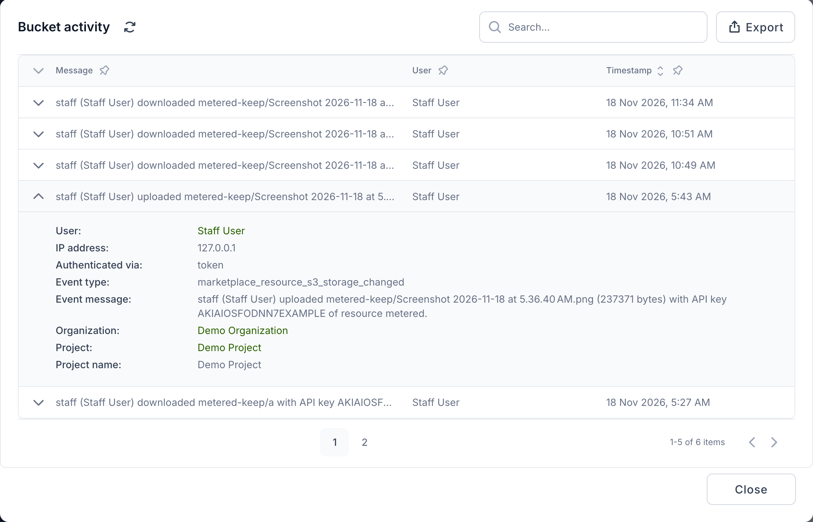
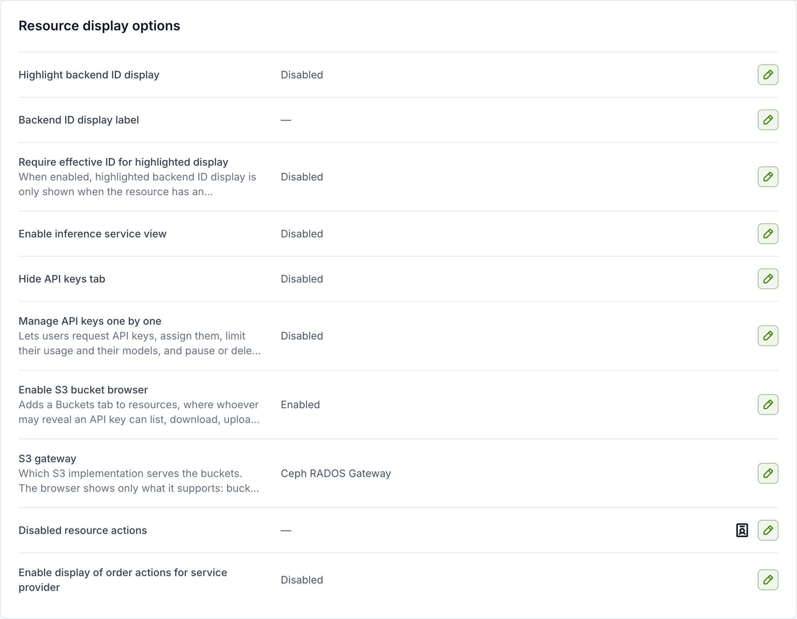

# Resource buckets

An S3 storage resource holds its data in **buckets**. Where the provider has turned
the bucket browser on, the resource has a **Buckets** tab next to **API keys**.
On it you can see the resource's buckets and files, download files, upload
small ones, and create and delete buckets, without installing an S3 client.

The tab works through one of the resource's [API keys](resource-api-keys.md).
Waldur signs each request to the storage service with that key, so the tab
can do whatever the key can, and it is open to exactly those who may reveal
the key. The key's secret never reaches your browser.

## The bucket list

Open the resource and select the **Buckets** tab.

Each row is one bucket:

- **Name**: select it to open the bucket.
- **Objects**: how many files the bucket holds.
- **Size**: how much it stores, against the limit on each bucket when the
  provider sets one.
- **Access**: **Public** when anyone can read the bucket, through its access
  control list or its policy; otherwise **Private**.
- **Versioning**: **Enabled** when the bucket keeps earlier versions of
  files it overwrites or deletes, **Suspended** when it no longer does, or
  **Disabled** when it never did.
- **Created**: when the bucket was created.

Storage services differ in what they keep track of, and the tab shows only
what the provider's one supports. **Objects** and **Size** appear on Ceph
storage, which reports them per bucket; **Access** and **Versioning** are left
out where the storage service has no access control lists or versioning, as on
Garage.

Select a column's sort button to sort by it, and the gear button to choose
which columns to show. The line under the table sums up storage: how much the
buckets hold against the resource's quota, how many buckets there are, and the
limit on each bucket. The quotas are the ones the provider's site agent last
reported.

When you can use more than one of the resource's API keys, the header shows
**Key** to choose which one the tab works through: the keys shared by the
project, and any assigned to you. Each key sees what its permissions allow,
and if one cannot reach the storage service, you can still switch to another.

### Bucket details

Expand a row to see how the bucket is set up:

- **Public access**: whether anyone can read the bucket, and whether through the
  access control list or the policy.
- **Owner** and **Access control list**: who owns the bucket and who has been
  granted access to it. A grant to **Everyone (anonymous)** or **Any
  authenticated user** makes the bucket public.
- **Public access block**: settings that stop the bucket from being made
  public.
- **Bucket policy**: the bucket's policy, if it has one.
- **Versioning**, **Object lock** and **Default encryption**.
- **Lifecycle rules**: rules that expire files or move them to another storage
  class after a time.
- **CORS rules**, **Tags** and **Location**.

The details are read-only. Change them with an S3 client. A part that the
storage service does not support, or will not report to the key, is left out.

### Creating and deleting a bucket

Select **Add** above the bucket list and enter a name of 3 to 63 lower-case letters, digits,
dots or hyphens. Depending on how the provider set up the storage service, bucket
names may be shared with its other users, so a common name may already be taken.

To delete a bucket, open its row's actions menu and select **Delete**. Only an
empty bucket can be deleted.

## Files in a bucket

Select a bucket to open it. Folders come first, then files, in the order the
storage service lists them. When a folder holds more files than fit on one
page, select **Load more** under the table. The breadcrumb above the table
leads back to the bucket and to the list of buckets.

Expand a file's row to see its details:

- **Content type**, **Size**, **Last modified** and **ETag**.
- **Uploaded in parts**: the number of parts, for a file uploaded in parts.
- **Storage class**, and any other content headers the file was stored with.
- **User metadata**: the metadata the uploader attached to the file.
- **Public access**, **Owner** and **Access control list**, as for buckets.
- **Encryption**, **Object lock** and **Legal hold**.
- **Versions**: how many versions of the file the bucket keeps, and how many
  delete markers.
- **Tags**.

As for buckets, parts the storage service does not support are left out.

A file's actions menu offers **Download** and **Delete**, and a folder's offers
**Open** and **Delete folder**, which deletes everything in it. Deleting cannot
be undone. In a bucket with versioning, earlier versions stay. When the storage
service refuses to delete a file, for example because a bucket policy forbids
it, the tab says so and the file stays.

A download goes straight from the storage service to your browser, through a
link that Waldur issues and that expires after five minutes.

## Uploading

Select **Upload** to add files to the open folder. The browser uploads files
up to a size the portal's administrators set, 50 MB unless they changed it;
the button's tooltip shows the limit. Larger files are not sent: **Upload with
an S3 client** opens instead. If a file of the same name is already there, you
are asked before it is replaced.

### Using an S3 client

For large files, whole folders, or anything the tab does not do, use an S3
client. Select **Use an S3 client**, above the files of an open bucket or in
the bucket list's **Actions** menu, for commands filled in with the resource's
endpoint, region, the open bucket and folder, and the API key's access key ID,
for the AWS CLI, rclone and s3cmd:

The commands leave out the secret key. Reveal it on the **API keys** tab and put
it in place of the placeholder.

## Bucket activity

Select **Actions → Bucket activity** above the bucket list to see what was
done through the tab: every download, and every bucket created or deleted and file uploaded or
deleted, with who did it, with which key, and when. Expand a row for the
details.

Changes made with an S3 client go straight to the storage service and do not
appear here.

## For service providers

The bucket browser is off by default. Turn it on for an offering in
**Integration → Resource display options → Enable S3 bucket browser**. The
option is available on site-agent offerings whose resources are S3 storage.

Once it is on, choose the offering's **S3 gateway**, the S3 implementation
that serves the buckets. It decides what the browser asks the storage
service for and shows:

| S3 gateway | Shown |
|---|---|
| **Ceph RADOS Gateway** | Everything, including each bucket's object count and size. |
| **MinIO-compatible (MinIO, RustFS)** | Everything except bucket object counts and sizes. |
| **Garage** | Files, location, lifecycle and CORS rules. No versioning, access control lists, policies, object lock, encryption or tags, which Garage does not implement. |
| **Other S3-compatible gateway** (default) | Whatever the gateway answers; parts it refuses are left out. No bucket object counts or sizes. |

When the site agent publishes no region for a resource, requests are signed
for the gateway's usual default: `default` on Ceph, `garage` on Garage and
`us-east-1` otherwise. Garage refuses any region but its configured one, so a
Garage deployment with another region must have the agent publish it.

The browser reaches the storage service from the Waldur server, at the S3
endpoint the site agent publishes for each resource. A staff user must also
allow that endpoint, as described below.

## For staff

Three settings, under **Administration → Settings → S3 bucket browser**, govern
the browser for the whole portal:

- **S3_BROWSER_ALLOWED_ENDPOINTS**: the storage endpoints Waldur may contact,
  by host name or address, optionally with `:port`, separated by commas or
  spaces. It is empty by default, and the browser works with no endpoint until
  one is listed. Waldur refuses endpoints that carry credentials, and plain
  HTTP to anything other than a private address.
- **S3_BROWSER_VERIFY_TLS**: whether Waldur checks the endpoint's TLS
  certificate. On by default; turn it off only for a test endpoint with a
  self-signed certificate.
- **S3_BROWSER_MAX_UPLOAD_SIZE_MB**: the largest file the browser uploads,
  50 MB by default. Larger files go through an S3 client.

Downloads and every change made through the browser are recorded in the
resource's event log.
