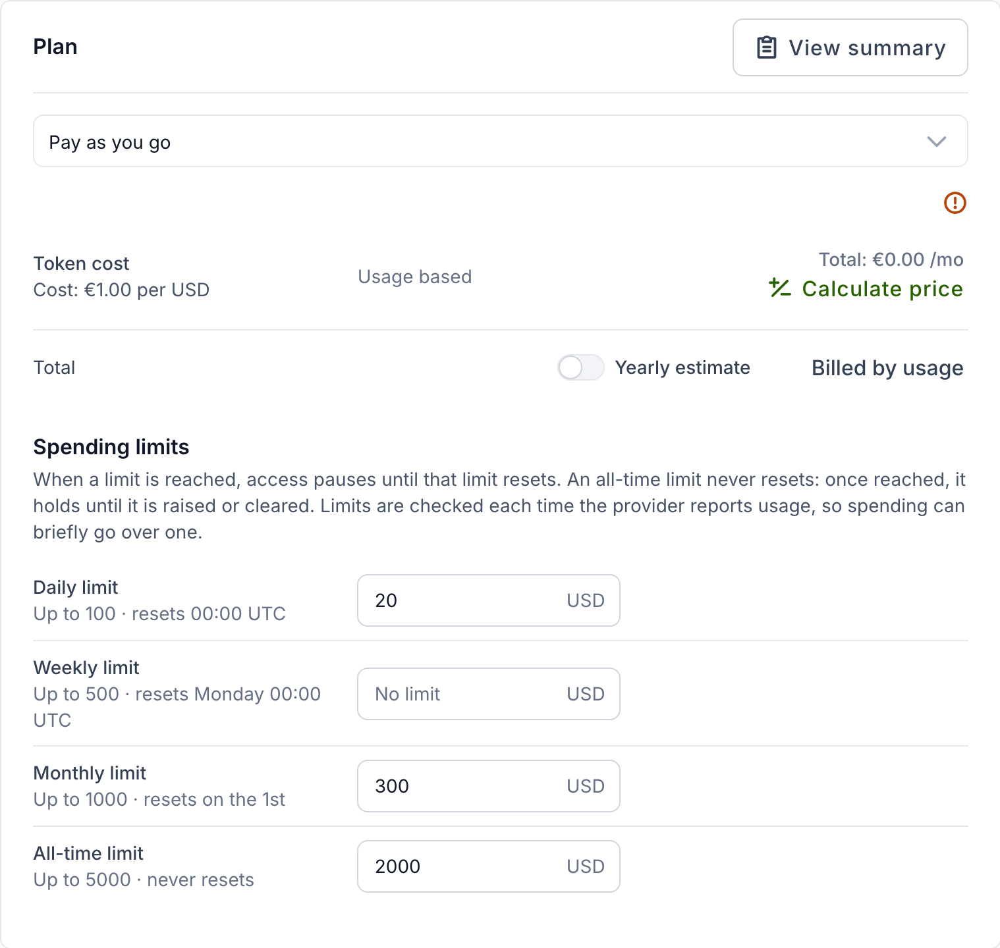
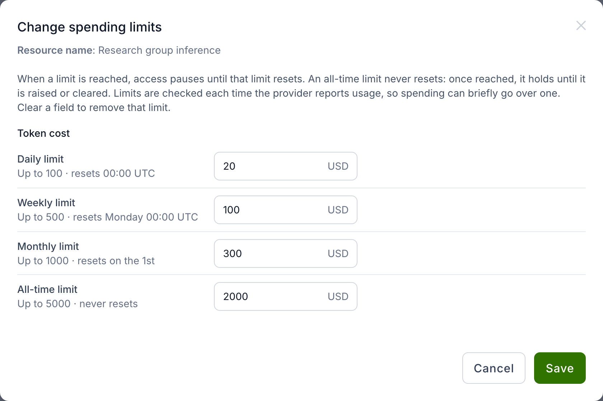
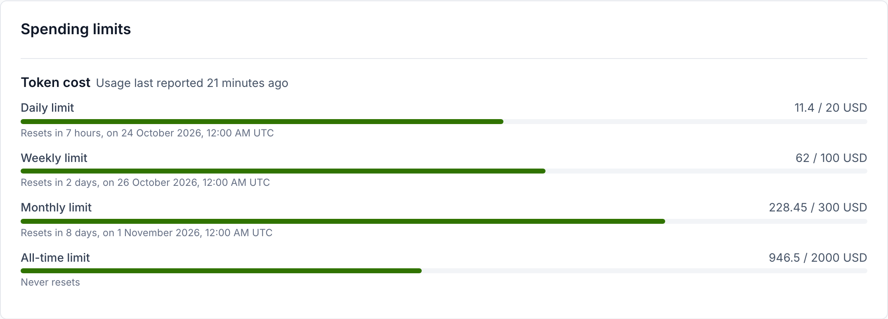
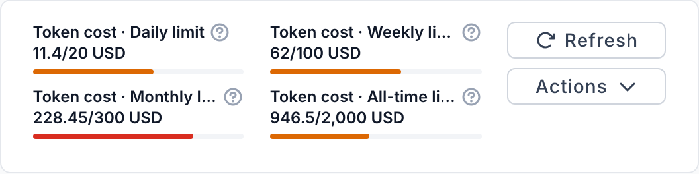
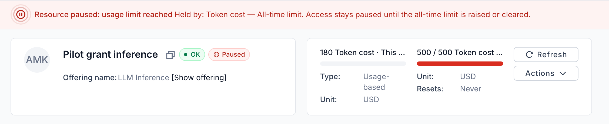
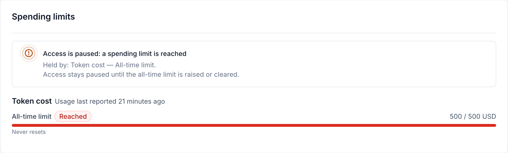
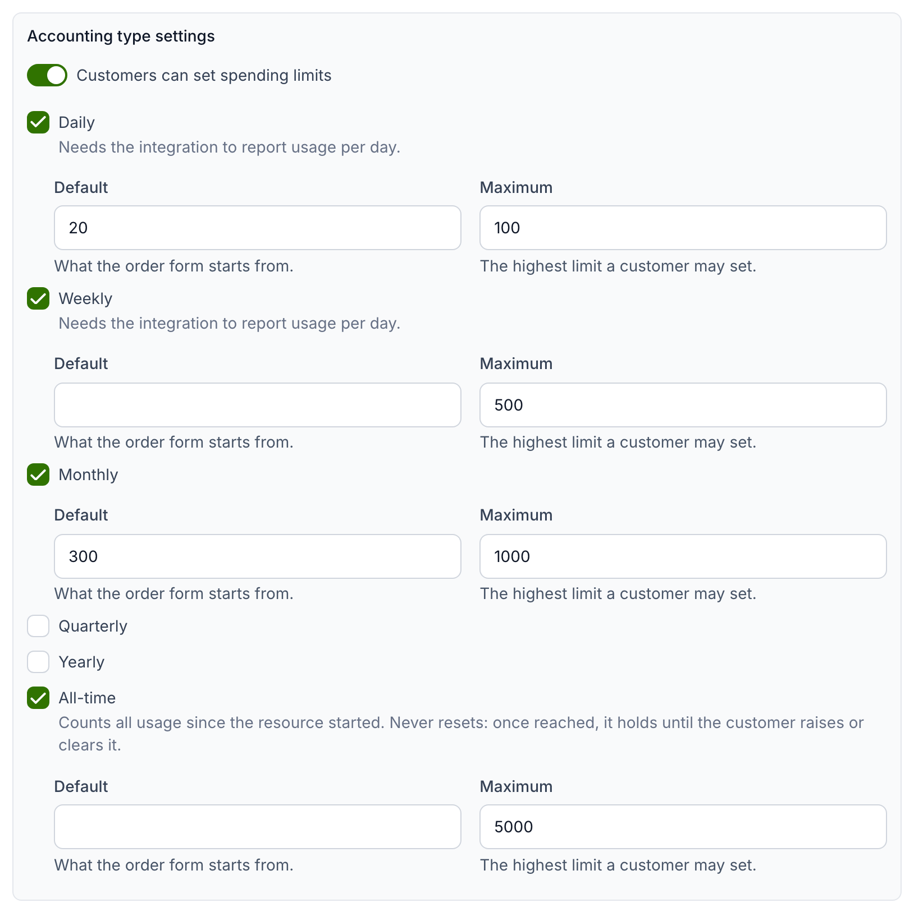

# Resource spending limits

A **usage-based** component is billed on what the resource used. Where the
provider allows it, you can also cap that use with **spending limits**: at most
one limit per period on each component, for a day, a week, a month, a quarter,
a year, or for all time. Limits are never billed. The invoice is still the usage times the
price.

Every limit compares a different span of the same usage. With limits of 20 a
day, 100 a week and 300 a month:

```text
Mon 19   18
Tue 20   20   daily limit reached: paused until Wed 00:00 UTC
Wed 21   15

Daily limit     today            15 of 20
Weekly limit    Mon 19–Wed 21    53 of 100
Monthly limit   1–21 October    142 of 300
```

## Periods and reset times

Periods are calendar periods in UTC, not rolling windows. A weekly limit counts
Monday to today, even across the start of a month.

| Limit | Its usage starts from zero |
| --- | --- |
| **Daily limit** | every day at 00:00 UTC |
| **Weekly limit** | on Monday at 00:00 UTC |
| **Monthly limit** | on the 1st of the month |
| **Quarterly limit** | on 1 January, April, July and October |
| **Yearly limit** | on 1 January |
| **All-time limit** | never |

A shorter period's limit may not exceed a longer one's: daily ≤ weekly ≤
monthly ≤ quarterly ≤ yearly ≤ all-time.

### All-time limits

An **all-time limit** counts all the usage since the resource started, and
never resets. It suits a one-off budget, such as a grant of 500 USD for a
pilot, which a yearly limit would hand out again every January. Once it is
reached it holds the resource until someone raises or clears it (see
[Changing limits](#changing-limits)): no new day, month or year lifts it.
Months in which the resource's plan billed the component by limit do not count
towards it.

## Setting limits when ordering

When the chosen plan bills a component on usage and the provider lets customers
cap it, the **Plan** step of the order form shows a **Spending limits** section
with one field per period the provider offers:

- A field starts from the provider's default, if there is one. Leave it empty
  for no limit on that period.
- **Up to …** under a field is the provider's maximum. The reset time is shown
  next to it.
- A value above the maximum, a negative value, more than two decimal places,
  or a shorter period's limit above a longer one's is refused, and the order
  cannot be submitted until it is corrected.
- A limit of **0** keeps the resource restricted for as long as it is set.
- A notice above the fields says what reaching a limit does on this offering
  (see [What happens at a limit](#what-happens-at-a-limit)): access pauses, or
  the resource is downscaled, until that limit resets — or, where the provider
  has set neither, reaching a limit is only reported. Where an all-time limit
  is offered, the notice adds that it never resets and holds until it is
  raised or cleared.



A plan that bills the component by limit takes no spending limits on it, so
the section is not shown for it.

## Changing limits

Use **Actions → Change spending limits** on the resource. Clear a field to
remove that limit, and save. The new limits apply at once, with no order and
no provider approval.



- Organization owners, project administrators and project managers can change
  spending limits: the roles that hold the permission to change a resource's
  limits.
- Limits can be changed while the resource is **Creating**, **OK**, **Erred**
  or **Updating**.
- The change is recorded in the resource's event log, and the limits are
  checked again straight away: if raising or removing limits brings usage under
  every limit, a restriction they caused lifts without waiting for the next
  usage report. This is the only way to lift a restriction held by a reached
  all-time limit.
- The dialog shows the same notice as the order form on what reaching a limit
  does on this offering.

A limit stays in force if the provider later stops offering its period. The
dialog warns that some limits are on periods the provider no longer offers,
and saving it removes them.

## Following usage

The resource's **Usage** tab has a **Spending limits** card. For each component
it shows every limit as used / limit, a **Reached** badge on a reached one,
when each limit resets, and when usage was last reported. An all-time limit
reads **Never resets**.



The components panel at the top right of the resource page lists each
component followed by one entry per period it has a limit for, such as
**Token cost · Daily limit** with its usage and limit. Hover over an entry's
help icon to see when it resets. Beside its limits, a component's own usage is
named **This month**, and shows 0 until something is reported for the month.
Where the component has a monthly limit, the monthly entry already shows this
month's usage, so the component's own entry is left out. With only one or two
entries the panel shows them in full, with a **Resets** line, **Never** for an
all-time limit.



## What happens at a limit

- When usage in a period reaches that period's limit, the resource is
  **paused** or **downscaled**, as the provider set up the offering. A banner
  at the top of the resource page, and the **Spending limits** card, then say
  which limits hold the resource and when access resumes.
- The restriction lifts by itself once usage is under every limit again:
  within five minutes of the reset of the last limit reached, without waiting
  for a new usage report, or as soon as you raise or remove the limits reached.
- A reached **all-time limit** never resets, so it holds the resource until you
  raise or clear it. The banner and the card say so instead of giving a time
  when access resumes.
- Spending limits lift only a restriction they applied themselves. A resource
  paused by hand, by the project's
  [grace period](project-management.md#grace-period) or by a
  [cost policy](cost-and-usage-policies.md) stays paused, and so does one that
  the grace period or a cost policy still holds when the limit resets.





!!! note
    Usage is checked each time the provider reports it, so spending can go
    somewhat over a limit between two reports. Where the provider has not set
    the offering to pause or downscale resources at a limit, limits and their
    usage are still shown, but nothing is restricted when one is reached.

A resource's [API keys](resource-api-keys.md#limits) can have limits of their
own, each within the resource's limits for the same and every longer period:
under a resource limit of 40 a month, no key can have a daily limit of 50, and
under an all-time limit of 500, no key can have a limit above 500 on any
period. A key that reaches its limit is paused alone, and the resource keeps
working.

## For service providers

### Letting customers set limits

1. Open the offering's **Edit** page and go to **Accounting → Components**.
   Choose **Add component**, or **Edit** in the actions menu of an existing
   **Usage-based** component.
2. Under **Accounting type settings**, turn on **Customers can set spending
   limits**.
3. Tick the periods customers can set a limit for: **Daily**, **Weekly**,
   **Monthly**, **Quarterly**, **Yearly** or **All-time**. At least one is
   needed.
4. For each ticked period, optionally set a **Default**, which the order form
   starts from, and a **Maximum**, the highest limit a customer may set.
5. Click **Confirm** for a new component, or **Save** for an existing one.



A default may not exceed its maximum, and a shorter period's default may not
exceed a longer one's. Amounts take at most two decimal places. Spending limits
are accepted on usage-based components only, and not on a component whose
limit a resource option already shows.

### Daily and weekly limits need usage per day

The dialog marks **Daily** and **Weekly** as needing the integration to report
usage per day. Those limits add up the amounts reported for each UTC day, so
offer them only where the site agent or integration reports per-day usage. An
integration that reports a total for the month can offer monthly, quarterly,
yearly and all-time limits.

API keys have a setting of their own for this: a key is offered daily, weekly,
quarterly and yearly limits only where the offering declares that the site
agent reports each key's usage per day. Monthly and all-time limits need no
per-day usage (see
[Resource API keys](resource-api-keys.md#for-service-providers)).

### All-time limits and late usage

An all-time limit adds up every monthly figure reported for the resource, so
it counts usage reported late for a past month as well. Keep the integration
re-sending the previous month once a new one has begun — the site agent does
so on every run by default (`reporting_periods: 2`, see the
[site agent configuration](../../admin-guide/providers/site-agent/docs/configuration.md)) —
or the usage between its last report of a month and midnight is never
counted.

### Pausing or downscaling at a limit

A reached spending limit restricts the resource with the offering's **Action on
usage limit**, the same setting that acts on limit-based components (see
[Pausing or downscaling resources on usage limit](../service-provider-organization/adding-an-offering.md#pausing-or-downscaling-resources-on-usage-limit)).
Without it, customers can still set limits and see their usage, but nothing is
restricted.

### A limit set before spending limits

A usage-based component could carry a single limit before spending limits
existed. The component dialog shows such a limit as, for example, **Limit 50
per month — not enforced**: reports above it are accepted and billed. It can no
longer be configured; **Clear limit** removes it. Use spending limits to cap
usage instead.
