# Resource management

## VPC management

A Virtual Private Cloud (VPC) is a private OpenStack cloud, also called a tenant. It has its own
quota of CPU cores, RAM and storage and its own internal network. Virtual machines and volumes
are always created inside a VPC, so a project needs a VPC before you can create virtual machines
in it.

### Ordering a VPC

1. Open **Marketplace**, choose the category that holds private clouds (**Private Clouds** in
   this example) and click **Request** on the offering. You can also start from **Add resource**
   at the top of the sidebar, see [Ordering other resources](#ordering-other-resources).

    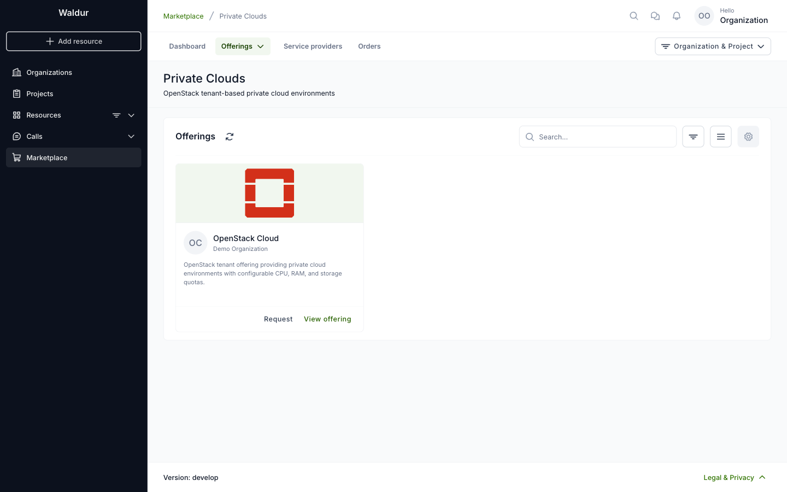

2. Under **General information**, select the organization and the project the VPC belongs to.
3. Under **Plan**, select a plan and enter the quota you need for each component: **CPU Cores**,
   **RAM** and **Storage**. Each line shows the component's price and monthly total, and the
   panel on the right adds them up. Switch on **Yearly estimate** to see the cost for a year.

    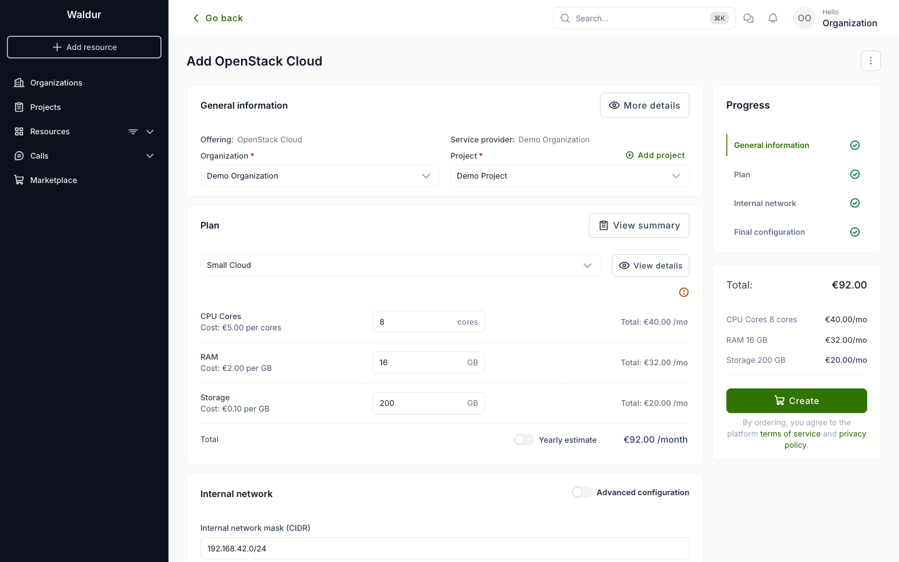

4. Under **Internal network**, keep or change the address range (CIDR) of the VPC's default
   subnet. **Advanced configuration** lets you skip the default router, the connection to the
   external network or the default subnet. Leave these off unless your network design needs them.
5. Under **Final configuration**, enter a **Tenant name** or click **Suggest name**. The name is
   required and appears in accounting data. Add a description so that others in the project know
   what the VPC is for. A **Termination date** is optional: when it is reached, the VPC is
   scheduled for termination.

    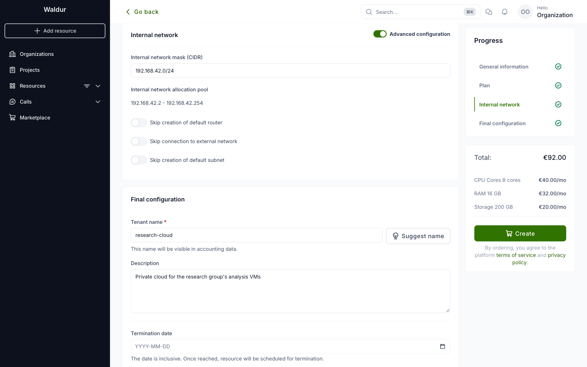

6. When every step under **Progress** has a check mark, click **Create** and confirm the order.

### Request approval

After you submit the order, the VPC's page opens. The tracker at the top shows the order's
progress: created, approved by the organization, approved by the service provider, being
created, completed.

- If you are an **organization owner**, the organization approval is given automatically.
  Depending on the offering, the service provider approves the order automatically or manually,
  and then the VPC is created.

    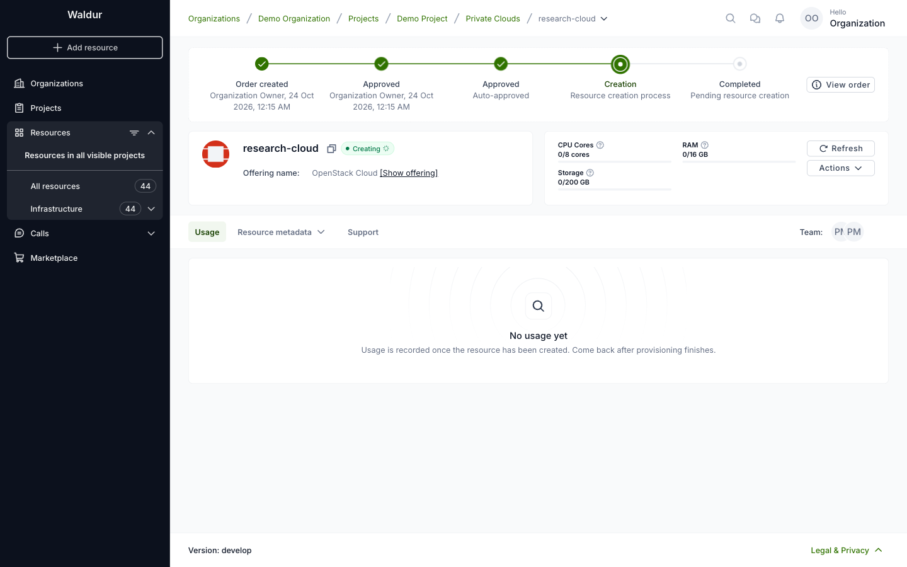

- If your role cannot approve orders, for example **project manager** or **project member**, the
  order waits for organization approval.

    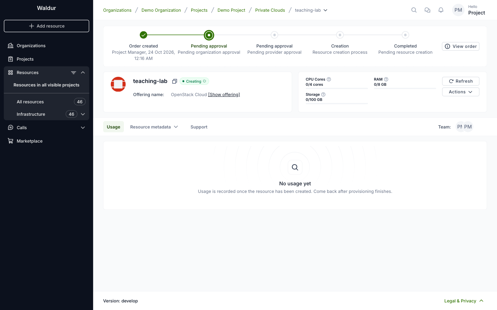

    Organization owners find waiting orders under the bell icon in the top bar, in **Pending
    confirmations**, and approve or decline them there.

    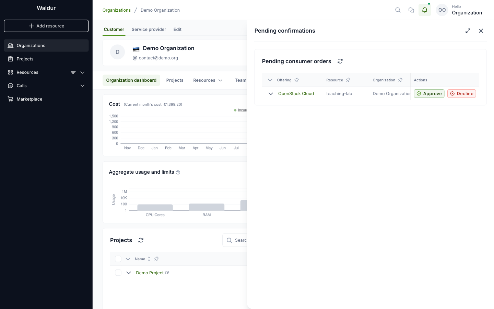

Creating the VPC takes a few minutes. When it is done, the state changes to **OK** and the
**Quotas** tab shows how much of each quota is in use.

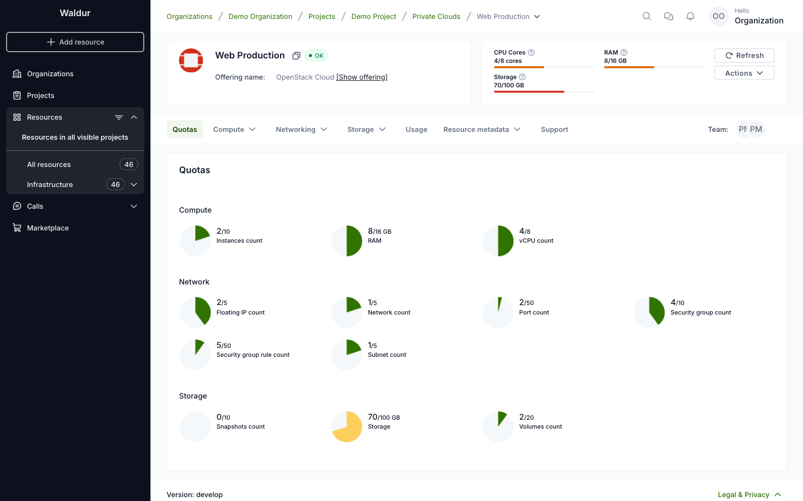

!!! info
    Each VPC adds two offerings to the marketplace: **Virtual machine in &lt;VPC name&gt;** and
    **Volume in &lt;VPC name&gt;**. Only the VPC's project can use them, and the virtual machines
    and volumes created from them are charged as part of the VPC.

## VM management

!!! info
    A virtual machine runs inside a VPC, so its project needs one first. See
    [Ordering a VPC](#ordering-a-vpc).

### Ordering a virtual machine

1. Open **Marketplace** and choose **Virtual Machines**. Each VPC has its own offering,
   **Virtual machine in &lt;VPC name&gt;**. Click **Request** on the one for the VPC the virtual
   machine should run in.

    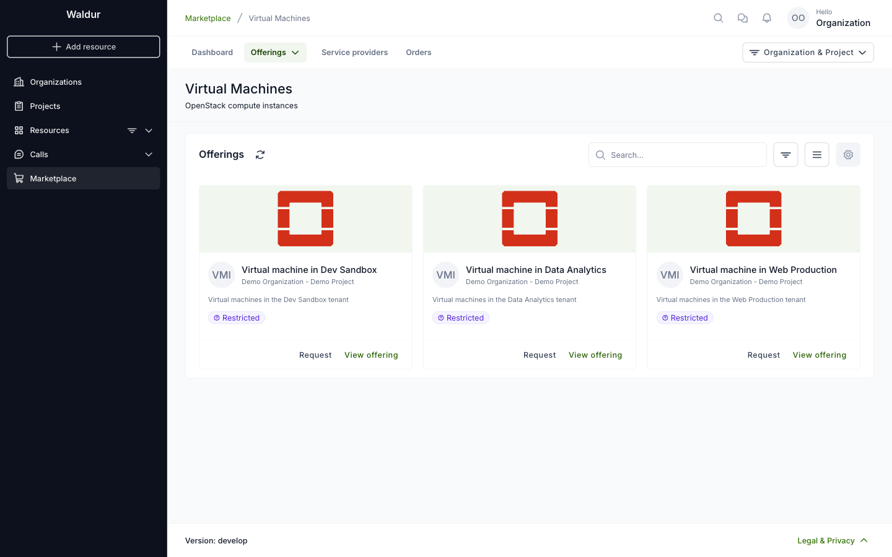

2. Under **Image**, select the operating system and its version.
3. Under **Hardware configuration**, select a flavor. The flavor sets the number of vCPUs and the
   amount of RAM. The bars in the table header show how much of the VPC's vCPU and RAM quota is
   used, including the selected flavor. A flavor is greyed out when it would exceed the VPC's
   quota or has less RAM than the image needs.
4. Selecting a flavor fills in the **System volume size**, which you can increase. Use the toggle
   next to **Data volume type** to add a second volume. See
   [System and data volumes](#system-and-data-volumes).

    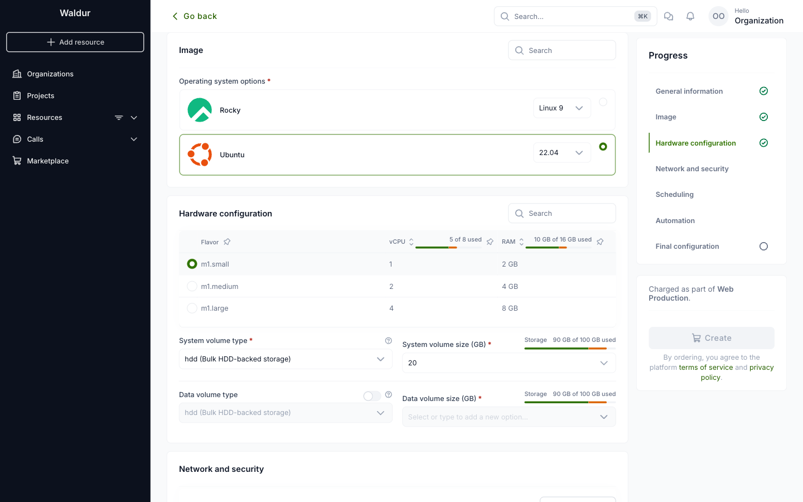

5. Under **Network and security**:
    - Select the **SSH public key** to install on the virtual machine. Keys come from your user
      profile; **Create new** adds one without leaving the form.
    - Select the **Subnet** to connect to. To reach the virtual machine from outside the VPC,
      choose **Auto-assign floating IP** or a free floating IP from the list. With
      **Skip floating IP assignment** it can only be reached from inside the VPC. **Add subnet**
      connects it to more subnets.
    - Select the **Security groups**, which are the firewall rules. No incoming traffic is
      allowed unless a security group allows it, so add one that opens the ports you need, such
      as SSH (port 22).

    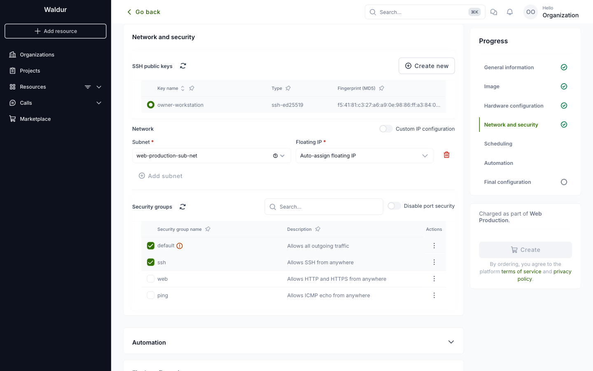

6. **Scheduling** appears when the VPC has server groups, which control how virtual machines are
   placed on physical hosts. **Automation** holds an optional start script (cloud-init user data)
   and the [config drive](#config-drive) toggle.
7. Under **Final configuration**, enter a **VM name** and a description, and optionally a
   termination date.
8. Click **Create** and confirm. The panel on the right shows which VPC the virtual machine is
   charged to. The order then follows the same [approval flow](#request-approval) as a VPC.

    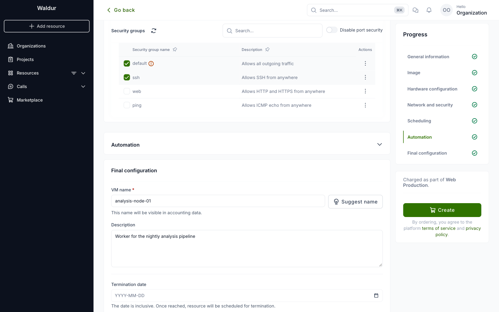

!!! info
    The **default** security group is selected automatically. It allows outgoing traffic, which
    the virtual machine needs to answer incoming connections and to reach the OpenStack metadata
    service. Keep it unless another security group gives the same access.

!!! info
    A floating IP is a public address mapped one-to-one to the virtual machine's internal address
    (1:1 NAT).

### System and data volumes

The **Hardware configuration** step has a **system volume** (the boot disk,
always created) and an optional **data volume**. For each one, pick a
**volume type** and a **size**. Next to each size, a bar shows the quota the
volume draws from and how much of it this order would use.

Which quota the bar shows depends on how the VPC tracks storage:

- **A single storage quota** — the bar reads **Storage** and stays in place
  whatever volume type you pick, because every type draws from it.
- **A quota per volume type** — the bar reads **Gigabytes &lt;type&gt;**
  (for example *Gigabytes ssd*) and follows the selected type.

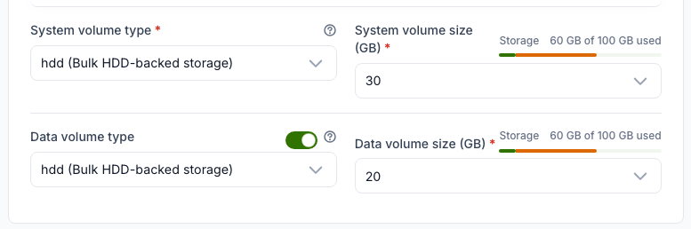

#### Sizes are checked together

Both volumes of the order count against the VPC's storage quota at the same
time, and volumes of the same type also count against that type's quota. Each
size may fit on its own while the two together do not; both size fields then
show **Quota usage exceeds available limit.** Reduce either size, or choose a
type with room left, to continue.

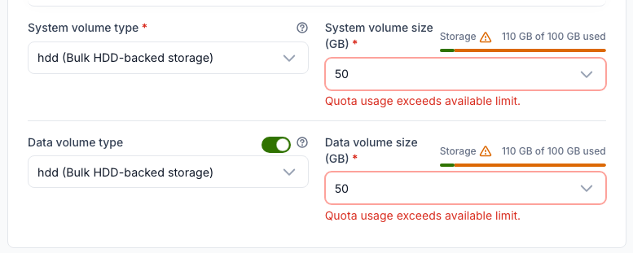

#### Optional data volume

The data volume is switched off by default. Use the toggle next to
**Data volume type** to add one. Switching it off again clears its size, so
the data volume is no longer part of the order.

#### Volume types with no quota left

When a volume type has its own quota and that quota is used up, the type stays
in the list but is greyed out and marked **(quota exhausted)**. It cannot be
selected, and the form preselects the first type that still has room.

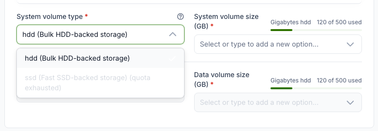

!!! tip
    If every volume type is used up, no type is preselected and the order
    cannot be submitted. Ask the VPC's service provider to raise the quota —
    see [OpenStack tenant quotas](../service-provider-organization/openstack-tenant-quotas.md).

The same quota display and checks apply when ordering a standalone volume.

### Config drive

The Automation step has an **Enable config drive** toggle next to the start script field. A config drive is a small read-only disk attached to the instance at boot. Cloud-init reads metadata, the SSH key and the start script from it without going through the OpenStack metadata service on the network (`http://169.254.169.254`).

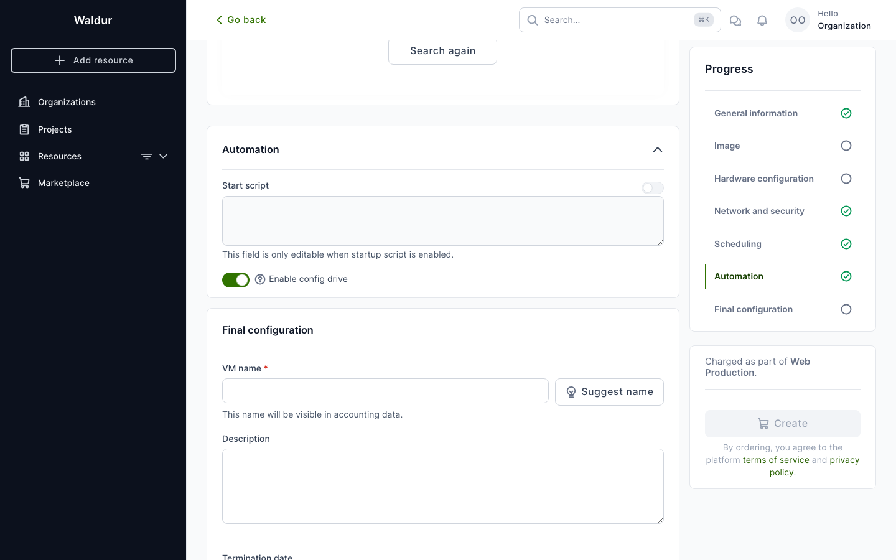

The toggle is pre-filled from the provider default. Enable it for instances that:

- have no DHCP on their tenant network,
- sit on an isolated network that cannot reach the metadata service, or
- must read user data before networking is up.

Leave it off for normal cases where the metadata service is reachable.

!!! tip
    Hover the question mark next to the field for a full explanation in the UI.

### Accessing the virtual machine

When the virtual machine is ready, its state changes to **Active**. The **Details** tab shows
its image, flavor, **Fixed IPs** (addresses inside the VPC) and **Floating IPs** (public
addresses).

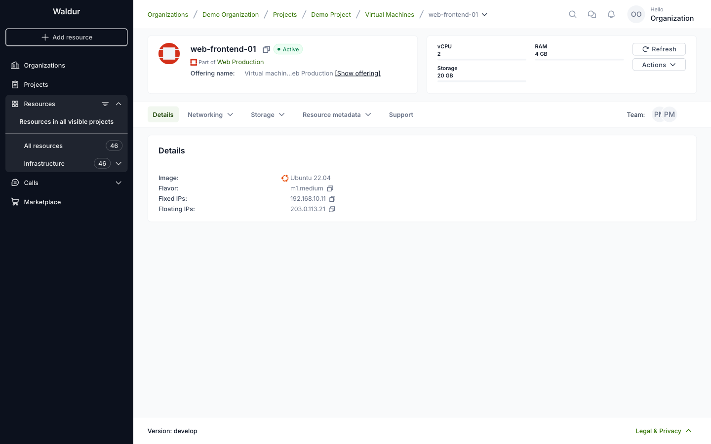

Log in over SSH with the private key that matches the key you selected, at the floating IP:

```bash
ssh ubuntu@203.0.113.21
```

The user name depends on the image. Cloud images usually use the distribution's name in lower
case, such as `ubuntu`, `debian` or `rocky`; if unsure, ask the service provider. Password login
is disabled by default.

!!! info
    SSH (port 22) or RDP (port 3389) access has to be allowed by a security group linked to the
    virtual machine. To change them later, open **Networking → Security groups** on the virtual
    machine's page.

## Ordering other resources

Other resources, such as HPC allocations or storage, are ordered the same way:

1. Click **Add resource** at the top of the sidebar.
2. Select the organization and the project.
3. Choose a category and an offering. You can also search for an offering by name.
4. Fill in the order form and click **Create**. The order follows the same
   [approval flow](#request-approval).

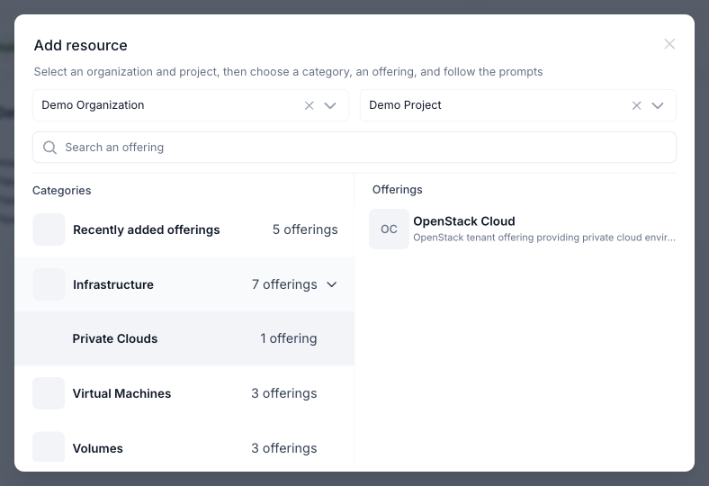

You can also browse **Marketplace** by category and click **Request** on an offering.

## Changing resource limits

If a resource's limits turn out to be too low or too high, you can change them after the
resource is created. Open the resource, click **Actions** and select **Change limits**. Enter the
new limits; the dialog shows the difference from the current limits and the new monthly price.
Click **Request for a change** to submit it. The change is an order, so it follows the same
[approval flow](#request-approval) as a new resource.

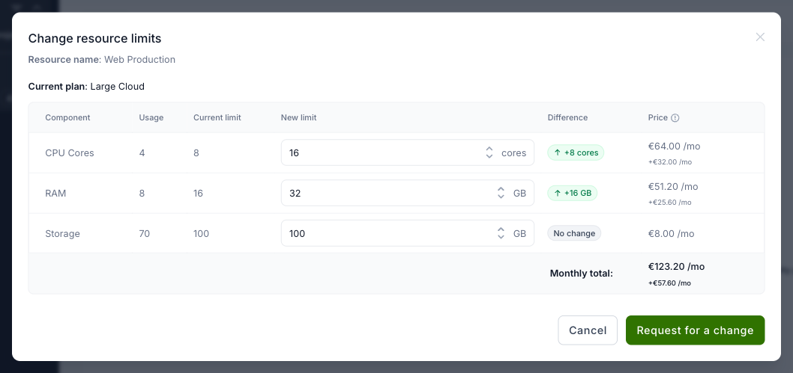

Users who may not change the limits themselves can ask for new ones on offerings
that enable it, see [Requesting resource limit changes](resource-limit-change-requests.md).

## Changing a calculated size

Some offerings calculate several limits from one value you enter when ordering, such as the net storage of a database, from which the provider derives replica, log and backup space. If the provider lets you change that value later, it appears on the resource's **Options** tab:

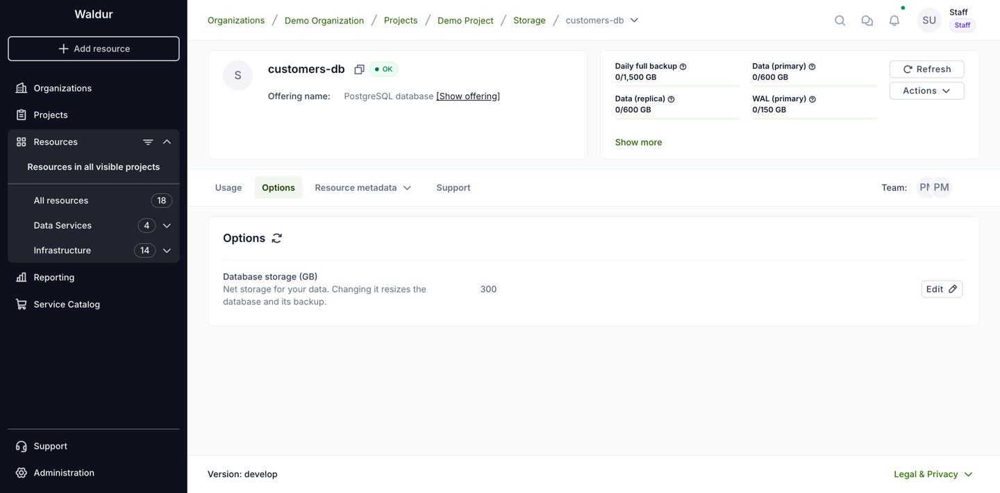

Click **Edit** next to it and enter the new value. The dialog shows the limits calculated from it, the difference from the current ones and the new monthly price before you submit:

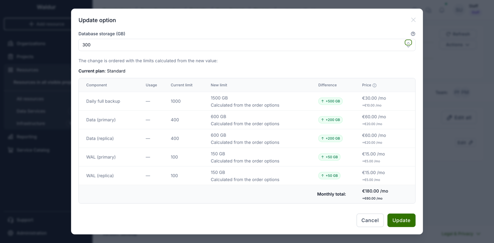

**Update** submits an order with the new value and the recalculated limits. It follows the same approval flow as other changes, and its details show both the limit change with its price impact and the changed value:

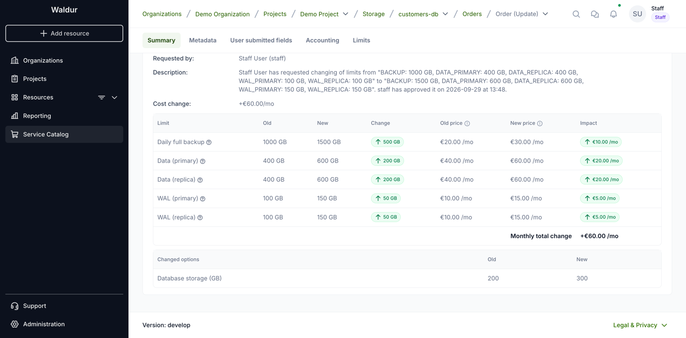

When the order is done, the resource has the new value and limits, and billing follows them from that day.

The calculated limits cannot be changed on their own. **Change limits** shows them without an input, and they follow the value on the **Options** tab:

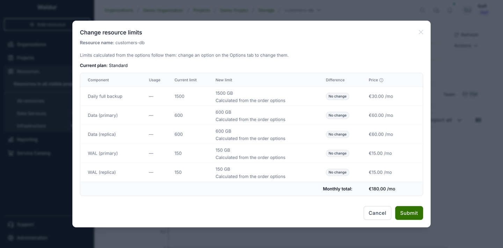

## Changing the plan of a resource

If the offering has several plans, **Change plan** in the resource actions moves
the resource to another plan. The dialog lists each plan with its billing
(limit-based, usage-based, prepaid) and price; plans with a different billing
period cannot be selected. When the new plan bills differently from the current
one, the dialog explains what changes:

- Moving from a limit-based plan to a usage-based plan charges the limit fee for
  the plan's current billing period (the whole month for a monthly plan, the days
  used for a daily plan). From then on you are billed for actual consumption; your
  quotas stay unchanged and cap usage instead of being billed.
- Moving from a usage-based plan to a limit-based plan invoices the usage accrued
  before the switch at the old rates, then bills your current quotas as limits
  for the new plan's billing period. The dialog shows the limits that will be
  billed. If the resource has no quotas yet, ask the service provider to set them
  first.

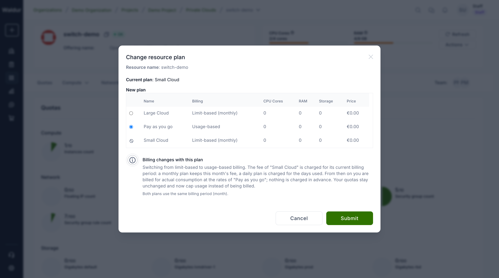

Like any change, the request follows the approval flow; the order shows both
plans with their billing modes. On the invoice, the resource's lines for the month
are grouped by plan, each group with its period and subtotal.

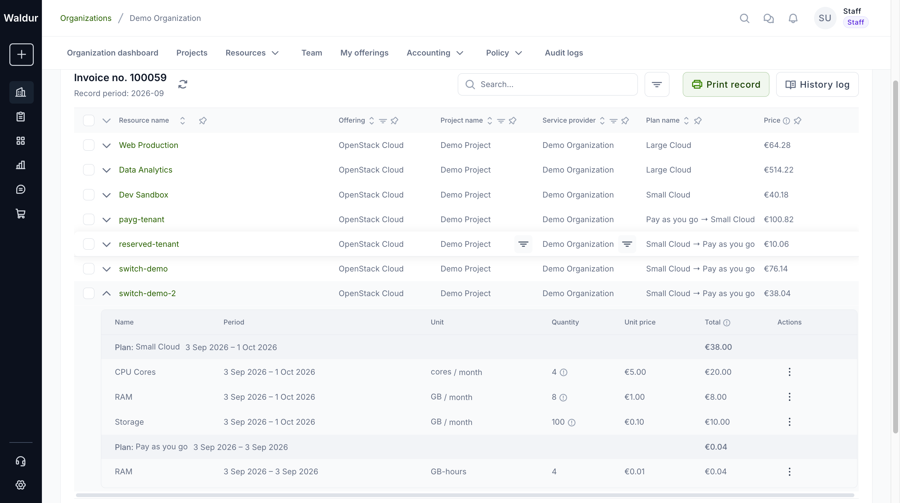

## Resource end date update

The termination date can be changed the same way on offerings that enable it —
see [Changing a resource end date](resource-end-date-changes.md).

## Volume discounts

Some offerings have volume discounts configured on their components by the
service provider. A discount reduces the price of a component once your usage
reaches a threshold.

**In the order form**, a discount is shown live — a green *− X % volume
discount* next to the component and a reduced total — only when it can be
computed up front. That is the case when the discount applies **per resource**
and the quantity is fixed at order time (limit-based, prepaid one-time or
fixed-price components).

For everything else the exact saving cannot be known until the invoice is
finalized — usage-based components (metered later), or discounts calculated on
your **total** usage of a component across the whole organization (which depends
on your other resources). In those cases the order form shows a *"Volume
discount applied on your invoice"* note instead of a price.

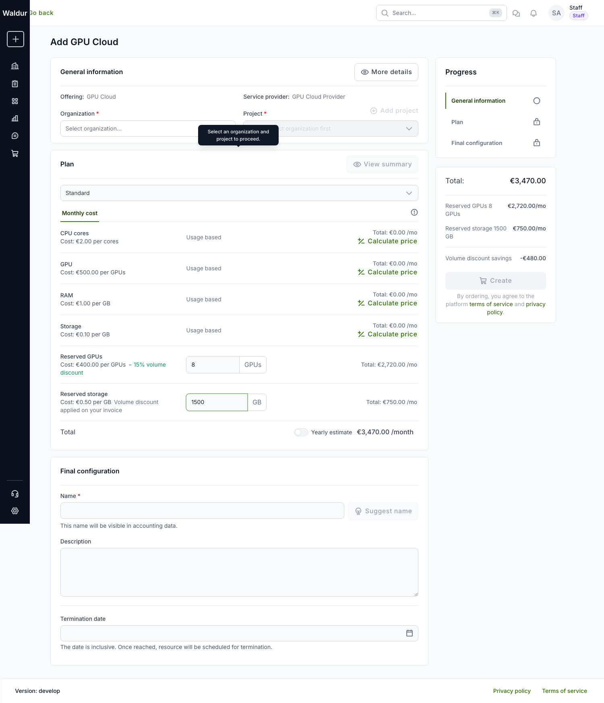

In the example above, *Reserved GPUs* is discounted per resource, so the 15 %
tier is applied live and reflected in both the component total and the *Volume
discount savings* summary. *Reserved storage* is discounted on the
organization-wide total, so it shows the deferred note instead — its saving is
calculated when the invoice is finalized.

Either way, the discount appears as a separate line on your invoice, paired with
each discounted component. See
[volume discounts on invoices](affiliate-earnings.md#volume-discounts-on-invoices)
for how to read the breakdown.
