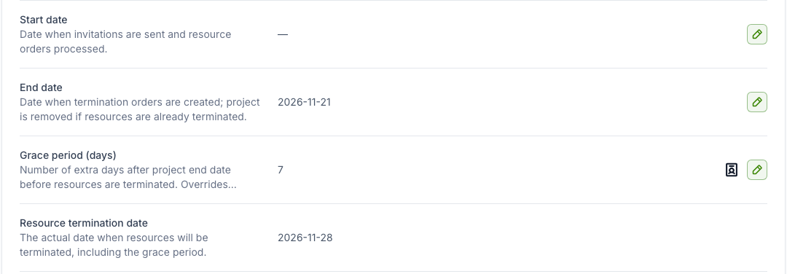
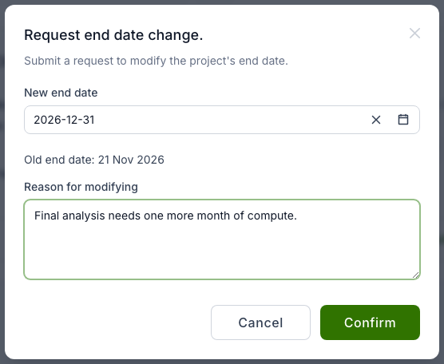
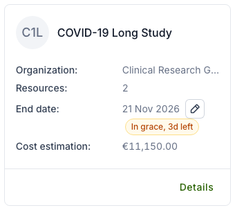
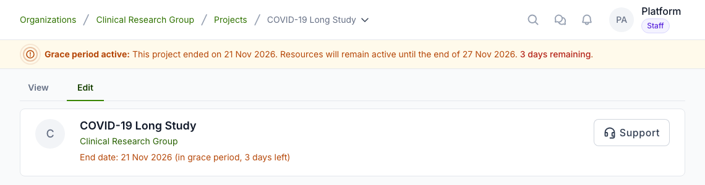
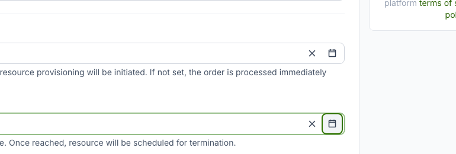
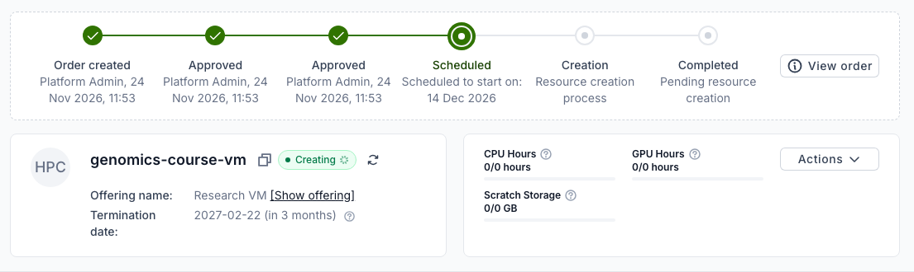
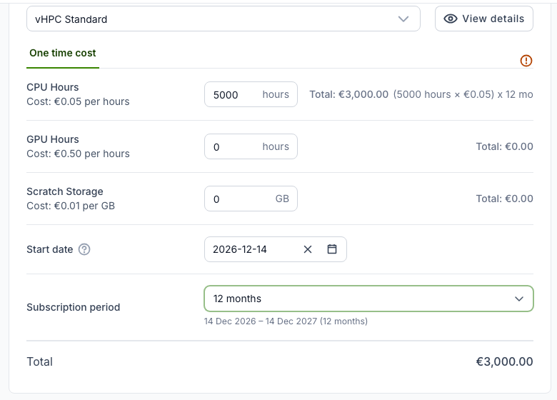
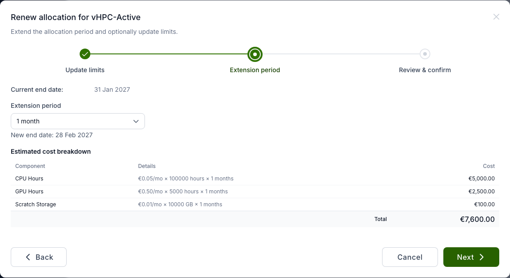

# Start and end dates

Waldur uses dates in several places to decide when things start and stop: the
project, each order, each resource and, for prepaid offerings, the subscription.
This page explains what each date does, how the dates affect each other, and what
happens on the day each one is reached.

| Date | Set on | What happens when it is reached |
|------|--------|---------------------------------|
| Project start date | Project | Invitations are sent and orders waiting for the project are processed |
| Project end date | Project | Every resource in the project is terminated, after the grace period if there is one |
| Grace period | Organization or project | Pushes the project's terminations back by a number of days |
| Order start date | Order | The approved order is processed |
| Resource termination date | Resource | The resource is terminated |
| Subscription period | Prepaid resource | Sets the resource's termination date; extended by renewal |

!!! note "Dates are calendar days"
    All of these are dates, not times, and they are read in the time zone of the
    Waldur server. The checks run in the background a few times a day, so an action
    due on a date happens during that day, not at a precise hour.

## How the dates fit together

```d2
direction: right

project: Project {
  start: start date
  end: end date
  grace: grace period
  start -> end -> grace
}

order: Order {
  ostart: start date
}

resource: Resource {
  rend: termination date
}

order.ostart -> project.start: not before {style.stroke-dash: 3}
order.ostart -> project.end: not after {style.stroke-dash: 3}
resource.rend -> project.end: not after {style.stroke-dash: 3}
```

- An order's start date must fall between the project's start date and end date.
- A resource's termination date cannot be later than the project's end date.
- A resource is terminated on its own termination date or on the project's
  termination day, whichever comes first.

## Project start date

The project start date lets you prepare a project before it begins. Until that
date:

- **Invitations are held.** Invitations you create are saved but not sent. They
  go out once the start date is reached, and their expiry is counted from the
  start date, not from when you created them.
- **Orders are held.** An order placed in the project waits in the **Pending
  project** state. Once the start date is reached it continues to provider
  review, if the offering needs it, and is then processed.

The dates are on the project's **Edit** tab, under **General**. Once a grace
period is set, **Resource termination date** shows the day the resources will
actually be terminated.



A start date cannot be in the past. Once it has been reached, it cannot be
changed. Clearing the start date of a project that has not started yet releases
the held invitations and orders straight away.

## Project end date

The project end date is the day the project's resources are terminated. When it
is reached, Waldur creates a termination order for every active resource in the
project. Treat **the day before the end date as the last full day of work**: the
terminations are started in the early hours of the end date itself.

Once every resource has been terminated, the project itself is removed.

A project end date cannot be set in the past. Users who may set it (by
default, organization owners) change it on the project's **Edit** tab. For
project managers, administrators and members, the pencil next to **End date**
in the project list opens **Request end date change**: they pick a new date and
give a reason, and an organization owner approves or rejects the request. See
[Who can change an end date](end-date-change-requests.md) for who sees which
action.



### Reminders

Project members and organization owners receive an email **7 days** and
**1 day** before the project's resources are terminated, so with a grace period
the reminders are counted from the end of the grace period. They are sent only
if the notification is enabled on your Waldur.

## Grace period

A grace period gives the project's users extra days after the end date to back
up their data or to ask for an extension before anything is deleted.

- Staff set it in days, on the organization (the default for all of its
  projects) or on a single project. A project's own value always wins, and a
  value of **0** turns the grace period off for that project even when the
  organization has one.
- Resources are terminated on **end date + grace period**.
- During the grace period, resources of offerings that support pausing are
  **paused**: they keep existing, but you cannot start new work on them. For
  SLURM, for example, no new jobs can be submitted.
- The project list marks the project **In grace** with the days left, and the
  project's pages show a warning bar with the original end date, the last day
  of the grace period and the days remaining.





```d2
direction: down

active: "Before the end date\nResources work normally" {style.fill: "#c8e6c9"; style.font-color: "#1f2328"}
grace: "Grace period\n(from the day after the end date)\nResources paused" {style.fill: "#fff3cd"; style.font-color: "#1f2328"}
terminated: "End date + grace period\nResources terminated,\nthen the project is removed" {style.fill: "#ffcdd2"; style.font-color: "#1f2328"}

active -> grace: end date passes
grace -> terminated: last day of the grace period
grace -> active: end date extended {style.stroke-dash: 3}
```

**Extending the end date during the grace period** brings the project back to
normal: the pause applied for the grace period is lifted automatically. While a
project is in its grace period, its end date can be moved to any date whose
grace period has not yet run out, including a date in the past.

!!! note "Offerings that opt out"
    A service provider can switch the grace period off for an offering. Its
    resources are terminated on the project end date itself, while the project's
    other resources still get the grace period.

### A project with a 3-day grace period

A project ends on **30 November** and has a **3-day** grace period:

| Day | State of the project | What happens to its resources |
|-----|----------------------|-------------------------------|
| 26 November | Active | Reminder email: 7 days until termination |
| 29 November | Active | Last full day before the end date |
| 30 November | Active (end date reached) | Nothing yet |
| 1 December | In grace period | Resources that support pausing are paused |
| 2 December | In grace period | Reminder email: 1 day until termination |
| 3 December | Grace period over | Resources are terminated; the project is removed once they are gone |

Without a grace period, the resources would be terminated on 30 November, and
the reminders would arrive on 23 and 29 November.

## Order start date

An order's start date delays the processing of an approved order, for example
to have a resource ready on the first day of a course. It is shown as **Start
date** in the last step of the order form.

- It is optional. Without it, an order is processed as soon as it is approved.
- It must be a future date, not before the project's start date, and not after
  the project's end date.
- Approvals still happen first. An order with a future start date goes through
  consumer and provider review as usual, then waits in the **Pending start
  date** state.
- A future project start date is waited for before the provider review, and the
  order's own start date after it.
- On the start date, Waldur starts processing the order, as if it had just been
  approved.



Until then, the resource page shows the order as **Scheduled**, with the date
it will start on.



!!! note
    The field is available only if your Waldur administrator has enabled order
    start dates. Without it, every order is processed as soon as it is approved.

```d2
direction: down

placed: Order placed
consumer: "Consumer review\n(if required)"
project: "Pending project\n(project start date\nin the future)"
provider: "Provider review\n(if required)"
pending: "Pending start date\n(order start date\nin the future)"
exec: Executing
done: Resource created {style.fill: "#c8e6c9"; style.font-color: "#1f2328"}

placed -> consumer
consumer -> project
consumer -> provider: project already started
project -> provider: project start date reached
provider -> pending
provider -> exec: no future start date
pending -> exec: order start date reached
exec -> done
```

## Resource termination date

The termination date (end date) is the day a single resource is terminated,
independent of the rest of the project. Like the project end date, it is the
day the resource goes away, not the last day you can use it.

You can set it in the order form as **Termination date**, or later with
**Actions → Set termination date** on the resource. Those without the
permission to set it can ask for a new date instead: see
[Changing a resource end date](resource-end-date-changes.md).

A termination date must be:

- today or later;
- not before the order's start date;
- not after the project's end date;
- within any limits the service provider sets for the offering.

Depending on the offering, the service provider may also:

- **require** a termination date for every new resource, in which case the
  order form fills in a default date a set number of days ahead, never after
  the project's end date, and you can change it within the allowed range;
- cap it at a **maximum number of days** after creation, or at a **latest
  date**.

Resource reminders are sent 7 days and 1 day before the termination date by
default. A service provider can choose other days for its offering.

### Three resources in one project

A project ends on **31 December** with a **10-day** grace period. Three of its
resources:

| Resource | Its termination date | Terminated on |
|----------|---------------------|---------------|
| A | none | 10 January (project end date + grace period) |
| B | 15 December | 15 December (its own date comes first) |
| C | none, from an offering that opts out of the grace period | 31 December |

Resource B cannot be given a termination date later than 31 December while the
project ends on that date.

## Prepaid subscriptions

For prepaid offerings, you buy a **subscription period** of a number of months
and pay for it upfront. You do not choose a termination date: it is the order's
start date (or the day you order) plus the subscription period. With order
start dates enabled, the start date is asked for next to the subscription
period, and the form shows the period it covers.



- The service provider decides which subscription periods can be chosen.
- Only staff can change the termination date of a prepaid resource directly.
  End date change requests are not available for prepaid offerings.
- To keep using the resource, **renew** it with **Actions → Renew allocation**.
  The renewal is priced and charged upfront, like the original order, and can
  increase the limits at the same time.

A renewal extends the resource from its current termination date or from today,
whichever is later:

| Termination date when renewing | Renewing on | Extension | New termination date |
|--------------------------------|-------------|-----------|----------------------|
| 31 January | 1 December | 1 month | 28 February |
| 15 November (already passed) | 1 December | 12 months | 1 December next year |



The new date is applied once the renewal order has been completed. A renewal is
an order, so renew well before the termination date to leave time for any
approval it needs.

The renewal dialog shows what the renewal costs, line by line, before you
confirm it. If the offering gives a **volume discount** for large allocations,
the discount is shown too:

- When it depends only on this allocation, it appears under each line it
  reduces, and the total is what you are charged. The same amount is on the
  renewal order and on the invoice.
- When it depends on all of your organization's resources of that offering, the
  dialog shows the full price and the note **Volume discount applied on your
  invoice**. The discount is then worked out on the month's invoice.

The discount depends on the size of the allocation, not on how long you renew
it for, and an allocation counts once in a month however many times it is
renewed in that month.

## Related pages

- [Project management](project-management.md): setting the project's dates and
  grace period
- [Changing a resource end date](resource-end-date-changes.md): requesting and
  approving a new termination date
- [Who can change an end date](end-date-change-requests.md): who sets the date,
  who requests it, and why the request can be missing
- [Resource lifecycle](../../about/concepts/lifecycle.md): order and resource
  states
