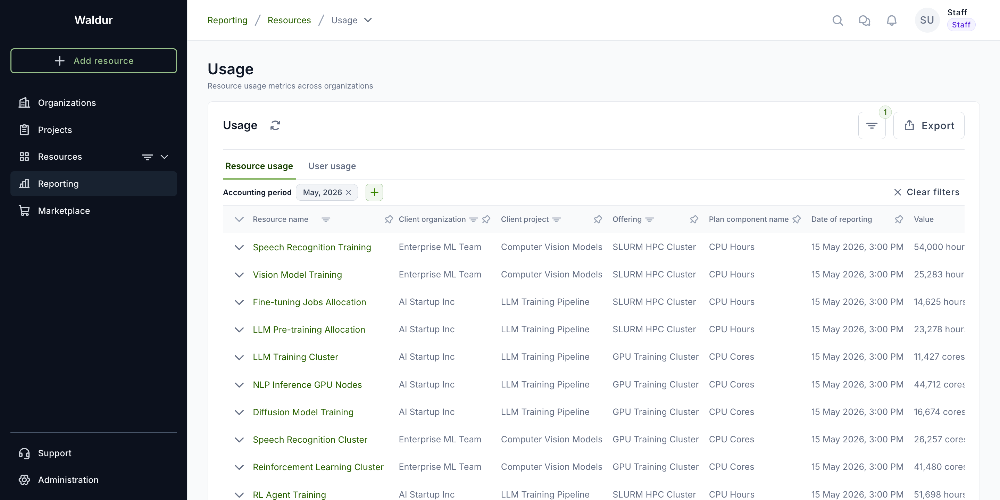
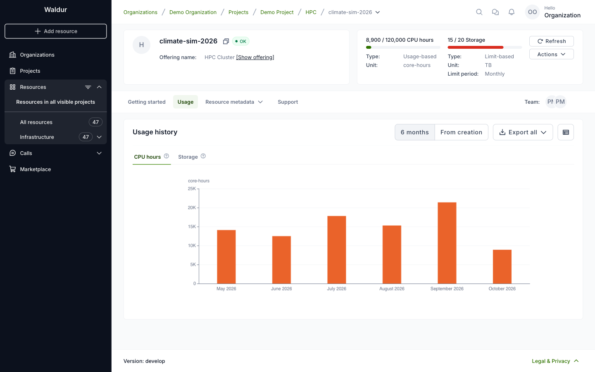
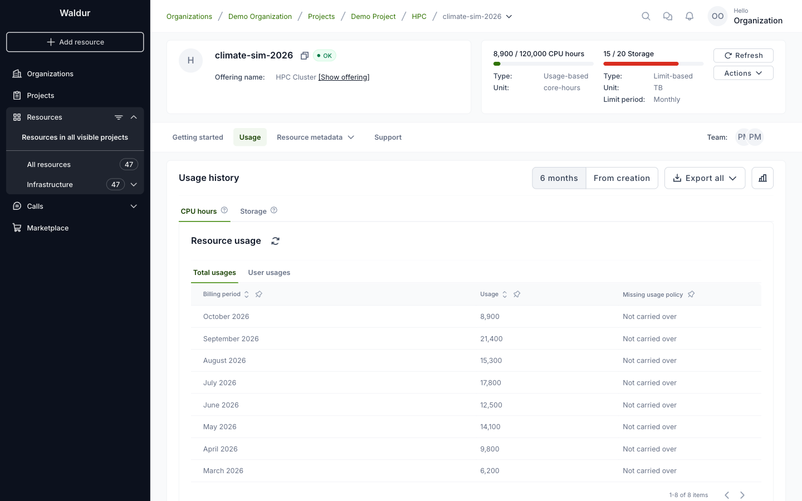

# Usage reports

## Usage of a resources

To see overall usage information of resources, open **Reporting → Resources → Usage**.

It is possible to filter the results by organization, project and offering, and to export them.
The **Resources** tab carries a number of sibling views alongside **Usage** — among them **Usage by
user**, **Usage trends**, **Quotas** and **Usage monitoring**, which flags missing or anomalous
usage reports.

   

The usage of a single resource is on the resource's own page.

### Private clouds

1. Open your project and select the **Resources** tab.
2. Open the private cloud (VPC) resource.
3. The card at the top shows how much of each limit (CPU cores, RAM, storage) is in use, and
   the **Quotas** tab shows the usage of every OpenStack quota, grouped into compute (instances,
   vCPUs, RAM), network (floating IPs, networks, ports, security groups and their rules,
   subnets) and storage (snapshots, volumes, storage).

### HPC

1. Open your project and select the **Resources** tab.
2. Open the allocation (resource).
3. The card at the top shows each component with its usage and limit, its billing type and
   unit.
4. Select the **Usage** tab. There is one chart per component; switch between them with the tabs
   above the chart (**CPU hours** and **Storage** in the example).

    

5. For an older resource, buttons above the chart choose the period: **6 months**,
   **12 months** for resources older than a year, or **From creation** for the whole life of
   the resource.
6. To see the numbers, click the table icon next to **Export all**. **Total usages** lists the
   usage per billing period, **User usages** the usage per user. Click the chart icon to go
   back.

    

7. **Export all** downloads the usage as PNG, PDF, CSV or Excel.

## Including terminated resources

Usage charts normally count only resources that still exist, so terminating one removes
its usage from the totals and from a project's own history. An administrator can enable
the **Include terminated resources** feature flag, which adds a switch of the same name
to the organization dashboard. Turning it on:

- counts the usage that terminated resources reported in the current month, and
- keeps a removed project's usage visible on the organization dashboard.

Terminated usage is reported separately: the API returns it as `usage_terminated` and
`limit_usage_terminated` alongside `usage` and `limit_usage`, and a component's limit
never includes it. While the feature flag is off, the usage endpoints ignore the
`include_terminated` parameter.
