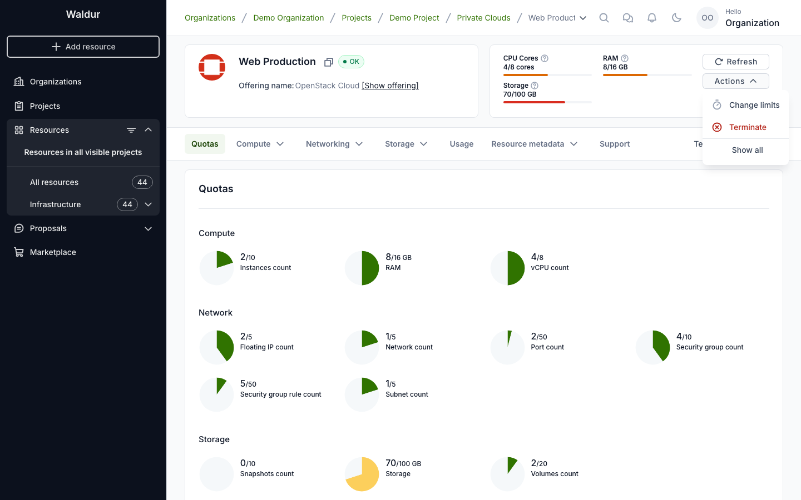
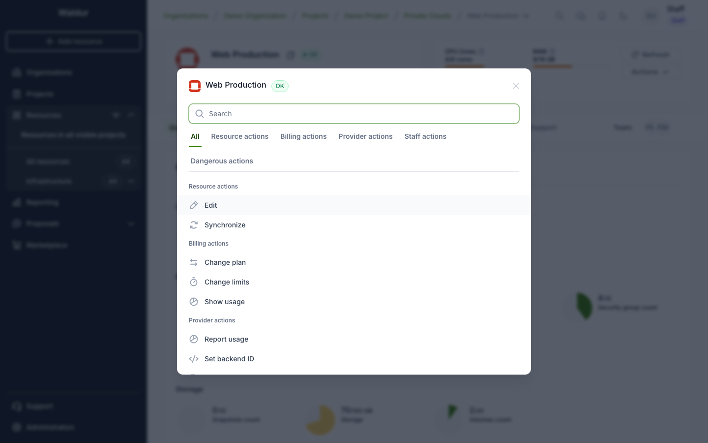
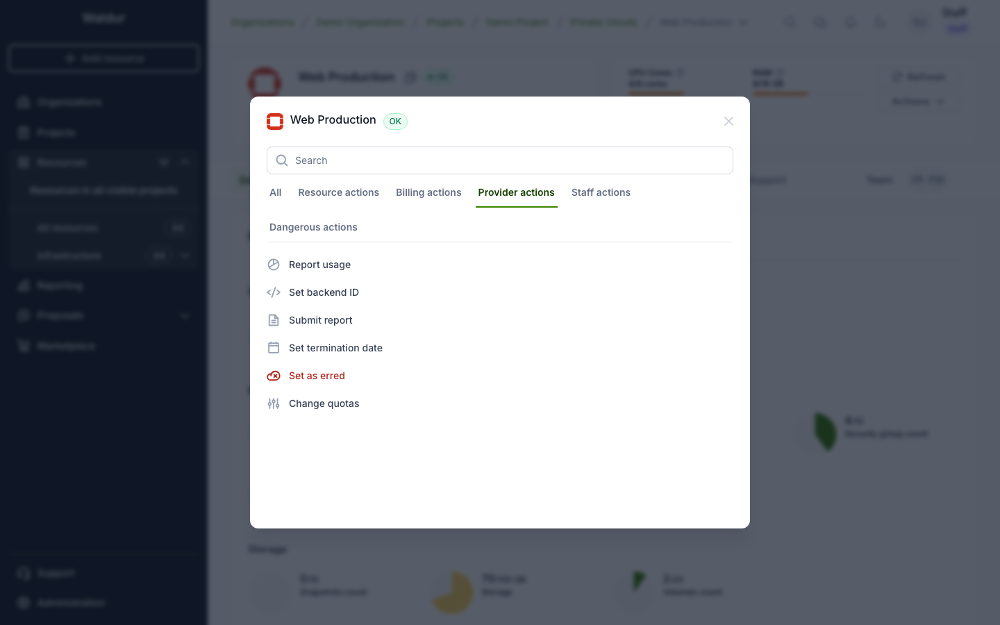
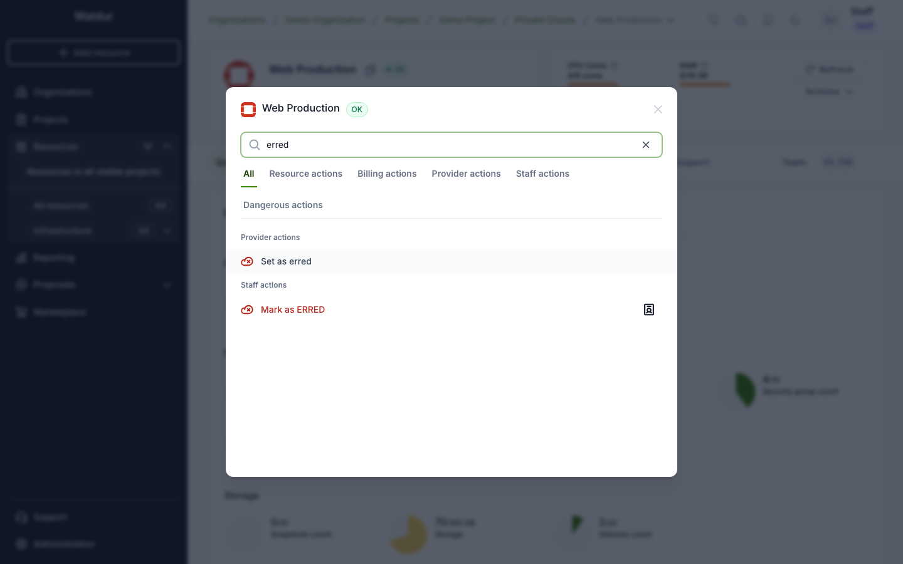
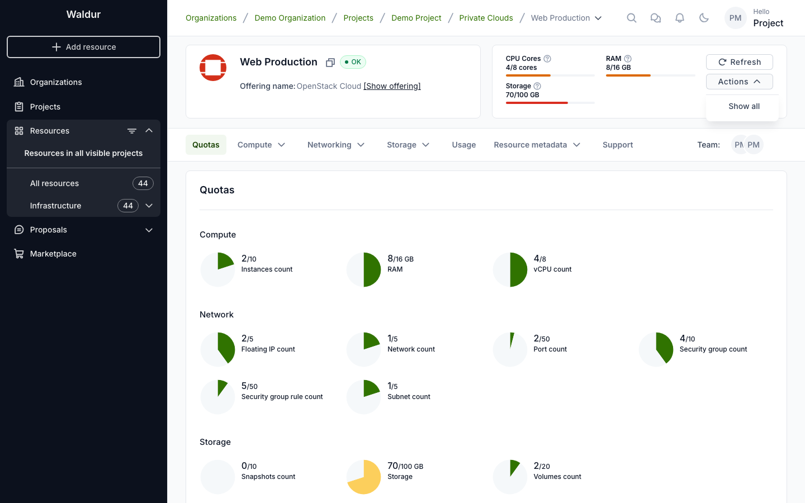

# Resource actions

Everything you can do to a resource — restart it, change its plan, set a
termination date — lives in one **Actions** menu. This page explains how that
menu is laid out and how to find an action in it.

## Opening the menu

Two places offer it:

- **In a table**, the **⋮** button at the end of the resource's row.
- **On the resource page**, the **Actions** button next to **Refresh**.

The menu in a table row is kept short. It lists only the few actions people
reach for most — **Start**, **Stop** and **Restart** for a virtual machine,
**Change limits** and **Terminate** for many other resources — followed by
**Show all**, which opens every action in a dialog.

On the resource page it depends on the kind of resource:

- OpenStack **virtual machines**, **volumes** and **tenants** show the same
  short list and **Show all** there too.
- **Every other resource** lists all of its actions at once, under group
  headings, so there is no **Show all** to click.

## Show all

**Show all** opens the complete list, grouped by what the actions are for.

The groups you see depend on your role and on the resource:

| Group | What it holds |
|-------|---------------|
| **Resource actions** | Day-to-day operations — editing, starting and stopping, synchronizing. On resources other than OpenStack ones it also holds plan, limit and termination actions |
| **Billing actions** | Plan, limits and usage. OpenStack tenants only |
| **Provider actions** | For the organization providing the offering — reporting usage, setting the backend ID, marking the resource as erred |
| **Staff actions** | Administrative operations, for staff only. Each one carries a staff badge |
| **Dangerous actions** | Destructive operations, such as **Terminate** or **Destroy**, kept apart so they are not hit by accident. OpenStack resources only |

A group appears only if it has at least one action for you.

The dialog opens on **All**, showing every group at once. Selecting a tab
narrows the list to that group. If the tabs do not fit on one line, they wrap
onto the next. When there is only one group, there are no tabs.

## Searching

Typing in the search box filters by action name **across every group**, whichever
tab you had selected, so you do not need to know which group an action belongs
to. The tab bar returns to **All** while you are searching, and each result keeps
its group heading so you can see where it came from.

Clearing the search brings back the tab you had chosen.

## What each role sees

The menu is built from the permissions you hold, so the same resource offers
different actions to different people. Below is the same OpenStack tenant seen
by each role. On a tenant, the short list is the same in the table row and on
the resource page.

| Role | In the menu | Added under **Show all** |
|------|-------------|--------------------------|
| **Project member** | **Show all** only | **Edit**, **Synchronize**, **Show usage** |
| **Project administrator** | **Change limits**, **Terminate** | **Change plan** |
| **Project manager** | the same as project administrator | the same as project administrator |
| **Organization owner** | **Change limits**, **Terminate** | **Set termination date** |
| **Staff** | **Change limits**, **Terminate** | **Report usage**, **Set backend ID**, **Submit report**, **Set as erred** and **Change quotas** under Provider actions, and the staff-only group (**Move**, **Unlink**, **Mark as ERRED**, **Mark as OK**) |

Each row adds to the one above it, except that a project member has none of the
short-list actions. Their menu holds nothing but **Show all**:

!!! note
    The short list is the same few actions for everyone. A role adds actions to
    it only when one of those actions becomes available to that role. Anything
    else a role gains, such as an organization owner's **Set termination
    date**, appears under **Show all**.

Provider actions such as **Set as erred** come from a role in the organization
that *provides* the offering, not the one that uses it. When both are the same
organization, its owner sees those actions too.

### Service providers

Providers work from the **Resources** list in their provider workspace. There
the **⋮** menu on a row holds **View details** and **Show all**, and **Show
all** lists the provider actions: Show usage, Report usage, Set backend ID, Edit
metadata, Submit report, Create robot account, Set as erred, Set termination
date, View details and Synchronize. Staff also see their own group there.

A resource's own page in the provider workspace lists the same actions under
its **Actions** button, all at once and with no **Show all**.

These actions need a provider-side role, such as owner or service provider
manager, in the organization that provides the offering. Some are reserved for
staff — **Submit report** is greyed out for everyone else.

## Why an action might be missing

An action you expect may not be listed, for any of these reasons:

- **Your role.** Actions appear only if you hold the permission for them. Staff
  actions are the clearest case, but the same applies to setting a termination
  date or reporting usage.
- **The resource's state.** Some actions only make sense in some states. On a
  running virtual machine, **Start** is greyed out with *Instance is already
  active*, and **Change flavor** asks you to stop the instance first. Such
  actions stay in the list, greyed out with a **?** that explains why.
- **The offering.** A service provider can switch specific actions off for their
  offering, and can enable others such as end date change requests.

!!! note
    Greyed out is not the same as absent. A greyed-out action is one you could
    normally use but cannot right now — hover the **?** beside it for the reason.

## See also

- [Changing a resource end date](../customer-organization/resource-end-date-changes.md)
- [Resource management](../customer-organization/resource_management.md)
