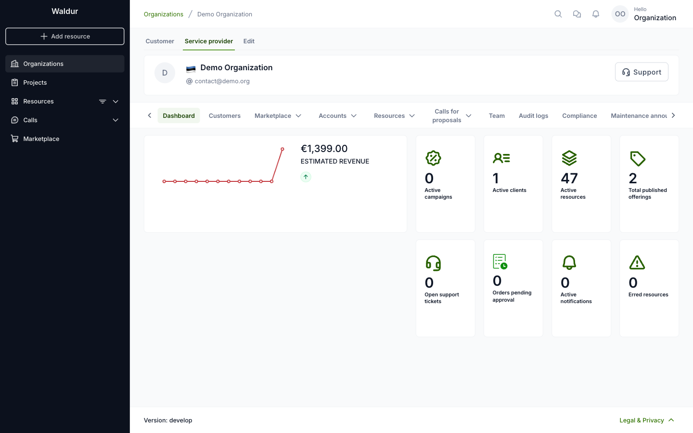
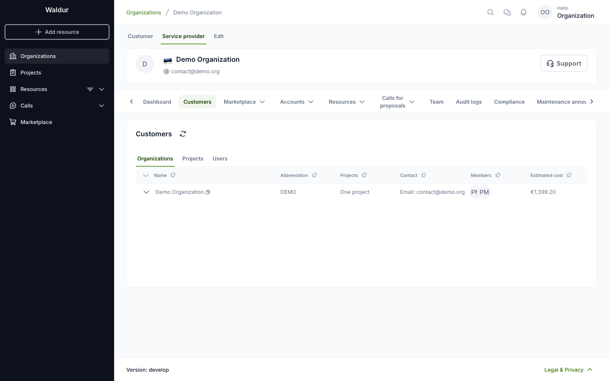
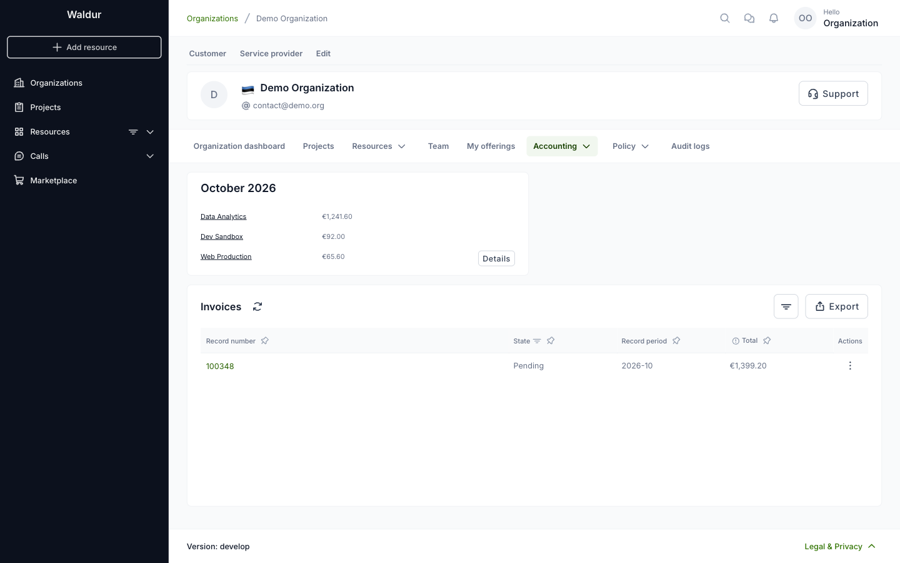
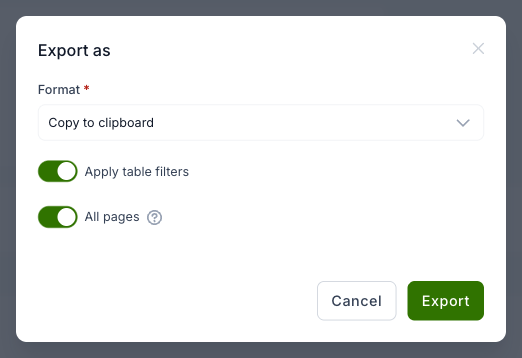

# Accounting

## Accounting of Service providers

### Service provider revenue

If the organization is a service provider, open it and select the **Service provider** tab. The
**Dashboard** shows the estimated revenue of the running month, with a chart of the previous
months, and counters for active clients, active resources, published offerings, open support
tickets, orders pending approval and erred resources.

The **Customers** tab lists the organizations, projects and users that use the provider's
offerings. The **Organizations** list shows each customer's estimated cost for the month.

### Invoices

To see the invoices issued to the organization, open it and select **Accounting → Invoices**.

To download the invoice list, click **Export** and choose the format: copy to clipboard, CSV,
PDF or Excel. **Apply table filters** exports only the rows that match the current filters, and
**All pages** exports every page instead of the one shown.

### Estimated cost

The estimated cost of the running month is shown above the invoices. The card lists the
resources with the highest estimated cost; click **Details** to see the whole breakdown.
