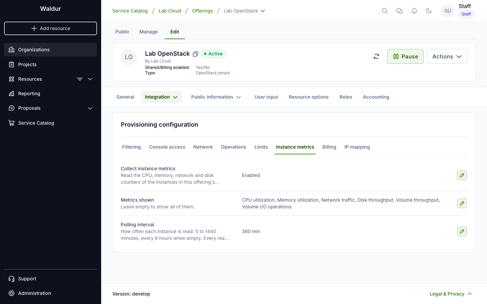

# OpenStack instance metrics

Waldur can read the usage figures of the virtual machines in your OpenStack
offering — CPU, memory, network and disk — and show them on each virtual
machine's and volume's **Metrics** tab and on the project's **Metrics** tab.
Waldur reads them from Nova itself: there is nothing to install in your cloud
and nothing to report, unlike the [custom metrics](custom-metrics.md) other
services send.

## Turning it on

Open the OpenStack offering, switch to **Edit**, choose
**Integration → Provisioning configuration**, and open the
**Instance metrics** tab.

- **Collect instance metrics** — off by default. When on, Waldur reads the
  running virtual machines in every tenant of this offering.
- **Metrics shown** — which metrics projects see. Empty shows all of them.
- **Polling interval** — how often each virtual machine is read, from 5 to
  1440 minutes; every 6 hours when empty.

The settings apply to every tenant of the offering, those created later
included.

## The metrics

| Metric | Shown on | What it is |
|---|---|---|
| CPU utilization | Virtual machine | Share of the virtual machine's vCPUs in use between two reads |
| CPU time | Virtual machine | CPU time its vCPUs consumed |
| Memory utilization | Virtual machine | Share of the guest's memory in use, reclaimable cache left out |
| Network traffic | Virtual machine | Bytes received and transmitted on its ports |
| Disk throughput | Virtual machine | Bytes read from and written to all its disks |
| Disk I/O operations | Virtual machine | Read and write requests to all its disks |
| Volume throughput | Volume | Bytes read from and written to the volume |
| Volume I/O operations | Volume | Read and write requests to the volume |

Network, disk and volume figures are split into receive and transmit, or read
and write. A volume's figures come from the virtual machine it is attached to,
and are read with it.

Removing a metric from **Metrics shown** archives it: projects no longer see
it, and its data is kept for a grace period (30 days by default) before it is
deleted. Showing it again within that period brings its history back.

## Which virtual machines are read

A virtual machine is read when it is running and its resource is in a working
state, and when both its tenant's offering and your OpenStack offering are
**Active** or **Paused**. Virtual machines of draft, archived or unavailable
offerings are not read, and neither are those whose service settings are
inactive or in error.

Each read is one call to Nova's diagnostics, plus one to list the attached
volumes when volume metrics are shown. Reads are spread evenly over the
polling interval. With the default interval of 6 hours, 1,000 running virtual
machines make about 8,000 calls a day.

A call that takes longer than 30 seconds is given up. When Nova fails five
reads in a row, Waldur stops reading your offering's virtual machines for 10
minutes. A stopped or deleted server, or one whose hypervisor keeps no
diagnostics, doesn't count as a failure.

People who manage a virtual machine can have it read sooner: once, or more
often for up to 24 hours, at intervals faster than yours. See
[Metrics of OpenStack virtual machines and volumes](../customer-organization/openstack-instance-metrics.md).

## Requirements

- **Admin credentials.** Nova shows a server's diagnostics to admins only, so
  the offering's service settings must use an admin account.
- **Nova API microversion 2.47 or later, on libvirt.** Waldur asks for the
  2.47 form of the diagnostics, which names each disk and port; that is what
  ties a disk's figures to its volume.
- **Memory statistics in the guest.** Memory utilization needs the guest's
  balloon driver to report its statistics, which Nova's libvirt driver turns
  on with `mem_stats_period_seconds` (10 seconds by default). Without them the
  memory card stays empty; the other metrics are not affected.

Figures are recorded as what each disk and port added since the previous read.
When a virtual machine restarts, migrates, or has a volume attached anew, its
counters start from zero; Waldur notices that and counts from there, so
nothing is counted twice. The first read of a virtual machine that has been
running for longer than one polling interval is a starting point, not counted,
so turning metrics on doesn't put earlier activity into one moment.

Raw readings are kept for 14 days, hourly figures for 14 days and daily
figures for 400 days.

## Related pages

- [Metrics of OpenStack virtual machines and volumes](../customer-organization/openstack-instance-metrics.md)
- [Project metrics](../customer-organization/project-metrics.md)
- [Custom metrics](custom-metrics.md)
