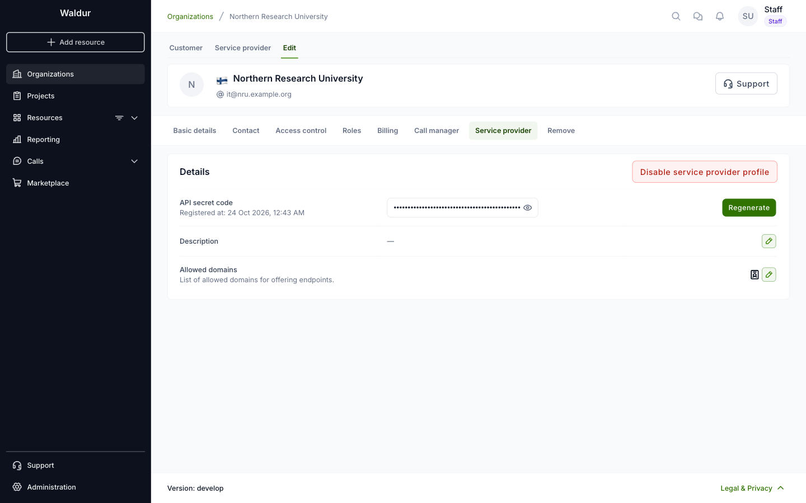

# Service provider registration

In Waldur, only organizations registered as service providers can create offerings and provide the service to users.

Registering requires the *register service provider* permission. Out of the box only staff users
have it; a deployment can grant it to other roles, such as organization owners.

To register organization as service provider:

1. Open the organization, select the **Edit** tab and then **Service provider**.
2. Click **Register as service provider**.

    

3. The organization is registered right away. The tab now shows the provider's **API secret
   code**, a **Description** and **Allowed domains**, and the organization gets a **Service
   provider** tab next to **Customer**.

    

4. Add a description of the service provider. It is visible in the marketplace, in the list of
   service providers and on the provider's details page.
5. Under **Allowed domains**, list the domains that offering endpoints may point to.

The **Regenerate** button replaces the API secret code. **Disable service provider profile**
turns the organization back into a regular one.
