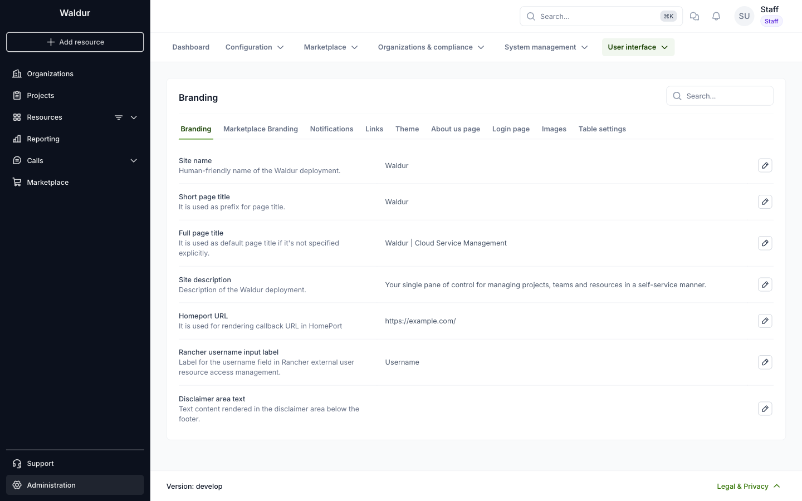

# Branding configuration

The portal allows you to customize its appearance to match your organization's brand identity. This guide will help you configure the branding settings.

## Accessing Branding Settings

1. Select **Administration** in the sidebar.
2. Open **User interface → Branding**.

Each setting has an edit button; the search box finds a setting by name.

## Available Customisation Options

### Branding

- **Site name**: Human-friendly name of the Waldur deployment.
- **Short page title**: Prefix of the page title.
- **Full page title**: Default page title when a page does not set its own.
- **Site description**: Description of the Waldur deployment.
- **Homeport URL**: Used for rendering callback URLs in HomePort.
- **Rancher username input label**: Label of the username field in Rancher user access management.
- **Disclaimer area text**: Text shown in the disclaimer area below the footer.

### On the same page, you will find more tabs to customise

- Marketplace Branding
- Notifications
- Links
- Theme
- About us page
- Login page
- Images
- Table settings

!!! note
    All changes in branding settings will be applied system-wide. Please preview changes before saving to ensure they meet your organization's visual guidelines.

## Recommended sizes and formats for all branding images

These images are used across the platform. Images larger than the suggested sizes are supported, but will be scaled automatically to fit.

**Site logo**

- Displayed in the Marketplace order header.
- Format: PNG or SVG
- Recommended size: ~160–180 px wide and ~20-32 px high
- Avoid vertical/tall logos for better visibility.

**Sidebar logo**

- Displayed at the top of the sidebar menu.
- Format: PNG or SVG
- Recommended size: ~160–180 px wide and ~20-32 px high
- Horizontal logos provide the best readability.
- Vertical logos are supported but will appear smaller.

**Sidebar logo (mobile)**

- Displayed in the mobile sidebar.
- Recommended size: Same as desktop (~32 px height)
- Horizontal layout preferred.

**Sidebar logo (dark mode)**

- Displayed in dark theme sidebar.
- Recommended size: ~32 px high
- Use a light / high-contrast version for dark backgrounds.

**Powered by logo**

- Displayed at the bottom of the login view.
- Recommended size: ~150–180 px wide
- Horizontal logos work best in this compact area.

**Hero image**

- Displayed in the HomePort landing page hero section.
- Minimum size: 1600×400 px
- Requirements: No text or logos in the image and keep the center area clean for headings.

**Marketplace hero image**

- Displayed in the Marketplace hero section.
- Minimum size: 1600×400 px
- Clean, wide image with no text
- Choose darker images for dark mode, brighter images for light mode.

**Call management hero image**

- Displayed in Call Management landing page hero section.
- Minimum size: 1600×400 px
- Wide image with no text
- Keep the central area free of visual noise.

**Login logo**

- Displayed on the login screen.
- Recommended size: ~180×40 px (horizontal PNG)
- Scales well across desktop and mobile.

**Favicon**

- Displayed in browser tab.
- Recommended size: 32×32 px or 64×64 px
- Format: PNG

**Offering logo placeholder**

- Default image used in offering cards.
- Recommended size: ~200×200 px (square image; cropped to circle).

**Keycloak icon**

- Displayed on the "Login with Keycloak" button.
- Recommended size: ~40×40 px
- Use a simple icon with a clear silhouette.
- Format: SVG, PNG
