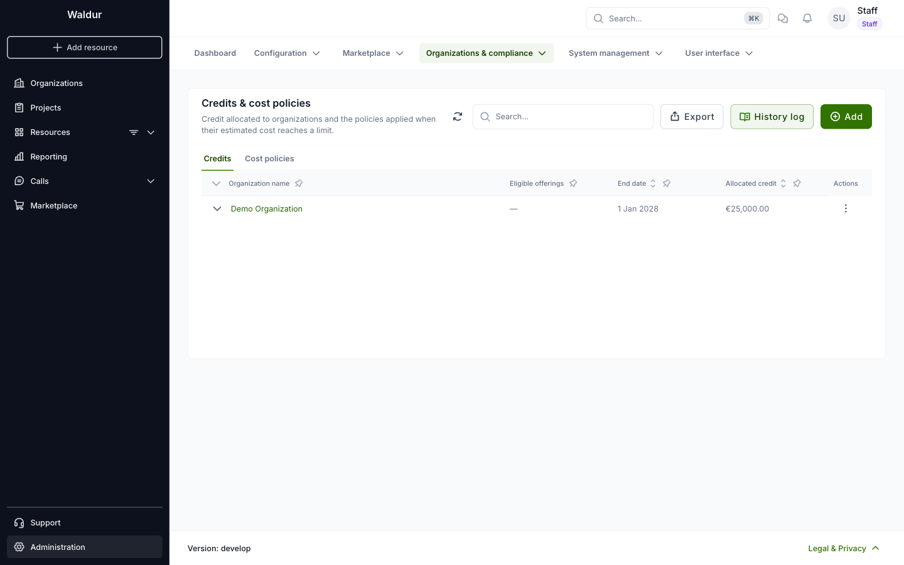
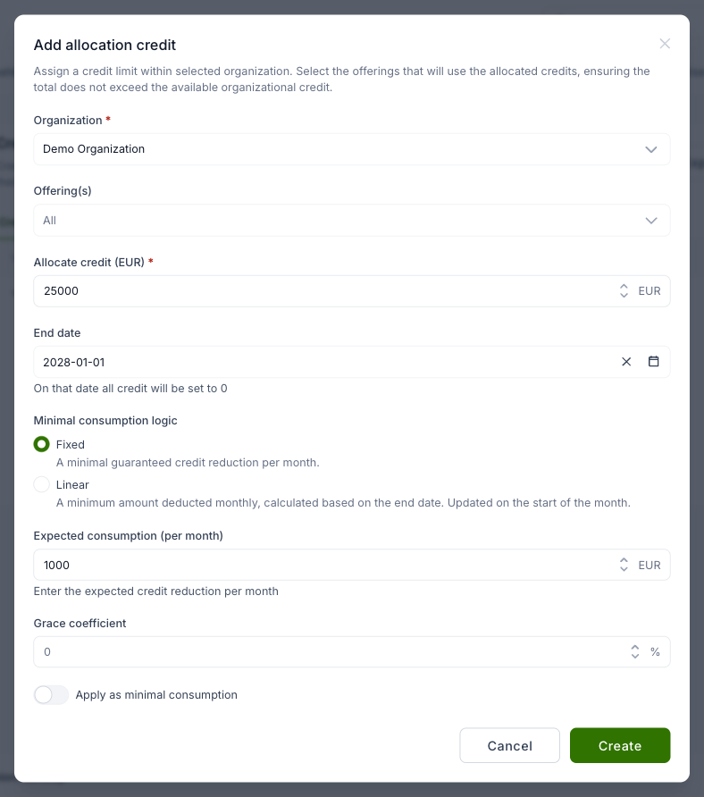
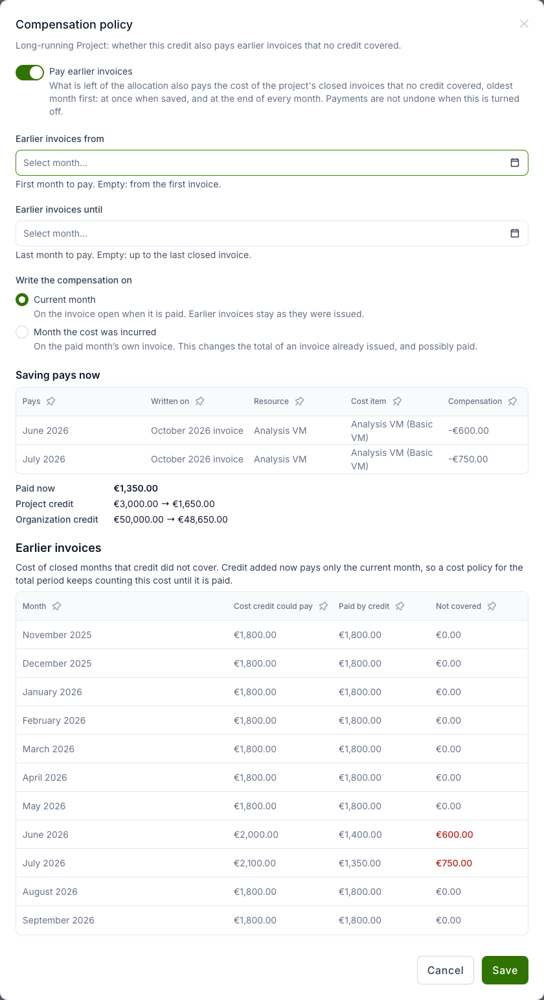

# Credit management configuration for staff

Credit management establishes credit limits for organizations that can be used for purchasing eligible services.
The credit can optional be sub-allocated to projects and used in [cost policies](../customer-organization/cost-and-usage-policies.md).

Users with staff role can allocate credit to organizations. Open **Administration** in the
sidebar, then **Organizations & compliance → Credits & cost policies**. The **Credits** tab lists
the credits already assigned; the **Cost policies** tab holds the organization
[cost policies](../customer-organization/cost-and-usage-policies.md#cost-policies-for-organizations).

To assign a credit, click **Add**. A dialog opens with these fields.

1. Select an organization to which you would like to assign credits.
2. Select the offerings the credit may be spent on. **Leave this empty to allow all offerings** —
   an empty list means unrestricted, not "none". Cost on any other offering is invoiced
   normally and is never drawn from the credit.
3. Set the credit value. This is the total value that the organization will be able to spent.
4. Optionally set an end date. On that date the remaining credit is set to 0. It must be the
   first day of a month.
5. Minimal consumption logic defines, how minimal monthly consumption is calculated:

    - Fixed means that it is possible to define minimal monthly value and overall credit will be reduced by the monthly value, even if the usage has been less than minimal consumption.
    - Linear means that by setting the end date, the total value of the credit will be divided evenly across the period until the end date and the overall value will be reduced monthly by the calculated value even if the consumption is less than the calculated value.

6. **Expected consumption** is the monthly amount for the fixed logic. It is only charged as a
   minimum when **Apply as minimal consumption** is on. The **Grace coefficient** lowers that
   minimum by a percentage: with an expected consumption of 1 000 and a grace coefficient of
   10 %, at least 900 is deducted each month. In the month of the end date, the full expected
   consumption is deducted.
7. If all set, click **Create**.

!!! warning
    Restricting the offerings is not the same as excluding cost from the organization.
    Resources on offerings outside the list are still bought and still invoiced — the
    credit simply never covers them. Because that cost is never compensated, it counts
    towards [cost policies](../customer-organization/cost-and-usage-policies.md)
    immediately, while the credit balance still looks untouched.

## Paying earlier invoices

Credit pays the month it is used in, so cost of a closed month that no credit covered stays
uncovered, however much credit is added later. A project cost policy with the period **Total**
keeps counting that cost and stays over its limit; see
[Cost policies and credit](../customer-organization/cost-and-usage-policies.md#paying-earlier-invoices).

A project credit can also pay that cost. Only staff can set this up, because it changes what the
organization was billed for those months. Open the organization, then **Accounting → Credit
management**, open the project credit's actions menu and select **Compensation policy**.

1. Turn on **Pay earlier invoices**.
2. Optionally limit the months it pays with **Earlier invoices from** and **Earlier invoices
   until**, both included. Empty means from the first invoice, and up to the last closed one.
3. Choose where the compensation is written:
    - **Current month** (the default): on the invoice open when it is paid. Earlier invoices
      stay as they were issued; the open invoice can go below zero.
    - **Month the cost was incurred**: on the paid month's own invoice. This changes the total of
      an invoice already issued, and possibly paid.
4. **Saving pays now** lists what saving will pay: each compensation, with the month it pays, the
   invoice it is written on, the resource and the cost item, and the project credit and the
   organization credit before and after. The **Earlier invoices** table below it shows every
   closed month and what is not covered.
5. Click **Save**.

What the credit pays:

- Closed invoices of the project in the chosen months, oldest month first, on the offerings the
  organization credit covers.
- Up to the credit available. When saved, that is what is left after this month's usage so far;
  at the end of every month, what is left after the closing month's own compensation. A later
  increase of the allocation pays more.
- Each payment is a credit compensation named after the month it pays and the cost item, for
  example "Credit compensation for 2026-06." followed by the item's name. Cost views and cost
  policies count it in the month it pays.

!!! warning
    Payments are not undone when **Pay earlier invoices** is turned off; turning it off only stops
    further payments. To reverse a payment, adjust the credit.

The same payment can be made from a cost policy: in its **Fix…** dialog, **Pay earlier invoices**
shows a preview of what will be paid and turns the setting on. See
[Paying earlier invoices](../customer-organization/cost-and-usage-policies.md#paying-earlier-invoices).
