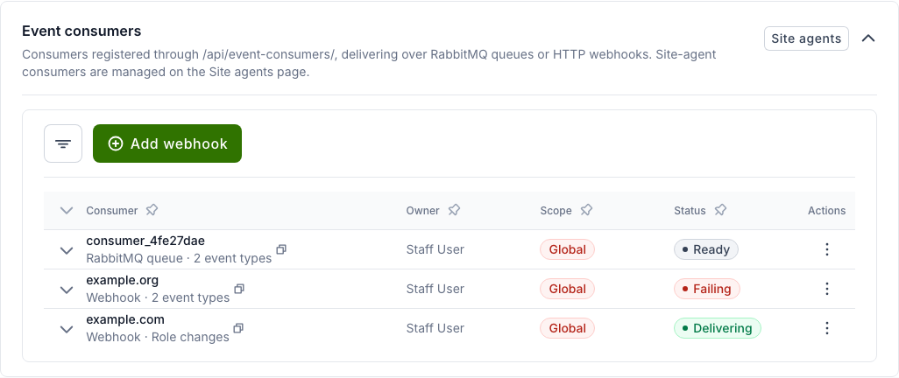
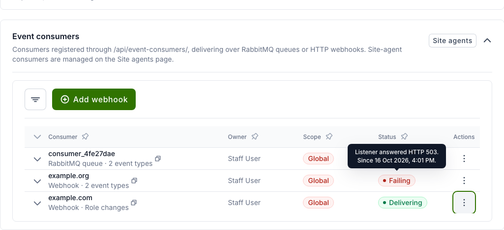
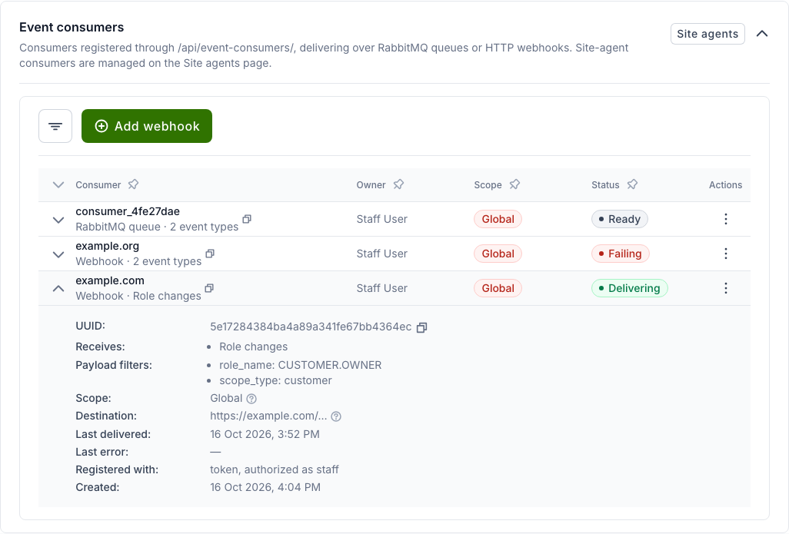
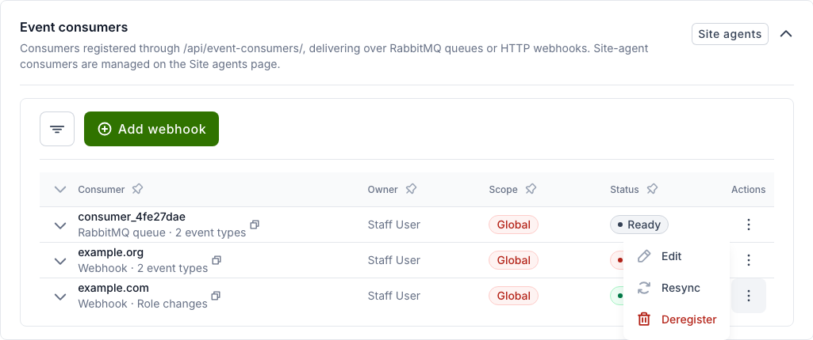
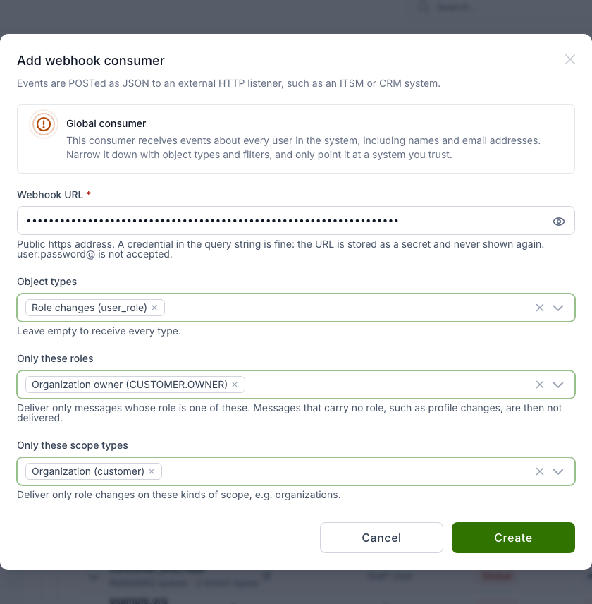
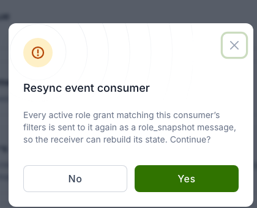
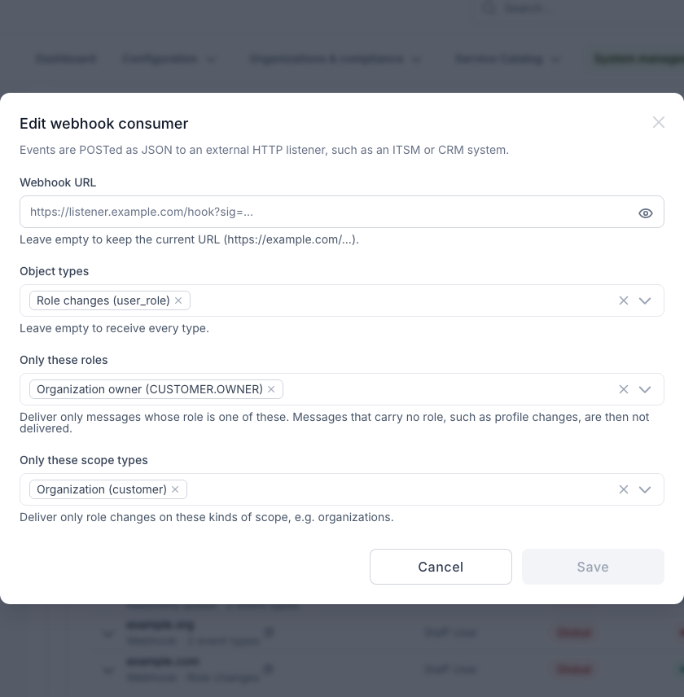

# Webhook event consumers

A webhook event consumer sends Waldur events as JSON `POST` requests to an
external HTTP listener, such as an ITSM, CRM or identity management system.
Use it to keep another system in sync with Waldur. For example, it can send
the system the current organization owners, followed by every owner that
is added or removed.

A webhook consumer receives the same events as a RabbitMQ (STOMP) event
consumer: role changes, profile changes, account lifecycle, SSH keys,
orders, resources and so on. The receiving system only needs an HTTPS
endpoint and does not need a message-queue client.

!!! warning
    A webhook consumer created from the user interface is **global**: it
    receives events about every user in the system, including names and
    email addresses. Narrow it down with object types and filters, and only
    point it at a system you trust.

## Prerequisites

- You are logged in as a **staff** user. Support users can see webhook
  consumers and resync them, but cannot create, edit or remove them.
- The receiving system exposes a public `https://` URL. A credential may be
  part of the query string (for example `?sig=…`). The URL is stored as a
  secret and is never shown again. URLs with `user:password@` are not
  accepted, and neither are private or loopback addresses.

## Managing webhook consumers

1. Open **Administration** → **System management** → **Workers & messaging**
   and select the **PubSub health** tab.
2. Expand the **Event consumers** card.

    

    Each row shows:

    - **Consumer**: where the events go (the webhook host, or the RabbitMQ
      queue name), how they are delivered, and what the consumer receives.
      Only the host of a webhook is shown, never the full URL.
    - **Owner**: the staff user the consumer delivers on behalf of.
    - **Scope**: **Global** for a consumer that receives events about the
      whole system.
    - **Status**: whether events are getting through. Hover over the status
      to see the detail.

    | Status | Meaning |
    |--------|---------|
    | **Delivering** | The last event was delivered successfully. |
    | **Failing** | The last delivery attempt failed and has not succeeded since. The tooltip shows the error and when it started. |
    | **Waiting** | No event has been delivered yet. |
    | **Blocked** | Nothing can be delivered, for example because the owner has been deactivated or is no longer a staff or support user. The tooltip says why. |
    | **Connected**, **Disconnected**, **Pending**, **Ready** | States of RabbitMQ queue consumers. |

    

3. Click the arrow at the start of a row to see the consumer's details:
   UUID, the event types it receives, its payload filters, the destination
   host, the last delivery and the last error, and how it was registered.

    

4. Use the **⋮** menu on a row to **Edit**, **Resync** or **Deregister** the
   consumer.

    

Use the filter button to show only webhook consumers (**Delivery** →
**HTTP webhook**).

## Adding a webhook consumer

1. In the **Event consumers** card, click **Add webhook**.
2. Fill in the form:

    - **Webhook URL**: the listener URL, including any credential in the
      query string.
    - **Object types**: the event types to send, for example **Role changes
      (user_role)**. Leave empty to send every type.
    - **Only these roles**: send only role changes for these roles, for
      example **Organization owner (CUSTOMER.OWNER)**.
    - **Only these scope types**: send only role changes on these kinds of
      scope, for example **Organization (customer)**.

    

3. Click **Create**.

The example above sends a message whenever an organization owner is added or
removed, and nothing else.

!!! note
    A role or scope-type filter matches only messages that have that field.
    With **Only these roles** set, events without a role, such as profile
    changes, are not delivered.

## Sending the current state (resync)

Events only describe changes. When a receiving system is connected for the
first time, or has lost its data, send it the current state:

1. Open the **⋮** menu of the consumer and select **Resync**.
2. Confirm with **Yes**.

    

Waldur then sends every active role grant that matches the consumer's
filters. Each is a `user_role` message with `event_type` set to
`role_snapshot` and `granted` set to `true`.

**Resync** is offered only for global consumers that receive role changes
(their object types are empty or include **Role changes**). Through the API,
a resync is also refused when the consumer's payload filters would exclude
every snapshot message, for example a filter on `event_type`. A resync runs in the background
and can be requested at most once every 15 minutes per consumer. Every
request is recorded in the audit log.

## Editing a webhook consumer

Select **Edit** in the **⋮** menu to change the URL, object types or filters.
Leave **Webhook URL** empty to keep the current URL.



!!! note
    The staff user who edits a webhook consumer becomes its owner. Every
    change is recorded in the audit log with the destination host.

## What the receiving system gets

Each event is one `POST` request with a JSON body. A role change looks like
this:

```json
{
  "object_type": "user_role",
  "event_type": "role_granted",
  "granted": true,
  "role_name": "CUSTOMER.OWNER",
  "email": "owner@example.com",
  "full_name": "Alice Owner",
  "user_uuid": "…",
  "user_username": "alice",
  "scope_type": "customer",
  "scope_uuid": "…",
  "scope_name": "Example Organization",
  "customer_uuid": "…",
  "customer_name": "Example Organization",
  "customer_registration_code": "12345678",
  "emitted_at": "2026-10-16T12:00:00+00:00",
  "schema_version": 1
}
```

- `granted` is `true` when a role is added and `false` when it is removed
  (`event_type` `role_revoked`).
- `customer_*` fields identify the organization the role belongs to. For a
  project role this is the project's organization.
- Every request carries an `X-Waldur-Message-Id` header. The header stays
  the same when a request is retried.

The receiving system should answer with any `2xx` status. Any other answer,
or no answer within the timeout, counts as a failure.

## Delivery behaviour

- **Retries**: a failed request is retried with increasing delays (from 10
  seconds up to 10 minutes) about 8 times over roughly half an hour. After
  that, the message is dropped. Use **Resync** to bring the receiver up to
  date again.
- **At least once**: a message can arrive twice. Use `X-Waldur-Message-Id`
  to ignore duplicates.
- **No ordering across events**: each event is delivered on its own, so a
  removal can arrive before the addition it follows. Use `emitted_at` to
  ignore an update that is older than the one already applied.
- **Owner changes**: if the consumer's owner is no longer an active staff or
  support user, delivery stops.

## API

Webhook consumers can also be managed through the API:

| Action | Request |
|--------|---------|
| Create | `POST /api/event-consumers/register_webhook/` |
| Edit | `POST /api/event-consumers/{uuid}/update_webhook/` |
| Resync | `POST /api/event-consumers/{uuid}/resync/` |
| List | `GET /api/event-consumers/?delivery=webhook` |
| Remove | `DELETE /api/event-consumers/{uuid}/` |

Through the API you can also use any message field in `payload_filters`, for
example to send role changes for a single organization only:

```json
{
  "webhook_url": "https://listener.example.com/hook?sig=…",
  "object_types": ["user_role"],
  "payload_filters": {
    "role_name": ["CUSTOMER.OWNER"],
    "customer_uuid": ["<organization uuid>"]
  },
  "scopes": []
}
```
