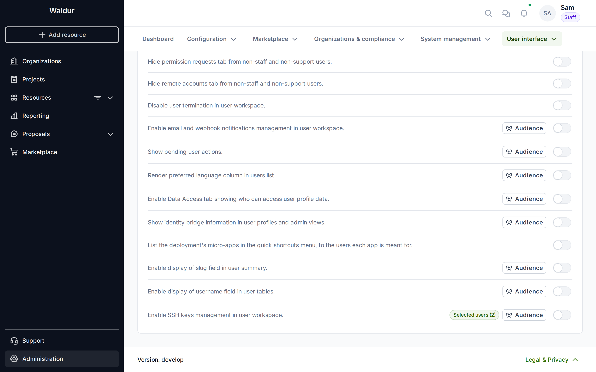
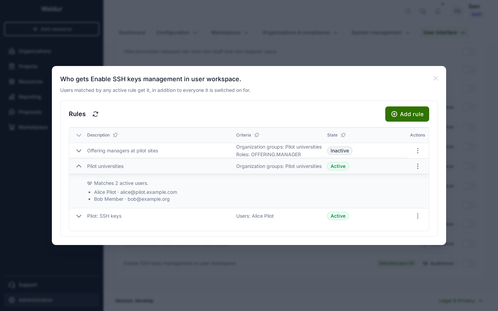
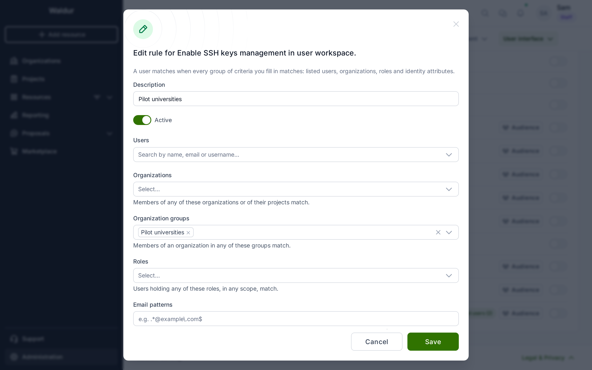
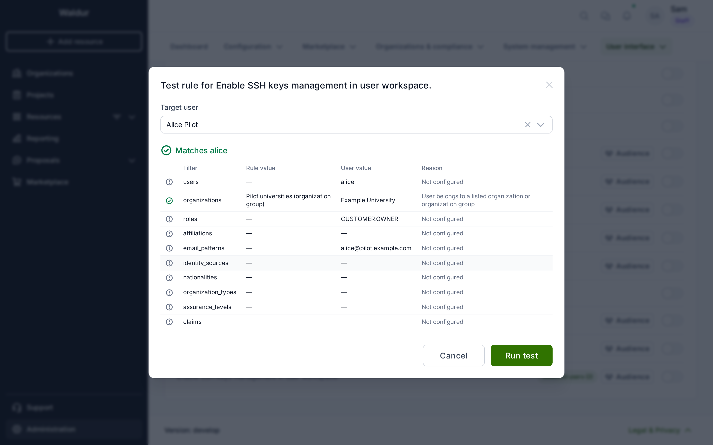
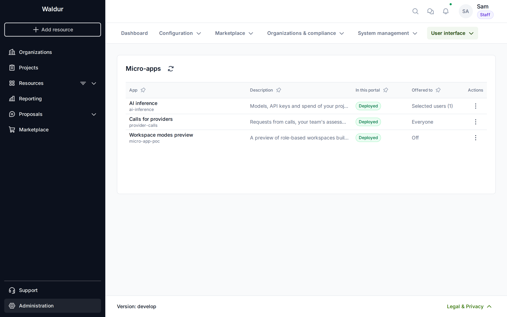
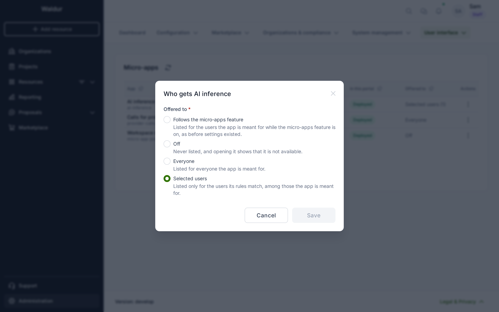
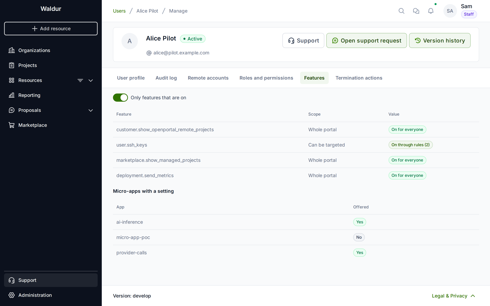

# Turning features and micro-apps on for selected users

A feature is normally on or off for the whole portal. Many features can also be turned on for
selected users first, for example a pilot group, the members of a few organizations or the users
of one identity provider, before they are switched on for everyone. Micro-apps, the separate
applications listed in the quick shortcuts menu, can be offered the same way, one app at a time.

This guide is for staff. Support users can see the rules and test them, but not change them.

## Which features can be targeted

A feature can be turned on for selected users only when its effect is the user's own view of the
portal: a column, a tab, a dialog field, a chart. Such a feature has the scope **user**.

Features that anonymous visitors see (the cookie notice, the disclaimer area), that change what the
whole deployment is (catalogue mode, externally run calls, telemetry), or that change what other
people see (prices with VAT on an organization's invoices) have the scope **deployment** and stay
one value for everyone.

The [features reference](../../admin-guide/mastermind-configuration/features.md) lists the scope of
every feature.

## Turning a feature on for selected users

1. Open **Administration → User interface → Features** and select the feature's tab.
2. Next to a feature with the scope **user** there is an **Audience** button. Click it.
3. Click **Add rule** and choose who the rule matches (see [Criteria](#criteria)).
   Give it a description, such as *Pilot group*, so that the next person knows why it exists.
4. Click **Create**.

The feature's switch stays off. Next to it, a **Selected users (N)** badge shows how many active
rules turn it on. Users matched by any active rule get the feature the next time the portal loads
their profile, usually on their next page load.

The **Audience** button opens the feature's rules. Expand a rule to see whom it matches now:

!!! tip
    To turn a feature on for everyone, switch it on and click **Save**, as before. Its rules then
    change nothing, and you can delete them.

### What the three states mean

| Switch | Active rules | Who gets the feature |
| ------ | ------------ | -------------------- |
| On | any | everyone |
| Off | none | nobody |
| Off | one or more | the users any active rule matches |

### Criteria

A rule can combine these groups of criteria. A user matches the rule when **every group you fill
in** matches. Within one group, any value matches, except where noted.

| Criterion | A user matches when |
| --------- | ------------------- |
| Users | the user is listed |
| Organizations | the user holds a role in the organization or in one of its projects |
| Organization groups | the user belongs to an organization in the group |
| Roles | the user holds the role in any organization, project or offering |
| Email patterns | the email address matches one of the regular expressions; end a pattern with `$` |
| Affiliations, identity sources | the user's identity provider sent one of the values |
| Identity provider claims | the user carries an accepted value for **every** listed claim; a value ending in `*` matches by prefix |
| Nationalities, organization types | the user's identity provider sent one of the values |
| Assurance levels | the user holds **all** of the listed levels |

For example, a rule with the organization group *Pilot universities* and the role
*Offering manager* matches members of those universities who are offering managers. The groups
are checked independently: the role can be held anywhere, also in an organization outside the
group.

A rule without any criterion matches no one: to turn a feature on for everyone, use its switch.
The rule dialog warns when no criterion is filled in, and the rules table lists such a rule as
**No one**. A rule also ends up without criteria when the users, organizations or organization
groups it lists are all deleted. It then stops matching rather than widening to everyone, and you
can still edit or deactivate it.

### Checking a rule

In the rules dialog, open a rule's row menu:

- **Test for a user** shows, for a user you choose, each criterion of the rule, the user's value
  and whether it matches.
- Expanding a row shows how many active users the rule matches now and the first few of them. For
  rules on identity attributes, Waldur checks the first 5000 candidate users and says so when the
  count is a lower bound.
- **Deactivate** keeps a rule but stops it from turning anything on. **Activate** brings it back.

## Offering a micro-app to selected users

Open **Administration → User interface → Micro-apps**. The page lists the micro-apps that this
portal's image contains, and the settings of apps it no longer contains as *Not deployed*.

Choose **Change who gets it** in an app's row menu and pick one of the settings below. When
Waldur can read the portal's list of apps, it refuses a setting for an app the portal does not
contain, so a mistyped name cannot create a setting that does nothing.

| Setting | The app is listed for |
| ------- | --------------------- |
| Follows the micro-apps feature | the users the app is meant for, while the **List the deployment's micro-apps in the quick shortcuts menu** feature is on. This is the default and how every app behaved before these settings existed. |
| Off | nobody. A user who opens the app's address sees that it is not available to them. |
| Everyone | everyone the app is meant for, whether the micro-apps feature is on or not. |
| Selected users | the users its rules match, among those the app is meant for. Choose **Edit audience** to manage the rules, which work as described above. |

Whatever the setting, an app is only listed for the users it is meant for: an app for offering
managers is never listed for someone without that role, even when a rule matches them. Choosing
**Follows the micro-apps feature** again removes the app's setting and its rules.

!!! warning
    These settings decide what the portal offers a user, not what the user may do. Access to data
    is still decided by the user's roles and permissions, in the app as everywhere else.

## Seeing what a user gets

On a user's page (**Support → Users → user → Features**), staff and support see every feature's value for that
user and why it has that value:

- **On for everyone**: the feature is switched on for the whole portal.
- **On through rules (N)**: the feature is off for the portal and N of its rules match this user.
- **Off**: neither.

The tab also lists the micro-apps that have a setting and whether this user is offered each.

To see the portal as the user sees it, [impersonate](impersonation.md) the user: while you do, the
portal applies the impersonated user's features and micro-apps.

## Rules without effect

A rule stops having an effect when its feature can no longer be targeted (a release changed its
scope to deployment, or removed it) or when its micro-app's setting was removed. The Features
page then shows a warning naming the features of such rules, and staff can delete them there.
Delete them rather than leave them: if the feature became targetable again, they would apply
again.

## Audit

Creating, changing and deleting rules, and changing a micro-app's setting, are recorded as events
in the administration event group.

## API

| Endpoint | Purpose |
| -------- | ------- |
| `GET /api/metadata/features/` | every feature with its `scope` |
| `/api/feature-rules/` | the rules; `feature_key` is a feature (`section.key`) or `micro_apps.<name>`; `?orphaned=true` lists the rules without effect |
| `POST /api/feature-rules/<uuid>/test-match/` | check a rule against a user |
| `GET /api/feature-rules/<uuid>/matched-users/` | count and preview of matched users |
| `/api/micro-app-settings/` | the micro-app settings (`off`, `all`, `audience`) |
| `GET /api/users/<uuid>/features/` | a user's feature values and their source |
| `GET /api/users/me/` | the signed-in user's own `features` and `micro_apps` |

`GET /api/configuration/`, which the portal reads before anyone signs in, keeps returning the
portal-wide values only.
